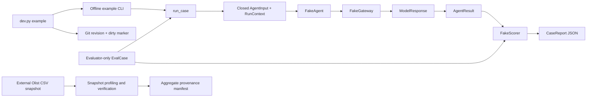

# Code Study Guide — Production Agentic Systems

Updated: 2026-10-20 (Africa/Lagos). Unmerged `codex/c2-risk-baselines` reconciles user-merged O4 + O5 #85, main `e11290a92f22588aa7c1c6d799a7b649097dc2fa`. Its tree matches reviewed41a2b19; clean-main replay passed. CFPB source/tests retain reviewed618b6c6; Olist/backend/workflow source and shared lock are taken unchanged from main. Both provisional AI-review boundaries and all source chapters are preserved. No human-validated release or live model-quality claim.

F1–F5/O1/H1–H10 are merged and verified. H9 adds [private scorecards and paired case regressions](docs/code-study-scorecards.md). H8 supplies [correlated redacted telemetry](docs/code-study-telemetry.md). H7 adds [seeded boundary faults and independent state invariants](docs/code-study-faults.md). H6 adds exact trial schedules, fresh controlled state, bounded spawned execution, exclusive journals and complete outcome accounting. H5 supplies pinned evaluator-only case populations, grouped splits, explicit versioned scorer composition and per-case manifest provenance. H4 supplies shared call/token/cost reservations, monotonic deadlines, bounded retries/circuits, owned SDK workers and controlled replay. H10 adds [fresh dispatch receipts and independently reviewed release gates](docs/code-study-release.md). Verification is offline only; domain adapters, reviewed domain scoring/thresholds and actual fresh domain quality remain subsequent work.

This guide covers sixty-two nontrivial application/tool Python files, associated offline/integration tests, package/config boundaries and related entrypoints. Package markers are grouped. Historical untracked plans, generated distributions, dependency internals, raw data, existing Langfuse server/security configuration and future applications are outside inspection. This is a source-grounded engineering study, not an exhaustive security audit.

H8 and its cancellation/test-bootstrap follow-up are merged/verified; Build Book Entries 20–21 retain their construction/failure history. H9 reporting reuses existing independent assessments and complete schedules. H10 adds candidate-bound recording and release-policy mechanisms. No reviewed domain baseline or H10 live provider result is claimed.

## Reading route

1. Read the implemented architecture and follow the offline execution.
2. Open the linked code while reading its anatomy; explain each validator and boundary aloud.
3. Follow the independent Olist acquisition path and its source-integrity checks.
4. Study the design tradeoffs, test evidence and reproduced concerns.
5. Practice the interview questions and offline exercises.

[BUILD_BOOK.md](BUILD_BOOK.md) explains construction history and documented decisions, particularly Entries 6–28. [CFPB baseline chapter](docs/code-study-cfpb-baselines.md) traces this branch’s three additional modules. [Olist policy chapter](docs/code-study-olist-policy.md) traces the new vertical work. [CFPB chapter](docs/code-study-cfpb.md) traces narrative/target isolation and temporal grouping; [Olist orders chapter](docs/code-study-olist-orders.md) traces exact grains, source pins and conservative visibility; [Release chapter](docs/code-study-release.md) follows H10 source/config pins, private receipts and external approval; [Scorecard chapter](docs/code-study-scorecards.md) follows H9 private aggregation/comparison; [Telemetry chapter](docs/code-study-telemetry.md) follows H8 projection/export health; [Fault chapter](docs/code-study-faults.md) traces seeded hooks, treatment evidence and independent state/ledger checks; [Isolated-trial chapter](docs/code-study-trials.md) explains H6 scheduling, process/state lifetimes, outcome categories and recovery; [Case/scorer chapter](docs/code-study-cases.md) explains H5 membership, byte pins, grouped splits and independent scorer registration; [Execution controls chapter](docs/code-study-controls.md) traces H4 admission, retries/circuits and owned worker cleanup; [Postgres code chapter](docs/code-study-postgres.md) explains persistence/service blocks; [CI code chapter](docs/code-study-ci.md) explains the hosted workflow, audit and contribution/gate helpers; [recording/replay code chapter](docs/code-study-replay.md) traces H3 publication, current-code matching and completion; [gateway code chapter](docs/code-study-gateway.md) traces the real H2 dispatch and per-occurrence evidence; [integration code chapter](docs/code-study-integration.md) traces the H1 SDK/framework/live/export/read-back checks. [Shared contracts](docs/shared-contracts.md) is the API reference. [Delivery plan](docs/project-management.md) defines later work. This guide explains how the current pieces fit together.

## 1. What exists and what the architecture means

The destination is a shared agent/evaluation platform serving Olist support, CFPB triage, revenue integrity, prior authorization and supply-chain disruption. The current executable work is much smaller: installable packages, import checks, original Olist snapshot profiling/verification, a deterministic fake agent/evaluation flow, and checkout/trial-isolated local Postgres persistence. H1 adds development-only Gemini calls and local trace export/read-back. H2 supplies a shared Gemini transport; H4 wraps live attempts with shared reservation and process-bounded execution. H5 loads a fixed private case manifest and binds explicitly registered independent scorer versions before dispatch; H6 schedules all case/trial pairs, prepares fresh controlled state, owns bounded child processes and reconciles missing/error evidence. The state-check acceptance plugins use invented data. A controlled SIM refund backend and persistent Olist LangGraph workflow now exist; [the workflow chapter](docs/code-study-olist-workflow.md) traces their separate business/checkpoint transactions. Real payment operations, human approval, authenticated web service, deployment and production traffic remain absent at this snapshot.



The two paths are independent. Olist records do not feed the fake text example. Expected answers and hidden state are available to the runner/scorer, but the runner projects only public input into the agent call. A dictionary typed as an evaluation case would be too easy to forward accidentally; a separate input type makes that mistake fail validation.

Dependency direction is `vertical → agent_harness → Pydantic / Psycopg`. The harness must never import a vertical; verticals must never import each other. [Import contracts][import-contracts] enforce this for static imports. Python protocols describe replaceable agent/gateway/scorer interfaces without choosing a workflow framework. H1 installs LangGraph and Pydantic AI as pinned development dependencies and tests their extension seams. H2 supplies ProviderGateway/GeminiTransport, with optional Google/schema runtime dependencies; framework-specific domain adapters remain planned.

The fake example runtime objects live in one Python process; the H4 controlled live path owns one spawned SDK worker per attempt. FakeGateway retains a list of requests in memory; reports print to stdout. F4 creates generic review/ledger persistence slots; no runtime workflow queue or domain action tool uses them yet. Olist CSVs live in an external local cache, while only aggregate provenance enters Git. Worktrees alone isolate checkouts. F4 adds explicit Compose project/port/volume isolation and restricted trial databases; see [the current code walkthrough](docs/code-study-postgres.md).

Useful vocabulary: a **case** is one evaluation input plus evaluator-only expectations; a **trial** is one attempt at a case; a **run ID** identifies execution; a **business-event ID** identifies the underlying operation across retries/new runs; a **fingerprint** identifies request content; a **reference** names evidence but does not prove that evidence exists; **strict replay** matches captured model calls without a provider transport or fallback; **fresh candidate** would obtain new model output. FakeGateway executes only offline_fake. H2 ProviderGateway accepts fresh_candidate/monitoring for transport calls and refuses fake/replay modes; H3 persists reviewed model fixtures explicitly; neither layer is a fresh quality/release evaluation.

## 2. Walk one case through the actual code

Input: `hello, shared contracts`. Expected output: `HELLO, SHARED CONTRACTS`. Both are invented fixture values; this is not an Olist support decision.

1. [dev.py][dev-main] resolves its own checkout root. `example` discovers actual Git HEAD and porcelain status, marks tracked/untracked changes with `+dirty`, then passes revision/lockfile arguments to [CLI `main`][example-main]. The module parses those required arguments, hashes the lockfile, and calls `example_context`/`example_case`. Direct module calls or explicit revision overrides still depend on caller honesty; the wrapper does not hash a dirty tree.
2. [Context construction][example-context] fixes the test clock at 2026-01-01 UTC, uses a 30-second declared deadline, and records run/case/trial/business-event identities, seed and code/candidate/data/policy/environment versions. A zero-cost fake budget is a declaration; it does not reserve or enforce resources.
3. [Case construction][example-case] puts request text into `AgentInput`, and keeps expected output, autonomy/review decisions, allowed decisions and a private marker in evaluator-only fields. Source kind is `synthetic`.
4. [`run_case`][run-case] serializes/revalidates context and case, checks case/snapshot/policy agreement, rejects fault declarations without explicit H7 composition, and passes only the closed public input (plus declared untrusted-content observations when selected) to the agent. This makes the public view a fresh closed model, rather than sharing the full case object.
5. [`FakeAgent.run`][fake-agent] creates one user message with the public request, explicit fake provider/model/endpoint and `temperature=0`. It does not use public observations in this toy behavior. `FakeGateway.generate` receives the typed request.
6. [The gateway][fake-gateway] rejects other run modes/routes, tools, output schemas and unsupported message/parameter shapes. It appends the validated request, applies Python's `str.upper`, and returns a typed assistant response with one fake call and zero tokens/cost. No model tokenization or provider pricing occurs.
7. The agent revalidates the response and creates `AgentResult`: decision `return_text`, outcome `completed`, uppercase output, usage, and fabricated `model:`/`offline:` references. These references are explicitly example identifiers, not exported traces.
8. The runner revalidates the result and checks run/case/trial identity. It gives a separate result copy to [FakeScorer][fake-scorer], which compares outcome, exact output, allowed decision and presence of required review. It does not inspect committed state.
9. [CaseReport][case-report] binds context/result IDs and scorer/policy versions, requires a nonempty score list, and retains the result/scores. The CLI validates a JSON round trip, prints the report, and exits nonzero unless `fake_case_correct` equals 1. Expected answers and hidden state are not report fields.

With an injected typed fake timeout, the gateway returns a failure instead of output. The agent chooses `stop`/`failed`; usage and failure survive the report; the ordinary success case scores 0. A Python exception from a broken scorer propagates, while an explicitly typed scorer error carries no score. Both behaviors keep errors visible; complete batch/release accounting remains future work.

## 3. Code anatomy: public contracts

File: [contracts.py](harness/src/agent_harness/contracts.py). The following source links pin the explained revision.

| Symbol and lines | Design mapped into the code | Consequence if changed incorrectly |
|---|---|---|
| [Aliases][aliases] | `NonEmpty` rejects empty strings; `Count` rejects negative integers; decimal `Money` rejects negative/nonfinite amounts; `Outcome` is a closed vocabulary. | An arbitrary outcome would make report interpretation ambiguous. A nonempty string still allows whitespace-only values: this is shape validation, not identifier/business validation. |
| [Contract][contract] | Every nested model forbids extra fields, freezes attribute assignment, validates strictly/defaults, revalidates instances, and disallows nonfinite numbers. WireContract owns common strict rules; Contract uses literal version 1 and ModelContract literal version 2. JSON mode converts wire types before object keys are sorted. | Removing `extra="forbid"` can silently accept unintended fields. Sorting message lists or stripping text would lose request meaning. Frozen attributes do not freeze nested dictionaries. |
| [Budget and CandidateVersions][budget-versions] | Budget fields express positive call/token caps and nonnegative cost with a currency label. Versions record code, candidate, snapshot, policy and environment identity. | DTO fields alone do not enforce caps, authenticate versions or validate a currency standard. The future gateway/runner must turn them into behavior. |
| [RunContext][run-context] | IDs remain separate; `mode` distinguishes four meanings. Aware timestamps require an offset. An after-validator rejects deadlines at or before the fixed clock. | Using run ID as the sole business-operation key breaks cross-run deduplication. A valid declared deadline still needs an execution-time check. |
| [PublicObservation / AgentInput][public-input] | Public context is restricted to source reference/text, alongside request text. No arbitrary metadata bag exists. | This blocks extra structural label fields, but not an answer embedded in a legitimate text/reference. Domain adapters must construct approved as-of views. |
| [EvidenceReference][evidence-ref] | Evidence has an identifier and a closed kind such as source/state/review/trace/model/score. | A supplied reference is not authorization or evidence lookup. Later scorers must resolve it independently. |
| [Usage][usage] | Token/cost observations may be null. Cost and currency must either both be known or both be unknown. Call count is required. | Turning unknown values into zero would understate costs. Decimal serialization preserves textual precision, but currency/rounding policy belongs to a domain/provider adapter. |
| [Failure][failure] | Stage/code distinguish agent, model, tool and scorer failures; retryability and evidence survive serialization. | `retryable=True` is descriptive; retries still need permission, attempts and budget. Adding retry loops here would mix transport data with execution policy. |
| [AgentResult][agent-result] | Outcome/text/decision are separate from state/review/trace references and usage. Two validators bind review/failure fields to outcomes. | A completion claim remains untrusted until scored against actual evidence; this class validates consistency, not business success. |
| [ToolCall and ModelMessage][model-message] | A call carries ID/name/JSON arguments. Only assistant messages can contain calls. Tool-result messages require corresponding ID/name/content; other roles cannot carry those result identifiers. A message needs content or calls. | The shared shape is checked; H2 GeminiTransport additionally enforces unique IDs, pending-result correspondence and its supported semantics. Ordered ModelPart data preserves opaque signatures and must match public content/tool-call projection. Empty content is allowed where a provider may support it. |
| [ToolSchema and ModelRequest][model-request] | Preserve tools and output schema, endpoint/provider/model/revision, ordered messages, supplied generation parameters and serializer version. The hash covers canonical UTF-8 JSON. | Hashing only prompt text misses model/schema/sampling changes. An identical request can still have different responses: occurrence/trial identity belongs to replay storage. The contract preserves schemas; H2 validates declared local JSON schemas and rejects unsupported transport choices before dispatch. Provider API dialect rejection is still a failure. |
| [ModelResponse][model-response] | Exactly one of output/failure is required; output must be assistant-shaped; a response failure must be at model stage. Provider/model/request/revision and finish reason remain explicit. | These validators do not check that returned provider/model matches the original request; the integration boundary must do that. |
| [ModelGateway and Agent protocols][protocols] | Define typed replaceable interfaces; no harness-to-domain import or framework inheritance is needed. | A type checker checks signatures, not behavioral compliance. The runner and adapters still need runtime validation and tests. |

### Read the two unusual boolean expressions

In `AgentResult.consistent_outcome`, `(outcome == "review_required") != (review_ref is not None)` detects disagreement. Both true is valid review; both false is valid non-review; either mismatch is rejected. The failure condition uses the same truth table. This current contract also forbids attaching a review reference to a completed result, which may need a versioned extension when approved/resumed reviews exist.

In `ModelResponse.output_or_failure`, `(output is None) == (failure is None)` detects both absent or both present. Those are invalid; exactly one present is valid. Writing these conditions as simpler-looking `or` expressions can accidentally accept two contradictory paths.

### Shape, semantics and authorization are different

A Pydantic model can validate that `tenant_id` is a string. It cannot prove the caller belongs to that tenant. A reference can have the right type while naming another user's state. The current program has no service/authorization layer; it should not be presented as enforcing tenant isolation or approved actions merely because the fields exist.

## 4. Code anatomy: evaluator-only objects and runner

File: [evaluation.py](harness/src/agent_harness/evaluation.py).

| Symbol and lines | What to understand | Evidence / limit |
|---|---|---|
| [ExpectedResult / FaultScenario][expected-fault] | Expectations describe allowed behavior and expected state changes. Fault definitions name target/timing/recoverability/invariants before execution. | They are data contracts, not a reviewed gold dataset or an injection engine. Cross-field business consistency still belongs to case preparation. |
| [EvalCase and agent_input][eval-case] | Public input, source/snapshot/policy/scorer provenance, hidden state, risk/slices/faults are separate fields. `agent_input()` reconstructs only the public model. | Structural leakage tests mutate private labels and capture agent/gateway arguments. The case remains in the same process, so this is not isolation from malicious Python code. |
| [ScoreResult][score-result] | One finite number or one category is required unless a typed scorer failure exists. Failures cannot coexist with values/categories and must be scorer-stage. Eligibility remains explicit for later denominators. | Numeric range is not fixed at 0–1 because latency/cost use other units. Units and whether a score means pass belong to the metric definition. Evidence can currently be empty. |
| [CaseReport][case-report] | Requires scores and checks result IDs, scorer versions and policy version against context. It deliberately excludes expected/hidden case fields. | It cannot prove source versions, code revisions or references are authentic, and is not a complete release manifest. |
| [Scorer protocol][scorer-interface] | The scorer can inspect the entire case and the agent's result; the agent cannot receive the case through this interface. | Implementations must independently inspect actual state when business writes are introduced. |
| [run_case][run-case] | Revalidate inputs → reject identity/snapshot/policy mismatch → require an explicit session for fault declarations → dispatch closed public input → revalidate/check result IDs → copy result for scorer → revalidate scores → report. | Exceptions propagate and empty scores fail. H6 supplies batch/process accounting around this function; H7 adds explicit hook evidence. The plain fake path still does not enforce budgets or use persistent domain state. |

Copying/revalidation costs CPU and JSON conversions but makes the boundary explicit and prevents an ordinary mutable model copy from bypassing validators. The scorer gets a distinct result, so normal scoring code cannot mutate the retained result. This is a maintainability/control measure; trusted code can still misuse internals or shared memory.

## 5. Code anatomy: fake implementations and entrypoint

File: [offline_example.py](harness/src/agent_harness/offline_example.py).

| Symbol and lines | Why the implementation is this small | Important details |
|---|---|---|
| [FakeGateway.__init__/generate][fake-gateway] | A deterministic dependency double permits testing without services/keys, and rejects unsupported modes instead of impersonating fresh/replay behavior. | Request history is in memory. Failure injection is an explicit constructor argument, not the scheduled FaultScenario engine. `str.upper` is Unicode behavior; this is not a general text model. |
| [FakeAgent.run][fake-agent] | Demonstrates the public interface, request construction, response revalidation and typed failure conversion. | It ignores observations, forwards only request text, checks response shape but not route identity, and fabricates evidence references. |
| [FakeScorer.score][fake-scorer] | A transparent exact check catches changed expected output and obvious incorrect decisions without an LLM judge. | It ignores expected state changes, hidden state and autonomy eligibility; it sets score eligibility true for this wiring case. Do not reuse it as a business-action scorer. |
| [example_case][example-case] | Explicitly invented input, expected output, private marker, policy/scorer/source versions and slices let tests demonstrate separation. | These labels are authored test expectations, not independently reviewed industry ground truth. |
| [example_context][example-context] | A fixed clock and identities make the wiring repeatable; code revision and lock hash are caller-supplied actual/proposed evidence. | IDs are static for one example. Multiple real trials need unique run/trial identities plus a stable business-event identity. |
| [main][example-main] | CLI parses evidence inputs, hashes the lock, runs one case, checks the report's wire representation, prints it and checks its score. | It does not write a database or upload telemetry. Missing arguments/files and validation errors are normal failures; output can contain legitimate result text, so a future real-data exporter needs a separate privacy policy. |

### F3: portable commands down to the failure paths

File: [dev.py][dev-main], tested by [test_dev_commands.py][dev-tests]. The bootstrap imports only standard-library modules. H10 release commands delegate argument validation to the locked installed release module.

| Symbol / block | Execution and reason | Evidence / limit |
|---|---|---|
| [ROOT, CHECKS, RELEASE_COMMANDS, SERVICE_COMMANDS][dev-constants] | Resolve the runner's directory, define check order once, and name release/service commands. | Changing caller directory does not change the project. Release arguments go unchanged to the locked module; invalid or missing inputs fail there. |
| [uv_command][dev-map] | Construct argument arrays for locked setup/tools, package builds and explicit integration/trace commands. `check` reuses the same map as individual commands. | All-members installation matters for a virtual root; no shell quoting or duplicate CI map. |
| [execute][dev-execute] | Run a child with `cwd=ROOT` and no shell, return its exact exit status, convert process-start failure to a visible nonzero result. | A real child test uses a directory/argument with spaces and exits 7. This is local tooling, not a sandbox for hostile programs. |
| [source_revision][dev-revision] | Read HEAD and tracked/untracked status; any dirty source adds `+dirty`. Failed/missing Git discovery requires an explicit identifier. | Dirty is a provenance flag, not a saved content snapshot. Ignored source modifications and concurrent mutation remain outside this simple check. |
| [main][dev-main] | Route release commands to their locked module; otherwise parse command/options → reject wrong commands → locate uv → dispatch locked service commands with absolute root or run example/replay/check steps → return first failure. Trial-only and destroy-only options are validated before dispatch; db-check explicitly overrides offline database-test exclusion. | The type-check failure test returns 13 and proves imports/tests are skipped afterward. H1 maps offline/live/trace probes separately; only provider-free probe tests and pinned H3 replay run in ordinary CI. Setup may download packages; the fake example has no provider call. |

Mypy uses root configuration with strict checking for dev.py, ci_checks.py and the harness. Dataset scripts and untyped test helpers are covered by lint/behavioral tests, not declared fully type-checked. Formatting is check-only; `check` does not modify source. F5 supplies actual CI orchestration and additional platform checks; exact hosted evidence is recorded in [the CI runbook](docs/ci.md). [Development commands](docs/development-commands.md) specifies the shared command path.

## 6. Olist source path: acquisition is not evaluation

File: [snapshot.py](projects/olist-support/scripts/snapshot.py). The top [script declaration and schema inventory][snapshot-schema] pins `kagglehub==1.0.2` and the explicit version-7 handle, defines the checkout boundary, and preserves ordered original column names, including source misspellings. Source currency/timezone remain unverified; country alone is not evidence of units.

| Function and lines | How it works | Why / failure boundary |
|---|---|---|
| [outside_repository][outside-repo] | Expand/resolve the path, then reject anything under the script's checkout root, including resolved symlinks pointing inside it. | Prevents this tool reading raw snapshots stored in the checkout; it is not an OS sandbox or a universal Git secret/data guard. |
| [profile_file][profile-file] | Hash original bytes, initialize per-column empty counts, parse UTF-8-with-optional-BOM CSV strictly, require ordered headers, reject short/extra-width rows, count records/empty strings and validate purchase timestamps. Return filename/hash/size/schema/aggregates and optional naive timestamp range. | CSV quoting/newlines mean parsed records must be counted rather than newline bytes. Empty string is the chosen missingness definition; string `NULL` or whitespace is not automatically missing. Hashing and parsing use separate file opens: see the reproduced race below. |
| [profile_snapshot][profile-snapshot] | Require exactly the known lowercase `.csv` names at the snapshot root, validate every source file's location, then profile in sorted filename order. | Stable order makes manifest equality meaningful. It is not a recursive directory integrity check; non-CSV artifacts/subdirectories are outside the checked inventory. |
| [verify_snapshot][verify-snapshot] | Require the pinned handle/version; reprofile and compare the full file records with `manifest["files"]`; mismatches raise and never replace the baseline. | The baseline must itself be trusted/reviewed. This checks the known snapshot, not a signature from its publisher or all top-level manifest metadata. |
| [main][snapshot-main] | `acquire` imports/downloads through the pinned library; profile/verify require local `--source`. Existing acquisition manifests are verified. A new profile refuses an existing output. New manifests record publisher/license/use notes, versions, aggregates and unresolved units. Print only aggregate counts plus a local source path. | `profile` does not independently authenticate arbitrary local bytes as publisher version 7. Publisher provenance comes from the acquisition workflow/review, not the metadata label alone. Existence checks before writing are not atomic. |

The known publication includes nine files and 99,441 orders, with 1,551,698 total records across tables. Summing table rows does not produce unique orders. Checksums and aggregate notes are in [the manifest](docs/data/olist-v7-manifest.json); handling/use boundaries are in [the source notes](docs/data/olist-source.md). No source records were needed for this guide's reproductions.

## 7. Packaging and architectural enforcement

| File / group | Role and non-obvious detail |
|---|---|
| [Root pyproject][root-config] | Virtual root (`package=false`), workspace members `harness` and `projects/*`, workspace dependency source, pytest paths, Ruff rules, locked dev requirements (including mypy 2.4.0), and strict type targets for dev.py, ci_checks.py, the harness and installable vertical source packages. Use `--all-packages`; root-only sync does not install every member. Allowed Python range is 3.12–3.13; actual verification is Windows/3.13.4. |
| [Harness metadata][harness-config] and five vertical `pyproject.toml` files | Six separately installable distributions share one uv lock. The harness pins Pydantic 2.14.1 and Psycopg binary 3.3.6; each vertical base depends only on the harness; Olist has an explicit optional workflow extra for LangGraph/Postgres checkpoint dependencies. Each build backend is `uv_build==0.11.1`. Distribution names differ from import names, for example `production-agent-olist-support` → `olist_support`. |
| [Import Linter configuration][import-contracts] | Forbid harness → domain imports and enforce pairwise domain independence. Static relative/indirect violations are tested. Reflective imports are not policed; this is architectural enforcement, not a malware sandbox. |
| [Ignore rules][ignore-rules] / [.env.example](.env.example) | Exclude credentials, raw data and generated runtime artifacts; allow aggregate `docs/data` documentation. Examples contain empty reserved names. Git ignore rules do not stop force-adds, previously tracked secrets or arbitrary external uploads. |
| `uv.lock`, `.python-version`, package `__init__.py` files | Lock dependency resolution, identify the exercised interpreter, and establish importable package markers. The five domain markers contain no business implementation. Lockfiles support reproducibility, not automatic dependency-vulnerability clearance. |
| README / CONTRIBUTING / project docs | Define supported commands, delivery boundaries and workflow. They are not executable checks; compare their claims with source and actual results. F3 supplies the portable dev.py wrapper; F5 supplies the hosted workflow and CI helper. Strict mypy 2.4.0 is now in the shared lock and checks the runner, CI helper, harness and installable vertical sources. |

## 8. Tradeoffs to explain in an interview

| Decision | Documented reason / inferred cost | Alternative and revisit trigger |
|---|---|---|
| Six members in one uv workspace | Build Book Entry 6 documents separate installation with one dependency baseline. Shared root files still require one integrator; independent deployment can eventually need stronger separation. | One distribution is simpler but installs all domains; separate repositories/environments reduce shared coupling but increase integration/version coordination. Revisit after deployment needs diverge. |
| Pydantic contracts over plain dataclasses | Entry 8 documents avoiding handwritten nested validation/JSON handling. Cost: a runtime dependency and repeated serialization at boundaries. | Dataclasses with an explicit codec can work if validation ownership is clear. Do not claim the present choice was benchmarked faster. |
| Closed public input versus one case dictionary | Entry 8 documents preventing structural expected-label leakage. Cost: domain adapters must project public facts; a text view does not preserve every original structured type. | A broad dictionary is flexible but easier to leak labels through. A reviewed typed structured observation could be a versioned extension. |
| Exact request fingerprint | Accepted design requires model/schema/parameter changes to change identity. Cost: semantically similar prompts are distinct, and fingerprints alone cannot model repeated sampled calls. | Fuzzy matching would be convenient but weakens replay evidence. H3 adds scoped occurrence storage and completion instead of weakening request identity. |
| Fake exact scorer first | Makes contract mechanics transparent/offline. Cost: no real model quality, committed-state verification or review-burden measurement. | Domain state scorers and reviewed cases are necessary for releases; a judge requires separate calibration and cannot compensate for a wrong state change. |
| Standard-library portable runner | Entry 10 records one bootstrap/check map and locked mypy instead of shell-specific scripts. Cost: tool/interpreter prerequisites remain and the wrapper must propagate failure/provenance honestly. | Separate Bash/PowerShell/Make recipes duplicate behavior; actual CI should call the runner after installing prerequisites. |
| Version-pinned external Olist snapshot | Entry 7 documents publisher/version ambiguity and keeping raw content outside Git. Cost: local acquisition and an explicit integrity baseline must be maintained. | A mirror/unversioned latest download is easier but weakens provenance. A signed/immutable artifact store would strengthen trust if warranted. |
| Require explicit execution composition | Source rejects unsupported fake modes and faults without an H7 session/plan. | H7 enables only declared supported boundary hooks; silently accepting an uninstrumented scenario would produce misleading evidence. |

## 9. Findings, weaknesses and boundaries

These observations are scoped to the inspected code. There is no assessed remote service attack surface and no claim of an exhaustive vulnerability scan.

### R1 — Verified correctness bug: snapshot hash/parse race

Location: [profile_file][profile-file] hashes through one file handle, closes it, then opens the path again for CSV parsing; size is inspected afterward. [verify_snapshot][verify-snapshot] compares those mixed-time observations with the trusted manifest.

Trigger: an independent writer changes same-width CSV values after hashing and before parsing, without changing schema, row count, empty counts or purchase bounds. Verification can return successfully while the final bytes have a different hash from the manifest. An isolated invented nine-file fixture reproduced this; the full 43-test suite still passed because existing integrity tests change bytes before verification starts.

Impact: the tool's successful verification is weaker than an immutable snapshot guarantee under concurrent mutation. If a local attacker can write the source directory while a trusted process verifies it, they may exploit this race to bypass the integrity check. That access/precondition is essential; no remote exploit was demonstrated.

Mitigation direction: stage verified bytes into a private immutable snapshot and parse the same captured bytes. A single descriptor narrows path substitution but does not stop another process rewriting the inode. Metadata checks/double hashes can detect common races but are not a complete immutability proof. Add a controlled concurrent-mutation regression test before changing the integrity claim. This documentation task leaves runtime code unchanged.

### R2 — Verified missing check, potential integration bug: response route identity

Location: [FakeAgent.run][fake-agent] revalidates `ModelResponse` shape but does not compare returned provider/model/revision with its request. A supplied gateway returning `other-provider`/`other-model` and the expected text produced score 1 in an isolated probe.

The bundled FakeGateway always returns its fixed fake route, so this is not a wrong-provider incident or an exploitable live gateway. It remains a concern if the fake-agent example is reused without a guarded integration boundary. H2 ProviderGateway now revalidates responses and checks provider/requested-model plus any explicit revision, failing on disagreement. It permits no fallback route. The fake-agent gap itself remains unresolved; matching an alias still does not prove immutable provider weights.

### R3 — Verified design limitation: fake scoring ignores state expectations

Location: [FakeScorer.score][fake-scorer]. Setting `expected_state_changes={"ledger_count": 1}` on the invented case still yielded score 1 with no state-change references. This is deliberately a text/wiring scorer, not a state scorer; the probe demonstrates why its result cannot support a refund/ledger success claim. Domain scorers must inspect committed state and independently verify review/evidence records.

### Additional concerns, explicitly classified

| Status | Trigger/location | Control / next step |
|---|---|---|
| Design limitation: structural label separation only | [PublicInput][public-input] permits legitimate text and references; answers can be embedded inside them. Same-process code can reach shared memory. | Closed fields/projection stop ordinary structural leakage. Review as-of adapters/content; use stronger isolation only if the threat model includes untrusted code. No prompt-injection resistance is demonstrated by uppercase text. |
| Design limitation: frozen is shallow | [Contract][contract] freezes attributes but JSON arguments/parameters/hidden state remain mutable dictionaries. | Runner/fake adapters copy and revalidate at boundaries. Future concurrent recording code should capture immutable request bytes before dispatch. |
| Potential bug: manifest creation race | [snapshot main][snapshot-main] checks `exists()` then uses ordinary `write_text`. Two writers choosing one new path could race/overwrite. Not reproduced here. | An existing baseline is normally rejected/verified. Use exclusive creation or atomic no-replace publication if concurrent acquisition is supported. |
| Conditional data-trust weakness | [verify_snapshot][verify-snapshot] trusts the checked-in baseline; `profile` can label arbitrary local files with the fixed handle. | Publisher/library acquisition plus reviewed checksums establish provenance. Add signed manifests/explicit source provenance if the trust model requires more. A SHA-256 string alone does not authenticate a publisher. |
| Deliberate implementation gap | Budget/deadline IDs in [RunContext][run-context] remain declarations on the fake example and bare H2 gateway. H4 enforces them only through BoundedGateway sharing one controller. | Do not expose this runner as a cost-bounded/tenant-authorized service. H4 supplies in-process reservation/execution controls; F4 supplies local trial-database isolation, not tenant authorization or cost enforcement. |
| Contract evolution question | [AgentResult][agent-result] prohibits a review reference on completed results. | Decide how durable approved/resumed workflows retain review history before adding them; introduce a compatible/versioned contract rather than bypass validation. |
| Not assessed | Dependency advisories, production auth/storage/networking, real model redaction and operational concurrency. | No clean bill of health is implied. Evaluate the real surfaces and exact deployed versions when introduced. |

### Reproduce the central race offline

Use the synthetic snapshot helper in [test_olist_snapshot.py][snapshot-tests]; do not modify the original Olist cache. Profile a baseline first. Then wrap `hashlib.file_digest` so its original call finishes, but before returning, replace `b"invented"` with same-length `b"changedx"` only in the temporary customers CSV. Call `verify_snapshot` and compare a new independent `sha256(path.read_bytes())` with the baseline hash. The observed result was: verification returned, hashes differed. Restore the function in `finally` and delete only the owned temporary directory. This controlled scheduling hook simulates the concurrent writer; it does not prove exploit reliability in deployment.

## 10. Tests, evidence and their limits

Original guide evidence: 43 tests and three separate invented-data probes on the unchanged F2 runtime. Those probes were not permanent tests or fixes; their findings remain unresolved. Prior F3 verification on Windows/Python 3.13.4/uv 0.11.1: `python dev.py check` passed all **55 tests**, strict types (five source files), Ruff lint/format, both import contracts and lock check. The wrapper example/build also passed. A fresh local clone in a directory containing spaces passed setup/check/example/build from a different caller directory, including a clean revision equal to 71e4abd; no Linux or actual CI pass is implied.

| Test file and source | Behavior demonstrated | Limit to explain |
|---|---|---|
| [test_dev_commands.py][dev-tests] | Three planned eval modes fail without uv/dependencies; missing tools fail; aggregate types failure returns 13 and skips later checks; a real child/path/argument with spaces returns 7; clean/dirty revision discovery and invalid options are checked (12 tests). | Fresh installation/example/build are additionally exercised manually; Hosted OS/interpreter evidence is maintained in the F5 CI runbook. |
| [test_workspace.py][workspace-tests] | Six parametrized imports resolve to the expected source; declared dependencies match intended direction (7 tests). | Does not prove every supported OS/interpreter or supply-chain security. |
| [test_import_boundaries.py][boundary-tests] | Isolated source copies, tmp PYTHONPATH and the actual CLI wrapper prove one allowed import and four rejected direct/indirect/cross-domain cases (5 tests). | Reflective imports are outside the check. The subprocess wrapper matters: an inert command can falsely pass negative cases. |
| [test_olist_snapshot.py][snapshot-tests] | Invented CSVs test repeatable profiling, changed bytes/version, missing files/schema, malformed rows and checkout-location rejection (4 tests). | No concurrent mutation test yet; no domain joins, policy labels or authenticity proof from test fixtures. |
| [test_shared_contracts.py][shared-tests-a] | Socket-blocked run; changed private labels are absent from captured agent/gateway inputs; extra root/observation fields fail; review/evidence/decimal/unknown usage and failures survive round trips. | Demonstrates the runner's structured boundary, not adversarial content/process isolation or durable review. |
| [test_shared_contracts.py][shared-tests-b] | Complete tool/message wire shapes, canonical key-order equivalence, request-change fingerprints and invalid context rejection. | Request content identity is not a recording store or provider schema validation. |
| [test_shared_contracts.py][shared-tests-c] | Invalid result/score/usage/model shapes, wrong IDs before scoring, scorer exception/empty list failure and unsupported fake modes/faults without composition. F2 parametrization totals 27 tests. | The test name mentioning empty evidence actually checks an empty score list; nonempty evidence references are not mandatory today. |

Shared commands (PowerShell and future CI):

```powershell
python dev.py setup
python dev.py check
python dev.py example
python dev.py build
```

Use a clean committed checkout for the final revision claim. A dirty checkout is marked automatically by the wrapper; an explicit source-export identifier remains caller-supplied. The example's zero cost and score 1 do not establish model quality, real-world safety, production latency or recovered business value. A passing suite can coexist with the reproduced race and deliberately limited scorer.

Current F4 evidence on Windows/Python 3.13.4/uv 0.11.1: offline check passed **64 tests**, strict mypy (seven source files), Ruff, both import contracts and lock check. The separate required database suite passed **11 tests**, without skips, against two temporary Linux Postgres 17.11 services. Actual port/system-ID/volume separation, denied cross-trial access, restart persistence, exact reset and rollback/refusal paths are described in [the Postgres chapter](docs/code-study-postgres.md). CLI db-up/status and invented trial-create/reset/drop passed. This is local database foundation evidence, not model quality, production tenancy, CI or workflow-adapter evidence.

Current F5 local evidence: 77 offline tests, eight strictly typed source files, Ruff/import/lock checks, six builds and hashed dependency audit passed. Hosted forbidden-import run [38640533520](https://github.com/Protagonist01/my-production-agentic-systems/actions/runs/38640533520) proved architecture failure in all four quality cells and CI gate; Postgres, both audits, Gitleaks and PR evidence passed. [Clean hosted run 38641578564](https://github.com/Protagonist01/my-production-agentic-systems/actions/runs/38641578564), head 9cbc8ad, passed all ten jobs, including 77 offline tests and 11 database checks. Latest-head evidence is maintained in [the CI evidence record](docs/ci.md) and PR #70. Thirteen new tests exercise PR structure, gate failures/skips, audit export failure and workflow trust/interpreter boundaries.

## 11. Change the code safely

To add a field: determine whether it is public runtime information or evaluator-only data. Update the correct model and round-trip/extra-field tests, decide schema compatibility, and check callers. A field added to `EvalCase` must not appear in `AgentInput` automatically. Revalidate JSON at dispatch and update this guide/API reference.

To implement a provider: retain explicit request parameters/message order/tool schemas, validate route/response identity, and reserve/enforce budgets before dispatch. Test typed error/unknown usage paths. Do not give a live adapter the fake mode label or claim request fingerprints alone implement replay. H1/H2/H3/H4 define those responsibilities.

To implement Olist operations: first validate joins, currency/timezone and historical views. Separate constructed support policy/cases from original records. Add code-enforced permissions and atomic action/ledger state; stable business-event keys deduplicate across run IDs. Approval must bind the exact payload/record version. A scorer must inspect actual resulting state, not the agent's declared completion. These are future tasks, not guarantees of the present classes.

## 12. Interview preparation

### An honest project pitch

“I'm building a Python monorepo for a shared agent/evaluation harness and five industry applications. The implemented foundation separates installable packages and enforces static import boundaries. I acquired a pinned original Olist snapshot outside Git and recorded aggregate integrity/provenance. The current F2 implementation defines validated runtime/model/evaluator contracts and runs an invented case offline. Expected labels stay outside the agent call. F4 separately provides tested checkout/trial Postgres isolation, known-baseline reset and persistence slots; the fake runner remains in-process. H2 adds bounded provider transport and separate call occurrences; state-based scoring and the usable Olist workflow remain subsequent work. I can explain the working boundaries and reproduced limitations without treating a fake score as production evidence.”

Adjust personal contribution wording to what you actually implemented/reviewed; shared assistant work is not evidence of unaided authorship.

| Question | Strong answer grounded in code | Follow-up / claim to avoid |
|---|---|---|
| How do Windows and CI checks stay identical? | Trace dev.py through one argument map, locked dependencies, fixed root and fail-fast statuses. Planned eval commands fail before tool setup. | What happens if types fails? Explain skipped later checks; distinguish hosted run evidence from local checks and fake scoring. |
| Why one monorepo with six packages? | Explain shared lock/contracts, independent installation, static forbidden imports and root ownership; cite Entry 6 and [configuration][root-config]. | How would independent releases change it? Do not claim separate packages isolate runtime resources. |
| How are labels kept away from the agent? | Trace `EvalCase.agent_input` and the restricted protocol; describe captured-input/changed-label tests and free-text/same-process limits. | What if a label appears in an observation's text? Do not call it a security sandbox. |
| How do trial databases stay isolated? | Trace the checkout project/volume/port and database-specific restricted login; PUBLIC CONNECT is revoked and cross-trial connections were denied. | Why is admin/host access trusted? Contrast tested disposable reset with production recovery. |
| What does Pydantic actually prove? | Shapes/constraints/cross-field consistency at constructors and explicit JSON boundaries, not tenant authorization, source truth or business success. | Explain shallow frozen dictionaries and bypass APIs. Avoid “typed means secure.” |
| Explain the review/failure expressions. | Use the boolean agreement truth table in `AgentResult`, then the exclusive-output condition in `ModelResponse`. | How would approved reviews be retained on completion? Do not bypass validators to make a new workflow fit. |
| Why hash the entire model request? | Describe canonical JSON, preserved text/list ordering and provider/model/schema/parameter inputs. | Same request twice can produce different responses; explain trial/occurrence storage. Distinguish H3 model replay from full domain-state replay or fresh quality. |
| Why not use a judge for this example? | Exact fake output has a deterministic oracle; adding a judge would hide simple wiring errors and introduce uncertainty/cost. | What requires independent state scoring or calibrated judging later? Do not claim exact text is the right domain success metric. |
| What happens when a scorer fails? | Exceptions propagate; typed errors cannot carry values; empty score lists fail. Explain future accounting of incomplete batches. | What must a release gate do with partial results? Do not drop failed cases from denominators. |
| How do you establish real-source provenance? | Explain pinned publisher handle/library, external raw files, ordered schemas/checksums/aggregates, baseline review and unresolved units. | Distinguish table records from unique orders; checksums from signatures. Avoid claiming source support decisions exist. |
| Describe a bug the tests missed. | Explain hash/parse separate reads, controlled same-width mutation, unchanged aggregates, passing verification and the required immutable-byte strategy. | Is it remotely exploitable? State the local writable-source precondition and unassessed deployment context. |
| What would break at scale? | Repeated JSON copies, in-memory request history, synchronous one-case execution and missing reservations and runtime persistence adapters become design pressures. F4 supplies tested reset/persistence infrastructure, with per-trial setup cost still unbenchmarked. | Propose measurements/queueing/isolation; do not invent a bottleneck benchmark or deployed traffic. |

### Practice exercises

1. Sketch the flow without looking. Place `ExpectedResult` and `hidden_state` on the evaluator side and show where result IDs are checked. Compare with [run_case][run-case].
2. Change only dictionary key order in generation parameters; predict the same fingerprint. Change prompt whitespace or message order; predict a different fingerprint. Use the existing request test helper and do not contact a provider.
3. Make the deadline equal the fixed clock; predict a validation error before execution. Then explain why a valid deadline still does not enforce a timeout.
4. Change the expected uppercase answer; predict unchanged agent output but score 0. Then set an unmet state expectation; predict the fake scorer still returns 1, and explain why.
5. Return another provider/model through an invented gateway; trace why shape validation accepts it and where a route-agreement check belongs.
6. Run `python dev.py eval-replay` after setup. Predict six consumed calls, two recorded timeouts and no provider requests. Change current FakeAgent prompt text in a disposable copy and require a mismatch. Explain why this wiring result is not independent domain quality.
7. Reproduce the source race with temporary invented CSVs. Propose a test and a source-capture strategy before editing runtime code.

## 13. Keep this guide current

For meaningful code changes, refresh affected architecture, execution steps, block links, tradeoffs, findings, tests and interview answers. Record a new inspected revision and use immutable permalinks. Retain unresolved findings until their fixes are verified; move resolved findings into a brief explanation of the fix/evidence. Append historical reasoning to the Build Book rather than rewriting it here.

The reusable personal skill is `$code-study-guide`; its default output is this file and it contains an adaptable outline. Other contributors can follow this guide's maintenance requirements without installing the skill. The pending questions are the source-capture race, real response provenance, durable review contract shape, framework-specific adapters, full domain-state replay/budget enforcement and independently reviewed domain scoring/data views. H1 verifies the small compatibility probes described in its integration chapter.

[aliases]: https://github.com/Protagonist01/my-production-agentic-systems/blob/4b33c3c0ce242a4f4553840c6ffb79d97338e095/harness/src/agent_harness/contracts.py#L14-L25
[contract]: https://github.com/Protagonist01/my-production-agentic-systems/blob/4b33c3c0ce242a4f4553840c6ffb79d97338e095/harness/src/agent_harness/contracts.py#L28-L56
[budget-versions]: https://github.com/Protagonist01/my-production-agentic-systems/blob/4b33c3c0ce242a4f4553840c6ffb79d97338e095/harness/src/agent_harness/contracts.py#L59-L71
[run-context]: https://github.com/Protagonist01/my-production-agentic-systems/blob/4b33c3c0ce242a4f4553840c6ffb79d97338e095/harness/src/agent_harness/contracts.py#L74-L92
[public-input]: https://github.com/Protagonist01/my-production-agentic-systems/blob/4b33c3c0ce242a4f4553840c6ffb79d97338e095/harness/src/agent_harness/contracts.py#L95-L104
[evidence-ref]: https://github.com/Protagonist01/my-production-agentic-systems/blob/4b33c3c0ce242a4f4553840c6ffb79d97338e095/harness/src/agent_harness/contracts.py#L107-L109
[usage]: https://github.com/Protagonist01/my-production-agentic-systems/blob/4b33c3c0ce242a4f4553840c6ffb79d97338e095/harness/src/agent_harness/contracts.py#L112-L123
[failure]: https://github.com/Protagonist01/my-production-agentic-systems/blob/4b33c3c0ce242a4f4553840c6ffb79d97338e095/harness/src/agent_harness/contracts.py#L126-L131
[agent-result]: https://github.com/Protagonist01/my-production-agentic-systems/blob/4b33c3c0ce242a4f4553840c6ffb79d97338e095/harness/src/agent_harness/contracts.py#L134-L154
[model-message]: https://github.com/Protagonist01/my-production-agentic-systems/blob/4b33c3c0ce242a4f4553840c6ffb79d97338e095/harness/src/agent_harness/contracts.py#L157-L216
[model-request]: https://github.com/Protagonist01/my-production-agentic-systems/blob/4b33c3c0ce242a4f4553840c6ffb79d97338e095/harness/src/agent_harness/contracts.py#L219-L239
[model-response]: https://github.com/Protagonist01/my-production-agentic-systems/blob/4b33c3c0ce242a4f4553840c6ffb79d97338e095/harness/src/agent_harness/contracts.py#L242-L261
[protocols]: https://github.com/Protagonist01/my-production-agentic-systems/blob/4b33c3c0ce242a4f4553840c6ffb79d97338e095/harness/src/agent_harness/contracts.py#L264-L274
[expected-fault]: https://github.com/Protagonist01/my-production-agentic-systems/blob/2982797d6009e2686508fe56fa018a222982381e/harness/src/agent_harness/evaluation.py#L26-L43
[eval-case]: https://github.com/Protagonist01/my-production-agentic-systems/blob/0e85f9a662651a2e6cd3694b5869a7c533c7646f/harness/src/agent_harness/evaluation.py#L41-L57
[score-result]: https://github.com/Protagonist01/my-production-agentic-systems/blob/0e85f9a662651a2e6cd3694b5869a7c533c7646f/harness/src/agent_harness/evaluation.py#L60-L81
[case-report]: https://github.com/Protagonist01/my-production-agentic-systems/blob/08ba28e28e9ac01a946648cdc3411ae65451833b/harness/src/agent_harness/evaluation.py#L91-L113
[scorer-interface]: https://github.com/Protagonist01/my-production-agentic-systems/blob/0e85f9a662651a2e6cd3694b5869a7c533c7646f/harness/src/agent_harness/evaluation.py#L105-L106
[run-case]: https://github.com/Protagonist01/my-production-agentic-systems/blob/08ba28e28e9ac01a946648cdc3411ae65451833b/harness/src/agent_harness/evaluation.py#L120-L153
[fake-gateway]: https://github.com/Protagonist01/my-production-agentic-systems/blob/0e85f9a662651a2e6cd3694b5869a7c533c7646f/harness/src/agent_harness/offline_example.py#L32-L75
[fake-agent]: https://github.com/Protagonist01/my-production-agentic-systems/blob/0e85f9a662651a2e6cd3694b5869a7c533c7646f/harness/src/agent_harness/offline_example.py#L78-L104
[fake-scorer]: https://github.com/Protagonist01/my-production-agentic-systems/blob/0e85f9a662651a2e6cd3694b5869a7c533c7646f/harness/src/agent_harness/offline_example.py#L107-L125
[example-case]: https://github.com/Protagonist01/my-production-agentic-systems/blob/0e85f9a662651a2e6cd3694b5869a7c533c7646f/harness/src/agent_harness/offline_example.py#L128-L148
[example-context]: https://github.com/Protagonist01/my-production-agentic-systems/blob/0e85f9a662651a2e6cd3694b5869a7c533c7646f/harness/src/agent_harness/offline_example.py#L151-L174
[example-main]: https://github.com/Protagonist01/my-production-agentic-systems/blob/0e85f9a662651a2e6cd3694b5869a7c533c7646f/harness/src/agent_harness/offline_example.py#L177-L202
[snapshot-schema]: https://github.com/Protagonist01/my-production-agentic-systems/blob/0e85f9a662651a2e6cd3694b5869a7c533c7646f/projects/olist-support/scripts/snapshot.py#L1-L87
[outside-repo]: https://github.com/Protagonist01/my-production-agentic-systems/blob/0e85f9a662651a2e6cd3694b5869a7c533c7646f/projects/olist-support/scripts/snapshot.py#L90-L94
[profile-file]: https://github.com/Protagonist01/my-production-agentic-systems/blob/0e85f9a662651a2e6cd3694b5869a7c533c7646f/projects/olist-support/scripts/snapshot.py#L97-L128
[profile-snapshot]: https://github.com/Protagonist01/my-production-agentic-systems/blob/0e85f9a662651a2e6cd3694b5869a7c533c7646f/projects/olist-support/scripts/snapshot.py#L131-L141
[verify-snapshot]: https://github.com/Protagonist01/my-production-agentic-systems/blob/0e85f9a662651a2e6cd3694b5869a7c533c7646f/projects/olist-support/scripts/snapshot.py#L144-L152
[snapshot-main]: https://github.com/Protagonist01/my-production-agentic-systems/blob/0e85f9a662651a2e6cd3694b5869a7c533c7646f/projects/olist-support/scripts/snapshot.py#L155-L209
[root-config]: https://github.com/Protagonist01/my-production-agentic-systems/blob/efd822fffc1b17c0272a4c2bd966f789109081ff/pyproject.toml#L1-L49
[harness-config]: https://github.com/Protagonist01/my-production-agentic-systems/blob/08ba28e28e9ac01a946648cdc3411ae65451833b/harness/pyproject.toml#L1-L17
[import-contracts]: https://github.com/Protagonist01/my-production-agentic-systems/blob/0e85f9a662651a2e6cd3694b5869a7c533c7646f/.importlinter#L1-L30
[ignore-rules]: https://github.com/Protagonist01/my-production-agentic-systems/blob/65dcefb3ea38707f288c6b3bd3a62d823c0e8ef8/.gitignore#L1-L47
[workspace-tests]: https://github.com/Protagonist01/my-production-agentic-systems/blob/65dcefb3ea38707f288c6b3bd3a62d823c0e8ef8/tests/test_workspace.py#L20-L34
[boundary-tests]: https://github.com/Protagonist01/my-production-agentic-systems/blob/0e85f9a662651a2e6cd3694b5869a7c533c7646f/tests/test_import_boundaries.py#L13-L74
[snapshot-tests]: https://github.com/Protagonist01/my-production-agentic-systems/blob/0e85f9a662651a2e6cd3694b5869a7c533c7646f/tests/test_olist_snapshot.py#L15-L68
[shared-tests-a]: https://github.com/Protagonist01/my-production-agentic-systems/blob/0e85f9a662651a2e6cd3694b5869a7c533c7646f/tests/test_shared_contracts.py#L37-L140
[shared-tests-b]: https://github.com/Protagonist01/my-production-agentic-systems/blob/0e85f9a662651a2e6cd3694b5869a7c533c7646f/tests/test_shared_contracts.py#L143-L234
[shared-tests-c]: https://github.com/Protagonist01/my-production-agentic-systems/blob/0e85f9a662651a2e6cd3694b5869a7c533c7646f/tests/test_shared_contracts.py#L237-L331

[dev-constants]: https://github.com/Protagonist01/my-production-agentic-systems/blob/6b20fb959e5f54a71495aeac97f5c6b9b54ca182/dev.py#L10-L21
[dev-map]: https://github.com/Protagonist01/my-production-agentic-systems/blob/fbf0d80a4d450ab9de27b325108613b9fdc497c5/dev.py#L27-L78
[dev-execute]: https://github.com/Protagonist01/my-production-agentic-systems/blob/fbf0d80a4d450ab9de27b325108613b9fdc497c5/dev.py#L81-L87
[dev-revision]: https://github.com/Protagonist01/my-production-agentic-systems/blob/fbf0d80a4d450ab9de27b325108613b9fdc497c5/dev.py#L90-L111
[dev-main]: https://github.com/Protagonist01/my-production-agentic-systems/blob/6b20fb959e5f54a71495aeac97f5c6b9b54ca182/dev.py#L111-L293
[dev-tests]: https://github.com/Protagonist01/my-production-agentic-systems/blob/6b20fb959e5f54a71495aeac97f5c6b9b54ca182/tests/test_dev_commands.py#L17-L155

## H1 current integration evidence

[Integration chapter](docs/code-study-integration.md) covers both new modules and their twenty boundary cases. Full local checks passed 97 tests and strict types in ten source files; all six builds passed. Gemini 3.8 Flash returned HTTP 503 twice; explicitly selected gemini-3.5-flash-lite, which passed live JSON and one allowed function proposal. Local Langfuse v4.50.0 with SDK 5.0.1/CLI 1.2.4 returned a correlated root/two-generation trace with actual input/output/usage; final context/CI evidence is in the ADR and H1 PR. Cost remains unknown; no domain-quality result or production framework/gateway/redaction claim follows. Original R1/R2/R3 findings remain unresolved.


## 13. H2 gateway source and evidence

[Gateway walkthrough](docs/code-study-gateway.md) covers all three added modules and the 54 new offline cases. Final local check passed 151 cases, strict types in thirteen source files and both import contracts. Live source 9b3af1c passed two real invented calls, preserving a signature across the function-result turn and validating JSON. Later snapshot hardening rejects mutated non-finite values before JSON can coerce them; that fix has isolated regression evidence. These H2 observations do not prove domain quality, H3 recording/replay, shared budgets, production tracing/privacy or authorization. R1/R3 remain unresolved; R2 remains on the fake path, while the H2 gateway now checks returned route/revision.

## H3 model recording/replay extension

The [replay code chapter](docs/code-study-replay.md) explains all three new modules, the pinned resource, explicit captured/current bindings, exact next-occurrence matching, typed recorded failures, immutable publication and completion. The [runbook](docs/replay.md) includes integration examples and privacy/state boundaries. Local final source passed 220 tests (69 H3 cases), sixteen strict typed files, Ruff/import/lock and six builds. A forced-CRLF clone exposed a raw lock hash mismatch; Git attributes pin LF rather than weakening the matcher. Capture source bce80f8 and current execution remain separate facts. Installed-wheel/clean-checkout and hosted exact-head evidence are maintained in Entry 15/the H3 PR. No live requests were required for H3.


## H4 shared controls extension

The [execution controls chapter](docs/code-study-controls.md) traces each new function/block and the changed gateway, Gemini and probe path. [Operating instructions](docs/controls.md) distinguish reserved ceilings from observed usage, explain explicit shared controller lifetime and show strict replay integration. Twelve concurrent agents admit only two attempts against shared capacity; every retry reserves again. Owned SDK processes enforce elapsed waiting/cleanup instead of leaving a timed-out request thread running. No H4 live request or production trace change is claimed. Full local/hosted evidence is recorded with H4 #18 and the PR; model quality and domain-state outcomes remain future work. R1/R3 and the fake-agent R2 concern stay open.


## H5 case population and scorer extension

The [case/scorer code chapter](docs/code-study-cases.md) covers both new modules, every class/function and 53 acceptance cases; the [runbook](docs/case-manifests.md) explains independently reviewed raw-byte pins and trusted application composition. Full local check passed 329 tests, twenty-one strict typed files, both import contracts, Ruff/format/lock and six builds. Identical completed claims/forged references score 1/0/0 against settled/pending/absent invented state. Private labels, eligibility, grouped split and hidden outcomes stay outside captured agent/gateway input. This establishes H5 wiring, not a real domain scorer, complete H6 trial accounting or live quality evidence. R1/R3 and fake-agent R2 remain unchanged. Final-head hosted/package/link evidence is recorded in Entry 17 and the H5 PR.


## H6 isolated trials extension

The [trial code chapter](docs/code-study-trials.md) covers four new modules, all core functions and the offline/required database acceptance cases. The [runbook](docs/isolated-trials.md) explains trusted factory/state composition, independent correctness/safety/review metrics, private journals, manifest-bound recovery and the necessary release-evidence precondition. Eligibility remains fixed even when rows are missing; escalation-only behavior earns no autonomous completion credit. Parent lifecycle I/O, custom serialization and conforming factory behavior remain trusted; no OS sandbox, automatic resume, domain quality or complete release gate is claimed. The locked check passed 380 offline cases (51 H6), twenty-five typed files, both import boundaries and standard lint/format/lock checks; all six archives/wheels built. A fresh installed base wheel reproduced independent completion 2/2 and escalation-only 0/2 under parent/child network denial, with Google/Langfuse absent. Final database/hosted source identity is recorded in Entry 18 and [PR #76](https://github.com/Protagonist01/my-production-agentic-systems/pull/76)/#20. R1/R3 and fake-agent R2 are unchanged.


## H7 seeded faults extension

The [fault chapter](docs/code-study-faults.md) covers the four new modules, changed case/scorer/worker/gate path, offline controls and three real Postgres additions. The [runbook](docs/seeded-faults.md) explains the closed kind/target/timing matrix, hash-derived occurrence windows, single-thread hook order, actual commit placement, state/ledger allowlists and separately reviewed-plan recovery. A claimed completion cannot hide duplicate or unapproved effects; safe unresolved outage and durable review remain distinct from verified recovery. This is invented infrastructure evidence, not production authorization, live service failure injection, actual restart restoration or a domain-quality result. The repaired source passed 425 offline tests (45 H7), strict types in twenty-nine source files, both imports/Ruff/format/lock, sixteen database tests and six package builds. A rebuilt base-only wheel produced seven recovered outcomes plus one appropriate review under network denial, with Google/Langfuse absent. Final hosted revision is recorded in Entry 19 and [PR #77](https://github.com/Protagonist01/my-production-agentic-systems/pull/77)/#21. R1/R3 and fake-path R2 are unchanged.


## H10 fresh evidence and release extension

The [release code chapter](docs/code-study-release.md) traces all five new modules, root dispatch, private artifact verification and independent baseline approval. The [runbook](docs/release-evidence.md) lists required pins/paths, trusted composition requirements, budget partitions, source inventories and the no-promotion boundary. The locked check passed 570 tests with forty-four typed source files and standard lint/format/import/lock checks. Actual mock captures use new H6 workers and raw dispatch receipts; equal answers still have distinct execution identity. Mock evidence always blocks release. Positive gate unit tests use explicitly artificial DTOs only; no actual domain approval or live H10 quality result exists. Generic adapters and approval storage remain trusted, and source changes require new whole-population evidence. Source/package/hosted evidence is recorded on #24 and Entry 23 before Review; no production deployment is implemented.


## O2 source-grain and historical view extension

The [Olist orders chapter](docs/code-study-olist-orders.md) covers three installable modules, explicit caller order grants, exact source-unit arithmetic and the observation/effective-time boundary. The [runbook](docs/data/olist-orders.md) documents pinned import, private data handling and the known missing currency/timezone/availability evidence. The focused suite passed27 invented tests and actual import reconciled all99,441 orders with112,650items/103,886payments/100,000reviews. A deterministic1,000-order read smoke check exercised purchase-clock hiding and snapshot row counts; no provider/model-quality claim follows. Shared CI type checking now includes installable vertical sources, preserving standalone acquisition scripts' separate dependency boundary. Full/package/hosted results are recorded in Entry24 and #27. O3 policy/cases are merged/verified; the current O4 + O5 extension adds controlled SIM business transactions and a persistent graph.


## CFPB source preparation (C1)

The [CFPB source chapter](docs/code-study-cfpb.md) covers fixed official archive acquisition, external-only source/prepared storage, strict narrative-only inputs and separate consumer-selected target storage. The user selected the complete September 2023–March 2024 cohort; normalized exact-text groups spanning development/regression/March holdout are quarantined. [Source operations and aggregate provenance](docs/data/cfpb-source.md) distinguish actual historical ingestion from invented mechanism tests. No classifier, reviewed risk labels, tenant service or harm-reduction result exists. C1 is merged/verified after #82. C2 is the current unmerged extension, preserving the source isolation boundary.


[Olist policy chapter](docs/code-study-olist-policy.md) covers the three added modules, tests, actual offline evidence and remaining limitations. The current O4 + O5 extension adds controlled SIM writes and a bounded persistent workflow. Real payment operations, authenticated services and independently human-validated labels remain outside this snapshot.


## O4 + O5 transactional workflow extension

[Workflow chapter](docs/code-study-olist-workflow.md) covers all five added Python modules, business SQL, strict caller/command/receipt contracts, atomic order/budget/ledger updates, persistent graph recovery and private operator CLI. [Operations](docs/olist-workflow.md) explains installation, enrollment, private inputs, idempotent recovery, independent SQL verification and trust limits. Required real Postgres tests include concurrent overspend/duplicate attempts and a hard process exit after commit; the pinned hybrid source drill records only aggregates. Optional model planning uses an injected bounded gateway and invented test responses; acceptance remains offline. O6 human approval, O7 authenticated UI/API and O8 complete domain release evidence remain unimplemented.


## CFPB provisional review and deterministic baselines (C2)

[Baseline chapter](docs/code-study-cfpb-baselines.md) and [operations](docs/cfpb-risk-baselines.md) trace blind hash selection, separate provisional AI labels, development-only fitting, split/slice denominators and consumer-reference label limits. C2 remains unmerged in #84. Individual source narratives/labels stay private; no independent human review or harm-reduction/model-release result is claimed.
