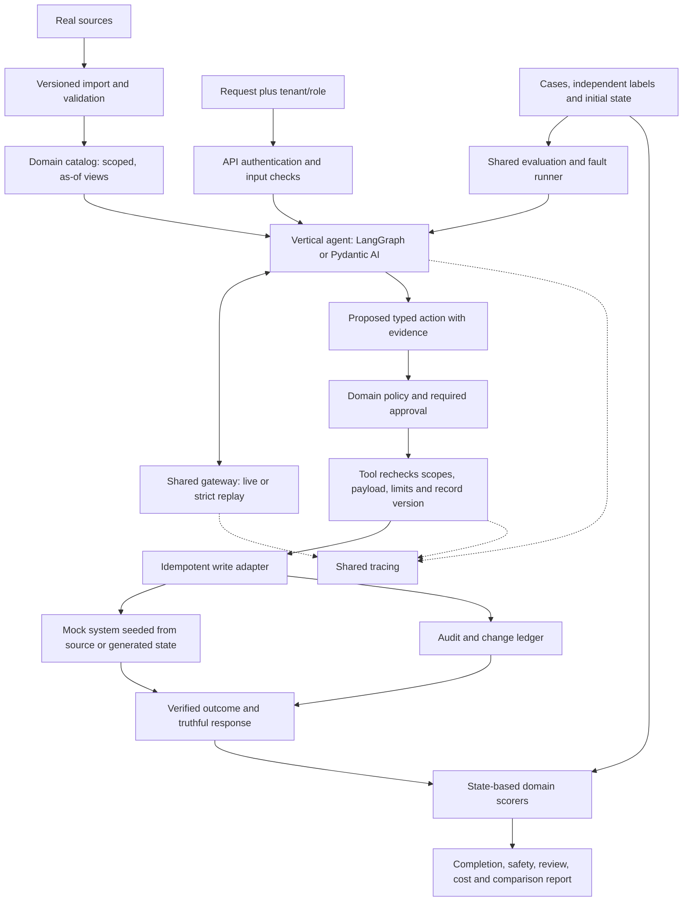

# Real data and architecture comparison

Written: 2026-10-09. Delivery direction adopted 2026-10-11; runtime and dataset validation remain unimplemented. [Current delivery plan](project-management.md) and [architecture](README.md) govern execution; tentative examples here are design rationale, not tested APIs.

This clarifies `01-execution-and-evidence-proposal.md`. The destination remains one shared evaluation/resilience platform with five industry agents. The user's goal is general AI engineering plus industry-specific applications. Real-source ingestion is part of the first vertical's acceptance criteria; fake fixtures only unblock component development.

## 1. What is real, what we construct, and what each proves

| Vertical | Real-source input | Constructed layer | Honest evidence claim |
|---|---|---|---|
| CFPB | Public complaint narratives and published metadata | Human-reviewed high-risk/ambiguity labels, adversarial edits, routing policy | Classification on published complaints, with separate risk-label quality and temporal/category slices |
| Olist | Anonymized historical orders, items, payments, delivery timestamps and reviews | Support messages, our refund/reship policy, mock action ledger | Policy-correct actions on scenarios grounded in real order histories; not reproduction of Olist's actual refund decisions |
| Prior auth | CMS coverage-policy sources; MTSamples transcription examples | Structured criteria, human-labeled note-policy pairs, explicitly edited counterfactual notes | Evidence extraction and recommendation/routing against selected criteria; not validated patient or payer outcomes |
| Supply chain | DataCo order/shipping records and NWS weather alerts | Shipment-world mapping, candidate interventions, action costs/outcome model; optional BTS-derived aviation proxy | Simulated disruption decisions grounded in sources; not causal estimates of actual freight savings |
| Revenue integrity | CUAD contracts/annotations; selected EDGAR agreements if useful | Generated subscription/billing state, seat/price/uplift clauses where absent, injected discrepancies and benign exceptions | Real-contract extraction results and separate synthetic reconciliation/write-safety results; not real recovered revenue |

CFPB provides downloadable published complaints and notes that published category fields reflect the consumer's selections. They are useful reference labels, not independently adjudicated expert truth; the database is not a representative sample of all consumers. [CFPB source](https://www.consumerfinance.gov/data-research/consumer-complaints/)

Olist's source describes real anonymized commercial orders from 2016-2018, with order status, payments, delivery and reviews. It lists CC BY-NC-SA 4.0. Treat license/attribution constraints explicitly in the manifest before publishing derived extracts. [Olist source](https://www.kaggle.com/datasets/olistbr/brazilian-ecommerce)

CMS policy selection requires recording effective dates and source references; its portal contains separate licensing conditions for third-party code content. Policy-note suitability and permission to publish any derived artifact must be checked for the selected content. [CMS source](https://www.cms.gov/medicare-coverage-database/)

MTSamples presents transcription examples and states an educational sharing permission with attribution. That does not establish validated patient histories or a complete permission for every proposed data-processing/export path. Verify the selected download's provenance and use terms, and retain illustrative status. [MTSamples source](https://www.mtsamples.com/)

DataCo describes company supply-chain records and lists CC BY 4.0. NWS exposes weather alerts and observations, which we can capture as timestamped snapshots. They are independent sources: there is no demonstrated shipment/weather join in this workspace. [DataCo](https://data.mendeley.com/datasets/8gx2fvg2k6/5), [NWS](https://www.weather.gov/documentation/services-web-api)

BTS on-time data covers scheduled passenger air carriers. It is a proxy for aviation delay patterns, not measured truck or freight-lane reliability. I recommend making it optional for the core logistics result and using DataCo shipping durations as the first observed shipping input. If included, show it as a separate simulation experiment. [BTS source](https://www.transtats.bts.gov/ONTIME/)

CUAD contains 510 commercial contracts labeled for 41 legal-clause types. It is useful for authentic extraction, but does not supply an account-linked CRM/subscription/invoice history. Preserve original contract context for real extraction evaluation; contracts assembled using its clauses belong to the hybrid set. [CUAD source](https://www.atticusprojectai.org/cuad/)

**Correction to the initial planning comparison:** Maven's CRM Sales Opportunities is described by its publisher as a fictitious computer-hardware company's pipeline. Use it as an optional realistic CRM fixture, not as real SaaS customer history. It does not independently corroborate generated subscriptions or invoices. [Maven source](https://mavenanalytics.io/guided-projects/sales-pipeline-analysis)

## 2. Data implementation that every vertical must deliver

### Shared mechanism, domain-owned meaning

The shared package supplies manifest parsing, checksum verification, snapshot identifiers and schema-check execution. Each vertical owns download/import instructions, transformations, dataset definitions, joins, label guidelines, split logic and attribution. There is no single flattened dataset spanning five unrelated industries.

Proposed pipeline:

```text
Source -> immutable local snapshot -> validated domain tables/documents
                                      |                    |
                                      v                    v
                              agent-visible views    independent labels
                                      |                    |
                                      v                    v
                                    agent -----------> evaluator
```

### Concrete outputs

1. A manifest per source with URL/publisher, version/download timestamp, checksum, schema, time/geographic coverage, language, license/use notes, privacy handling, and known missing fields.
2. A repeatable importer with a small development selection and a larger evaluation selection. Use local immutable snapshots in CI; current APIs are optional demonstrations.
3. Validated domain views: keys, joins, grain, units/currency, dates, missingness and provenance. Aggregate order items/payments before joining where appropriate to prevent multiplication of amounts.
4. Independently reviewed evaluation labels. The candidate does not generate its own expected decisions or get access to expected-label tables.
5. Fixed development, regression and final holdout manifests. Group related messages from the same order/complaint together; keep contract/template families together; use temporal splits when testing future-period performance.
6. Separate reports for original real examples, source-grounded constructed cases, and fully synthetic/adversarial cases. Do not blend them into one real-world accuracy number.

Every field/case needs enough provenance to trace it to its source row, contract/span, snapshot or generator recipe. Copying a real clause into a generated contract makes the resulting case hybrid. An actual API in test mode still acts on synthetic test data.

### Two important leakage boundaries

- **CFPB:** hide target product/issue labels and other answer-revealing fields from the agent-visible view; keep them in the scorer's table. Review narrative/category disagreement separately.
- **Historical Olist:** choose a case's as-of time. Order status, final delivery timestamps or later reviews must not be visible if they occurred after that time. A generated complaint based on a future outcome cannot silently grant the agent that future knowledge.

For Olist, preserve Brazilian currency and units from the source, and label any conversion. Keep Portuguese scenarios or explicitly version and review translations; an English-only generated message set does not prove Portuguese support quality.

### First data milestone

The Olist workstream begins with source acquisition, manifest and validated `orders_360`, before its end-to-end quality milestone. Fakes allow gateway/evaluation implementation to proceed concurrently; they do not satisfy the first complete-demo acceptance criteria. The first data review should show joined amounts, missing delivery/review fields, an as-of order view and a case manifest linked to source IDs.

CFPB can then reuse the snapshot/manifest mechanism while implementing different views and labels. Real-contract extraction can begin in parallel with Revenue integrity's generated world, so simulation quality cannot conceal extraction weaknesses.

## 3. What changes compared with the original documents

The original already specifies a thin harness, independent verticals, code-enforced rules, public sources, mocks, fault injection and staged access-layer extraction. Those principles remain. The proposal makes ownership, evidence and delivery gates more explicit; it is not a replacement platform.

| Concern | Initial documents | Proposed implementation / architecture |
|---|---|---|
| Destination | Shared harness + five verticals | Same destination, serving general and specialized roles |
| Architectural planes | Runtime, harness, access, configuration, evaluation, observability | Same logical planes; deploy/build only the mechanisms the current milestone needs |
| Initial build | Minimal harness then CFPB, Olist, Prior auth, Supply chain, Revenue | Contract scaffold, parallel gateway/evaluation/Olist slice; then CFPB plus Revenue preparation; later specialized agents |
| Data | Public sources and synthetic additions, source manifests planned | Add original/hybrid/synthetic evidence categories, case/field lineage, label isolation and as-of views to acceptance criteria |
| Reproducibility | Cache model calls; replay can reproduce any run exactly | Capture input/model/error dependencies, mock state, clock and event schedule; state/output reproducibility with explicit limitations |
| Evaluation modes | Live/record/replay, mostly replay PR gates and live nightlies | Strict offline software checks + cache-bypassed candidate quality + monitoring; behavior changes require release evidence |
| Actions | Shared access boundary, scopes, approval limits and ledger | Preserve it; recheck rules inside every write tool; stable business-operation identity across runs; approval binds exact payload/version |
| Metrics | Broad success/resilience scores, fixed initial regression limits | Completion + review burden + separate fault outcomes; actual state checks; independently chosen thresholds after baseline |
| Dependencies | LangGraph/Pydantic AI; MCP; optional/core Inngest by vertical | Same intended frameworks; in-process typed tools first, MCP after semantics are tested; add Inngest when external waits/events need it |
| Infrastructure | Gateway fallbacks, Postgres, cache, vector store, tracing/dashboard stack | Begin with one model adapter, mock transport, local snapshots, SQLite recordings and Postgres for writes/checkpoints; choose one tracing backend; add retrieval storage when needed |
| Parallelism | Sequential calendar, no explicit contributor ownership | Three bounded worktrees, one integrator, shared-contract owner, isolated services and continual integration |
| Scope of claims | Production-minded, zero-cost, multi-industry | Same aim; report local/replay cost separately from provider resources, synthetic outcomes separately from observed data |

H1 selects Gemini Developer API / gemini-3.5-flash-lite and the existing local Langfuse, with pinned LangGraph/Pydantic AI probes; see the [integration ADR](adr/0001-first-integration.md). This unmerged smoke-tested integration does not implement the shared gateway or prove domain quality. Retrieval technology remains a choice for the first retrieval task; alternatives are deferred.

## 4. Proposed runtime architecture



Read tools support reasoning before the proposed-action stage. Every write goes through enforcement, even if the model calls a tool directly. Approval-required actions wait for a decision bound to that exact action and record version. For no-write tasks, validated outputs go directly to reporting and review as appropriate. Scorer labels and hidden simulator outcomes are never available to the agent.

The shared harness supplies model I/O, recording/replay, execution limits, traces, fault injection, evaluation scheduling and reports. Verticals supply domain data, prompts, state graphs, policies, tools and scorers. Workflow orchestration wraps the runtime when needed; it does not introduce a second owner for the same wait/checkpoint.

## 5. Acceptance gates in implementation order

1. **Foundation:** fake end-to-end case, agreed schemas and repeatable local checks.
2. **Data:** real Olist snapshot, validated view, independent cases and no future/label leakage.
3. **Runtime:** correct actions, evidence-bearing handoff, enforced limits, crash resume and no duplicate effect after commit-timeout.
4. **Evidence:** compatible strict replay, fresh candidate quality, complete per-case accounting and separate real/hybrid/adversarial results.
5. **Reuse:** a second vertical uses the foundation; only demonstrated common mechanisms move into the harness.
6. **Portfolio:** each agent ships with its dataset limitations, evaluated results, failure stories and a focused demo before claiming that vertical is complete.

This proposal does not validate the downloaded data, its suitability for each task, or the runtime. Source-page checks establish the distinctions above; implementation will establish data quality and agent performance.
