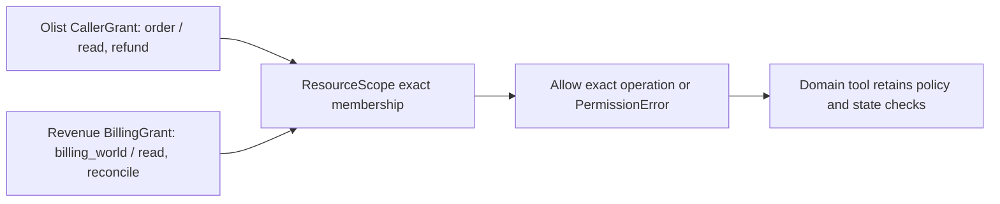

# Study the shared resource scope

Updated 2026-10-20. R3 #41 is part of the user-authorized R2/R3/R4 Revenue batch on `codex/r2-r3-r4-revenue-engine`, based on merged main `058d1c7`. Source links pin `701353d88c7e1e8439326bbb6ba6203db231cd5d`. Coverage: the shared scope predicate, both domain grant adapters, Olist migration contracts and the Revenue reader integration boundary. This is a small in-process mechanism, not an authentication service or exhaustive security audit.

## Why this extraction exists

Olist's existing `CallerGrant.require(tenant, order, capability)` already guarded scoped reads and refunds. Revenue's new `read_world(database, case_id, grant)` needs the same conjunction before reading a public constructed billing input: exact tenant, an explicitly allowed resource and capability. A billing world is one case/input row; its account/subscription IDs remain facts within that row rather than independently granted resources.

The common behavior is exact membership. Refund eligibility, invoice arithmetic, database transactions, idempotency and receipts do not share the same domain rules, so they stay in their applications. No shared registry, write primitive, role system, wildcard interpretation or MCP protocol adapter is introduced. A future adapter must enforce these same contracts but has not been implemented here.

## The shared predicate

[`ResourceScope`][scope] is a strict immutable H2 contract containing `tenant_id`, `actor_id`, `resource_kind`, `resource_ids` and `capabilities`. The actor records trusted attribution; it is not an extra credential checked against model-supplied input. Trusted composition creates the scope. Agent text or tool arguments do not grant authority by naming a tenant or actor.

`require` accepts requested tenant, kind, ID and capability as keyword-only strings. It rejects if **any** of four checks fails: tenant equality, resource-kind equality, resource-ID membership or capability membership. An empty resource/capability tuple grants nothing. Resource kinds stop an equal string ID in two domains from becoming interchangeable. The shared code imports only harness contracts and names no refund or invoice policy.

The `*` character and string prefixes are literal data. If the exact resource ID `*` is explicitly present, that one resource string can match; it never authorizes all other IDs. Lists preserve order and duplicates as provided; no silent normalization, case folding, coercion, deduplication or new count ceiling changes a domain's existing contract. Lookup is linear in the explicit tuple size. Current callers choose bounded local resources through trusted composition; measured high-scale authorization performance is not claimed.

## Olist migration without a wire change

[`CallerGrant`][olist] retains its exact fields, `schema_version=1`, existing identity constraints, `order_ids` tuple and closed `Literal['read','refund']` capability vocabulary. `require` constructs a ResourceScope with kind `order` and forwards the three existing requested values. On denial it preserves the existing domain error text: `caller grant does not authorize this tenant/order/capability`. Positional callers continue to work.

No generic maximum list length is added: existing `CallerGrant` could contain more than 1,000 IDs. The distinct console `Principal` still limits its account scope to 1,000 and checks operator/reviewer roles separately. Its `grant(order)` calls the migrated Olist grant just as before. Shared access does not turn a role into a policy override or relax the 100.00 SIM cap.

The migration test pins the pre-extraction canonical JSON hash for an invented grant and checks the complete original field set, round-trip serialization, closed capabilities and original error text. A 1,001-ID grant still authorizes its explicitly listed final ID. Existing workflow and console tests exercise actual callers beyond the adapter unit test.

## Revenue's separate domain contract

[`BillingGrant`][revenue] has tenant/actor, explicit `world_ids` and its own closed `Literal['read','reconcile']` vocabulary. It adapts to ResourceScope kind `billing_world` through keyword-only `require(tenant_id=..., world_id=..., capability=...)`. The word `reconcile` allows a read-only calculation; it does not authorize invoice mutation or real payment. Refund capability cannot be serialized into this DTO, and Revenue capability cannot be serialized into Olist's DTO.

R2's integrated [`read_world(database, case_id, grant)`][reader] calls `grant.require(tenant_id=grant.tenant_id, world_id=case_id, capability='read')` **before opening the public store**. It opens SQLite read-only, checks the exact [schema-object inventory][schema] and queries the selected case with a bound SQL parameter. After parsing the strict `BillingInput`, it checks that the stored tenant/case exactly match the grant/request before returning the projection. A requested allowed ID is not sufficient proof that the stored row belongs to that tenant. This reader opens only the supplied public input store; the evaluator store has a different schema and is rejected. This application boundary does not prevent a trusted process with filesystem access from independently opening another path.

Trace invented world `world-a` in tenant `tenant-a`: trusted composition issues a read grant for `world-a`; the reader rejects `world-b` before I/O, or reads the selected public row and rejects a mismatched tenant before returning it. Matching input then reaches Revenue's domain reconciliation code, which independently decides whether commercial terms and invoice calculations are supported. The scope helper does not inspect that policy or confer write authority.

## Tests, limits and safe changes

Initial focused verification passed **26 tests in 16.37 seconds**: five new access tests plus 14 existing Olist workflow and seven console tests. Strict typing passed for the three changed source modules; Ruff and format checks passed. After R2 source `c6407aa` integrated, the complete focused consumer set passed **39 tests in 26.68 seconds**: five access, 13 Revenue billing-world, 14 Olist workflow and seven console checks. Complete database acceptance remains a separate final batch check; these focused results do not establish fresh model quality or exhaustive authorization security.

- Crossed tenant, resource kind, resource ID and capability fail independently.
- Empty grants deny; wildcard/prefix strings have no magic interpretation.
- Olist canonical wire bytes, field set, unknown capability rejection, error wording and existing list capacity stay unchanged.
- Console role/scope checks still operate outside the common helper.
- Revenue retains its own read/reconcile vocabulary and rejects refund authority.
- The actual Revenue reader rejects an ungranted world before opening a nonexistent path, denies reconcile-only grants for reads, rejects a different stored tenant/case, and returns a projection without expected labels, split, family, arithmetic or reviewer metadata. A store with an unexpected view or trigger fails schema verification.

**Design limitation:** this is trusted in-process authority, not a sandbox. A caller controlling composition can mint another grant. Authentication, trusted account provisioning, private-store paths and domain state validation must remain separate boundaries. No expiry, delegation, deny rules, hierarchy, token signing, OS isolation or remote transport is claimed. There is no reproduced authorization bug in this extraction; the documented limits are not evidence of a public-service exploit.

For an interview, explain why tenant equality alone is insufficient, why resource kind is explicit even when IDs look globally unique, and why moving refund or invoice rules into this helper would weaken domain ownership. To add another application, first show its real scoped caller and closed domain contract, then adapt only this exact predicate. A useful offline exercise is to give two scopes the same resource ID under different kinds: crossing the kinds must fail even when tenant and capability match.

[scope]: https://github.com/Protagonist01/my-production-agentic-systems/blob/701353d88c7e1e8439326bbb6ba6203db231cd5d/harness/src/agent_harness/access.py#L6-L28
[olist]: https://github.com/Protagonist01/my-production-agentic-systems/blob/701353d88c7e1e8439326bbb6ba6203db231cd5d/projects/olist-support/src/olist_support/business_contracts.py#L13-L36
[revenue]: https://github.com/Protagonist01/my-production-agentic-systems/blob/701353d88c7e1e8439326bbb6ba6203db231cd5d/projects/revenue-integrity/src/revenue_integrity/billing_access.py#L12-L32
[reader]: https://github.com/Protagonist01/my-production-agentic-systems/blob/c6407aa7d15043cdb6a59af6f4844f3ef2ad3064/projects/revenue-integrity/src/revenue_integrity/billing_worlds.py#L416-L427
[schema]: https://github.com/Protagonist01/my-production-agentic-systems/blob/c6407aa7d15043cdb6a59af6f4844f3ef2ad3064/projects/revenue-integrity/src/revenue_integrity/billing_worlds.py#L438-L455
