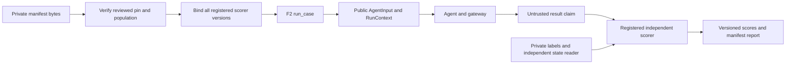

# H5 code study: fixed populations and independent scorer selection

Inspected source **9ac83e5dbde2bb6689d8b08a80b0a4bc42b4d3f8**, branch `codex/h5-versioned-cases`, based on merged/verified H4 main e9ebd07. H5 merged through #75 into verified main c08f67d: clean 329-test checks/replay and nine applicable hosted jobs. This chapter covers every class/function in `cases.py` and `scorers.py`, their acceptance tests and invented fixture. H7 extends evaluator/scorer dispatch with an optional explicit fault session; H8 forwards optional telemetry to evaluation; changed scorer links pin source 08ba28e. F2 public input and model contracts remain unchanged. Dependencies and model wire formats are unchanged. Raw source data, real domain scorers and plugin internals outside the invented test implementation are unassessed.

## Trace one claimed success

The fixture declares `fake-text-001`, grouped as `invented-order-1` in development. Its public input is `hello, shared contracts`. Private expectations include `status=settled`; the scorer is `invented-state` / `invented-state-v1`, compatible with `invented-text-v1` and `fake-text-policy-v1`.

1. `load_manifest` reads the file once. `LoadedManifest` compares SHA-256 with a separate reviewed pin, rejects duplicate JSON keys, parses strict closed contracts and checks manifest ID/version. Membership and snapshot/split validation runs before any agent.
2. The composition root explicitly registers an independent scorer object with compatible snapshot/policy pairs. `bind` visits every case. An unknown scorer on the second case prevents even the first case being dispatched through the returned bound object.
3. `BoundEvaluation.run_case` selects the case, checks its scorer and calls existing `evaluation.run_case`. That runner validates context and result identity and projects only `AgentInput` into the agent. A gateway sees the public prompt, not the expected state, eligibility, group or holdout label.
4. The invented agent returns completed, uppercase text and even an invented success reference. The test scorer ignores that claim as evidence of state. It reads a separately supplied actual-state dictionary. Settled state earns 1; pending or absent state earns 0 under the same claim. The scorer declares `invented_state_correct`, its version and a state evidence reference.
5. The registered wrapper validates/copies scores, rejects empty/duplicate metrics or wrong versions, and returns through F2 `CaseReport`. `ManifestCaseReport` adds the reviewed manifest pin and selected group/split/scorer ID. Candidate code/environment, source/policy/scorer versions and result remain in the nested report.

The manifest and labels stay in the same process as trusted Python code. This is a deliberate dispatch boundary, not an isolation boundary against a malicious agent/plugin.

## cases.py anatomy

| Verified block | Mechanics and reason | Failure or tradeoff |
|---|---|---|
| [Aliases and SnapshotSpec][snapshot] | Identifier requires at least one non-whitespace character; Digest requires lowercase SHA-256; split is development/holdout. Snapshot descriptors tie an opaque reference to source category/version. | Strings are not source integrity proofs. IDs preserve surrounding whitespace; consistent reviewed IDs matter. |
| [CaseEntry][entry] | Adds group, split and scorer ID around unchanged evaluator-only EvalCase. Case.scorer_version remains the evaluator pin. | Keeps selection private without extending AgentInput. |
| [CaseManifest fields][manifest] | Requires nonempty explicit membership, snapshots and embedded entries. | Inferring membership from whatever loaded would miss deleted cases. Embedded private records avoid path traversal and multi-file read races. |
| [exact_population][population] | Check duplicate declared/actual IDs before set equality; build a unique snapshot map; match each case's source category/version; remember group split across all snapshots; reject unused declarations. | Set equality alone would hide duplicates. Global groups conservatively reject the same family in different splits under different snapshots. Group quality and temporal boundaries still require review. |
| [ManifestPin][pin] | Reviewed ID/version/digest is separate configuration. | A supplied self-generated digest establishes consistency only, not trust. |
| [_unique_object][unique] | Called for every JSON object; reject a key already seen instead of overwriting an earlier label/version. | Applies to nested labels as well as the root. |
| [LoadedManifest.__init__][load] | Copy/validate the pin; hash bytes; parse for duplicate keys; strict Pydantic parse of the same bytes; compare ID/version; retain canonical case/pin strings. | Parsing twice costs CPU but never rereads the file. Canonical private storage differs from the original raw-byte digest, which correctly remains attached to the reviewed file. |
| [manifest/pin properties][copies] | Reconstruct fresh validated objects from private serialized strings. | A frozen Pydantic model can still hold mutable nested dictionaries; fresh copies prevent caller mutation through returned values. |
| [entry][lookup] | Search a fresh population for the exact case ID; fail on absence. | Whole-population parse and linear search are an explicit small-dataset limitation. |
| [load_manifest][file-load] | Read once and give that same buffer to LoadedManifest. | A source file changed after the read cannot alter the loaded snapshot. The historical Olist hash/parse race remains unresolved in its separate implementation. |

## scorers.py anatomy

| Verified block | Mechanics and reason | Failure or tradeoff |
|---|---|---|
| [ScorerCompatibility and ScorerSpec][spec] | ID/version plus explicit snapshot/policy pairs; reject repeated pairs. | Separate lists would accidentally authorize a cross product. Compatibility is reviewed configuration, not automatic semantic verification. |
| [_RegisteredScorer fields/check][check] | Retain the copied spec and trusted implementation; match case scorer ID/version and exact compatibility pair. | Registry versions describe code by convention; candidate code SHA/environment must also be recorded. A version string cannot attest a callable's truthfulness. |
| [score][score] | Detach case/result, invoke plugin, revalidate each returned ScoreResult, require a nonempty set of unique metrics all at the registered version. | Exceptions propagate and typed scorer failures retain no value/category. Metric eligibility is plugin-defined because different metrics have different denominators. |
| [ScorerRegistry.__init__/register][register] | Map `(ID, version)` to a binding; reject duplicate keys and objects without callable score; copy the spec. | No importlib/entrypoint discovery or arbitrary Python name in JSON. Plugin construction remains the application's explicit responsibility. |
| [bind][bind] | Visit the full manifest, resolve exact registrations and validate every compatibility pair, then build a case-ID binding map. | Fail before dispatch when any case is unsupported. Composition is single-threaded; registry synchronization and plugin state isolation are not provided. |
| [ManifestCaseReport][report] | Wrap F2 report with manifest pin, group/split/scorer ID; do not change old CaseReport or model schemas. | Public model contracts remain label-free. Evaluator reports still need export/privacy review because trusted scorer evidence strings are arbitrary. |
| [BoundEvaluation.__init__/run_case][run] | Copy the binding map; select a detached entry, check compatibility, delegate to run_case and attach manifest provenance. | No batch/reset/release accounting. A caller must not treat one returned case report as proof that all scheduled cases ran. |

Snapshot/source/policy labels remain subject to independent review; H5 verifies declared consistency. Trusted plugins can access any Python/process resource and may mutate their own evidence readers. Generic registration cannot enforce that every domain scorer independently reads actual committed state. The acceptance plugin demonstrates the required wiring using invented state; a real integration needs state-reader tests and authorization/trial scoping.

## Decisions and concrete evidence

[Build Book Entry 17](../BUILD_BOOK.md#entry-17--pinning-case-membership-and-independent-scorers) records the construction choices. Embedded records and exact membership allow complete structural validation before dispatch; external case files would need their own atomic index/hash rules. Explicit registration preserves `vertical → harness` dependency direction; automatic discovery is convenient but makes imports and configuration execution harder to inspect. Serialized retention prevents accidental nested mutation at the cost of repeated parsing; a larger corpus warrants a validated immutable index, measured before replacing this design.

The [53 H5 acceptance cases][tests] cover invalid populations and duplicate object members. They also check malformed or absent files, pin mismatch, same-buffer verification/parsing, grouping across snapshots, nested mutation, exact registration/version/compatibility, copied scorer inputs, typed errors and independent state checks. [The fixture][fixture] contains only invented text/state. Network is denied in its load/run acceptance test. Full `python dev.py check` passed 329 tests, twenty-one strict typed source files, import boundaries, Ruff/format and lock. Six packages built. Tests run on Windows/Python 3.13.4; hosted cross-platform evidence must identify the final PR head separately.

The pinned fixture must survive Windows checkout. `.gitattributes` fixes LF for `tests/fixtures/cases/*.json`, matching the existing replay/lock approach. A byte pin should fail changed line endings; silently normalizing input in the loader would weaken the reviewed-byte identity.

## Risks and interview practice

**Design limitations:** no signed provenance, raw-source verification, process isolation, hostile-file resource bounds, temporal split builder, automatic label review, persistent registry, batch scheduling or complete trial ledger. Existing R1/R3 and fake-agent R2 concerns remain open; this work changes none of those implementations. No new consequential H5 bug is claimed from the inspected paths. Passing acceptance tests is not an exhaustive audit.

- **Why declare IDs as well as records?** A loader cannot infer that a vanished record should have existed. Duplicate checks plus exact inventory equality and an independently reviewed byte pin prevent silent population drift. Follow-up: changing the trusted pin can still authorize a smaller population; review is essential.
- **How do scorer plugins avoid label leakage?** The scorer is composed by the application and receives private case data after the agent receives only F2's closed public projection. The harness never imports the domain and never sends group/split/eligibility. Follow-up: an answer embedded in legitimate request text still leaks; review the public adapter.
- **Why does the same completed result score 0?** Success is a claim. The invented reader observes pending/missing state, so expected settled state is not met. Follow-up: a real scorer must independently resolve tenant/trial-scoped committed state, not trust arbitrary reference strings.
- **What happens when a scorer crashes?** Exception propagates; a typed scorer error carries no numeric/category score. H6 must retain that terminal trial failure rather than omit it from accounting. Do not claim H5 already has a release gate.
- **Exercise:** place two paraphrases in different splits under the same group but different snapshot refs. Loading must fail before any gateway request. Then move both to development: valid registration can bind them, but complete multi-trial execution is still separate work.
- **Exercise:** change a returned manifest's hidden dictionary, then request the case again. The original private value remains. Explain why `frozen=True` alone would not be enough.

Refresh this chapter when manifest identity/membership rules, registration compatibility, private projection, report wrappers or test evidence change. [Operating runbook](case-manifests.md) explains reviewed pin handling. Source links below pin the inspected implementation, not a moving branch.

[snapshot]: https://github.com/Protagonist01/my-production-agentic-systems/blob/9ac83e5dbde2bb6689d8b08a80b0a4bc42b4d3f8/harness/src/agent_harness/cases.py#L14-L21
[entry]: https://github.com/Protagonist01/my-production-agentic-systems/blob/9ac83e5dbde2bb6689d8b08a80b0a4bc42b4d3f8/harness/src/agent_harness/cases.py#L24-L28
[manifest]: https://github.com/Protagonist01/my-production-agentic-systems/blob/9ac83e5dbde2bb6689d8b08a80b0a4bc42b4d3f8/harness/src/agent_harness/cases.py#L31-L36
[population]: https://github.com/Protagonist01/my-production-agentic-systems/blob/9ac83e5dbde2bb6689d8b08a80b0a4bc42b4d3f8/harness/src/agent_harness/cases.py#L39-L66
[pin]: https://github.com/Protagonist01/my-production-agentic-systems/blob/9ac83e5dbde2bb6689d8b08a80b0a4bc42b4d3f8/harness/src/agent_harness/cases.py#L69-L74
[unique]: https://github.com/Protagonist01/my-production-agentic-systems/blob/9ac83e5dbde2bb6689d8b08a80b0a4bc42b4d3f8/harness/src/agent_harness/cases.py#L77-L83
[load]: https://github.com/Protagonist01/my-production-agentic-systems/blob/9ac83e5dbde2bb6689d8b08a80b0a4bc42b4d3f8/harness/src/agent_harness/cases.py#L89-L99
[copies]: https://github.com/Protagonist01/my-production-agentic-systems/blob/9ac83e5dbde2bb6689d8b08a80b0a4bc42b4d3f8/harness/src/agent_harness/cases.py#L102-L107
[lookup]: https://github.com/Protagonist01/my-production-agentic-systems/blob/9ac83e5dbde2bb6689d8b08a80b0a4bc42b4d3f8/harness/src/agent_harness/cases.py#L109-L113
[file-load]: https://github.com/Protagonist01/my-production-agentic-systems/blob/9ac83e5dbde2bb6689d8b08a80b0a4bc42b4d3f8/harness/src/agent_harness/cases.py#L116-L118
[spec]: https://github.com/Protagonist01/my-production-agentic-systems/blob/9ac83e5dbde2bb6689d8b08a80b0a4bc42b4d3f8/harness/src/agent_harness/scorers.py#L13-L28
[check]: https://github.com/Protagonist01/my-production-agentic-systems/blob/9ac83e5dbde2bb6689d8b08a80b0a4bc42b4d3f8/harness/src/agent_harness/scorers.py#L31-L41
[score]: https://github.com/Protagonist01/my-production-agentic-systems/blob/9ac83e5dbde2bb6689d8b08a80b0a4bc42b4d3f8/harness/src/agent_harness/scorers.py#L43-L57
[register]: https://github.com/Protagonist01/my-production-agentic-systems/blob/9ac83e5dbde2bb6689d8b08a80b0a4bc42b4d3f8/harness/src/agent_harness/scorers.py#L63-L73
[bind]: https://github.com/Protagonist01/my-production-agentic-systems/blob/9ac83e5dbde2bb6689d8b08a80b0a4bc42b4d3f8/harness/src/agent_harness/scorers.py#L75-L84
[report]: https://github.com/Protagonist01/my-production-agentic-systems/blob/9ac83e5dbde2bb6689d8b08a80b0a4bc42b4d3f8/harness/src/agent_harness/scorers.py#L87-L92
[run]: https://github.com/Protagonist01/my-production-agentic-systems/blob/08ba28e28e9ac01a946648cdc3411ae65451833b/harness/src/agent_harness/scorers.py#L99-L126
[tests]: https://github.com/Protagonist01/my-production-agentic-systems/blob/9ac83e5dbde2bb6689d8b08a80b0a4bc42b4d3f8/tests/test_case_manifests.py
[fixture]: https://github.com/Protagonist01/my-production-agentic-systems/blob/9ac83e5dbde2bb6689d8b08a80b0a4bc42b4d3f8/tests/fixtures/cases/invented-v1.json

The [H6 trial chapter](code-study-trials.md) extends this pinned H5 boundary with fresh state, bounded workers and complete outcome accounting; H5 source links above remain unchanged.

H7 [seeded fault composition](seeded-faults.md) extends the explicit H5 dispatch with a reviewed treatment plan/session and independent state/ledger invariants; faults still fail without that composition. Fault journals require both reviewed manifest and external plan on recovery. H5 model/public projection and private-label boundaries remain.
