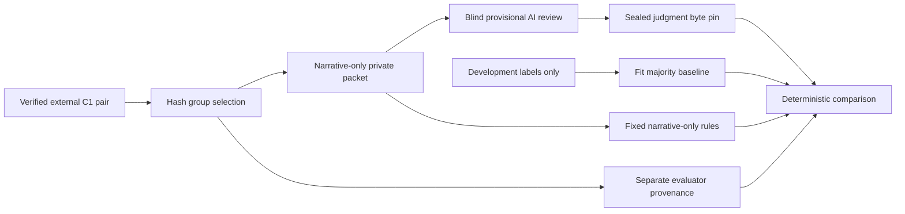

# Code study — provisional CFPB review and deterministic baselines

Inspected 2026-10-19, unmerged `codex/c2-risk-baselines`, based on verified C1 main `2988428`. Executable source: `087d4703f4ae72cb9aa75b5c68418f76392d8cea`. Covers all three added modules and both test modules, alongside the preserved [C1 source chapter](code-study-cfpb.md). [Operations](cfpb-risk-baselines.md) and the [guideline](cfpb-risk-guideline.md) explain the pilot and actual evidence. No model classifier, calibrated router, human-adjudicated labels, live dataset or application service is implemented.

## Trace the boundaries

Twelve complaints are selected from the pinned C1 stores, one representative from each of twelve distinct exact-text groups, four groups per temporal split. `select_cases` accepts only case/group/split identifiers. It ranks SHA-256 of a fixed seed, domain and group ID, then a representative case and final presentation order. Targets and narrative keywords cannot affect this function because neither is an input. Reversed input order gives the same result. Group identity is inherited from C1's verified exact-normalization policy; this does not establish consumer identity or near-duplicate independence.

`make_packet` verifies the externally pinned prepared snapshot, reads metadata for selection, reads narrative-only inputs for selected IDs and verifies the snapshot again. It writes a new external blind file containing case IDs/text only and a separate evaluator selection file. Reviewer receives the complete blind narratives; group, date, split, consumer selections and baseline outputs stay separate. A `Review` stores exact text digest, reviewer kind/identity/time, guideline version/digest, risk/ambiguity, Unicode spans and rationale. The user asked Codex to supply this first review, so every label is AI-reviewed and provisional.

An invented narrative says `Invented account access lost. Unicode é.`. The test's span starts at9 and ends at28, selecting `account access lost`. A one-character end change fails unless the recorded text also matches exactly. A wrong narrative digest, missing/extra/duplicate row, contradictory reviewer kind or elevated judgment with no evidence also fails. Complete review evidence is required before scoring; no difficult case disappears from the denominator. Human identity, independence and factual truth are trusted assertions beyond these mechanics.

After the twelve real reviews were sealed, `pinned_pilot` checks packet/selection/review bytes against separately supplied pins and binds their inventories and guideline. `pilot_report` selects the explicitly requested reviewer, fits risk/ambiguity majority using development cases only and compares majority and fixed rules on every split. Multiple reviewers are preserved, and `review_summary` reports comparable/disagreement cases; one reviewer yields `disagreement_cases=null`, not a fabricated agreement rate. It never silently adjudicates differing judgments.

## Core code and failure paths

- [Closed reviewer contracts and ranking](https://github.com/Protagonist01/my-production-agentic-systems/blob/087d4703f4ae72cb9aa75b5c68418f76392d8cea/projects/cfpb-triage/src/cfpb_triage/review.py#L22-L60) reject extra fields/coercion, require explicit provisional/prediction-blind declarations and distinguish AI/human provenance. A digest identifies content, not reviewer competence.
- [Selection and packet creation](https://github.com/Protagonist01/my-production-agentic-systems/blob/087d4703f4ae72cb9aa75b5c68418f76392d8cea/projects/cfpb-triage/src/cfpb_triage/review.py#L63-L134) reject duplicate cases, groups crossing temporal splits, invalid counts and insufficient coverage. There is no undersized silent fallback. Private output is created exclusively outside every Git ancestor. Explicit UTF-8/LF keeps byte pins portable.
- [Review validation and accounting](https://github.com/Protagonist01/my-production-agentic-systems/blob/087d4703f4ae72cb9aa75b5c68418f76392d8cea/projects/cfpb-triage/src/cfpb_triage/review.py#L137-L191) revalidates detached records and requires each reviewer to cover the whole packet. Exact spans and one guideline digest are checked. Summary records zero human reviews and no established human validation for the actual single-AI batch. A later second reviewer requires additional evidence, not relabeling the original identity.
- [Pinned private loading](https://github.com/Protagonist01/my-production-agentic-systems/blob/087d4703f4ae72cb9aa75b5c68418f76392d8cea/projects/cfpb-triage/src/cfpb_triage/review.py#L194-L207) reads one byte buffer, verifies its supplied digest and rejects duplicate JSON keys. Pins must come from reviewed configuration, not be discovered from an untrusted incoming artifact at scoring time.
- [Fixed predictors](https://github.com/Protagonist01/my-production-agentic-systems/blob/087d4703f4ae72cb9aa75b5c68418f76392d8cea/projects/cfpb-triage/src/cfpb_triage/baselines.py#L16-L85) use declared literal terms/regexes and deterministic order. `majority` resolves ties lexically; only development labels enter fitting. `risk_rules` intentionally fails on negated/quoted fraud language. The test preserves that weakness; the pilot findings did not prompt tuning.
- [Confusion accounting](https://github.com/Protagonist01/my-production-agentic-systems/blob/087d4703f4ae72cb9aa75b5c68418f76392d8cea/projects/cfpb-triage/src/cfpb_triage/baselines.py#L88-L131) stores `(reference,prediction)` counts, reports support/calls/correctness per class and uses `2*TP/(support+predicted)` for F1. The class union includes predicted-only labels; their zero F1 affects the mean. Null precision/recall retains undefined denominators rather than fabricating success. Three invented cases `(a,a),(a,b),(c,b)` yield accuracy1/3 and macro-F1=2/9.
- [Pilot report and pin binding](https://github.com/Protagonist01/my-production-agentic-systems/blob/087d4703f4ae72cb9aa75b5c68418f76392d8cea/projects/cfpb-triage/src/cfpb_triage/baselines.py#L134-L237) preserve all three splits and uncertain judgments. Route review when predicted risk is elevated/uncertain or meaning ambiguous; report actual review fraction and elevated-case support. A zero elevated denominator produces null recall. Selection/packet/guideline mismatches fail before output. No per-case narrative/evidence is emitted in aggregate reports.
- [Complete consumer-reference report](https://github.com/Protagonist01/my-production-agentic-systems/blob/087d4703f4ae72cb9aa75b5c68418f76392d8cea/projects/cfpb-triage/src/cfpb_triage/baselines.py#L240-L292) first fits product majority and per-product issue majorities from development. It then walks narrative/target stores in exact case-ID order, refusing inventory mismatch. Only narrative enters product rules; target values affect counters and never the current predictor. Source pins are rechecked after consumption. Consumer-reference and provisional-risk reports remain separate because neither can establish the other's truth.
- [CLI](https://github.com/Protagonist01/my-production-agentic-systems/blob/087d4703f4ae72cb9aa75b5c68418f76392d8cea/projects/cfpb-triage/src/cfpb_triage/review_cli.py#L13-L66) creates private packets or exclusive aggregate reports. Schema errors are redacted rather than printing Pydantic's private input values. It makes no SDK/provider request.

## Actual verification and remaining limits

Twenty-one invented focused tests passed; strict typing passed59sources after an explicit numeric F1 accumulator replaced heterogeneous dictionary inference. The real blind review contains twelve provisional AI judgments, nine routine/one elevated/two uncertain. The [pilot aggregate](data/cfpb-risk-pilot-v1.json) shows that the development-fitted majority gets9/12 risk matches but misses the only elevated case; rules match5/12 and route7/12 to review, including the one elevated case. Do not interpret1/1 as validated recall. The [consumer-reference report](data/cfpb-consumer-baselines-v1.json) reports all260,738records and every per-class denominator; it is source-label agreement, not verified classification truth. Full/package/exact-head hosted acceptance is recorded on#35 after completion.

**Verified artifact bug, repaired:** the first Windows blind-packet metadata pin hashed intended text instead of actual written bytes. Preserve original packet/reviews, correct only evaluator metadata under a new file/pin, and use explicit UTF-8/LF generation. The invented source-to-packet test checks actual file bytes. No source text, selection or risk judgment changed.

**Verified bounds bug, repaired:** Python slices clamp an end beyond the narrative length. Exact suffix text alone therefore could accept a false end offset. The repaired validator checks the upper bound explicitly; an invented matching-suffix/oversized-end witness fails as required. This does not alter any sealed review labels.

**Design limitations:** the rubric and AI reviewer are not independent of the authoring agent; metadata preserves that fact. No qualified human adjudication or agreement evidence exists. Hash selection gives deterministic membership, not representative risk prevalence; twelve cases have inadequate coverage. Fixed rules cannot understand negation, chronology or legal quotation. A locally pinned file is not authenticated human evidence or a security sandbox. Holdout labels were reviewed only for evaluation, not candidate tuning; future policy/model changes need new preregistered evidence. No medical/legal/financial advice or actual harm claim follows from the labels.

## Exercises

Reverse the selection input and explain why membership stays fixed. Introduce a repeated group across cutoffs and predict the error. Change only holdout labels and show that fitted majority remains unchanged. Hand-calculate the three-case macro-F1 witness. Explain why missing elevated support is null and why one AI review cannot report an agreement percentage. For a future calibrated router, describe a development-only threshold-selection procedure and a new held-out evaluation without claiming this code implements it.

[Root guide](../CODE_STUDY_GUIDE.md) · [Build Book](../BUILD_BOOK.md#entry-27--blind-provisional-risk-review-before-deterministic-baselines)
