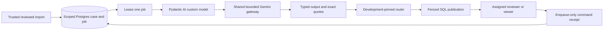

# Code study — typed CFPB triage and durable review

Follow-up inspected 2026-10-24 from merged base `b915f1b`: unmerged
`codex/three-release-evaluators` adds the [three-issue evaluation preparation](three-release-evaluators.md).
The original walkthrough below retains its historical implementation/evidence scope.

Inspected 2026-10-23 on unmerged `codex/c3-c4-cfpb-triage`, based on merged #84 `95397c4`, with dirty implementation additions. Coverage: classifier/contracts/calibration, all desk modules and SQL, shipped web assets, diagnostics/tracing, their focused/SQL/session tests and shared Gemini opt-in. This chapter is a source walkthrough, not an exhaustive security review. [Operations and actual pilot](cfpb-triage-operations.md), [aggregate evidence](data/cfpb-triage-evidence-v1.json) and [Build Book Entry37](../BUILD_BOOK.md#entry-37--typed-cfpb-triage-and-scoped-review) preserve the evidence boundary. C1/C2 chapters remain historical source studies.

## Follow one invented complaint

`ComplaintInput(case_id=<64 hex>, narrative="Invented credit card billing dispute.")` is the entire agent-visible record. Evaluator targets are separate. [`desk_cli.main`](../projects/cfpb-triage/src/cfpb_triage/desk_cli.py) reads bounded external JSON, then [`DeskStore.enroll`](../projects/cfpb-triage/src/cfpb_triage/desk_store.py) validates taxonomy/policy pins and atomically stores the case, pending job and enrollment event. This CLI is trusted import, not an unprotected HTTP ingestion endpoint.

[`GatewayModel.request`](../projects/cfpb-triage/src/cfpb_triage/classifier.py) rejects repeat calls and executable tool declarations. It supplies only narrative text, rubric and pinned taxonomy in a closed shared `ModelRequest`. Pydantic's output tool is a return channel: the provider JSON becomes `ToolCallPart`, and Pydantic validates `ExtractedPrediction`. No business tool executes. `classify` sets `agent.instrument=False` to prevent global prompt capture and returns a closed failure when the schema or evidence fails. A provider failure preserves unknown usage and cannot silently trigger another route.

[`ExtractedPrediction.locate`](../projects/cfpb-triage/src/cfpb_triage/triage_contracts.py) finds each quote once, searches again from `start+1` to reject overlapping/repeated occurrences, and computes Python Unicode offsets. `Prediction.check` requires product and issue together, a permitted pair and exact nonempty support for categorization/elevated priority. For `é🙂 credit card problem`, `credit card` starts at character 3, not a UTF-8 byte position. Missing or duplicated quotes fail. This verifies source membership only; a real quote can still support a wrong inference.

`route` first checks context case/narrative and policy/taxonomy digests. Its loop stops after operational failure or any risk/ambiguity signal. Only clear routine output below the cheap threshold can escalate once. `eligible` also requires a non-null category and threshold membership. With threshold 1.01, no confidence in [0,1] can pass. The stronger route changes model identity but uses the same resource controls; explicit opt-in keeps older gateway callers unchanged.

## Development fitting and honest denominators

[`calibration.validate_cases`](../projects/cfpb-triage/src/cfpb_triage/calibration.py) rejects duplicate cases and groups spanning splits. `fit` rejects every non-development row; it hashes sorted complete evaluator rows into the fit manifest. `fit_threshold` searches a fixed grid and selects maximal admitted coverage under the declared composite error ceiling. Correctness combines consumer product/issue references and provisional priority/ambiguity; neither is independently established truth. The 50% review target is metadata/reporting, not an enforced maximum. Independent cheap/strong fits do not prove a global pipeline error guarantee.

`measure` includes every row, records selective error as null with zero admissions, and keeps provisional elevated recall null when its denominator is zero. Failure cases remain scheduled cases. Observed token sums include only known components, alongside explicit unknown-attempt counts. They cannot establish a complete bill. The actual development v2 fit admitted zero; fresh regression/holdout in both modes also admitted zero. Useful automation, human validation and production release remain unestablished.

## Transactions, retries and process loss

[`desk.sql`](../projects/cfpb-triage/src/cfpb_triage/desk.sql) separates cases, jobs, events, commands, accounts and sessions under a domain-owned schema. [`desk_auth.setup_review`](../projects/cfpb-triage/src/cfpb_triage/desk_auth.py) pins DDL bytes and grants bounded runtime privileges. The DDL is normalized to LF so Windows and Linux agree. A mismatched schema is rejected rather than silently migrated.

`DeskStore.enqueue` locks the scoped case and checks a command receipt before expected revision. This ordering lets a retried command with its old revision return its original receipt. The payload digest prevents command-ID rebinding; revision/event/job invalidation commit together. `ReviewTool` has identity/case bound in its constructor. A model or HTTP caller cannot choose another principal in the command body.

`claim` locks one pending/expired job using SKIP LOCKED and commits a random five-minute lease. It reads the case without taking a case lock while holding the job lock, avoiding inversion with writers that lock case first. [`desk_worker.step`](../projects/cfpb-triage/src/cfpb_triage/desk_worker.py) assesses outside SQL locks. `finish` checks result pins/evidence and reconstructs classified eligibility, then locks the canonical case/job and compares revision, lease ID/state and expiry before publication. A reviewer enqueue or a replacement lease makes stale results unpublishable. This fences durable results, not external model billing: a crash after dispatch can cause another charged/consumed attempt after reclaim. Attempts above three publish review without dispatch.

Real Postgres tests cover duplicate concurrent commands, stale versions, rebound IDs, lease reclaim/old publication refusal, reviewer override, disabled accounts, runtime event-delete denial, forged classified output and an actual child exit after claim. They do not emulate a multi-region database or establish model quality.

## Protected API and browser state

[`desk_api.create_app`](../projects/cfpb-triage/src/cfpb_triage/desk_api.py) owns loopback Host/Origin checks, 16KB bodies, hashed sessions, CSRF, no-store and fixed errors. Accounts carry exact assigned cases and tenant identity. HTTP exposes session/list/detail/aggregate diagnostics and one enqueue command. Import and account provisioning are local trusted operations. No resolve/refund/account-mutation route exists.

[`console.js`](../projects/cfpb-triage/src/cfpb_triage/web/console.js) renders source text through textContent. Session epochs suppress obsolete list/detail replies and late 403s; auth commands are serialized. Logout clears private DOM immediately. Viewer controls are omitted for usability, while API/store checks enforce authorization. Actual SQL-backed Edge evidence covers reviewer enqueue, viewer/unassigned 403, logout and 390px overflow. The shipped asset's Node regressions cover stale response races independently of the browser.

## Trace and monitoring boundaries

[`traced_route`](../projects/cfpb-triage/src/cfpb_triage/tracing.py) composes existing H8 run/agent/node/model spans with `TracedGateway`. A generic evaluation envelope is used only for closed trace metadata; no fake scorer runs and no quality score is emitted. It hashes source/input/version references using a private per-run HMAC key and always finishes export/flush/cleanup. The live CLI's explicit `--langfuse` flag selects the shared exporter. Test assertions verify hierarchy and absent raw narrative. Backend acceptance/read-back is separate operational evidence, not implied by those tests.

[`diagnostics.profile`](../projects/cfpb-triage/src/cfpb_triage/diagnostics.py) counts proposed categories, character-length bins, heuristic language markers, mask density and attempted model/provider mix. `compare` normalizes each dimension, computes half the L1 distance, flags >=0.2 and marks empty dimensions insufficient. HTTP profiles only assigned cases; the local operator CLI compares an explicit external reference. Neither function sees hidden labels or estimates accuracy.

## Risks and safe changes

- **Design limitation:** all-review pilot and provider quota failures establish no useful automation. Keep the conservative policy; collect new independently reviewed development evidence before changing thresholds. Never retune on this exposed holdout.
- **Design limitation:** taxonomy is a development-observed subset and provisional labels are one AI review. Representative coverage and independent adjudication remain release work.
- **Trust boundary:** a database owner/local importer can misstate masking review or alter stored facts. HTTP users cannot import; operational access and external review remain required.
- **Design limitation:** loopback sessions and database roles are a local deployment model, not production identity, TLS termination, distributed rate limiting or migration readiness.
- **Not assessed:** load capacity, multi-region recovery, human label agreement and production privacy certification.

To add a new fixed enqueue reason, update `QueueCommand`, the UI option and closed event expectation together; rerun command-rebinding/permission/session tests. To add a model, review admission and endpoint payload limits first, require explicit opt-in, then use a new development experiment version. Do not relax quote membership to rescue an observed result.

## Interview exercises

1. Explain why typed output cannot prove a correct category. A strong answer separates schema, exact source support, provisional references and factual truth.
2. Trace two identical concurrent enqueue commands. Mention case lock, receipt-before-revision lookup and one stored event/version.
3. Kill a worker after claim. Predict lease reclaim and refusal of the old lease; distinguish fenced publication from repeated provider consumption.
4. Explain 100% elevated review recall at 100% review load. It does not imply a useful classifier; zero elevated holdout cases means unknown recall there.
5. Change the source text by one Unicode character. Predict source-pin or exact-span rejection and explain why UTF-8 byte offsets are wrong here.
