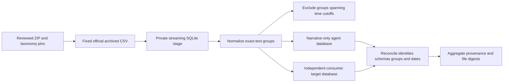

# Code study — CFPB source preparation

Inspected 2026-10-18, unmerged `codex/c1-cfpb-import`, based on reviewed merged main `54f5af2`. This chapter covers all four installable preparation modules and their invented-data tests. Current executable source is `1dd98fb66426b7c992a794d8f0a1232a8d32383b`. The complete real archive was prepared by `8ddf6c12448adea66b4afdd66103b85fcd031a5b`; the follow-up tightens download/verification boundaries without changing source selection or prepared rows. It covers source integrity and isolation mechanics, not a classifier or production service. [Source operations](data/cfpb-source.md) records exact archive/taxonomy pins and population limits; [Build Book Entry 25](../BUILD_BOOK.md#entry-25--archive-grounded-cfpb-preparation-in-parallel) explains construction and the current-source change.

## Trace one invented complaint

Suppose complaint ID `123` was received September 1, 2023, and its published narrative is `Invented fee disputed.`. Its consumer-selected product and issue are `INVENTED PRODUCT TARGET` and `INVENTED ISSUE TARGET`. `source_cli.main` loads an independently stored SourcePin and calls `prepare_snapshot`. `verify_sources` checks exact external ZIP/PDF bytes before creating output. `archive_rows` checks the one expected ZIP member and exact CSV schema before yielding rows.

`_stage` verifies numeric unique IDs and ISO dates, assigns the development window, counts missingness/mask patterns and writes the original narrative into private staging. `case_key` hashes `cfpb:123`; `group_key` hashes NFKC/case-folded/whitespace-collapsed narrative. The transformation is used only to group duplicates. If the same normalized text appears in March, the group is quarantined in full. No future row moves into development.

`_materialize` writes `inputs(case_id,narrative)` into `agent.sqlite` and the eight consumer target/date/split/group fields into `evaluator.sqlite`. It never writes company or response metadata to the agent store. `inspect_prepared` independently walks both ordered case inventories, validates typed target rows, recalculates groups and dates and fails any cross-partition group. It then emits aggregate counts. The stage is closed before unlinking, which matters on Windows. `prepare_snapshot` rechecks source bytes and seals aggregate evidence plus both database hashes. A new manifest is created exclusively; existing output always fails.

Later `verify_prepared` accepts the expected manifest digest from reviewed external configuration. It checks exact completed file inventory and hashes, then reruns semantic inspection within explicit read transactions. It checks inventory and file/manifest hashes again afterward, detecting a concurrent write that persists between initial hashing and semantic inspection. Active WAL/SHM/journal sidecars are never accepted. Giving it the artifact's own current hash without independent review defeats that trust boundary. `read_inputs` opens only the narrative store in SQLite read-only mode and constructs closed `ComplaintInput` objects; `read_targets` is an evaluator-only API. Caller access control is outside this local preparation library.

## Code anatomy

| Symbol | Inputs → output/effect | Invariant / tested failure |
|---|---|---|
| `SourcePin` | Independent SHA-256 ZIP/PDF values → strict frozen contract | Changed archive or taxonomy fails before output creation. |
| `ComplaintInput` / `ConsumerTarget` | Separate visible/private shapes | Product/issue/company/response canaries are absent from input objects and agent-file bytes. |
| `temporal_split` | Received date → development/regression/holdout or excluded | Inclusive boundaries and February 29 have explicit tests. |
| `external_path` | Resolved path → external path or error | Rejects any Git ancestor, including another worktree and host drive-root repository. |
| `OfficialRedirect` / `acquire_file` | Fixed official download → byte-pinned exclusive file | Off-host/HTTP redirects, oversized and mismatched bodies fail; partial file removed. |
| `archive_rows` | ZIP → streaming strict CSV rows | Changed member inventory, headers, row width and encoding fail. |
| `_stage` | Rows → on-disk normalized groups / aggregate profile | Missing targets/text counted; duplicate IDs and invalid dates fail. |
| `_materialize` | Accepted staging rows → two closed databases | Cross-window groups never appear; original text is retained. |
| `inspect_prepared` | Read-only pair → reconciled aggregates | Schema/views/triggers, unequal case membership, changed date/group fail. |
| `prepare_snapshot` | Pins / source / new output / code revision → sealed manifest | Source checked before/after; empty usable cohort and existing output fail. |
| `verify_prepared` | Expected manifest digest / completed output → verified metadata | Changed manifest, database bytes or extra files fail. |
| `source_cli.main` | Explicit command arguments → safe aggregate stdout / exit status | Parser/source/database failures never echo narrative values. |

Streaming SQLite avoids holding the complete narrative corpus in memory. Group verification keeps one digest/split entry per distinct group in memory; the bound is this selected archive, not arbitrary streaming infinity. The source is pinned twice around ingestion, but the local filesystem/operator remains trusted. SHA-256 is a content identity check, not publisher signing or consumer anonymization.

## Tradeoffs, risks and verification

Separate databases make accidental column projection mistakes visible and testable. A single wide table with a narrative-only query would be simpler, but target columns would share the agent's data file. This design still requires the later runtime to deny evaluator-file access; it does not sandbox arbitrary Python. Exact grouping is reproducible without labels or a learned model, but misses paraphrases/repeated consumers. Quarantine is conservative: it discards overlapping groups instead of weakening temporal order, and its actual removed denominator stays in the manifest.

**Design limitation:** source-selected product/issue labels are not reviewed truth. **Privacy limitation:** source text is only publication-scrubbed, with masked tokens counted; no local privacy certification or provider export exists. **Population limitation:** published narratives are selected and unrepresentative; archive missingness says nothing about missing narratives among all received complaints. **Not assessed:** classifier performance, high-risk labels/recall, legal correctness, tenant authorization and production service operation. No confirmed service vulnerability or harm reduction is claimed.

Focused tests use entirely invented records. Complete real-source preparation/verification and package checks are recorded separately in the source manifest/issue evidence before Review. No model call is required. The first verification caught a real host-environment boundary: `C:\.git` covers default cache/temp paths. Moving source/temp to an external D: directory preserved the strict guard rather than introducing a bypass. An earlier strict-type failure on `hashlib.file_digest` for the ZIP stream was corrected with explicit chunked hashing. No test substitutes a synthetic corpus for actual archive integrity evidence.

## Interview exercises and maintenance

- Explain how an issue target is kept from classifier input. A strong answer traces distinct files, strict input type and the trusted caller boundary; avoid claiming a hostile-process sandbox.
- Why quarantine a duplicate spanning December/March? Explain future-data leakage, whole-group removal and published denominator loss. The follow-up is how to establish consumer-level or near-duplicate grouping without available identity.
- A verifier reports a database hash mismatch. Preserve old bytes and independent pins, inspect private local changes and rebuild into a new directory. Never replace the reviewed digest merely to make verification pass.
- Change a taxonomy or cutoff safely. Version source/policy, reimport complete source, review observed categories and regenerate compatible case/scorer/baseline evidence. Do not tune the March holdout.
- Trace missing text versus optional empty sub-issue. Missing text excludes the row; optional target detail remains empty. Distinguish archive-wide missing fields from cohort eligibility counts.

Refresh source anchors, source handling notes, test witnesses and aggregate provenance whenever the importer/policy changes. Later C2/H5 integration must explicitly map regression/development treatment and add independent risk/ambiguity targets; this importer does not invent those labels.

## Verified source anchors

- [source_contracts.SourcePin](https://github.com/Protagonist01/my-production-agentic-systems/blob/1dd98fb66426b7c992a794d8f0a1232a8d32383b/projects/cfpb-triage/src/cfpb_triage/source_contracts.py#L42-L44)
- [source_contracts.ComplaintInput](https://github.com/Protagonist01/my-production-agentic-systems/blob/1dd98fb66426b7c992a794d8f0a1232a8d32383b/projects/cfpb-triage/src/cfpb_triage/source_contracts.py#L47-L51)
- [source_contracts.ConsumerTarget](https://github.com/Protagonist01/my-production-agentic-systems/blob/1dd98fb66426b7c992a794d8f0a1232a8d32383b/projects/cfpb-triage/src/cfpb_triage/source_contracts.py#L54-L64)
- [source_contracts.temporal_split](https://github.com/Protagonist01/my-production-agentic-systems/blob/1dd98fb66426b7c992a794d8f0a1232a8d32383b/projects/cfpb-triage/src/cfpb_triage/source_contracts.py#L67-L74)
- [source_io.external_path](https://github.com/Protagonist01/my-production-agentic-systems/blob/1dd98fb66426b7c992a794d8f0a1232a8d32383b/projects/cfpb-triage/src/cfpb_triage/source_io.py#L13-L18)
- [source_io.digest_file](https://github.com/Protagonist01/my-production-agentic-systems/blob/1dd98fb66426b7c992a794d8f0a1232a8d32383b/projects/cfpb-triage/src/cfpb_triage/source_io.py#L21-L23)
- [source_io.verify_sources](https://github.com/Protagonist01/my-production-agentic-systems/blob/1dd98fb66426b7c992a794d8f0a1232a8d32383b/projects/cfpb-triage/src/cfpb_triage/source_io.py#L26-L34)
- [source_io.OfficialRedirect](https://github.com/Protagonist01/my-production-agentic-systems/blob/1dd98fb66426b7c992a794d8f0a1232a8d32383b/projects/cfpb-triage/src/cfpb_triage/source_io.py#L37-L44)
- [source_io.acquire_file](https://github.com/Protagonist01/my-production-agentic-systems/blob/1dd98fb66426b7c992a794d8f0a1232a8d32383b/projects/cfpb-triage/src/cfpb_triage/source_io.py#L47-L75)
- [source_io.acquire_sources](https://github.com/Protagonist01/my-production-agentic-systems/blob/1dd98fb66426b7c992a794d8f0a1232a8d32383b/projects/cfpb-triage/src/cfpb_triage/source_io.py#L78-L83)
- [source.case_key](https://github.com/Protagonist01/my-production-agentic-systems/blob/1dd98fb66426b7c992a794d8f0a1232a8d32383b/projects/cfpb-triage/src/cfpb_triage/source.py#L53-L54)
- [source.group_key](https://github.com/Protagonist01/my-production-agentic-systems/blob/1dd98fb66426b7c992a794d8f0a1232a8d32383b/projects/cfpb-triage/src/cfpb_triage/source.py#L57-L59)
- [source.archive_rows](https://github.com/Protagonist01/my-production-agentic-systems/blob/1dd98fb66426b7c992a794d8f0a1232a8d32383b/projects/cfpb-triage/src/cfpb_triage/source.py#L62-L82)
- [source._readonly](https://github.com/Protagonist01/my-production-agentic-systems/blob/1dd98fb66426b7c992a794d8f0a1232a8d32383b/projects/cfpb-triage/src/cfpb_triage/source.py#L85-L91)
- [source.read_inputs](https://github.com/Protagonist01/my-production-agentic-systems/blob/1dd98fb66426b7c992a794d8f0a1232a8d32383b/projects/cfpb-triage/src/cfpb_triage/source.py#L94-L101)
- [source.read_targets](https://github.com/Protagonist01/my-production-agentic-systems/blob/1dd98fb66426b7c992a794d8f0a1232a8d32383b/projects/cfpb-triage/src/cfpb_triage/source.py#L104-L111)
- [source._schema](https://github.com/Protagonist01/my-production-agentic-systems/blob/1dd98fb66426b7c992a794d8f0a1232a8d32383b/projects/cfpb-triage/src/cfpb_triage/source.py#L114-L122)
- [source._stage](https://github.com/Protagonist01/my-production-agentic-systems/blob/1dd98fb66426b7c992a794d8f0a1232a8d32383b/projects/cfpb-triage/src/cfpb_triage/source.py#L125-L211)
- [source._materialize](https://github.com/Protagonist01/my-production-agentic-systems/blob/1dd98fb66426b7c992a794d8f0a1232a8d32383b/projects/cfpb-triage/src/cfpb_triage/source.py#L214-L250)
- [source.inspect_prepared](https://github.com/Protagonist01/my-production-agentic-systems/blob/1dd98fb66426b7c992a794d8f0a1232a8d32383b/projects/cfpb-triage/src/cfpb_triage/source.py#L253-L303)
- [source.prepare_snapshot](https://github.com/Protagonist01/my-production-agentic-systems/blob/1dd98fb66426b7c992a794d8f0a1232a8d32383b/projects/cfpb-triage/src/cfpb_triage/source.py#L306-L367)
- [source.verify_prepared](https://github.com/Protagonist01/my-production-agentic-systems/blob/1dd98fb66426b7c992a794d8f0a1232a8d32383b/projects/cfpb-triage/src/cfpb_triage/source.py#L370-L388)
- [source._verify_files](https://github.com/Protagonist01/my-production-agentic-systems/blob/1dd98fb66426b7c992a794d8f0a1232a8d32383b/projects/cfpb-triage/src/cfpb_triage/source.py#L391-L403)
- [source_cli.main](https://github.com/Protagonist01/my-production-agentic-systems/blob/1dd98fb66426b7c992a794d8f0a1232a8d32383b/projects/cfpb-triage/src/cfpb_triage/source_cli.py#L16-L67)
