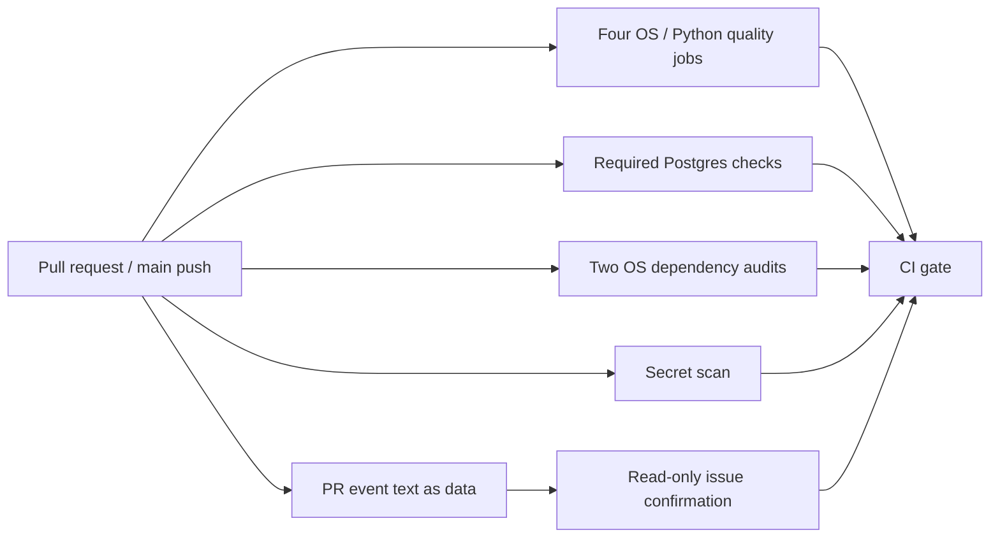

# Code study: hosted CI, audits and contribution evidence

F5 #14 / PR #70, based on merged F4 main d3f783c. This chapter explains the additional root tool and workflow/contribution configuration. Core source is pinned to b9a3d4c; the later disposable forbidden-import controls are test evidence, not delivered runtime files. Read [CI operations](ci.md), CONTRIBUTING.md and Build Book Entry 12 alongside the root [study guide](../CODE_STUDY_GUIDE.md).

## Execution and trust

For an invented PR body containing `Refs #14` and three evidence sections, the PR job checks out the merge-tested source with credential persistence disabled. setup-python selects 3.13 for the metadata helper; no project installation is needed because ci_checks.py uses the standard library. The helper reads GitHub's event JSON, validates the target repository and body, extracts the one primary issue, verifies substantive template sections and makes one authenticated GET to a fixed GitHub API endpoint. It accepts an issue, rejects a PR reference and prints only its number. PR-controlled text stays inside parsing; even a body containing shell-like characters is never executed or appended to a command.

The four quality cells install their specific interpreter and set UV_PYTHON explicitly. uv would otherwise respect .python-version and make the matrix label misleading. Each job asserts/prints the actual interpreter, then calls the same dev.py check order: lock, lint, format-check, types, imports, test. Nonzero status stops that child/job. The fake example still labels itself synthetic/offline_fake; build exercises all six distributions. The matrix's fail-fast=false collects every platform result rather than hiding the other cells after the first failure.

Postgres is a required Ubuntu job using the existing db-check command and pinned Compose image. Ordinary tests intentionally exclude its integration directory; this required job explicitly invokes it. It is not a skipped optional check on a machine without Docker. Two dependency jobs cover active Linux/Windows requirements, including platform markers. Gitleaks checks the fetched history/range using a pinned action/tool and reports failure without automatic PR comments or findings uploads.

CI gate uses `${{ !cancelled() }}` to run after ordinary failures while stopping on workflow cancellation. A superseded run is cancelled, not converted into a new gate failure. GitHub supplies the aggregated matrix/job results as environment values. gate requires success for quality, Postgres, dependencies and secrets. On pull_request it also requires successful PR evidence; on push-main it permits only that job's deliberate skipped state. For a gate that does execute, cancelled, missing, failed or accidentally skipped required work still raises an error. This is an orchestration gate, not a case-level model-quality gate. It does not replace review, prevent an author modifying the workflow, or automatically configure protected-branch policy.

The H8 follow-up in Build Book Entry 21 changes the workflow scheduling condition after e072551; the Python gate remains pinned to the original strict implementation. The configuration check is backed by actual hosted cancellation run [38991322271](https://github.com/Protagonist01/my-production-agentic-systems/actions/runs/38991322271): workflow and gate cancelled, no failed job. Normal final-head acceptance is recorded separately on #22.

## Meaningful code blocks

File [ci_checks.py](../ci_checks.py):

| Symbol / source | Inputs and ordered behavior | Output, invariant and evidence |
|---|---|---|
| [ROOT / REPOSITORY / REQUIRED_SECTIONS, L16–18][ci-constants] | Resolve this tool's checkout; fix the allowed API repository; declare the three template headings. | Caller directory does not change the audit root. Event text cannot redirect an authenticated API request to another host/repository. |
| [validate_pr, L21–51][ci-validate-pr] | Require a PR mapping with a valid base-repository mapping; require string body; match positive `Refs #n` lines; require one unique primary issue; slice ## sections; reject too-short or unchanged placeholder sections. | Returns an integer issue ID or ValueError. Duplicate mentions of the same ID still identify one primary task; two different primary IDs fail. This validates structure, not truth of prose or business acceptance. Tests vary missing/multiple issue, empty evidence and wrong repository, plus shell-like body text. |
| [confirm_issue, L54–67][ci-confirm-issue] | Build one HTTPS request to the fixed repository's issues endpoint with a read-only token; parse the response inside a closed HTTP context; reject a mismatched number or pull_request field. | Network/permission/collection errors fail the command. It does not write issues/comments or require a provider key. The hosted PR job passed on the negative-control runs. |
| [gate, L70–76][ci-gate] | Compare each required job with literal success; allow PR skipped only for a non-PR event. | Any required failure/skipped/cancelled/missing value raises. Tests cover those values and both PR/main event paths; deliberate hosted imports also made the gate fail. |
| [audit, L79–122][ci-audit] | Find uv; create an ignored artifact path; export the exact locked all-workspace/all-group third-party requirements with hashes, omitting local distributions; fail export/empty output; run strict pip-audit using the same environment, hashed input and no pip resolution. | Return the actual subprocess exit status. No auto-fix, advisory-ID suppression or fallback success. Export failure returns 17 in an isolated test without reaching the auditor. Hashes preserve locked package identity but do not prove absence of malicious package behavior. |
| [main / module guard, L125–159][ci-main] | Parse audit/pr/gate commands and permitted event-file option; use GITHUB_EVENT_PATH or explicit file; require a token for issue confirmation; collect job result environment for gate; return errors nonzero. | Unknown/wrong options fail. Errors are visible; the token is never printed. Job-result environment is trusted GitHub orchestration data, not an attestation against a hostile workflow author. |

dev.py adds ci_checks.py to lint/type scope, maps audit through the same locked/all-packages/copy uv invocation and retains the original six offline CHECKS. Audit is separate because it queries public advisory services; it is not disguised as an offline provider-free unit test. All inherited child failure propagation stays intact.

Workflow [.github/workflows/ci.yml](../.github/workflows/ci.yml) defines ten actual jobs after matrix expansion: four quality, one Postgres, two dependency audits, secret scan, PR metadata and final gate. Push-main intentionally omits only PR metadata. Per-job timeouts and concurrency cancellation bound stalled/superseded work. No continue-on-error, path-filter bypass, provider credentials or pull_request_target trigger is configured. All external uses entries are full resolved commit SHAs. The workflow tests also check interpreter/matrix and fail-open configuration boundaries; hosted evidence is stronger than this static test.

CODEOWNERS maps the shared command/helper, root dependency/lock, workflow, contract/evaluation, migration and journal paths to the integrator. The PR template uses Refs instead of automatic closing keywords and requires behavior, evidence and limitations. These are maintenance/review conventions, not independent review enforcement; a repository owner must still inspect CI and acceptance before merging.

## Decisions, limitations and safe changes

One command map avoids a separate Bash/PowerShell check implementation. Cost: uv/tool installation remains necessary; matrix jobs must explicitly select the interpreter. Separate audit jobs use public advisory networking and can fail on outages; that is preferable to calling missing audit evidence clean. Exact package hashes make audit input reproducible; findings still depend on current advisory coverage. An additional gate gives a stable status to review/optionally require through branch policy, but does not silently change repository merge permissions.

**Design limitation:** metadata checks cannot prove the prose is accurate, establish independent review or stop a trusted owner changing the workflow. **Design limitation:** fixed repository identity supports this project; a fork used as a different standalone project must intentionally change/configure that identity. **Design limitation:** secret heuristics/history range and Python advisory coverage are incomplete, and current passes are not production security clearance. **Not assessed:** a deployed authentication surface, live model behavior, hosted provider privacy, prompt injection, production dependency/native-image advisories and full supply-chain attestation.

Keep the unresolved original snapshot race, response-route agreement gap and fake state-scoring limitation visible in the root guide. CI proving the supplied tests pass does not resolve those findings. Real model release gates need independent cases, complete outcomes, required-case/critical-violation rules and approved baselines; do not derive them from the invented uppercase example.

## Evidence and interview exercises

Local Windows/Python 3.13.4/uv 0.11.1: 77 offline tests including thirteen CI boundary cases, eight strict typed source files, Ruff/import/lock checks, six builds and a hashed dependency audit passed. Merged F4 baseline separately passed eleven Postgres tests. Hosted negative run 38640533520 verified the actual forbidden Olist→CFPB import and all four quality/gate failures. Other required jobs passed. The removed probe is absent from the intended final diff; [Clean hosted run 38641578564](https://github.com/Protagonist01/my-production-agentic-systems/actions/runs/38641578564), head 9cbc8ad, passed all ten jobs. Latest documentation-head evidence is maintained in the CI runbook/PR.

- Explain why a job labelled Python 3.12 is not evidence until the interpreter selection/assertion is shown.
- Trace a skipped Postgres result into gate: it fails even if ordinary tests are green. Contrast the one intended PR-job skip on main.
- Put an extra `Refs #13` line into an invented PR event for #14: expect structural rejection. Put command-substitution text in the body: it remains data.
- Ask why dependency/secret passes cannot cancel a broken import or missing required case. Each required result must succeed; model case-level gates remain separate.
- Describe the first negative-control lesson: mypy stopped the harness probe before imports. The second control exercised the architecture stage without suppressing types.
- Add a new required workflow job: add it to needs, result environment, gate validation, tests and these docs together. Do not make it optional merely to turn the gate green.

Verified configuration/test sources: [workflow][ci-workflow], [CODEOWNERS][ci-owners], [PR template][ci-template], [CI boundary tests][ci-tests].

[ci-validate-pr]: https://github.com/Protagonist01/my-production-agentic-systems/blob/b9a3d4c148866bef8ee57d92be568cd5c25d3aac/ci_checks.py#L21-L51
[ci-confirm-issue]: https://github.com/Protagonist01/my-production-agentic-systems/blob/b9a3d4c148866bef8ee57d92be568cd5c25d3aac/ci_checks.py#L54-L67
[ci-gate]: https://github.com/Protagonist01/my-production-agentic-systems/blob/b9a3d4c148866bef8ee57d92be568cd5c25d3aac/ci_checks.py#L70-L76
[ci-audit]: https://github.com/Protagonist01/my-production-agentic-systems/blob/b9a3d4c148866bef8ee57d92be568cd5c25d3aac/ci_checks.py#L79-L122
[ci-constants]: https://github.com/Protagonist01/my-production-agentic-systems/blob/b9a3d4c148866bef8ee57d92be568cd5c25d3aac/ci_checks.py#L16-L18
[ci-main]: https://github.com/Protagonist01/my-production-agentic-systems/blob/b9a3d4c148866bef8ee57d92be568cd5c25d3aac/ci_checks.py#L125-L159
[ci-workflow]: https://github.com/Protagonist01/my-production-agentic-systems/blob/d5531a1947ff7b488309191b79cb97c2e2b845d6/.github/workflows/ci.yml#L1-L157
[ci-owners]: https://github.com/Protagonist01/my-production-agentic-systems/blob/b9a3d4c148866bef8ee57d92be568cd5c25d3aac/.github/CODEOWNERS#L1-L10
[ci-template]: https://github.com/Protagonist01/my-production-agentic-systems/blob/b9a3d4c148866bef8ee57d92be568cd5c25d3aac/.github/PULL_REQUEST_TEMPLATE.md#L1-L16
[ci-tests]: https://github.com/Protagonist01/my-production-agentic-systems/blob/0f3e75681cbd08206a0435a40ce805470edeebe0/tests/test_ci_checks.py#L1-L129
