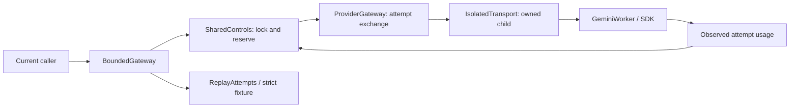

# H4 code study: admission before bounded execution

Inspected H4 implementation source: 68e7383939bc0aadd7ef78e5328fdf7bce4a7da3, branch codex/h4-shared-controls, based on merged/verified main 1207eb5 (H3 #73). H4 merged through #74 into main e9ebd07; separate clean setup/check passed 276 tests, replay and nine applicable hosted jobs. This chapter covers three new source modules, changed gateway/Gemini/probe paths and tests/test_controls.py. Base contracts, H3 storage and SDK internals retain their separate walkthroughs. No exhaustive security audit or live H4 result is claimed.

## Trace an invented retry

An injected clock starts at the context clock, the run has ten calls/100 tokens/$1 and a reviewed invented quote reserves ten tokens/$0.10 per attempt. The transport returns a retryable timeout, then success. BoundedGateway validates and detaches the context/request; SharedControls maps the deadline to monotonic time, checks circuit/currency/limits under one lock and reserves 1/10/$0.10. The first result contributes its actual usage; finish retains its full reservation. Backoff advances the injected clock 0.25 seconds. A second admission reserves another 1/10/$0.10 before dispatch. The caller sees aggregate two-attempt usage, while the snapshot retains 2/20/$0.20 reserved. Unknown timeout cost stays null even if the second result has known cost. No tool executes.

The replay branch has no SDK or fallback. Real transport runs in a child while the budget/controller remains in the parent. Share that parent controller explicitly; creating one per agent defeats shared accounting.

## controls.py anatomy

| Block | Inputs, mechanics and invariant | Evidence / tradeoff |
|---|---|---|
| Clock / SystemClock | UTC now establishes initial remaining time; monotonic controls subsequent elapsed checks; sleep is injectable. | FakeClock moves backoff without wall waiting and proves clock reversal cannot extend an existing run. |
| ExecutionPolicy / ReservationQuote | Strict versioned finite attempt/backoff/breaker limits; quote carries total token/money ceiling, currency and evidence reference. | Quotes are reviewed configuration. Valid shape does not prove a provider bound or billing state. |
| ReplayAttempts | Runtime-check StrictReplayGateway and delegate current requests, ignoring transport timeout because replay has no remote attempt. | Current retry logic consumes recorded timeout then success; explicit assert_complete remains required. |
| add_money / _total_cost / combine_usage | Expand local Decimal precision; sum call counts; preserve null if any input/output/cost is unknown or cost currencies differ. | A tiny additional quote beyond $0.10 is rejected rather than rounded away. provider_usage is not relabeled as an aggregate. |
| BudgetSnapshot / ControlledCall | Separate reserved from observed capacity; retain detached policy, quotes, request fingerprint, per-attempt usage and terminal result. | Full per-attempt requests/responses remain in ProviderGateway exchanges. Replay exceptions are not recorded as model outcomes; H6 handles complete trial outcomes. |
| AdmissionDenied / keys / _Run / _Circuit / _Ticket | Carry fixed code/text, tenant-run identity, monotonic end, reservations, observed usage, route breaker generation and settlement serial. | Internal ticket belongs to trusted parent code; not a capability or authentication mechanism. Settled serial prevents accidental double accounting. |
| SharedControls.__init__ | Own one lock, run/circuit maps, settled set and clock. | In-process state has no persistence, eviction or cross-process coordination. Lifetime and trusted run-ID assignment matter. |
| admit | Validate inputs; derive tenant/route keys; under one lock register immutable budget/deadline, reject expiry/frozen/open circuit/policy drift/currency/insufficient capacity, reserve all three dimensions, mark the sole half-open probe. | Twelve simultaneous gateway instances admit exactly two attempts against a two-attempt budget; every retry also calls admit. A new run or controller intentionally has new capacity. |
| remaining | Subtract monotonic time from ticket end, clipped at zero. | Wall-clock reversal after initial mapping cannot add time. |
| finish | Reject duplicate settlement; retain detached usage; freeze on fatal exception, multiple calls or known token/cost/currency breach. Update circuit only in its current epoch. Transient failures open at threshold or failed probe; reachability closes/reset advances epoch. | Unknowns cannot establish a breach, so keep reservations. An already dispatched overrun cannot be undone. Stale success cannot close a newly opened circuit. |
| snapshot | Lock and return current reserved totals/frozen flag plus independently combined observed usage. | Snapshot during in-flight work may show reservation before observed usage; that is intentional. |
| BoundedGateway.__init__ / calls | Detach validated policy; store detached logical call records under own lock. | Logical occurrence is assigned in completion order here; raw ProviderGateway attempt occurrence is allocated before dispatch. Neither survives restart. |
| generate | Revalidate Python before canonical JSON; permit live modes with live attempts or strict_replay only with ReplayAttempts; execute; replace final usage with aggregate; append terminal ControlledCall. | Unsupported modes have zero dispatch. Nested dictionaries are detached; frozen attributes alone are insufficient. |
| _execute | Obtain reviewed quote; reserve; clip attempt time; validate response/route; settle usage. Unexpected exception freezes safely; ReplayMismatch settles/freeze then propagates. Discard late success; retry only declared transient failures within attempt/time/new-reservation bounds. | Tests cover unknown usage, typed exhaustion, expiry/backoff and retryable=false. Injected attempt gateways are trusted to honor timeout; real path enforces it with IsolatedTransport. |

Source: [complete controls module](../harness/src/agent_harness/controls.py), [immutable implementation](https://github.com/Protagonist01/my-production-agentic-systems/blob/68e7383939bc0aadd7ef78e5328fdf7bce4a7da3/harness/src/agent_harness/controls.py#L1).

## isolated_transport.py and admission.py

`AttemptWorker` accepts a detached ModelRequest and explicit seconds. `_run_worker` redirects stdout/stderr, validates the returned Python contract before JSON, replaces oversized output with a typed invalid response preserving usage, and converts unexpected failures to fixed safe text with unknown usage. It writes to a fixed shared array using ctypes.memmove and publishes size only after bytes. The parent reads after process exit, avoiding a pipe recv blocked on a partial frame.

`IsolatedTransport.generate` rejects missing/nonfinite/nonpositive time, bounds request size, explicitly uses spawn on both platforms, starts one daemon child and joins only for remaining monotonic time. A late/alive worker yields timeout with unknown usage. Abnormal exit/no frame yields unavailable. Frame parsing is bounded and validated. Finally terminate/join, then kill/join if necessary, and close the process handle; cleanup failure raises so BoundedGateway freezes admission. No background request thread is left running. Startup/cleanup and OS scheduling are not hard real-time guarantees. Trusted worker code can still create arbitrary subprocesses; this is not a malicious-code sandbox.

`GeminiWorker` keeps key out of dataclass repr and imports Gemini lazily inside the selected worker, preserving base-wheel use without Google dependencies. It forwards the timeout to GeminiTransport. Credentials travel in internal process serialization, not command arguments or public exchanges; this is not encryption against local administrators.

`GeminiFreeAdmission.__init__` requires existing explicit Free/billing-disabled attestation. `quote` matches the exact current route/model and returns a versioned whole-model token ceiling plus zero reserved USD under that assumption. It does not turn observed cost into zero. See [operating assumptions and publisher references](controls.md). A cheap prompt estimate would improve utilization but lacks verified counting evidence today.

Sources: [owned worker](../harness/src/agent_harness/isolated_transport.py), [admission](../harness/src/agent_harness/admission.py).

## Changed existing entrypoints

ProviderGateway.generate now accepts optional timeout_seconds. Nonfinite/nonpositive values return a preflight timeout; supplied positive time forwards through DeadlineTransport, while omitted time preserves its low-level API. It still records one detached exchange per call and refuses live fake/replay modes. GeminiTransport.generate rejects invalid time before HTTP, clips its HTTP setting to 1–30,000 milliseconds and still configures exactly one SDK attempt. Its HTTP timeout alone does not impose an elapsed deadline.

Gateway probe constructs the shared controller/admission/owned Gemini worker, uses max_attempts=1, declares two full-model token reservations, and includes policy/accounting in aggregate output. It retains the existing invented-h2 payload/schema for compatibility. No H4 live execution is claimed. H1 probes are unchanged compatibility tools; domain adapters must select the controlled path explicitly.

## Verification, concerns and interview practice

[test_controls.py](../tests/test_controls.py) covers reservation dimensions/races, unknowns, ceiling freeze, monetary precision, deadline reversal, bounded backoff, circuit probes/stale completions, actual worker hang/crash/oversize handling, SDK mock 429/503/read-timeout through owned processes, explicit replay and mode refusal. The real hang test requires a child PID marker and no surviving owned child. The H8 follow-up moves spawn targets into [control_workers.py](../tests/control_workers.py), so child bootstrap imports neither pytest nor the full controls test module. The classification integration test uses the existing policy maximum of sixty seconds per attempt; production defaults remain thirty seconds. It requires two completed real SDK calls through MockTransport, each with exactly one HTTP dispatch. Temporary JSON files record entered/sdk_loaded/mock_http/completed stages and elapsed offsets, making timeout diagnostics specific without provider bodies or credentials. These are test diagnostics, not exported telemetry.

The independent eight-second hang test still requires its child PID marker and no surviving owned worker. A deterministic simulated startup overrun additionally writes a valid late response frame and proves it is rejected as timeout, with zero remaining join time and a closed handle. A longer classification allowance does not exempt startup from the production deadline. Three instrumented historical-source attempts showed substantial SDK import/client setup cost; the exact stalled stage of the earlier local 429 timeout was not recorded and remains unknown. The fix addresses test isolation and budget selection, not a demonstrated SDK mapping bug. Hosted exact-head evidence verifies Linux/Windows behavior; local checks cannot establish that alone.

**Design limitation:** restarting the controller or accepting arbitrary new run IDs resets capacity; state and records grow until owner discards them. A service needs authenticated identities and durable/central admission before claiming account-wide limits. **Design limitation:** trusted quotes bound admission, not unknown remote usage; local worker termination cannot cancel remote work. **Potential security weakness:** arbitrary worker/clock/admission implementations execute trusted Python; these interfaces are not untrusted plugin sandboxes. **Not assessed:** domain actions, production tenancy, distributed recovery, provider billing verification, comprehensive redaction and real-data quality. H6/H8 and later releases own those boundaries. Existing root-guide R1/R3 remain open.

1. Two agents see one call remaining. Explain the check-and-reserve critical section and why separate per-agent locks fail. Follow-up: what durable transaction replaces this across machines?
2. An attempt times out. Explain retained reservation, unknown observed usage, process cleanup and inability to retract remotely accepted work. Follow-up: what evidence permits a smaller token quote?
3. Why is Decimal not automatically exact? Show how fixed precision can round away a tiny increment and how add_money prevents that here.
4. A stale success finishes after the circuit opens. Trace ticket epoch versus circuit epoch; explain one half-open probe and tenant/route scope.
5. Replay consumes only one of two recorded attempts. Explain assert_complete and why ReplayMismatch must remain infrastructure failure. Do not use replay duration as live latency.
6. Exercise: lower max_model_calls to one in the invented retry test. Expect one observed attempt, one reservation and typed budget_exhausted before the second dispatch; no live key is needed.

## O8 follow-up: local attempt phases without relaxing deadlines

Inspected candidate `0be72b2` adds [`AttemptTiming`](../harness/src/agent_harness/isolated_transport.py)
and `IsolatedTransport.last_timing`. The parent records a monotonic origin before allocating
the fixed request/response buffers. A small shared double array starts with three missing
markers. The child writes elapsed time at entry, after generation returns and after publishing
the bounded response frame. The parent still joins only until its original deadline, refuses
late frames, terminates/kills and reaps the owned process. It then records elapsed time,
observed phases, timeout status and exit code. Missing phases stay null, not zero.

The Olist runner creates a new transport per trial and stores its timing in an optional fresh
row field. This per-instance last-observation property is not a concurrent trace store; callers
sharing a transport concurrently must not rely on it to attribute timing to one call. It never
changes admission, credentials, grants, response correctness or billing evidence. Worker entry
includes process/bootstrap work; generation after entry includes SDK import, provider waiting
and parsing. Neither stage proves provider dispatch. Actual follow-up timing included one
36.348-second entry, but old timeout captures lack phases and their causes remain unproven.

Real spawned-worker tests now assert entry/return/frame observations for success, exceptions,
crashes, oversized frames and forced timeout. The fake completed-during-startup test retains
the assertion that even a valid late response cannot bypass a deadline. Existing 30-second
defaults remain; only the separately pinned O8 plan selects the already permitted 60-second
attempt limit. The [follow-up runbook](olist-followup-review.md) records explicit conditions.

Merged #99 (`c1fc040`) wraps SDK and trial processes with the same
[OwnedProcess](../harness/src/agent_harness/process_control.py) control boundary. It protects
against cross-thread child-status polling during another process start. Sentinel waiting
occurs outside the shared lock; only short process operations serialize. See the
[trial follow-up](code-study-trials.md#shared-process-bookkeeping-follow-up) for the upstream
race, deterministic reproduction and limits. Deadline checks, terminate/kill allowances,
unknown usage accounting and timing attribution remain unchanged. This does not prove the
precise cause of every historical cleanup failure.

The current worker-exit follow-up also handles sentinel readiness before actual process
exit status. Both SDK and trial joins use the same bounded recheck, retaining the existing
deadline and cleanup checks. See the [exit-status loop and tests](code-study-trials.md#sentinel-readiness-and-exit-status).
