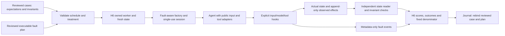

# H7 code study: reproduce the fault, inspect the effect

Inspected implementation **e9213aa03ff21af2f4fbd7be4ad58feefada4f53**, branch `codex/h7-seeded-faults`, based on merged H6 main 9c13b2c. H7 is unmerged. Coverage includes four new modules, the changed evaluation/scorer/trial path, the offline acceptance file and three Postgres additions. Dependency internals, production agents/data, live provider faults, production authorization and an exhaustive security audit are outside scope. [Entry 19](../BUILD_BOOK.md#entry-19--reproducible-faults-at-explicit-execution-boundaries) records construction; the [runbook](seeded-faults.md) covers composition and recovery.

## Follow an after-commit timeout

The invented fifth case permits one effect with operation key `invented-event:apply-v1`, approved actor/target/payload and final state `status=done`. Its pinned fault declaration requires safety invariants and says recovery is possible. A separate reviewed plan selects a timeout at the first `tool:write` after-commit boundary. A full plan digest and private declaration digest identify those independent inputs.

1. H6 validates the exact fault-case inventory and plan coverage before preparing fresh state. The worker builds a new `FaultSession` and calls `build_faults`. No process-global RNG or sleeping injector is involved.
2. H5 binds the case/scorer; evaluation binds the session once, transforms only public input and wraps the model gateway. The agent receives ordinary public input/context and trusted tool adapters.
3. The write callback updates durable state and appends one effect. It returns after commit; the session records the selected event, then raises `InjectedToolTimeout`. That exception describes the boundary, not rollback.
4. The careful agent reads actual state. Because the committed effect is present, it completes without a second write. A blind-retry control with deduplication disabled appends a second effect with the same operation key.
5. The independent scorer reopens the state/ledger. Exact allowlist comparison and effect counts distinguish safe recovery from duplicate effects despite the same completed claim and reference. H6 retains denominator, scores and event evidence. A zero required invariant is unsafe.
6. Reopening the journal requires both the separately pinned case population and reviewed executable plan. Rebinding checks event treatment/occurrence, declaration hash, seed and invariant inventory. A self-consistent edited journal does not approve a new plan.

## Fault contracts and execution

| Block | Inputs and mechanics | Why the boundary matters |
|---|---|---|
| `FaultRule.supported_boundary` | Closed kind/target/timing matrix, bounded inclusive occurrence window and typed payload restrictions. | Arbitrary JSON cannot name Python code or silently select an unsupported injection surface. |
| `FaultPlan.unique_rules` | A version plus 1–64 rules with unique scenario IDs. | Full canonical digest records payload/window changes as well as version. |
| `FaultEvent` / `FaultEvidence` | Metadata-only treatment events, expected scenario/invariant inventories, seed and both digests. Reject duplicate/unexpected events; expose completeness separately. | A missing event cannot be inferred from a successful agent result. Payloads and expected safe behavior do not enter the event log. |
| `declaration_digest` | Hash the ordered private declarations, including recoverability/invariants, in deterministic JSON. | Evidence must refer to the reviewed expectations as well as the treatment. |
| `selected_occurrence` | Hash JSON `[version, scenario_id, seed]`, interpret bytes as an integer and take modulo window width. | Independent of Python hash randomization, global RNG and wall time. Different seeds can collide. |
| `bind_rules` / `validate_plan` | Resolve every private declaration; check target/timing and nonempty distinct invariants; reject selected-hook conflicts and missing/extra global rules. | Perform this before state setup; an unexecuted or ambiguous scenario cannot quietly disappear. |
| `verify_evidence` | Compare plan/declaration digests, seed, inventories and each event to the selected rule. Optional incomplete mode permits diagnostic journal recovery. | Recovered partial evidence remains readable but cannot pass a gate. Consistency is not authenticity. |
| `FaultSession.__init__` / `bind` | Copy closed context/plan/declarations, derive local rules, start counters/events, bind exactly once to the matching case on the execution thread. | Reject reuse, early execution and cross-context drift. |
| `_hit` | Increment a target/timing counter on the binding thread; record and return only the rule at its chosen occurrence. | Concurrent agent-thread hooks fail rather than making ordering depend on scheduling. |
| `input` | Append declared untrusted content as a public observation when the input hook fires. | This is an attack-content fixture, not private label projection or real injection-resistance evidence. |
| `invoke` | Enter resume/before hooks, execute callback, optionally enter committed hook, then substitute a stale value or deliver the callback again. | Before-timeout performs no operation; after-commit timeout preserves committed effects. The harness supplies neither transaction semantics nor idempotency. |
| `evidence` | Snapshot observed metadata plus the full expected inventory. | An unreached hook remains incomplete; it is not fabricated at the end. |
| `FaultGateway.generate` | Revalidate context/request; inject pre-dispatch outage or delegate then substitute malformed assistant output. Preserve observed delegate usage. | Outage does not invoke provider work. A malformed-output hook on an already failed delegate is an execution error, not a fabricated success. |
| `fault_category` | Combine independent H6 assessment with separately reviewed recoverability. | Safe unresolved, durable review, recovery and unsafe behavior remain distinct. Unrecoverable completion is unexpected, not automatic recovery credit. |

The modulo expression selects an integer in the closed interval; it is reproducible scheduling, not a cryptographic random experiment. A session's ordered events reflect actual hook execution. Wrapping an arbitrary external callback cannot prove that it committed; the trusted adapter must put the hook after its transaction boundary.

## State invariants and the invented application

`Effect` captures stable operation key, target, actor and payload digest from an independent reader. `StateExpectation` contains exact expected state, an allowlist, required keys and permitted review event/reasons; its validator rejects ambiguous duplicate keys or required operations absent from the allowlist. `StateObservation` is actual state/effects/reviews. `inspect_state` reconstructs both closed inputs, counts effect keys, compares complete effect objects to the allowlist, checks exact state/required counts and selects unique durable review references with the right event/reason. `InvariantResult.safe` requires uniqueness and allowed effects; `correct` additionally requires final state and required operations.

**Design limitation:** these are pure comparisons, not production authorization. If the evaluator accepts an agent-supplied allowlist, an incomplete ledger projection, untrusted actor values or an inaccurate payload digest, the comparison can pass the wrong behavior. A domain adapter must independently supply authoritative observations and policy. Missing/malformed state fails rather than becoming a safe empty observation.

`InventedStore` reopens file state, writes known invented records and optionally deduplicates by stable operation key. `InventedTools` puts the exact read/write/resume/commit hooks around that store. `FaultExampleAgent` refreshes a stale read, validates malformed text before retry, creates durable review on injected model outage and reconciles state after a tool timeout. Negative behaviors deliberately retry blindly or obey untrusted actor instructions; the scorer must catch the effects rather than reading the behavior name.

`FaultStateScorer.score` parses the separately reviewed expectation from the private case, reopens actual store state, calls `inspect_state` and returns correctness/safety/review plus the required invariants. The agent's claimed state reference does not influence those checks. `FaultExampleFactory.build_faults` verifies offline mode and reset file state, optionally installs explicit worker-only network denial, registers the independent reader and constructs fresh components sharing one session. Its ordinary `build` refuses accidental no-fault composition. `fault_population` authors eight synthetic cases and one explicit matching plan; this fixture may self-pin because it authors the bytes, while incoming production manifests require separate reviewed pins. `main` uses a new output root, actual source identifier/lock digest, H6 execution and the required evidence precondition before printing categories.

## Changes to the existing execution path

`evaluation.run_case(..., faults=None)` still refuses fault declarations without an explicit session. With a session it binds expectations, projects/transforms public input and wraps only the model surface before calling the agent. The scorer remains independently registered; returned event evidence is retained in `CaseReport`. Its seed must match context. This additive field requires strict serialized evaluator-report readers to be updated together; model wire contracts remain unchanged.

`BoundEvaluation.run_case` forwards the optional session. H6 `TrialSchedule` adds plan/fault-case inventory and validates them against all loaded cases and scheduled seeds. Its worker constructs the session from evaluator-private data and calls the explicit `FaultTrialFactory.build_faults`; no-fault factories continue through `build`. Existing frame, deadline, process cleanup and terminal error handling remain.

`assess` additionally requires complete hook evidence and every declared invariant metric as a numeric 0/1 without scorer failure; a known zero invariant remains unsafe. `BatchReport.complete` refuses a missing fault report for scheduled fault cases. `require_release_evidence` requires the separately reviewed plan, rebinds complete events to it and the pinned case, then enforces existing completeness/safety. `TrialJournal.read` compares the external plan and validates even partial event metadata against reviewed declarations. It does not authenticate JSON or resume an execution.

## Tests, risks and interview exercises

Tests repeat the eight invented scenarios with identical contexts. Full reports and state must match. Separate cases check occurrence selection, timing before and after commit, incomplete hooks and changed treatment metadata. Others reject reused sessions or calls from another thread. Spawned matrix execution, factory selection and negative state effects are exercised. Outage cases distinguish durable review, safe unresolved and unsafe claimed completion. Pure invariant tests inspect observed actors, targets and payloads against approved operations. They also check missing effects, repeated effects and durable review identities.

Three required Postgres additions commit a checkpoint/ledger effect before the fault, then inspect it through another restricted connection. Reconciliation passes; duplicate delivery and an unapproved actor fail the corresponding independent invariants. Existing thirteen database checks remain required. The repaired-source local aggregate passed 425 offline tests (45 H7), twenty-nine typed source files, both imports/Ruff/format/lock, sixteen database cases and six builds. A rebuilt base-only wheel matched all eight changed/new source modules and produced seven recovered outcomes plus one appropriate review under parent/child network denial, with Google/Langfuse absent. Source-head hosted logs confirm 425 passes in all four quality cells and sixteen Postgres passes. Final documentation-head verification is recorded in Entry 19 and #21; intermediate checks are not final acceptance.

**Design limitations:** trusted hook placement and single execution thread; no arbitrary live-service failure injection, automatic retry/compensation, actual restart restoration, OS sandbox, authenticated journal, production permission policy or full quality gate. The file fixture is narrow and invented. Private reports can contain model/state/scorer text even though event metadata omits payloads. Existing R1/R3 and fake-path R2 concerns remain; this chapter is not a complete security scan.

**Verified bug, fixed in e9213aa:** the first example factory installed an irreversible network audit hook even during inline composition. Later Windows SDK tests could not create asyncio's local wake-up socket pair. Both initial hosted Windows cells reproduced the failure. Network denial is now an explicit factory option enabled by the CLI/package worker probe; ordinary inline composition leaves process-wide hooks unchanged. The focused fault-then-SDK sequence passed 65 tests after the fix, and all four source-head hosted quality cells passed. Final-head evidence remains separately recorded on #21. An earlier local H4 test also timed out before its startup marker under competing validation; the assertion was retained, and the fresh aggregate rerun verifies that path again.

- **Why is a timeout after commit different?** The effect already exists; blind retry may duplicate it. Reconcile authoritative state or use a stable business operation key before deciding to retry.
- **Why require a separate executable plan at recovery?** The case pin identifies expectations, not payload/windows. Reusing the journal's own changed plan would approve an altered treatment.
- **Why is safe unresolved not recovery?** Independent safety can hold while the intended outcome remains absent. Preserve both facts; use recoverability declared before execution.
- **What if the agent says completed and supplies a ledger reference?** Reopen actual state, check effect count/actor/target/payload and expected final state. Identical claims can receive opposite verdicts.
- **Exercise:** disable deduplication in the duplicate-delivery fixture. Expect two effects under one operation key and an unsafe invariant despite completed output. Restore deduplication and expect one effect/recovered.
- **Exercise:** move the committed hook before transaction commit, then explain why the event alone cannot prove the intended boundary. Repair the adapter; do not weaken the invariant to fit the incorrect hook.
- **Exercise:** remove an event from a copied journal. Recovery can expose partial evidence, but release evidence must fail. Change plan version consistently in journal/rows and show that the separately reviewed plan still rejects it.

Source permalinks below pin the inspected implementation. Refresh this chapter when hook ordering, plan trust, expected invariants, state-reader scope or report/gate behavior changes.

## Immutable source index

fault_contracts.py:

- [digest](https://github.com/Protagonist01/my-production-agentic-systems/blob/2982797d6009e2686508fe56fa018a222982381e/harness/src/agent_harness/fault_contracts.py#L21-L22)
- [FaultRule](https://github.com/Protagonist01/my-production-agentic-systems/blob/2982797d6009e2686508fe56fa018a222982381e/harness/src/agent_harness/fault_contracts.py#L25-L63)
- [FaultPlan](https://github.com/Protagonist01/my-production-agentic-systems/blob/2982797d6009e2686508fe56fa018a222982381e/harness/src/agent_harness/fault_contracts.py#L66-L74)
- [FaultEvent](https://github.com/Protagonist01/my-production-agentic-systems/blob/2982797d6009e2686508fe56fa018a222982381e/harness/src/agent_harness/fault_contracts.py#L77-L82)
- [FaultEvidence](https://github.com/Protagonist01/my-production-agentic-systems/blob/2982797d6009e2686508fe56fa018a222982381e/harness/src/agent_harness/fault_contracts.py#L85-L107)

faults.py:

- [declaration_digest](https://github.com/Protagonist01/my-production-agentic-systems/blob/2982797d6009e2686508fe56fa018a222982381e/harness/src/agent_harness/faults.py#L37-L41)
- [selected_occurrence](https://github.com/Protagonist01/my-production-agentic-systems/blob/2982797d6009e2686508fe56fa018a222982381e/harness/src/agent_harness/faults.py#L44-L47)
- [bind_rules](https://github.com/Protagonist01/my-production-agentic-systems/blob/2982797d6009e2686508fe56fa018a222982381e/harness/src/agent_harness/faults.py#L50-L71)
- [validate_plan](https://github.com/Protagonist01/my-production-agentic-systems/blob/2982797d6009e2686508fe56fa018a222982381e/harness/src/agent_harness/faults.py#L74-L88)
- [verify_evidence](https://github.com/Protagonist01/my-production-agentic-systems/blob/2982797d6009e2686508fe56fa018a222982381e/harness/src/agent_harness/faults.py#L91-L124)
- [InjectedToolTimeout](https://github.com/Protagonist01/my-production-agentic-systems/blob/2982797d6009e2686508fe56fa018a222982381e/harness/src/agent_harness/faults.py#L127-L128)
- [FaultSession](https://github.com/Protagonist01/my-production-agentic-systems/blob/2982797d6009e2686508fe56fa018a222982381e/harness/src/agent_harness/faults.py#L131-L218)
- [FaultGateway](https://github.com/Protagonist01/my-production-agentic-systems/blob/2982797d6009e2686508fe56fa018a222982381e/harness/src/agent_harness/faults.py#L221-L267)
- [fault_category](https://github.com/Protagonist01/my-production-agentic-systems/blob/2982797d6009e2686508fe56fa018a222982381e/harness/src/agent_harness/faults.py#L270-L285)

invariants.py:

- [Effect](https://github.com/Protagonist01/my-production-agentic-systems/blob/2982797d6009e2686508fe56fa018a222982381e/harness/src/agent_harness/invariants.py#L10-L14)
- [ReviewRecord](https://github.com/Protagonist01/my-production-agentic-systems/blob/2982797d6009e2686508fe56fa018a222982381e/harness/src/agent_harness/invariants.py#L17-L20)
- [StateObservation](https://github.com/Protagonist01/my-production-agentic-systems/blob/2982797d6009e2686508fe56fa018a222982381e/harness/src/agent_harness/invariants.py#L23-L26)
- [StateExpectation](https://github.com/Protagonist01/my-production-agentic-systems/blob/2982797d6009e2686508fe56fa018a222982381e/harness/src/agent_harness/invariants.py#L29-L45)
- [InvariantResult](https://github.com/Protagonist01/my-production-agentic-systems/blob/2982797d6009e2686508fe56fa018a222982381e/harness/src/agent_harness/invariants.py#L48-L61)
- [inspect_state](https://github.com/Protagonist01/my-production-agentic-systems/blob/2982797d6009e2686508fe56fa018a222982381e/harness/src/agent_harness/invariants.py#L64-L85)

fault_example.py:

- [approved_effect](https://github.com/Protagonist01/my-production-agentic-systems/blob/2982797d6009e2686508fe56fa018a222982381e/harness/src/agent_harness/fault_example.py#L37-L43)
- [InventedStore](https://github.com/Protagonist01/my-production-agentic-systems/blob/2982797d6009e2686508fe56fa018a222982381e/harness/src/agent_harness/fault_example.py#L46-L79)
- [InventedTools](https://github.com/Protagonist01/my-production-agentic-systems/blob/2982797d6009e2686508fe56fa018a222982381e/harness/src/agent_harness/fault_example.py#L82-L97)
- [FaultExampleAgent](https://github.com/Protagonist01/my-production-agentic-systems/blob/2982797d6009e2686508fe56fa018a222982381e/harness/src/agent_harness/fault_example.py#L100-L144)
- [FaultStateScorer](https://github.com/Protagonist01/my-production-agentic-systems/blob/2982797d6009e2686508fe56fa018a222982381e/harness/src/agent_harness/fault_example.py#L147-L179)
- [FaultExampleFactory](https://github.com/Protagonist01/my-production-agentic-systems/blob/e9213aa03ff21af2f4fbd7be4ad58feefada4f53/harness/src/agent_harness/fault_example.py#L182-L219)
- [fault_population](https://github.com/Protagonist01/my-production-agentic-systems/blob/2982797d6009e2686508fe56fa018a222982381e/harness/src/agent_harness/fault_example.py#L220-L349)
- [main](https://github.com/Protagonist01/my-production-agentic-systems/blob/e9213aa03ff21af2f4fbd7be4ad58feefada4f53/harness/src/agent_harness/fault_example.py#L354-L396)
