# H2 gateway code walkthrough

Inspected source: **4b33c3c0ce242a4f4553840c6ffb79d97338e095**, branch codex/h2-gemini-gateway, based on verified main 0a859bb. H2 is merged/verified through #72 on main 9282d87; the linked source remains the exact H2 implementation. H3 recording/replay is explained in its [own chapter](code-study-replay.md). Model request/message/response/tool calls and serializer are v2; other contracts remain v1.

Read [the runbook](gateway.md) for installation, migration and acceptance evidence; Build Book Entry 14 records construction and failures. This chapter covers every meaningful block in gateway.py, gemini.py, gateway_probe.py and the 54 new cases. Unchanged runtime/evaluation/Postgres/CI code is explained by the root guide and its other chapters. SDK/server internals, production deployment/security, durable replay and domain applications remain outside this inspection.

## Follow one invented call

```mermaid
flowchart LR
    D[dev.py gateway-live] --> P[Invented probe + code/lock identity]
    P --> G[ProviderGateway]
    G --> V[Python revalidation then canonical JSON copy]
    V --> O[Allocate scoped occurrence]
    O --> M{Live mode?}
    M -->|no| F[Typed failure, zero dispatches]
    M -->|yes| T[GeminiTransport]
    T --> R[Validate route, parameters, schemas and history]
    R --> S[One pinned SDK request]
    S --> H[Strict HTTP JSON/token types]
    H --> C[Validate candidate, ordered parts and schemas]
    C --> B[Typed output or failure + usage]
    B --> I[Gateway checks returned contract and route]
    I --> E[Detached per-occurrence exchange]
```

Take a request for the invented order. The probe builds an explicit ModelRequest and a fresh_candidate context containing no evaluation labels. The gateway validates the **Python object before serializing it**: otherwise a mutated nested NaN can become JSON null. It allocates occurrence 1, supplies a detached request to the transport, and captures the original request regardless of later transport mutation. Mode rejection records a failure without calling the transport.

GeminiTransport accepts only the selected Developer API route. It validates parameters and schemas, disables hidden SDK retry/continuation/tool execution, then dispatches once. A function proposal becomes an assistant message with ordered text/call parts and the original opaque signature. The caller appends an invented tool result to that unchanged message. The next request's fingerprint covers that history and gets occurrence 2. No lookup function is executed by the SDK or gateway; the probe supplies a fixed invented result. The second live response must validate as the expected case/answer JSON.

## Contract and gateway anatomy

| Block | Inputs, mechanics and reason | Verification / limitation |
|---|---|---|
| [ToolCall, ModelPart and ModelMessage][parts] | Local call ID is separate from optional provider ID. Ordered parts retain text or a function call, optional thought status and canonical-base64 signature. Public content is joined non-thought text; public calls must match ordered parts exactly. | Reject invalid base64 and changed public projection. Signatures are opaque data, not decoded reasoning. Generic contracts check shape; the provider validates history semantics. |
| [ModelRequest and ModelResponse][models] | Model schemas and serializer are version 2; runtime/usage remain version 1. Fingerprint covers the full canonical request. Response carries requested alias, actual reported revision/request ID, typed output/failure and raw provider usage. | Old version-1 model records fail. No durable migration exists yet. Explicit model revision is checked; alias equality does not establish immutable weights. |
| [failed_response][failed] | Build an assistant-free model-stage failure, preserving supplied known usage or using model_calls 0/1 with unknown tokens/cost. Retryability describes the class; it executes no retry. | Fixed diagnostic text excludes exception/request/key contents. Known usage survives invalid output. |
| [ModelTransport and ModelExchange][exchange] | A transport takes only ModelRequest. Exchange retains the full context, positive occurrence, request and response; identity combines run/tenant/agent/case/trial, occurrence and request fingerprint. | Three identical requests across two trials have occurrences 1/2/1, distinct identities and separate answers. Context is provenance, not authorization. |
| [ProviderGateway.__init__ and exchanges][state] | Own transport, a lock, scoped counters and private JSON records. Reading exchanges reparses JSON, so mutating a returned nested dictionary cannot alter stored evidence. | In-memory only; a new instance starts again. Completion order may differ from occurrence order. Memory retention is bounded by caller lifetime, not an eviction policy. |
| [ProviderGateway.generate][dispatch] | Revalidate Python objects, copy canonical JSON, reserve occurrence under lock, reject fake/replay or dispatch one separate copy, revalidate response before serialization, then check route/revision and store a detached exchange. | Tests cover mode rejection, route/revision mismatch, mutable transport input and concurrent allocations. Caller contract errors raise before allocation; invalid returned contracts become typed failures. Unexpected programming exceptions still propagate and can leave an occurrence gap. |

The initial snapshot implementation copied JSON first. A safe repro mutated `request.parameters["temperature"]` to NaN: model_dump_json emitted null, but Python revalidation rejected it. The correction makes order part of the dispatch invariant. Two regression cases reject NaN/infinity before any transport call. This is distinct from freezing attribute assignment; neither frozen models nor type hints make nested dictionaries immutable.

## Gemini transport anatomy

| Block | Execution and invariant | Failure / evidence |
|---|---|---|
| [GenerationParameters][params] | Strict, finite parameter model; reject unknown keys/coercion, limit max output to 1–512, pin LOW thinking. The adapter supplies versioned defaults for omitted fields and one candidate. | Coerced strings/booleans, unknown options and excessive caps fail before dispatch. Context seed is not implicitly a generation seed. Changing translation defaults requires serializer review. |
| [json_value][json] | Parse JSON with duplicate-key and NaN/Infinity rejection, then reject overflow-created non-finite values through allow_nan=False. Values remain data. | Malformed/duplicate JSON cannot quietly overwrite earlier fields or become valid model output. |
| [validate_http_response][http] | On successful HTTP status, read/parse the body and require nonnegative integer token fields before SDK conversion. Non-success statuses continue to the SDK's API error classification. | Regression cases reject boolean/string counts. No missing count is guessed from another field. Body/exception text is never emitted by this callback. |
| [schema_validator][schema] | Require the supported schema dialect and local reference fragments, check schema shape, use an empty referencing Registry. Returned validator checks output/tool arguments without coercion. | Local $defs work. External references fail before dispatch; no HTTP/file fetch is configured. Format keywords remain annotations. Provider dialect support can be narrower than local JSON Schema. |
| [sdk_part][sdkpart] | Translate retained parts back to SDK text/function objects, decode the signature bytes exactly and send a provider ID only if the provider supplied one. | The real SDK mock round trip compares ordered wire parts and function-result IDs. Generated local correlation IDs are not fabricated provider IDs. |
| [request_payload][payload] | Enforce the one route, build typed generation settings, declarations/choice/schema, retain ordered conversation content, move only leading system text into ordered instruction parts. Track pending/used call IDs; bind each tool result to its name and JSON object. Group parallel results in their received order. | Developer/late-system roles, orphan/duplicate/missing results, unknown tool choices and function history without retained parts fail. Unsupported semantics are refused rather than flattened into user text. |
| [response_usage][usage] | Retain prompt, candidate, thinking, cached-input and total counts. Input is full prompt count; aggregate output is visible plus thinking only when both are known. Currency/cost remain null. | Missing thinking makes aggregate output unknown. Cached counts are not subtracted speculatively; raw totals are not substituted for output. Attempt count is one even for a dispatched error. |
| [parse_response][parse] | Require exactly one STOP candidate with model role and supported parts. Validate declared function names/arguments and choice, unique call IDs, public projection and requested JSON output. Retain ordered signed parts, reported revision/ID and usage. | Blocked/truncated/ambiguous/multimodal output fails. Tool/schema content is validated, not executed or authorized. Streaming/continuing functions are excluded. |
| [GeminiTransport][transport] | Constructor requires a key and Free-project attestation. Each generate validates preflight, creates a fixed-route client with one attempt/30-second HTTP timeout, disables Enterprise/Vertex, proxy inheritance, redirects and automatic continuation/function execution, and closes it. Classify API/HTTP/timeout/wire/content failures using fixed messages. | HTTP 429/503/timeout are retryable classifications only; one mock request is observed. All output errors keep safe known evidence. This is not an end-to-end deadline, shared budget, fallback router or production transport/privacy audit. |

SDK defaults deserve tests: mypy passed a nonexistent configuration type because the SDK module has a dynamic attribute fallback. The first run failed at runtime; inspecting the actual field showed automatic_continuation is a boolean. The corrected adapter sets false. Runtime mock serialization and real two-turn evidence support the result; strict types alone did not.

## Probe, commands and tests

| Block | Mechanics and result |
|---|---|
| [GatewayAnswer/live_probe][probe] | Read only whitelisted ignored Free-project config, construct the transport/gateway and invented versioned context. Make one forced proposal, validate its arguments, append unchanged assistant parts and invented result, then require typed JSON on the second request. Print aggregate identities/known usage and signature count, never raw signatures or keys. |
| [Probe main][main] | Require root/revision, run the probe explicitly, return nonzero with a fixed permitted failure label. Raw validation text is not printed. Missing configuration fails before provider construction. |
| [dev.py main][dev] | gateway-live shares example's Git revision/dirty handling and portable locked uv subprocess; it passes the root instead of a fake-example lockfile argument. It is absent from ordinary check and hosted CI. |
| [Wire/JSON/function tests][tests-wire] | Actual pinned SDK over MockTransport, socket connects denied, schema-invalid JSON and signed function-result round trip with exact order/IDs. |
| [Error/preflight/mode tests][tests-errors] | Typed/redacted 400/401/403/408/429/503/504, read timeout/connect failures, malformed/blocked/truncated response, unsupported routes/parameters/roles/refs and fake/replay no-dispatch. |
| [Identity/state tests][tests-state] | Identical requests preserve distinct answers/occurrences across trials, detached snapshots, concurrent unique occurrences, explicit revision mismatch, model-v1 rejection and content/schema/parameter fingerprint changes. |
| [Accounting/mutation tests][tests-extra] | Local refs, unknown usage, undeclared/bad tool arguments/modalities, redirects/invalid wire, signature/part-order hashing, invalid returned contracts, missing Free confirmation, strict raw count types and mutated non-finite input. |

Final local check passed **151 cases**, including 54 new H2 cases, strict types in thirteen source files and both import contracts. Six distributions/wheels built; hashed audit found no known vulnerabilities. Isolated base-wheel import proved Google is optional; the selected extra imported the pinned SDK/schema packages. These are direct observations, not an exhaustive security audit.

The clean live observation used source 9b3af1c, before the later snapshot hardening: two requests returned the invented answer, retaining one signature, with scoped occurrences 1/2. Input counts 95/133 and visible outputs 25/19 were known; thinking/aggregate output and cost were unknown. This observation remains tied to its actual revision/lock. No domain source record, real tool or Langfuse instrumentation was added to this path. Hosted final-head evidence is maintained in the H2 PR/issue.

## Risks and interview practice

**Verified bug fixed in H2:** invalid mutated nested numbers could become null through JSON-first copying. Python-first revalidation plus NaN/infinity regressions closes this gateway path. **Design limitations:** synchronous calls, private unbounded in-memory history/counters, no restart uniqueness/durability, no global reservations/deadline enforcement and no complete unexpected-exception accounting. H3 now supplies explicit reviewed model fixtures/replay; it does not make this in-memory gateway automatically durable. H4/H6 own budget/complete attempt accounting. Model schema v2 has no automatic v1 migration.

**Potential security weakness:** trusted caller context is not tenant authorization; model-visible content/signatures remain in process memory. Transport controls prevent the supported configuration from selecting arbitrary endpoints, proxy routes or automatic tools; they do not sandbox Python code or supply production data redaction/retention. **Not assessed:** malicious production prompts/tool actions, server authentication/network deployment, provider internals, full privacy/error-path export and real-data model quality. Root guide R1/R3 remain open; R2's fake-agent weakness remains, while this gateway checks returned route/revision.

1. Why can two identical prompts have distinct recordings? Explain full request content identity versus scoped occurrence, and how H3 publishes immutable occurrences and requires complete consumption. Do not call this memory list a durable replay store.
2. Trace a signed function result. Name the ordered ModelPart, public projection, provider/local ID distinction and pending-result mapping. Explain why stripping a signature changes context.
3. Why validate before serializing? Reproduce the shallow-frozen NaN example and state the expected ValidationError/no dispatch. Then explain detached copies versus deep immutability.
4. A 503 occurs after dispatch. Explain one attempted call, unknown tokens/cost, retryability metadata and why H4 must reserve attempts/time/budget before retrying. Do not claim a 30-second HTTP setting is a global deadline.
5. A response omits thinking counts. Keep aggregate output unknown and retain visible/raw fields; do not infer zero thinking or actual free-tier charges from an estimated price.
6. To add a framework adapter, route every model call through ProviderGateway and preserve complete history/usage/errors. To add another model/parameter/default, update transport validation, wire/serializer review, tests, runbook and this guide before live use.

[parts]: https://github.com/Protagonist01/my-production-agentic-systems/blob/4b33c3c0ce242a4f4553840c6ffb79d97338e095/harness/src/agent_harness/contracts.py#L157-L216
[models]: https://github.com/Protagonist01/my-production-agentic-systems/blob/4b33c3c0ce242a4f4553840c6ffb79d97338e095/harness/src/agent_harness/contracts.py#L219-L261
[failed]: https://github.com/Protagonist01/my-production-agentic-systems/blob/4b33c3c0ce242a4f4553840c6ffb79d97338e095/harness/src/agent_harness/gateway.py#L19-L41
[exchange]: https://github.com/Protagonist01/my-production-agentic-systems/blob/4b33c3c0ce242a4f4553840c6ffb79d97338e095/harness/src/agent_harness/gateway.py#L44-L64
[state]: https://github.com/Protagonist01/my-production-agentic-systems/blob/4b33c3c0ce242a4f4553840c6ffb79d97338e095/harness/src/agent_harness/gateway.py#L67-L80
[dispatch]: https://github.com/Protagonist01/my-production-agentic-systems/blob/4b33c3c0ce242a4f4553840c6ffb79d97338e095/harness/src/agent_harness/gateway.py#L81-L145
[probe]: https://github.com/Protagonist01/my-production-agentic-systems/blob/4b33c3c0ce242a4f4553840c6ffb79d97338e095/harness/src/agent_harness/gateway_probe.py#L21-L129
[main]: https://github.com/Protagonist01/my-production-agentic-systems/blob/4b33c3c0ce242a4f4553840c6ffb79d97338e095/harness/src/agent_harness/gateway_probe.py#L132-L156
[dev]: https://github.com/Protagonist01/my-production-agentic-systems/blob/fbf0d80a4d450ab9de27b325108613b9fdc497c5/dev.py#L114-L220
[tests-wire]: https://github.com/Protagonist01/my-production-agentic-systems/blob/4b33c3c0ce242a4f4553840c6ffb79d97338e095/tests/test_gateway.py#L72-L164
[tests-errors]: https://github.com/Protagonist01/my-production-agentic-systems/blob/4b33c3c0ce242a4f4553840c6ffb79d97338e095/tests/test_gateway.py#L165-L260
[tests-state]: https://github.com/Protagonist01/my-production-agentic-systems/blob/4b33c3c0ce242a4f4553840c6ffb79d97338e095/tests/test_gateway.py#L263-L320
[tests-extra]: https://github.com/Protagonist01/my-production-agentic-systems/blob/4b33c3c0ce242a4f4553840c6ffb79d97338e095/tests/test_gateway.py#L323-L430
[params]: https://github.com/Protagonist01/my-production-agentic-systems/blob/4b33c3c0ce242a4f4553840c6ffb79d97338e095/harness/src/agent_harness/gemini.py#L32-L40
[json]: https://github.com/Protagonist01/my-production-agentic-systems/blob/4b33c3c0ce242a4f4553840c6ffb79d97338e095/harness/src/agent_harness/gemini.py#L43-L59
[http]: https://github.com/Protagonist01/my-production-agentic-systems/blob/4b33c3c0ce242a4f4553840c6ffb79d97338e095/harness/src/agent_harness/gemini.py#L62-L82
[schema]: https://github.com/Protagonist01/my-production-agentic-systems/blob/4b33c3c0ce242a4f4553840c6ffb79d97338e095/harness/src/agent_harness/gemini.py#L85-L106
[sdkpart]: https://github.com/Protagonist01/my-production-agentic-systems/blob/4b33c3c0ce242a4f4553840c6ffb79d97338e095/harness/src/agent_harness/gemini.py#L109-L120
[payload]: https://github.com/Protagonist01/my-production-agentic-systems/blob/4b33c3c0ce242a4f4553840c6ffb79d97338e095/harness/src/agent_harness/gemini.py#L123-L228
[usage]: https://github.com/Protagonist01/my-production-agentic-systems/blob/4b33c3c0ce242a4f4553840c6ffb79d97338e095/harness/src/agent_harness/gemini.py#L231-L251
[parse]: https://github.com/Protagonist01/my-production-agentic-systems/blob/4b33c3c0ce242a4f4553840c6ffb79d97338e095/harness/src/agent_harness/gemini.py#L254-L326
[transport]: https://github.com/Protagonist01/my-production-agentic-systems/blob/4b33c3c0ce242a4f4553840c6ffb79d97338e095/harness/src/agent_harness/gemini.py#L329-L434
