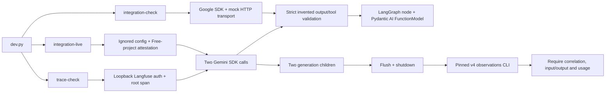

# H1 integration code walkthrough

Inspected source: ccc036efc843155818d4c591915deb13d46e2069, branch codex/h1-integration-selection, based on verified main 6e48011. H1 is unmerged. This chapter covers the two development probe modules and their test file; the runtime gateway, real framework adapters, replay, production redaction and domain quality remain unimplemented. Read the [ADR](adr/0001-first-integration.md), [command runbook](integration-smoke.md) and Build Book Entry 13 for the choices and measured evidence.

## Actual flow

For invented-h1, the JSON probe must produce exactly case_id plus answer 42. The function probe must propose one lookup_order with order_id invented-order-001. No function executes; this does not test a read/write backend or tool-result round trip. The offline model/version is explicitly invented. A live response records the actual returned model version and response ID; it must not borrow usage from the fake path or another request.

## integration_smoke.py anatomy

| Block | Inputs, execution and outcome | Boundary / related evidence |
|---|---|---|
| [Constants and strict shapes, L22–37][shapes] | Fixed free-tier candidate/endpoint/prompts; SmokeOutput permits one case and integer answer, LookupArguments one order; extra fields and coercion are rejected. | Pins make the exact small test visible. They are not domain models or an immutable provider-weight guarantee. Three JSON-negative and four tool-negative cases exercise wrong values, extras, unauthorized/missing/multiple proposals. |
| [structured, L40–54][structured] | Send JSON schema through the actual SDK with JSON MIME, 512 output cap, LOW thinking and automatic function execution disabled. Require text and parse it with SmokeOutput. | Unsupported schema, refusal/empty text or wrong answer fail. Pydantic validation establishes the requested shape/value, not broader reasoning quality. |
| [tool, L57–87][tool] | Declare lookup_order's JSON schema, force the allowed function name, disable automatic execution, then require exactly one proposal and validate its arguments. | A proposal is not an authorized effect. H2/domain tools still need full response/history translation, permissions and tool-result handling. |
| [response_evidence, L90–102][usage] | Require prompt/candidate token counts; retain returned version/ID and nullable thinking count. Monetary cost stays unknown with the Free-project attestation stated separately. | Missing token counts fail. Provider usage does not establish billing status; Langfuse price estimates also do not establish actual charges. |
| [GraphState/framework_check, L105–131][framework] | A typed graph node invokes the supplied callable and validates its output. A local FunctionModel inspects Pydantic AI's output-tool declaration and returns a ToolCallPart for that typed result; Agent validates the final output. | This exercises real installed extension seams with local invented output. It is not a GoogleModel-to-ModelGateway adapter. The graph runs one node; no durable workflow or resume is tested. |
| [offline_check, L134–181][offline] | MockTransport receives serialized SDK requests and returns invented JSON/function wire responses. Invoke both real SDK parsers; close the client; return two request count, outputs, framework result, exact installed versions and provider_access_verified=false. | Mock transport cannot prove provider schema support. A socket guard during the probe proves it does not open a provider connection; the Windows event loop's owned IPC socketpair is initialized before that guard. |
| [local_environment, L184–196][environment] | Read only named variables from process environment, otherwise parse matching .env.local lines as inert text; never execute interpolation or return unrelated fields. | Process values win. This narrow parser intentionally lacks full dotenv syntax. Ignored files protect Git publication, not access by local processes. Configured keys are never output by the command. |
| [live_check, L199–293][live] | Reject missing key/Free confirmation before a live client. Force Developer API endpoint/v1beta with vertexai=false, one attempt and 30-second HTTP timeout. Run structured then tool probe. Optional trace client creates generation children containing only explicit prompts/schema/parameters and validated output, versions/IDs/usage. | At most two SDK requests per invocation; no automatic tool execution, model switch or paid fallback. SDK timeouts are per HTTP request, not H4's global budget/deadline. Exceptions fail the invocation; missing-key and configuration tests prove refusal before dispatch. |
| [main, L296–311][main] | Parse offline/live plus required root; print safe aggregate JSON on success. Provider failures print status only; validation/network/start failures return nonzero. | No raw provider response or secret is printed. This is a development CLI; H2 will need typed runtime errors and stronger endpoint/config controls. |

## trace_probe.py anatomy

| Block | Ordered behavior | Why / failure paths |
|---|---|---|
| [validate_readback, L24–55][readback] | Require CLI status 200 and body/data list; exactly root plus two named generations; root SPAN identity, child parent/trace/GENERATION/model agreement; known nonnegative integer input/output counts and nonempty input/output. Return verified count/trace identity only. | Real CLI response shape caused and resolved the first parser failure. Wrong status, missing observation, parent/model mismatch and unknown usage are permanent negative cases. This is a required-field smoke audit, not a general trace-schema validator. |
| [trace_check, L58–153][trace] | Parse dedicated local project config, reject non-loopback/non-HTTP/userinfo/query/fragment/path; require npx before provider calls. Initialize Langfuse after config, with isolated TracerProvider; authenticate, root span with installed versions/source/lock hashes, call live_check for generation children, record validated root output and trace URL, flush, always shut down. Then invoke pinned CLI observations-list with exact trace/time range and selected fields/expanded metadata. Reject CLI failure, configured secret in output and incomplete read-back. | Export and API read-back cross separate boundaries; flush is insufficient. Late ingestion can cause a nonzero result; no hidden provider rerun follows. The CLI process has a 60-second timeout and no shell interpolation. Loopback auth uses the existing service; no account/server/container mutation occurs. |
| [main, L156–172][trace-main] | Parse required root, print aggregate report on success; provider failures disclose safe HTTP status, other failures disclose exception class only, then exit 1. | Safe diagnostics improved after a live 503 had looked like a parser failure. Raw exceptions/CLI stderr can contain request details and are withheld. |

The traced successful observations were retrieved and inspected against current [Langfuse trace guidance](https://langfuse.com/docs/observability/best-practices). The final trace is [ce1613328f8a20c48cbd4e2ef2fb35aa](http://localhost:3000/project/cmv8pr1r00006rd07qo80hr5h/traces/ce1613328f8a20c48cbd4e2ef2fb35aa). It records three correlated observations, model/prompts/outputs/usage and source/SDK/schema/parameter context. This local URL depends on the user's running instance. Earlier failed/successful attempts remain separate evidence. No domain accuracy, production traffic or measured resilience gain follows from these probes.

## Tests and remaining concerns

[test_integration_smoke.py, L22–161][tests] adds twenty cases to the 77-test baseline. The groups cover actual SDK/mock/framework execution under a connection guard; three malformed outputs; four disallowed tool shapes; unknown usage; absent Free confirmation; inert config text; complete trace collection; five broken collection/HTTP conditions; and three missing/nonlocal configs. The ordinary suite passed 97 tests. Strict mypy checks ten source files, Ruff/import/lock checks and all six package builds passed. Hosted matrix evidence is recorded in the H1 PR, not inferred from local Windows execution. No live credentials enter CI.

**Design limitation:** Pydantic AI's custom model gets a validated local result, not complete shared request/response translation. **Design limitation:** the Free flag is user attestation; model aliases can drift; capacity can fail even with a valid key. **Design limitation:** asynchronous export can lag the immediate read query, which fails visibly. **Potential security weakness:** trusted local environment/config controls the loopback trace endpoint; host validation is not OS isolation. Existing Langfuse host bindings and its authentication/security configuration were not changed or audited. **Not assessed:** production input redaction, malicious prompt/tool content, provider retention outside these invented probes, multi-tenant auth, failure-path secret capture and full retry/resource accounting. Original snapshot-race/response-route/fake-state-scoring findings in the root guide remain unresolved.

## Interview exercises

1. Explain why a green mock SDK test and a successful live function proposal establish different facts. A strong answer names request serialization versus provider behavior, and proposal versus execution.
2. Trace a 503 during the second call: first structured response may exist, root/generation error observations may export, but the command fails and no fallback or verified-success report appears. Discuss H4's later retry/budget design.
3. Explain why real CLI read-back exposed a wrong fixture that unit tests missed. Describe exact schema/correlation checks and asynchronous-ingestion limitations.
4. Sketch a Pydantic AI Model adapter that maps every request into ModelGateway, including tool history, usage and errors. Explain why calling Google directly would bypass strict replay and budgets. That adapter is future work.
5. Offline exercise: change the mock function name to refund in a temporary copy. Expect validation failure before any tool can execute; explain why production authorization still needs a separate enforcement layer.

[shapes]: https://github.com/Protagonist01/my-production-agentic-systems/blob/ccc036efc843155818d4c591915deb13d46e2069/harness/src/agent_harness/integration_smoke.py#L22-L37
[structured]: https://github.com/Protagonist01/my-production-agentic-systems/blob/ccc036efc843155818d4c591915deb13d46e2069/harness/src/agent_harness/integration_smoke.py#L40-L54
[tool]: https://github.com/Protagonist01/my-production-agentic-systems/blob/ccc036efc843155818d4c591915deb13d46e2069/harness/src/agent_harness/integration_smoke.py#L57-L87
[usage]: https://github.com/Protagonist01/my-production-agentic-systems/blob/ccc036efc843155818d4c591915deb13d46e2069/harness/src/agent_harness/integration_smoke.py#L90-L102
[framework]: https://github.com/Protagonist01/my-production-agentic-systems/blob/ccc036efc843155818d4c591915deb13d46e2069/harness/src/agent_harness/integration_smoke.py#L105-L131
[offline]: https://github.com/Protagonist01/my-production-agentic-systems/blob/ccc036efc843155818d4c591915deb13d46e2069/harness/src/agent_harness/integration_smoke.py#L134-L181
[environment]: https://github.com/Protagonist01/my-production-agentic-systems/blob/ccc036efc843155818d4c591915deb13d46e2069/harness/src/agent_harness/integration_smoke.py#L184-L196
[live]: https://github.com/Protagonist01/my-production-agentic-systems/blob/ccc036efc843155818d4c591915deb13d46e2069/harness/src/agent_harness/integration_smoke.py#L199-L293
[main]: https://github.com/Protagonist01/my-production-agentic-systems/blob/ccc036efc843155818d4c591915deb13d46e2069/harness/src/agent_harness/integration_smoke.py#L296-L311
[readback]: https://github.com/Protagonist01/my-production-agentic-systems/blob/ccc036efc843155818d4c591915deb13d46e2069/harness/src/agent_harness/trace_probe.py#L24-L55
[trace]: https://github.com/Protagonist01/my-production-agentic-systems/blob/ccc036efc843155818d4c591915deb13d46e2069/harness/src/agent_harness/trace_probe.py#L58-L153
[trace-main]: https://github.com/Protagonist01/my-production-agentic-systems/blob/ccc036efc843155818d4c591915deb13d46e2069/harness/src/agent_harness/trace_probe.py#L156-L172
[tests]: https://github.com/Protagonist01/my-production-agentic-systems/blob/ccc036efc843155818d4c591915deb13d46e2069/tests/test_integration_smoke.py#L22-L161
