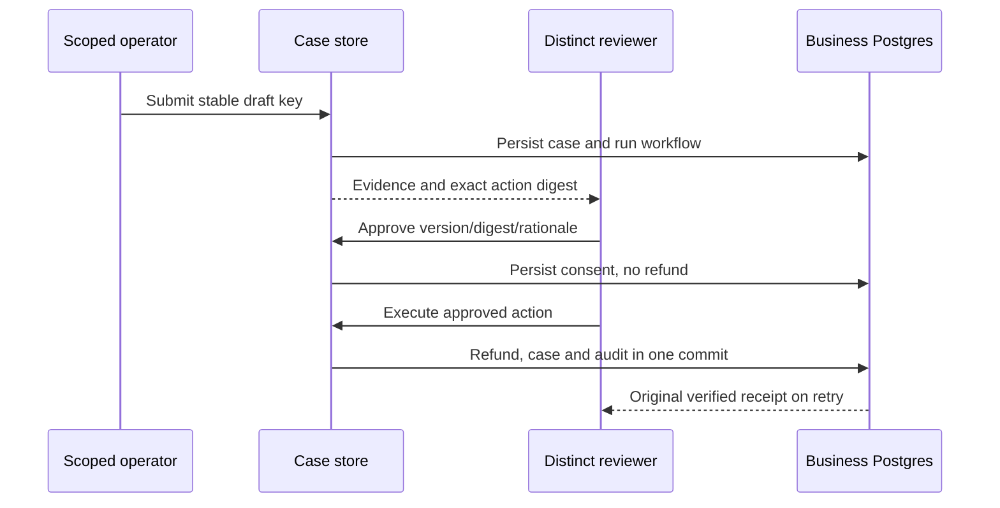

# Study the scoped support desk and durable approval

Updated: 2026-10-20. O6 #31 and O7 #32 share user-authorized `codex/o6-o7-review-console`, based on verified #85 main `e11290a`. Python/SQL links pin implementation `c656ef5`; readable browser assets pin `fb546aa`. See [operator commands](olist-console.md), [workflow study](code-study-olist-workflow.md) and [build history](../BUILD_BOOK.md#entry-29--exact-action-approval-behind-a-scoped-local-console). Coverage: five new Python modules, their SQL/browser boundary and the business transaction hook. This is not an exhaustive security audit.

## Follow an invented action

A scoped operator submits a manual-review request for an eligible 50.00 SIM refund. The server derives authority from the account, persists the stable case before dispatch, and runs the offline workflow. Review stores original order evidence, explicitly fictional confirmations, policy proposal, exact command, record version and digest. A distinct reviewer supplies matching case version/digest and rationale. Approval persists without a ledger effect.

Execution by that recorded reviewer locks/rechecks order and budget. A trusted recorder locks/rechecks the approved case and saves receipt, completion and audit in the same transaction as the business writes. Recorder failure rolls everything back. A lost response or new process returns the original verified receipt under the same business key. Queue/detail reads verify actual ledger/balance before displaying committed.

## Contracts and authentication

| Code | Meaning and boundary |
|---|---|
| [Principal][principal] | Trusted provisioned username/tenant/actor/role and at most 1,000 explicit order IDs. `grant` checks scope and `require` checks role. HTTP JSON cannot supply authority. |
| [Submission][submission] | Bounded event/order/text, explicit offline intent and manual-review choice. A draft key grants no permission. |
| [CaseRecord][case] | Request/context, status/version, evidence/proposal, exact command/digests, reviewer and verified result. Approval differs from completion. |
| [Decision / Resume][decision] | Expected version/digest/rationale for decisions; exact digest for approved execution. Shape validation alone proves neither authority nor freshness. |
| [Schema][sql] | Separate immutable-versioned application accounts, sessions, counters, cases and append-only events. Business-v1 DDL stays unchanged. |

[Password functions][password] use random salt, PBKDF2-SHA256 at 600,000 iterations, bounded inputs and constant-time comparison. [Setup/provision][setup] require trusted administration. Runtime cannot alter accounts, rewrite/delete audit or run DDL.

[Login][login] serializes admission, commits failed counters before generic errors, uses an unknown-user dummy hash, limits account failures to five per five minutes and global admission to 100 per window before expensive hashing. These are mechanism controls, not measured public-service capacity. Random opaque session/CSRF values are stored as digests with absolute 30-minute expiry. [Authenticate/logout][session] reread enabled account/scope per request and revoke on logout. Trusted password changes should revoke sessions; public account management is absent.

## CaseStore anatomy

| Code | Execution and invariant |
|---|---|
| [Connection/event/load/save][storage] | Own/close connection, bounded SQL waits, tenant/order scope, optimistic version and append-only history. |
| [Detail/listing][reads] | Verify receipts against business ledger/balance, including queue cards. |
| [Snapshot][snapshot] | Read trusted facts/version, run pure policy, create command only for already eligible refunds. Hash record/facts/version, then command/policy/submitter. Missing/conflicting/over-cap facts cannot acquire an approvable command. |
| [Submit][submit] | Structured tenant/actor/event identity plus immutable request fingerprint; save case/audit before dispatch; conflicting reuse fails. |
| [Run/recover][run] | Per-case session serializes graph/case persistence. New run/deadline retains business identity and persistent checkpoints. Exceptions mean needs recovery because commit may already exist. |
| [Decide][decide] | Reviewer role, explicit scope, distinct submitter, exact status/version/digest and fresh eligibility. Reject makes no business effect; approval saves consent only. |
| [Reevaluate][reevaluate] | Fresh evidence clears old approval and returns to review with new version/digest. Cannot edit source facts or raise the cap. |
| [Resume/recorder][resume] | Recorded reviewer and exact digest; completed retry returns verified original. Locked approval/command rechecked before receipt/case/audit share the business commit. |
| [Pre-write pin][prewrite] | Reconstruct known amount/version delta only from the locked just-written order, never client-supplied prior state. |
| [Business hook][hook] | Optional trusted callback participates in matching-prior-receipt and new-write paths; exceptions roll back. Default O4/O5 callers retain behavior. |

Business and graph checkpoint transactions remain separate. Automatic workflow completion can require recovery before app case update. Manual approval deliberately puts receipt/case/audit in one business transaction. **Design limitation:** administrators, local Python and runtime DB credentials are trusted; no database RLS or malicious-code sandbox is claimed.

## HTTP, CLI and browser

[App construction][api] requires explicit HTTP loopback origin and nonnegative integer SIM budget. [BodyLimit][body] rejects over 16 KiB before parsing. TrustedHost, exact Origin/JSON and session-bound CSRF protect mutations; login requires same-origin JSON before a session exists. Cookies are HttpOnly/SameSite Strict for sessions, separately readable for CSRF. Generic errors do not echo passwords/input. Normal responses carry no-store, CSP, no framing and nosniff. No OpenAPI/docs endpoint is enabled.

[Routes][routes] derive principal only from session and create trusted offline context. Operator submits/recovers; reviewer decides/executes. The first DB run exposed health querying admin-only schema metadata; querying a runtime-readable case table fixed it without widening privileges. **Verified bug, fixed:** health privilege mismatch, covered by HTTP integration.

[CLI][cli] separates admin bootstrap/account from restricted serving. External principal JSON and hidden password prompts provision accounts. Server binds `127.0.0.1`, disables proxy/access logging and limits concurrency. Optional `web` contains workflow/FastAPI/Uvicorn; base imports business/policy without those SDKs.

Read [HTML][html], [CSS][css] and [JavaScript][js] together: scoped queue/evidence precede exact-action controls, with loading/empty/error/rejected/stale/approved/committed states. Untrusted strings use `textContent`, credentials avoid browser storage, and draft identity survives retry. **Verified bug, fixed:** restoring button text flattened an accessibility span; retaining original child nodes preserves the sign-in name. Mobile and reduced-motion rules are explicit.

## Evidence, limits and practice

Seven new offline checks cover passwords, origins, generic validation/body limits and packaged assets. Nine new required Postgres checks cover exact consent, rollback, lost response, actual child-process exit after commit, changed evidence, concurrency/retries, roles/tenant/CSRF, session expiry/revocation/throttling and denied audit/account mutations. Complete local suite: **681 passed** with 69 typed sources; complete DB suite: **36 passed**. Both installed base/web probes matched package bytes under network denial. Final exact-head hosted evidence is maintained on #31/#32.

The Edge browser drill used invented accounts/order: approval survived owned service restart, then 50.00 SIM execution/reload yielded one independently counted ledger entry and committed audit. Desktop/mobile screenshots were inspected: inert HTML canary, no mobile horizontal overflow or page errors. [Source aggregate](data/olist-approval-drill-v1.json): three approvals before effects, then three refunds totaling 19,116 minor SIM matching ledger/order/budget sums; duplicate resumes returned originals. Automated reviewer actions are mechanism checks, not human adjudication or fresh model-quality evaluation.

**Not assessed:** remote deployment/TLS, SSO/MFA, backup/restore, exhaustive security/performance testing and complete serving-trace integration. O8 retains reviewed release scoring and fresh held-out repeated trials. No real payments or live provider calls occurred.

1. Explain why an approval row alone cannot authorize any refund. Trace identity, freshness and policy through commit.
2. Compare automatic-workflow and approved-execution crash windows. Which writes share a transaction?
3. Trace account scope/role changes during a session. Why reread the account?
4. Approve an invented 5,000-minor action, change record version and execute: expect no effect and stale state; reevaluation needs new consent.
5. Fail the recorder before commit, retry, and compare actual ledger/order/budget/case/audit before claiming rollback/completion.

[principal]: https://github.com/Protagonist01/my-production-agentic-systems/blob/c656ef564048ff02870c6966ab23da77cbf041d2/projects/olist-support/src/olist_support/console_contracts.py#L15-L34
[submission]: https://github.com/Protagonist01/my-production-agentic-systems/blob/c656ef564048ff02870c6966ab23da77cbf041d2/projects/olist-support/src/olist_support/console_contracts.py#L37-L42
[case]: https://github.com/Protagonist01/my-production-agentic-systems/blob/c656ef564048ff02870c6966ab23da77cbf041d2/projects/olist-support/src/olist_support/console_contracts.py#L57-L77
[decision]: https://github.com/Protagonist01/my-production-agentic-systems/blob/c656ef564048ff02870c6966ab23da77cbf041d2/projects/olist-support/src/olist_support/console_contracts.py#L80-L88
[sql]: https://github.com/Protagonist01/my-production-agentic-systems/blob/c656ef564048ff02870c6966ab23da77cbf041d2/projects/olist-support/src/olist_support/console.sql#L1-L38
[password]: https://github.com/Protagonist01/my-production-agentic-systems/blob/c656ef564048ff02870c6966ab23da77cbf041d2/projects/olist-support/src/olist_support/console_auth.py#L23-L41
[setup]: https://github.com/Protagonist01/my-production-agentic-systems/blob/c656ef564048ff02870c6966ab23da77cbf041d2/projects/olist-support/src/olist_support/console_auth.py#L44-L85
[login]: https://github.com/Protagonist01/my-production-agentic-systems/blob/c656ef564048ff02870c6966ab23da77cbf041d2/projects/olist-support/src/olist_support/console_auth.py#L93-L166
[session]: https://github.com/Protagonist01/my-production-agentic-systems/blob/c656ef564048ff02870c6966ab23da77cbf041d2/projects/olist-support/src/olist_support/console_auth.py#L168-L189
[storage]: https://github.com/Protagonist01/my-production-agentic-systems/blob/c656ef564048ff02870c6966ab23da77cbf041d2/projects/olist-support/src/olist_support/console_cases.py#L35-L93
[reads]: https://github.com/Protagonist01/my-production-agentic-systems/blob/c656ef564048ff02870c6966ab23da77cbf041d2/projects/olist-support/src/olist_support/console_cases.py#L95-L128
[snapshot]: https://github.com/Protagonist01/my-production-agentic-systems/blob/c656ef564048ff02870c6966ab23da77cbf041d2/projects/olist-support/src/olist_support/console_cases.py#L130-L178
[submit]: https://github.com/Protagonist01/my-production-agentic-systems/blob/c656ef564048ff02870c6966ab23da77cbf041d2/projects/olist-support/src/olist_support/console_cases.py#L180-L236
[run]: https://github.com/Protagonist01/my-production-agentic-systems/blob/c656ef564048ff02870c6966ab23da77cbf041d2/projects/olist-support/src/olist_support/console_cases.py#L238-L295
[decide]: https://github.com/Protagonist01/my-production-agentic-systems/blob/c656ef564048ff02870c6966ab23da77cbf041d2/projects/olist-support/src/olist_support/console_cases.py#L297-L334
[reevaluate]: https://github.com/Protagonist01/my-production-agentic-systems/blob/c656ef564048ff02870c6966ab23da77cbf041d2/projects/olist-support/src/olist_support/console_cases.py#L336-L359
[resume]: https://github.com/Protagonist01/my-production-agentic-systems/blob/c656ef564048ff02870c6966ab23da77cbf041d2/projects/olist-support/src/olist_support/console_cases.py#L361-L447
[prewrite]: https://github.com/Protagonist01/my-production-agentic-systems/blob/c656ef564048ff02870c6966ab23da77cbf041d2/projects/olist-support/src/olist_support/console_cases.py#L449-L467
[hook]: https://github.com/Protagonist01/my-production-agentic-systems/blob/c656ef564048ff02870c6966ab23da77cbf041d2/projects/olist-support/src/olist_support/business.py#L137-L273
[api]: https://github.com/Protagonist01/my-production-agentic-systems/blob/c656ef564048ff02870c6966ab23da77cbf041d2/projects/olist-support/src/olist_support/console_api.py#L65-L149
[body]: https://github.com/Protagonist01/my-production-agentic-systems/blob/c656ef564048ff02870c6966ab23da77cbf041d2/projects/olist-support/src/olist_support/console_api.py#L32-L62
[routes]: https://github.com/Protagonist01/my-production-agentic-systems/blob/c656ef564048ff02870c6966ab23da77cbf041d2/projects/olist-support/src/olist_support/console_api.py#L171-L302
[cli]: https://github.com/Protagonist01/my-production-agentic-systems/blob/c656ef564048ff02870c6966ab23da77cbf041d2/projects/olist-support/src/olist_support/console_cli.py#L25-L111
[html]: https://github.com/Protagonist01/my-production-agentic-systems/blob/fb546aaceab4ad7f38f4b710a5e2667a7f654a7c/projects/olist-support/src/olist_support/web/index.html#L1-L185
[css]: https://github.com/Protagonist01/my-production-agentic-systems/blob/fb546aaceab4ad7f38f4b710a5e2667a7f654a7c/projects/olist-support/src/olist_support/web/console.css#L1-L731
[js]: https://github.com/Protagonist01/my-production-agentic-systems/blob/fb546aaceab4ad7f38f4b710a5e2667a7f654a7c/projects/olist-support/src/olist_support/web/console.js#L1-L406
