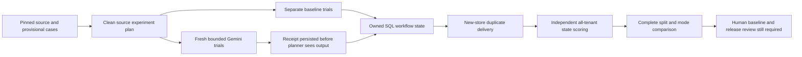

# Code study — fresh Olist state experiments

Inspected2026-10-23 on unmerged `codex/o8-fresh-release-evidence`, based on verified #94 main `3601508`. Coverage: all three new experiment modules, seeded/excluded case preparation, focused tests, real SQL collector tests and the existing planner/scorer calls they compose. Broader deployment/security/load are unassessed. [Operations and criteria](olist-fresh-review.md), [historical scorer study](code-study-olist-release.md) and [Build Book Entry38](../BUILD_BOOK.md#entry-38--fresh-olist-review-evidence-after-the-offline-pilot) separate implemented mechanisms from release claims.

## Follow one constructed request

A private case contains a source-grounded canceled order, fictional SIM proofs and a literal expected full50.00SIM refund. Its constructed request says to refund the full paid amount. Expected amount/reason, split and source metadata stay outside the planner. [`GatewayPlanner.plan`](../projects/olist-support/src/olist_support/workflow.py) sends only request text through the bounded gateway; trusted policy and scoped SQL determine the actual allowable effect. A model proposal cannot raise the100.00SIM cap or establish facts by assertion.

## Selection and immutable inputs

[`policy_case_cli.prepare`](../projects/olist-support/src/olist_support/policy_case_cli.py) now accepts a bounded seed and excluded exact order groups. Defaults preserve O3 selection. Filtering precedes coverage selection, so an excluded group cannot reenter under another split or edit. Tests build an invented larger source, prepare an old pilot, exclude all its groups, obtain twelve new cases and verify old bytes unchanged. This does not establish consumer/near-duplicate independence.

New request text is authored from the intended input request, not from expected policy outputs. It separates one primary request from quoted injection text. The private packet's case ID is used for routing/evaluation, not sent to Gemini. All labels stay provisional; new model behavior cannot retrospectively determine their truth.

## Plans, budgets and receipts

[`ExperimentPlan`](../projects/olist-support/src/olist_support/fresh_release.py) requires exactly three distinct trial IDs per case, unique task/run identities, a36call ceiling, one attempt per call and enough reserved full-ceiling tokens for every scheduled attempt. Free-only cost/currency admission remains explicit. `validate_population` checks canonical case and text pins, complete membership, duplicate IDs and exact reviewed text equality. Changing or omitting an input fails before execution.

[`make_plan`](../projects/olist-support/src/olist_support/fresh_cli.py) refuses dirty Git source and inventories every harness/Olist Python/SQL file plus `uv.lock`. It pins the existing planner source, model template, policy, scorer, environment and run budgets. `verify_runtime` checks both reviewed paths and actually executing installed package bytes. `verify_original_source` rederives each original view from the byte-pinned SQLite source and rejects undeclared changes. Private literal expected commands are built only for the independent scorer; the planner never receives them.

`context_for` creates fresh-candidate contexts with exact case/trial/run/source/policy identity and a90second outer deadline. `run_experiment` allocates separate controlled databases for rules, always-review and Gemini. Only the explicit live flag loads the Free configuration and creates `ReceiptGateway` plus `BoundedGateway` over `IsolatedTransport(GeminiWorker)`. No fallback or cached-response input exists. The existing H10 receipt primitive persists its detached exchange before returning output. Attempt timeouts and unknown usage are preserved, not converted to zero consumption or successful completion.

## Persisted state and recovery

[`execute_trial`](../projects/olist-support/src/olist_support/fresh_execution.py) bootstraps business/checkpoint schemas, enrolls a scoped view and collects an independent before snapshot. `ObservedPlanner` records the actual returned typed intent for separate intent scoring. `SupportWorkflow` reads trusted facts, applies policy and commits a scoped receipt. The collector then opens a new store/checkpointer and repeats delivery with `NoSecondDispatch`; calling that planner fails the recovery check. It compares both the result and final all-tenant state to the first committed result, so returning a receipt with another effect is not idempotent success.

The `finally` block drops only the owned trial; cleanup failure is explicit. A timeout/exception triggers another independent final-state read. Missing final state stays unknown. Fixed error codes avoid leaking SQL, credentials or source text. Before state unavailable means an unresolved observation, not a fabricated empty database. Four real Postgres tests exercise successful rules/model paths, a model timeout and a private exception, including actual database removal.

## Compare without hiding failed trials

`experiment_report` iterates scheduled tasks, not only supplied successful rows. Duplicate/unexpected rows fail; absent rows become missing. It uses the existing independent `score` implementation to compare exact ledger/order/version/budget deltas and truthful receipts/text. Errors or unverified cleanup/recovery prevent counting a trial as correct. Three-trial correctness requires every scheduled repetition; one successful row cannot erase two missing ones.

Attempt receipt checks bind run/case/trial/tenant/candidate/code/lock, approved route and exact provider text. Reused nonces or mixed execution identities fail. Input/output token sums explicitly retain unknown-attempt counts; cost per completion stays null when complete cost is unavailable. Metrics are separate by mode and development/regression/holdout; template-aware rules and always-review are disclosed baselines. Eligible completion and required-review correctness have distinct denominators. The report always refuses release and lists independent label/baseline/threshold/production validation blockers.

[`read_experiment`](../projects/olist-support/src/olist_support/fresh_cli.py) verifies a separately retained evidence byte pin, the complete JSON inventory, detached receipt files and the plan pin. It independently recomputes every verdict and rejects a different stored report. The focused tamper test shows that changing a row and re-pinning only its inventory does not preserve an old successful verdict.

The [actual model card](olist-model-card.md) records 30/36 correct Gemini trials, six unresolved timeouts and zero observed unsafe effects, against 36/36 template-aware rules. Only seven of twelve Gemini cases passed all three repetitions. The proposed criteria were not met. The [aggregate](data/olist-fresh-evidence-v1.json) preserves mode/split/source-type/treatment denominators; unknown output usage and cost remain unknown. This result does not grant release.

## Tests and limits

The unmerged `codex/o8-attempt-diagnostics` follow-up adds optional `FreshRow.attempt_timing`
from the actual isolated transport. Shared-memory phase timestamps distinguish worker entry,
generation return and a completed response frame; the parent records its elapsed bound and
exit status after cleanup. A timeout before entry means the worker entry was not observed,
not proof that no provider dispatch occurred. A timeout after entry still includes SDK work,
provider waiting and result handling. Timing never supplies authority or correctness credit.
`make_plan(..., attempt_timeout_seconds=...)` records an explicit shared execution policy;
the CLI's optional flag defaults to30seconds, with the new proposed plan using60seconds.
No runtime override can change the serialized plan's policy. [Follow-up operations](olist-followup-review.md)
retain the new source/input pins, conditions and historical evidence boundary.

The frozen follow-up candidate `0be72b2` completed 36/36 correct model trials, with no unsafe
or unresolved outcomes, 9/9 eligible refunds, 27/27 correct required reviews and 12/12 cases
correct in every repetition. Timing and token usage were captured for all 36. Median worker
entry was 8.225 seconds; one entry took 36.348 seconds, beyond the old attempt limit. Median
generation after entry was 4.831 seconds, including SDK import and response handling. This
measures lifecycle costs, without identifying the historical timeout causes. The [new card](olist-followup-model-card.md)
discloses four repeated text templates, unknown cost and the changed cohort/deadline/conditions.
The [new aggregate](data/olist-followup-evidence-v2.json) preserves mode/split/type/treatment
denominators, provenance and observed phases. Independent labels and release gates remain pending.

The focused suite passed 14 tests, and four actual Postgres collector tests passed. The full offline suite passed 935 tests in 667.01 seconds; strict typing passed for 139 source files. The tests use invented data/responses, not provider-quality evidence. The frozen live experiment is a separate artifact. No dependency or lock change was required. Historical O8 offline reports and the original O3 pilot remain unchanged.

**Design limits:** twelve coverage-selected hybrid cases do not represent support traffic. Literal AI labels need independent review. Template-aware rules have a deliberate grammar advantage. The local operator/database owner is trusted and can forge evidence; file pins provide integrity/reproducibility, not hardware attestation. Provider dispatch can consume quota before a process crashes; fenced business publication is not exactly-once billing. Public deployment, load, production identity and migration readiness remain outside this inspection.

## Interview exercises

1. Why can all-review be safe yet fail the comparison? Explain eligible denominators and the rules baseline.
2. A request times out after commit. Describe the independent final snapshot, receipt binding and new-store retry; never infer rollback from a missing response.
3. Copy one receipt into another case row. Trace which case/trial/input/nonce checks reject it.
4. Why does a36call cap reserve36full token ceilings? Contrast conservative admission with incomplete observed token accounting.
5. Change one prompt line after the first holdout response. Explain why the source inventory invalidates sealing and why a new experiment version is required.
