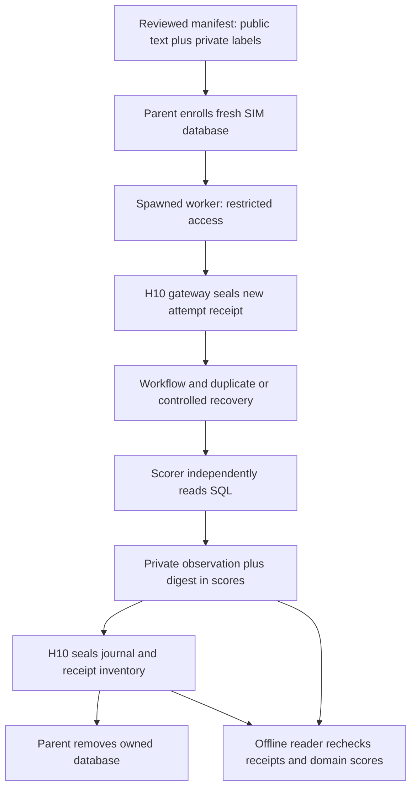

# Code study — Olist H10 recording and recomputation

Follow-up inspected 2026-10-24 from merged base `b915f1b`: unmerged
`codex/three-release-evaluators` adds the [three-issue evaluation preparation](three-release-evaluators.md).
The original walkthrough below retains its historical implementation/evidence scope.

Inspected 2026-10-24 on unmerged `codex/olist-h10-adapter`, from verified main `70abcdb`
(#100). Coverage: the six adapter modules, FieldCapture extension, focused mutations and
actual mock/Postgres execution. Full checks and hosted acceptance follow after completion.
[Runbook](olist-h10-recording.md) gives composition steps; [Entry 45](../BUILD_BOOK.md#entry-45--recording-olist-trials-through-h10)
records decisions. Historical [fresh pilots](code-study-olist-fresh.md) retain their own limits.

## Trace one request



[`manifest_for`](../projects/olist-support/src/olist_support/h10_manifest.py#L37) creates
an evaluator-only CaseManifest. `private_case` rebinds the whole ExpectedResult, request,
source, policy and original split to the typed private label. Expected action is never a
runtime plan. Regression maps to H10 development while keeping its original split; source
groups remain intact. The pin still requires separate review. This follows the separation
of input, expected output and metadata in the [Langfuse dataset guide](https://langfuse.com/academy/datasets);
no live Langfuse dataset is created.

[`OlistEnvironment`](../projects/olist-support/src/olist_support/h10_environment.py#L42)
owns database setup/enrollment and the initial independent snapshot. Its OlistAccess carries
only restricted connection credentials, scoped grant and controlled fixture configuration.
The administrator stays in the parent. H10 controls reaping/cleanup errors and denominators.

[`OlistAgent`](../projects/olist-support/src/olist_support/h10_runtime.py#L48) receives only
request text through AgentInput. GatewayPlanner uses H10's supplied bounded receipt gateway;
no transport or key is discovered implicitly. The actual workflow still checks policy,
scope, SIM amount and ledger state. NoSecondDispatch is used for redelivery and recovery.
Selected after-commit exceptions reopen the durable components; this is not an OS kill.

[`observed_result`](../projects/olist-support/src/olist_support/h10_runtime.py#L141) maps
actual workflow outcome, message, usage and receipt to AgentResult. The scorer requires the
entire shared result to equal that projection, blocking divergent outcome/decision/evidence
claims. A failed provider attempt remains typed failed with observed usage, not a successful
review. The durable checkpoint reference is checked through actual redelivery behavior.

[`OlistScorer`](../projects/olist-support/src/olist_support/h10_runtime.py#L187) rereads final
SQL after the agent returns. It replaces the claimed final snapshot with that independent
read, then scores the frozen labels against observed intent/action/amount/reason, truthful
message, exact state, duplicate delivery and required recovery. The domain oracle never
calls runtime `policy.propose`. Missing required observations become typed scorer errors.
Duplicate delivery needs the actual before-state and redelivered result, not only a boolean.

## Why preserve private observations?

SQL is disposable, so score numbers alone would prevent later recomputation. The scorer
writes a canonical FieldCapture exclusively and binds its digest into each score:

```python
reference = EvidenceReference(
    reference="olist-h10-observation:" + pin(capture), kind="state"
)
```

The H10 batch digest seals those score references. [`read_olist_evidence`](../projects/olist-support/src/olist_support/h10_evidence.py#L71)
first checks shared evidence/receipts/usage, then verifies the executing package inventory,
exact private file inventory, raw digest/canonical bytes, entire shared result and recomputed
domain scores. Changed, missing, extra or symlinked observations fail. Unknown costs remain
unknown and block H10 read-back. Repeated offline reading never calls a provider.

[`fingerprints`](../projects/olist-support/src/olist_support/h10_config.py#L21) binds route,
prompt, tools, policy, independent oracle and controlled environment. `verify_runtime` requires
all executing harness/Olist Python and SQL bytes plus the lock; it rejects omitted files.
[`record_olist`](../projects/olist-support/src/olist_support/h10_recording.py#L19) validates
group/split/source bindings and delegates fresh capture to H10. Provider selection requires
the existing Gemini transport/Free admission, clean pinned source and a separately pinned
original database whose views/declared edits are checked. These checks do not grant a budget.

## Verification and limits

The [unit mutations](../tests/test_olist_h10.py) check binding, source/route changes, independent
state overriding a claim, shared-result divergence, duplicate snapshots, missing recovery
and preflight before any database setup. The [required SQL checks](../tests/integration/test_olist_h10.py)
run three new mock dispatches each for refund/review/recovery/failure/unknown cost, then
verify cleanup and read-back. Tampering uses saved output without another dispatch.

All inputs/responses in these checks are invented. Trusted evaluator code and plain local
hashes provide consistency, not hostile-code containment or authenticated SQL attestation.
Recovery is controlled exception/reopen; full H7/OS crash evidence remains separate work.
The follow-up [parent timing change](trial-timing.md) measures new trial setup through cleanup;
historical timing stays unknown. The stronger twelve labels are accepted AI-assisted propositions, not blind
ground truth. Representative coverage, independent reviews, approved baselines/limits,
complete cost accounting, a bound methodology study and final fresh evidence still gate #33.
Shared profiles for the other four agents remain enforced; none is released by this adapter.

Local verification so far: 23 focused checks; 151 typed source files; five final SQL/H10
cases passed in 443.76 seconds, including private observation tampering and unknown-cost
rejection. Six package pairs built; audit clean. Installed resources matched 61 harness and
35 Olist files under network denial, with six replayed calls and zero provider calls.
Complete locked check passed 1,025 tests in 695.45 seconds, with 151 typed sources,
228 formatted files and import/lint/lock checks. Historical sealed evidence recomputed
unchanged without a provider call. Hosted acceptance remains pending at this writing.
