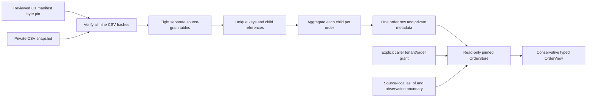

# Code study — Olist order snapshots

Source inspected 2026-10-18 on codex/o2-orders-360; O2 merged through PR#81 as36ad712 on2026-10-19. Coverage: three new installable Olist modules, invented CSV fixtures/tests and shared mypy scope. Executable source is pinned to 0781dddf0577bd8e00db94e04d15198050ffd4af; documentation follow-ups retain those bytes. Raw Olist records, independent domain policy/actions, provider calls, production authentication and infrastructure internals are outside this study. [Operations](data/olist-orders.md) and [Build Book Entry24](../BUILD_BOOK.md#entry-24--parallel-source-preparation-and-honest-historical-order-views) explain the data/clock decisions.

## Architecture and representative execution

Take the invented order with two items priced10.01/20.02, two payments12.00/20.03 and two reviews. `import_snapshot` verifies a separately supplied manifest pin and raw hashes, claims a new output file, then `_import_table` reads exact schemas into separate tables. Empty text becomesNone; original Unicode content remains intact. `minor_units` converts amounts to integer hundredths without assuming a currency. Composite primary keys reject duplicates instead of deciding which row is true.

`_references` rejects child rows that cannot resolve to their declared parent. `_aggregates` groups items/payments/reviews independently to one row per order, then joins those reduced tables. The result has two orders including an empty order, correct item total3003 and payment total3203. A deliberately wrong direct join in the test has eight rows and item total12012; this concrete witness proves why reduction must precede the join. The importer reconciles each resulting global count/total against raw source tables and fails if grain or totals change.

After the file is sealed and its digest retained separately, `OrderStore` rejects live journal/WAL/SHM sidecars, opens it with mode=ro/query_only, retains a read transaction and rechecks the digest after taking its read snapshot. A competing writer cannot commit changed pages until close. A caller grants order-1 to tenant-1. The view at January2 returns purchase/approval events but no future delivery, review text, money, final status, customer attributes or counts. At the January10 declared observation boundary it can return the complete source snapshot, with review text still restricted to answers at or before as_of. Event dates are source-effective dates; they do not prove historical ingestion. The final static fields have no revision log and cannot be assigned to purchase time. Unknown availability and missing amount remain distinct from a real observed zero.

## Core symbols and failure paths

| Symbol | Inputs, transformations and effects | Tested invariant / limit |
|---|---|---|
| digest_file / private_path | Files → SHA256 / resolved external path | Data stays outside the specified code checkout; pins depend on trusted review and private storage |
| source_time / minor_units | Original strings → canonical naive datetime or integer hundredths | No timezone/currency inference, rounding, nonfinite or overprecise money |
| quoted / verify_source | Reviewed manifest and exact CSV inventory → safe identifier/hash validation | Manifest/source changes fail; schema is trusted only relative to an external pin |
| _import_table | CSV plus declared composite keys → separate SQLite source table | Strict width/header/count/missingness, keys, dates and money; original strings retained |
| _references | Source relationships → orphan checks | Orders/customers/items/payments/reviews/products/sellers preserve referential identity |
| _aggregates | Child source tables → reduced per-order tables → orders_360 | Every child count and money subtotal reconciles; no many-to-many inflation |
| import_snapshot | Source/pin/output/explicit observation boundary → private transaction + metadata/digest | New file only, rejects backdated observation before an actual recorded event; rechecks source and explicitly closes SQLite before returning digest |
| OrderScope / view DTOs | Caller grant and selected source facts → closed typed outputs | Scope selection is explicit; Python DTO construction is not authentication |
| OrderStore.__init__ / close | Separately pinned database → read-only connection / release | Changed bytes/sidecars fail; retained read transaction blocks changed commits; caller closes the store |
| OrderStore.view | Tenant/order grant + source-local as_of → event-filtered/private snapshot projection | Future events, final text and untimed facts cannot leak into earlier views |
| source_cli.main | Explicit argument vector → offline import / aggregate report / nonzero typed failure | No rows or IDs printed; partial output retained, never overwritten |

SQL table names in reference/aggregate queries are fixed implementation constants, while values use placeholders. Source column identifiers are quoted and restricted to ASCII identifier characters. Manifest headers still need independent review: a hash establishes identity, not approval. A count of zero children does not prove an amount of zero, so complete monetary totals remain null without rows. A partially missing set retains the known subtotal and missing count, and the complete total stays null.

SQLite's composite review key is(order_id,review_id), not review_id alone. Actual-source inspection found802 duplicated global review IDs(up tothreeorders) with no duplicated composite pairs. Treating the single field as a primary key would reject or drop authentic observations. The importer preserves them and the view retains both the source ID and its containing order scope.

## Evidence, risks and design limits

The focused O2/source suite passed27tests. These are invented plumbing witnesses, not evidence of correct refund policy or independent business actions. The exact full-suite, real-source and packaged results are recorded in Entry24 and #27 after execution. No raw source text enters the committed fixtures or logs.

- **Design limitation:** Olist provides final snapshots, not observation/revision histories. Untimed values stay hidden before a declared observation boundary. A useful earlier full support scenario needs a reviewed hybrid availability policy rather than an invented historical fact.
- **Design limitation:** currency and timestamp timezone remain unverified. Scale2 arithmetic is not a BRL declaration and source-local clock comparisons cannot be mixed with UTC contexts without a reviewed mapping.
- **Operational trust boundary:** the caller supplies a separately reviewed source/database digest, repository boundary, observation boundary and tenant/order grant. This local package does not authenticate users or map anonymized source customers to actual application tenants.
- **Private handling:** raw text/IDs/private database remain outsideGit. POSIX files use0600; Windows inheritsACLs. The retained SQLite snapshot blocks ordinary competing commits; protected file permissions still matter against an operator who can replace files or violate SQLite locking. This is not hostile-operator isolation.
- **Not assessed:** live model quality, domain gold actions, refund/reship rules, transaction-ledger behavior, HTTP/API authorization and production deployment. Those are later O3–O8 tasks.

## Interview exercises and maintenance

1. Explain why twoitems×twopayments×tworeviews becomes eight rows and why DISTINCT is not a reliable repair. Show the aggregate-before-join implementation and exact totals witness.
2. A record says delivered but the customer-delivery timestamp is next week. Which view fields can be exposed today? Follow the event cutoff and final-status observation gate; do not derive a final status from the frozen snapshot early.
3. Why are review answers not enough to backdate final text? Describe missing revision history and the explicit conservative boundary. Identify what new reviewed evidence would permit earlier availability.
4. An item amount is blank. Contrast no row, unknown amount and observed0.00. Trace known subtotal/missing count/complete null through storage and DTOs.
5. A caller swaps tenant IDs. Follow the scope check before query, then explain why this is only a trusted grant mechanism and where real authentication must live.

When adding columns, update source schema handling, grain/reference validation, independent aggregates, DTO visibility, future-canary tests and provenance together. Never join raw child tables before monetary aggregation. Keep Portuguese and source translations separate. Refresh symbol anchors after executable commits; record actual source/package/CI evidence without promoting these tests into domain quality claims.

### Reproduced pre-publication bugs

**Verified bug, repaired before review:** the initial read-only store checked its file digest only once and could return another connection's later committed value. A WAL could hold changed pages outside the main-file hash. The repair rejects sidecars, retains a read snapshot and rechecks the digest under its lock; tests require a competing commit to fail and the old view to remain equal. **Verified resource bug, repaired:** a SQLite connection context does not close its handle. Explicit closing now releases importer handles before the final digest is returned, verified with a strongly retained real connection that rejects subsequent SQL as closed. No production deployment existed for either bug. Exact final results follow in Entry24/#27.

## Verified source anchors

- [source.digest_file](https://github.com/Protagonist01/my-production-agentic-systems/blob/0781dddf0577bd8e00db94e04d15198050ffd4af/projects/olist-support/src/olist_support/source.py#L40-L42)
- [source.private_path](https://github.com/Protagonist01/my-production-agentic-systems/blob/0781dddf0577bd8e00db94e04d15198050ffd4af/projects/olist-support/src/olist_support/source.py#L45-L49)
- [source.source_time](https://github.com/Protagonist01/my-production-agentic-systems/blob/0781dddf0577bd8e00db94e04d15198050ffd4af/projects/olist-support/src/olist_support/source.py#L52-L56)
- [source.minor_units](https://github.com/Protagonist01/my-production-agentic-systems/blob/0781dddf0577bd8e00db94e04d15198050ffd4af/projects/olist-support/src/olist_support/source.py#L59-L73)
- [source.quoted](https://github.com/Protagonist01/my-production-agentic-systems/blob/0781dddf0577bd8e00db94e04d15198050ffd4af/projects/olist-support/src/olist_support/source.py#L76-L79)
- [source.verify_source](https://github.com/Protagonist01/my-production-agentic-systems/blob/0781dddf0577bd8e00db94e04d15198050ffd4af/projects/olist-support/src/olist_support/source.py#L82-L100)
- [source._import_table](https://github.com/Protagonist01/my-production-agentic-systems/blob/0781dddf0577bd8e00db94e04d15198050ffd4af/projects/olist-support/src/olist_support/source.py#L103-L141)
- [source._references](https://github.com/Protagonist01/my-production-agentic-systems/blob/0781dddf0577bd8e00db94e04d15198050ffd4af/projects/olist-support/src/olist_support/source.py#L144-L158)
- [source._aggregates](https://github.com/Protagonist01/my-production-agentic-systems/blob/0781dddf0577bd8e00db94e04d15198050ffd4af/projects/olist-support/src/olist_support/source.py#L161-L205)
- [source.import_snapshot](https://github.com/Protagonist01/my-production-agentic-systems/blob/0781dddf0577bd8e00db94e04d15198050ffd4af/projects/olist-support/src/olist_support/source.py#L208-L267)
- [views.OrderScope](https://github.com/Protagonist01/my-production-agentic-systems/blob/0781dddf0577bd8e00db94e04d15198050ffd4af/projects/olist-support/src/olist_support/views.py#L16-L20)
- [views.AmountTotal](https://github.com/Protagonist01/my-production-agentic-systems/blob/0781dddf0577bd8e00db94e04d15198050ffd4af/projects/olist-support/src/olist_support/views.py#L23-L27)
- [views.Event](https://github.com/Protagonist01/my-production-agentic-systems/blob/0781dddf0577bd8e00db94e04d15198050ffd4af/projects/olist-support/src/olist_support/views.py#L30-L32)
- [views.Item](https://github.com/Protagonist01/my-production-agentic-systems/blob/0781dddf0577bd8e00db94e04d15198050ffd4af/projects/olist-support/src/olist_support/views.py#L35-L42)
- [views.Review](https://github.com/Protagonist01/my-production-agentic-systems/blob/0781dddf0577bd8e00db94e04d15198050ffd4af/projects/olist-support/src/olist_support/views.py#L45-L50)
- [views.Payment](https://github.com/Protagonist01/my-production-agentic-systems/blob/0781dddf0577bd8e00db94e04d15198050ffd4af/projects/olist-support/src/olist_support/views.py#L53-L57)
- [views.OrderView](https://github.com/Protagonist01/my-production-agentic-systems/blob/0781dddf0577bd8e00db94e04d15198050ffd4af/projects/olist-support/src/olist_support/views.py#L60-L81)
- [views.OrderStore](https://github.com/Protagonist01/my-production-agentic-systems/blob/0781dddf0577bd8e00db94e04d15198050ffd4af/projects/olist-support/src/olist_support/views.py#L84-L238)
- [source_cli.main](https://github.com/Protagonist01/my-production-agentic-systems/blob/0781dddf0577bd8e00db94e04d15198050ffd4af/projects/olist-support/src/olist_support/source_cli.py#L15-L53)
