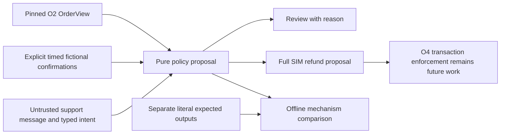

# Code study — constructed Olist policy and private cases

Inspected 2026-10-19 on unmerged `codex/o3-refund-policy`, based on verified main `2988428` after the user merged C1 #82. Executable source is `15908425fa0735317a9e5ec281e7948c9aaa9bba`. This chapter covers all three new installable modules and both invented-data test modules. The [policy](olist-policy.md) is user-approved demonstration policy; private expected case labels are provisional AI reviews. No transactional refund, reship, model workflow, authenticated service or independently human-validated business outcome is implemented.

## Follow a proposal

An invented canceled order has a complete payment of 3,203 source hundredths. Its original `OrderView.currency_unit` is still null. A separate `ScenarioConfirmation` declares SIM units, confirms payment/non-delivery, records zero prior refund and says when those fictional facts became available. Reusing the numeric amount is not currency conversion. `SupportRequest` asks for a full refund. `propose` revalidates all contracts, binds the confirmation to the same tenant/order, checks its time against the source-local case clock, then verifies visible cancellation, no future/delivery conflict, complete positive payment, zero prior refund, a full-amount request and the 10,000 cap. It returns amount 3,203 SIM with `committed=False`. Fixed wording says 32.03 SIM is **proposed**, and explicitly says no refund has been committed.

Change only the amount to 10,001: review. Change only the confirmation unit to null: review. Remove the independent non-delivery confirmation: review, even when the source delivery field is blank. A previous partial refund also requires reconciliation; this policy does not decide the remaining entitlement. Reship always requires review because inventory and shipping authority are absent. A support message demanding a larger limit never changes trusted facts. A mismatched tenant/order raises `PermissionError` before refund proposal; this is an input-boundary check, not authentication.

## Code anatomy

- [Policy contracts](https://github.com/Protagonist01/my-production-agentic-systems/blob/15908425fa0735317a9e5ec281e7948c9aaa9bba/projects/olist-support/src/olist_support/policy.py#L16-L54) own fictional confirmations, typed intent and closed proposals. Strict integer fields reject booleans/coercion. The cross-field validator prevents a review carrying a refundable amount or a proposed amount outside SIM/cap bounds. Nothing in these types moves money.
- [Clock and decision sequence](https://github.com/Protagonist01/my-production-agentic-systems/blob/15908425fa0735317a9e5ec281e7948c9aaa9bba/projects/olist-support/src/olist_support/policy.py#L57-L123) retain the unverified source-local clock. Invalid aware clocks fail; unavailable confirmations cannot authorize earlier decisions. `missing_rows`, `known_minor`, `total_minor` and payment count are checked together so a known subtotal or absent population cannot become a complete payment. Integer arithmetic avoids rounding at the cap.
- [Message template](https://github.com/Protagonist01/my-production-agentic-systems/blob/15908425fa0735317a9e5ec281e7948c9aaa9bba/projects/olist-support/src/olist_support/policy.py#L126-L134) uses `divmod` for exact display. It never copies untrusted request text into a success claim.
- [Public/private case contracts](https://github.com/Protagonist01/my-production-agentic-systems/blob/15908425fa0735317a9e5ec281e7948c9aaa9bba/projects/olist-support/src/olist_support/policy_cases.py#L18-L83) separate `CaseInput` from expected action, grouping, split, provenance and reviewer evidence. `PolicyCases.grouped` rejects duplicate case IDs, cross-split order edits, confirmation identity mismatch and missing construction declarations. A group hash is recomputed from the underlying order; a caller cannot assign a paraphrase a different arbitrary family name. The three-way format is local O3 preparation, not a silent change to H5's two-way manifest contract.
- [Private path and clock guards](https://github.com/Protagonist01/my-production-agentic-systems/blob/15908425fa0735317a9e5ec281e7948c9aaa9bba/projects/olist-support/src/olist_support/policy_cases.py#L86-L105) reject records below any Git ancestor. This includes other checkouts, not just the current worktree. Windows inherits the restricted parent ACL; chmod is not a new Windows authorization service.
- [Pilot preparation](https://github.com/Protagonist01/my-production-agentic-systems/blob/15908425fa0735317a9e5ec281e7948c9aaa9bba/projects/olist-support/src/olist_support/policy_case_cli.py#L25-L216) opens the independently pinned O2 store, selects fixed-hash source orders for declared coverage and retains the O2 observation boundary. Three under-cap cancellations, one over-cap cancellation, one delivered order and another cancellation supply six groups. Each group has a base and adversarial case in one split. Literal policy-table expected actions are authored in this preparation path; it does not call `propose` to generate its answers. Original view hashes and changed-field lists distinguish authentic source evidence from scenario edits. All twelve complete workflows are hybrid because the support requests and confirmations are constructed. No authentic refund-request population exists in Olist.
- [CLI](https://github.com/Protagonist01/my-production-agentic-systems/blob/15908425fa0735317a9e5ec281e7948c9aaa9bba/projects/olist-support/src/olist_support/policy_case_cli.py#L219-L240) requires source database pin, new external output and explicit clock. It emits aggregate counts/pins only; raw inputs and evaluator labels stay private. Files are created as UTF-8/LF so reported hashes identify actual bytes. Existing output is refused, not overwritten or resumed.

## Verification, risks and limits

The focused suite passed 33 invented tests after a real Windows encoding/default-newline hash mismatch was repaired. Strict repository types passed 59 sources. The private real-source pilot contains 12 cases in six order groups, four cases in each development/regression/holdout split; three literal refund proposals and nine review expectations matched the current pure function. The [aggregate report](data/olist-policy-pilot-v1.json) records its pins. This is a mechanism comparison against provisional policy-table labels, not model quality or proof of actual refund correctness. Full/hosted acceptance is recorded on #28 only after completion.

**Verified bug, repaired:** the first pipeline test found that hashing intended text could differ from the Windows-written artifact when encoding/newline defaults intervened. Explicit UTF-8/LF writing and independent file-byte checks repair that path; the failed test remains in Build Book Entry26.

**Design limitations:** scenario confirmations and caller grants are trusted assertions, not authenticated proof; original source currency/timezone stay unknown. The source library and local Python memory are not security sandboxes. This small coverage-selected pilot cannot estimate real support frequency or performance. One AI policy-table review supplies no independent human adjudication. Generic request text remains untrusted, and the next business tool must enforce cap, scope, current ledger state, exact approval and idempotency again at commit time. A proposal cannot serve as evidence that a write happened.

## Practice and interview questions

Explain why a missing delivery date cannot authorize a refund. Trace the exact-cap case and change one field at a time: unit, payment missingness, prior refund and confirmation time. Predict the reason before running the test. Explain why source and scenario units remain separate, how order-group checks prevent leakage and why `committed=False` belongs in every proposal. For O4, describe a transaction that rechecks current state and returns the original effect on a repeated business key; this chapter does not claim that transaction exists.

[Root guide](../CODE_STUDY_GUIDE.md) · [Policy and operations](olist-policy.md) · [Build Book](../BUILD_BOOK.md#entry-26--constructed-policy-and-review-evidence-before-domain-baselines)
