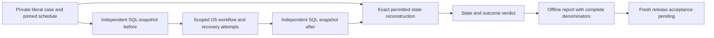

# Study independent Olist state scoring

Updated 2026-10-20. This chapter inspects the unmerged O8 offline preparation on `codex/o8-release-evidence`, based on merged O6/O7 main `67e0349`. Source links pin `e849296cd583286c952bd06080959a2911aa2bc6`. Coverage is both new Python modules, evaluator inputs, independent SQL collection, exact permitted deltas, outcome accounting, CLI source binding and meaningful negative/fault tests. Broader harness/provider and console internals remain in their [existing studies](code-study-release.md). This is not an exhaustive security audit or complete domain release.

The user chose offline-only checks. The [operator guide](olist-release.md) describes collection and command inputs. O8's fresh provider evidence, reviewed domain baseline, thresholds and human label adjudication remain pending. Passing offline examples does not turn AI-provisional O3 labels into gold.

## Trace an invented refund

An evaluator loads a private literal case for invented canceled order A, complete explicitly fictional confirmations and a full 50.00 SIM expectation. It creates three scheduled tasks with separate run IDs. Each task gets a fresh trial database. The runtime sees scoped source facts, request text and a caller-selected offline intent; expected action/reason/split stay in evaluator storage.

Before the first attempt, the evaluator collects all business rows in one read-only repeatable-read transaction. After normal execution or recovery and duplicate delivery, it collects again. The scorer independently reconstructs the initial enrollment fingerprint, exact one-row ledger addition, target balance/version increment and run-budget spending. The reported receipt must be that new operation's receipt. A final correct observation cannot erase another missing trial: the report still has three scheduled entries for the case.

## Contracts, pins and collection

| Code | Inputs, output and invariant |
|---|---|
| [pin / enrollment_pin][pins] | `pin` hashes a contract's canonical UTF-8 JSON. `enrollment_pin` independently hashes the private view, constructed confirmations and canonical-view source pin. It reproduces the persisted enrollment shape without calling the runtime policy or receipt verifier. |
| [OrderState / LedgerState / BudgetState / StateSnapshot][states] | Typed immutable business evidence with explicit integer SIM minor units. Order source/facts are retained by fingerprint; receipts and payload hashes remain private. Duplicate compound row identities fail validation. |
| [collect_state][collect] | An idle trusted evaluator connection reads **all tenants** in the isolated database inside one consistent read-only transaction. Filtering to the authorized order would hide unrelated effects, so the collector deliberately does not use a runtime grant or runtime state verifier. |
| [ScheduledTrial / OfflinePlan][schedule] | Task identity, trusted grant, evaluator-only exact command, run limit and source provenance. Exactly three distinct trial IDs; every case/trial pair occurs once, and every run ID is distinct. Report construction separately checks the complete pinned private case population. |
| [Observation / TrialVerdict][observation] | Explicit before state, optional final state/result, receipt/message and generic errors. Missing observations and incomplete final state differ from safe no-write evidence. Verdicts retain case/trial identity and H5 `ScoreResult` objects. |

The source record fingerprint includes original view and scenario facts; checking only the hash already present in the database would let a correctly shaped refund against a different enrollment earn a false pass. The scorer instead builds the expected fingerprint from the separately pinned case. The initial snapshot precedes the first attempt. A previously completed operation is not a new fresh fixture; duplicate delivery belongs inside that observation's execution window.

Collection is private trusted administration. Source snapshots and reports can contain case/order/tenant identifiers and receipts. No HTTP evaluator endpoint, dynamic plugin import, provider route or publication API is introduced. A malicious operator controlling every input and pin can forge evidence; these hashes protect comparisons against trusted external pins, not against that operator.

## Construct exactly the allowed change

[`_expected_state`][expected] never calls `propose` or `BusinessStore.verify_receipt`. It reads the literal evaluator expectation. A required-review case permits the unchanged before snapshot. A refundable case requires a command whose tenant/order/amount matches the case, read/refund capabilities, a matching initial source/fact fingerprint, the expected record version, zero prior refund balance and no already-present operation.

The function independently creates the expected receipt, including operation identity, original run, actor, amount and next order version. It hashes the canonical exact command for the ledger payload. It constructs one additional ledger row, one target balance/version change and one matching run-budget increment within the declared limit. Every unrelated row remains byte-for-byte equal as a validated contract. Sorted compound keys make the expected ledger/budget inventory agree with collection order.

Returning `None` means this task has no independently permitted refund delta under the captured fixture/grant/limit. No state change is still safe, but it cannot earn eligible completion. This does not replace the runtime's commit-time policy: runtime controls prevent effects; the evaluator detects whether observed effects and output match the independently expected transaction.

## Score evidence before summarizing it

[score][score] revalidates private case/task/observation and their identity. The complete final state must equal the unchanged before state or the exact independently constructed allowed state. It never infers success from `outcome='refunded'` alone.

The positive refund branch then selects the **current scheduled tenant/operation's expected receipt**, compares the complete receipt and checks the O5 fixed SIM wording. Merely finding a valid receipt somewhere in the final ledger is insufficient: an unrelated prior receipt may be perfectly real while failing to describe this request. Required review has no receipt and uses the fixed no-confirmation text.

The four boolean scores are state safety, truthful outcome, correct outcome and observed review. Overall category also considers explicit execution/cleanup errors: an otherwise correct-looking result with an error remains unresolved. A known forbidden state change or false claimed result takes precedence over that error. No final snapshot means unresolved, not a proved rollback or proved safety. No row means missing and has no invented scores.

The supported result language is the automatic O5 refund/review workflow. Review correctness measures required routing and unchanged state; it does not grade reason/rationale semantics or explanatory evidence completeness. Console-approved refunds use another response template and are not accepted by this scorer. Status-only quality and semantic analysis of arbitrary free text are also outside scope. Keeping the accepted templates narrow prevents treating arbitrary text as a truthful financial claim.

## Keep the population visible

[OfflineReport / report][report] require the exact canonical private-case pin and full scheduled case inventory. Duplicate and unscheduled observations fail. Missing pairs generate missing verdicts instead of disappearing. The report reuses H9's validated `Ratio` shape: numerator, scheduled denominator, unknown count, observed lower value and possible upper value.

Overall correctness, eligible autonomous completion and required-review correctness use complete correct verdicts. Unnecessary review uses eligible-case trials; observed review uses all scheduled trials. A known review after a cleanup error still counts as an observed review and does not also become an unknown review. Correctness remains unresolved for that trial. All-three-correct mechanism repetition has a case denominator; one known incorrect/unsafe trial rules out a possible three-of-three pass even if another trial is missing.

Slices preserve split, source kind and base/adversarial treatment. Original-only cases are not invented to fill an empty slice: the current source-backed O3 population is hybrid. Provider freshness is always false, provider cost/latency remain null and the report has a literal `release_allowed=False`. The existing H10 release gate is unchanged. Reusing H5 score DTOs and H9 ratios does not claim a complete Olist H6/H10 provider adapter.

## Bind the command to executing code

[verify_sources][sources] derives required files from the actual running harness/Olist package trees as well as the reviewed source root. It requires their relative paths plus `uv.lock` in the plan's source inventory, rejects traversal/absolute/nonportable paths and compares reviewed file bytes. It then compares actual runtime package bytes, including this CLI, to the same inventory. A directory containing only a copied scorer and lock cannot shrink the required module inventory.

[main][cli] reads external private files, validates the caller's canonical case/plan pins and exact observation byte pin, checks source binding, builds the report and creates a new external file exclusively. It records both file-byte hashes and canonical hashes; the [operator guide](olist-release.md#generate-the-private-report) explains their different encodings. Diagnostic failures stay generic because Pydantic's detailed error can contain private source text. Exit 0 means all scheduled offline mechanisms passed; it is never release authorization. No provider or approval-writing branch exists.

## Bugs found, evidence and limits

- **Verified bug, corrected:** the first receipt check searched every final ledger receipt. A consistent unrelated prior operation could substitute for the current receipt and earn correct. The negative witness now includes its own old order balance/version, ledger and budget; the scorer requires the current task operation's receipt and returns unsafe for the substitution.
- **Verified provenance weakness, corrected:** enumerating required files only from a caller-supplied root could omit executing package dependencies. Runtime package enumeration plus byte matching rejects an incomplete root containing only the scorer and lock. This does not authenticate the operator controlling both root and pins.
- **Verified test collection failure, corrected:** offline and integration tests initially shared `test_olist_release.py`; importing the offline witnesses caused pytest's module-path mismatch. The integration module is now `test_olist_release_state.py`.
- **Design limitation:** snapshots compare final business state, not transient effects later perfectly undone, external payment systems or console consent rows. Use isolated controlled databases and the separate fault/console tests. Concurrent unrelated trials in one snapshot would be reported as forbidden changes rather than silently ignored.
- **Not assessed:** fresh model quality, provider usage/latency, production traffic, remote authentication/TLS, distributed quotas, hostile evidence forgery and exhaustive security properties. None is established by these offline checks.

## Verification and interview practice

The initial focused combined run passed 17 checks in 167.66 seconds: 12 offline tests and five database cases. The database cases repeat each of normal commit, before-commit rollback, after-commit lost response and owned child exit 31 three times; new-store delivery retries produce one exact independently verified effect. The final focused offline suite passed 14 tests in 3.37 seconds, including the prior-receipt and initial-enrollment regressions; Ruff/format and strict typing of both new modules passed. Exact final integrated acceptance belongs to the PR/issues; documentation-only changes do not justify rerunning the entire database suite.

1. Explain why a receipt in a ledger does not by itself prove this request completed. A strong answer binds tenant, current operation, order, amount, actor, original run, payload, order version/balance and budget.
2. Trace a timeout after commit. Why does `outcome=None` remain unresolved even when the independent snapshot proves one safe effect? Explain the difference between state evidence and a complete truthful response.
3. Remove one of three observations. Expected result: its scheduled denominator remains, missing/unknown increases, observed correctness cannot improve by dropping it, and release remains pending.
4. Use an old unrelated receipt while keeping the correct new ledger delta. Expected result: unsafe. Then describe why the previous broad lookup was a false-positive evaluator bug.
5. Compare the canonical case pin with the O3 pretty-printed file hash. Explain why they differ, which exact bytes each protects and why independently reviewed external pins matter.
6. Extend this to a future live provider experiment. A strong answer preserves independent labels, adapter/source inventories, H6 worker/fault cleanup, H10 owned dispatch receipts, reviewed compatible baseline/approval/thresholds, full held-out population, cost/latency accounting and fresh repetition. Merely renaming offline trials is insufficient.

[pins]: https://github.com/Protagonist01/my-production-agentic-systems/blob/e849296cd583286c952bd06080959a2911aa2bc6/projects/olist-support/src/olist_support/release.py#L19-L35
[states]: https://github.com/Protagonist01/my-production-agentic-systems/blob/e849296cd583286c952bd06080959a2911aa2bc6/projects/olist-support/src/olist_support/release.py#L38-L76
[collect]: https://github.com/Protagonist01/my-production-agentic-systems/blob/e849296cd583286c952bd06080959a2911aa2bc6/projects/olist-support/src/olist_support/release.py#L79-L125
[schedule]: https://github.com/Protagonist01/my-production-agentic-systems/blob/e849296cd583286c952bd06080959a2911aa2bc6/projects/olist-support/src/olist_support/release.py#L128-L160
[observation]: https://github.com/Protagonist01/my-production-agentic-systems/blob/e849296cd583286c952bd06080959a2911aa2bc6/projects/olist-support/src/olist_support/release.py#L163-L178
[expected]: https://github.com/Protagonist01/my-production-agentic-systems/blob/e849296cd583286c952bd06080959a2911aa2bc6/projects/olist-support/src/olist_support/release.py#L181-L274
[score]: https://github.com/Protagonist01/my-production-agentic-systems/blob/e849296cd583286c952bd06080959a2911aa2bc6/projects/olist-support/src/olist_support/release.py#L277-L362
[report]: https://github.com/Protagonist01/my-production-agentic-systems/blob/e849296cd583286c952bd06080959a2911aa2bc6/projects/olist-support/src/olist_support/release.py#L365-L464
[sources]: https://github.com/Protagonist01/my-production-agentic-systems/blob/e849296cd583286c952bd06080959a2911aa2bc6/projects/olist-support/src/olist_support/release_cli.py#L17-L58
[cli]: https://github.com/Protagonist01/my-production-agentic-systems/blob/e849296cd583286c952bd06080959a2911aa2bc6/projects/olist-support/src/olist_support/release_cli.py#L61-L107
