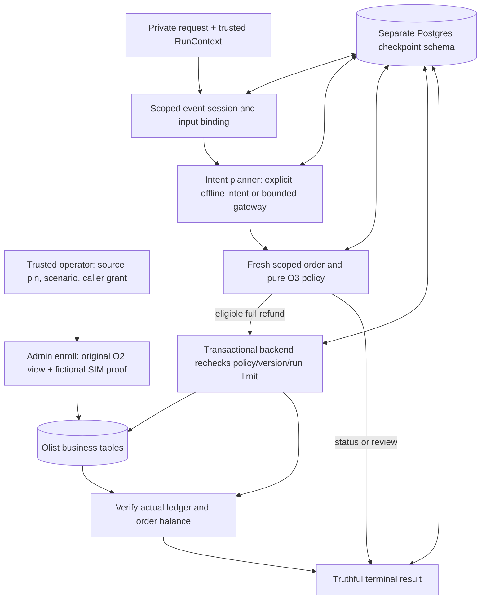

# Olist business transactions and persistent workflow

Inspected executable commit `efd822fffc1b17c0272a4c2bd966f789109081ff`, branch `codex/o4-o5-refund-workflow`, 2026-10-20 Africa/Lagos. O3 prerequisite main is `de04a96ecfefea597a7407e9551902da7dc65470`. O4 #29 and O5 #30 merged through user-reviewed #85 as `e11290a92f22588aa7c1c6d799a7b649097dc2fa`, with identical reviewed tree and verified main acceptance. C2 #84 remains a separate review. This chapter covers all five added Python modules, business SQL, callers and unit/database witnesses. It excludes SDK internals, deployment, service authentication and independent policy/model-quality validation. [Operations](olist-workflow.md) gives executable commands; [Entry 28](../BUILD_BOOK.md#entry-28--transactional-refunds-and-a-bounded-langgraph-workflow) records construction.

## State ownership and execution

The business database owns refund effects; checkpoints own progress. These are separate transactions. A checkpoint can lag a committed effect, so exactly-once business behavior depends on the operation key and business transaction, not the checkpointer alone. Intent output is untrusted and cannot supply a caller grant, tenant/order, record version or receipt.

An invented 50.00 SIM example follows the operator CLI into `SupportWorkflow.run`: trusted tenant `invented-tenant`, order `invented-order`, event `invented-refund-event`, run `attempt-1`. The fixed offline planner returns `refund`. The graph reads version zero, runs O3, and constructs a 5,000-minor command whose operation key is derived from the event. The backend checks read/refund scope, locks the operation, run budget and order, rechecks O3, updates balance to 5,000/version one, spends 5,000, and inserts a receipt in one commit. The result node rereads ledger and balance before saying 50.00 SIM is committed. After a crash, run `attempt-2` uses the same event; a repeated commit returns the original receipt and attribution without spending again.

## Contracts and business schema

| Source | Inputs, invariants and consequences |
|---|---|
| [Identity and CallerGrant][grant] | Bounded non-whitespace identity strings, tenant/actor, explicit order IDs and read/refund capabilities. `require` checks all three scope dimensions before lookup. This is a trusted grant DTO, not authentication. |
| [RefundCommand and RefundReceipt][command] | Exact integer hundredths, positive amount at most 10,000, SIM literal, expected nonnegative version. Receipt adds deterministic ledger ID, resulting positive version, original execution run and actor. Pydantic strictness rejects coercion/extra fields. |
| [BusinessReview][business-review] | A state/policy conflict with no new write. It is distinct from an uncertain transport failure after commit; callers must recover uncertain completion. |
| [business.sql][schema] | Orders keyed tenant/order; budgets keyed tenant/run with spent at most limit; refunds keyed tenant/operation with an order FK; sessions keyed tenant/event with input digest. DB checks complement application validation, rather than replacing policy. |

`schema_version` comes from the harness strict base contract. Frozen attributes do not make an arbitrary trusted Python process a sandbox. Source and receipt JSON are revalidated on ordinary boundaries. A positive receipt is a shape; verification against actual state establishes the tested completion claim.

## BusinessStore construction and transaction

| Block | Execution order and why it exists | Tests / failure if removed |
|---|---|---|
| [sha / identity_hash][hashes] | SHA-256 of UTF-8 canonical structured identity. A JSON array preserves boundaries between tenant/event parts; joining arbitrary identifiers with a delimiter permits ambiguous identities. | Invented delimiter-collision witness in the unit suite. Advisory-lock hashes may serialize unrelated keys on a hash collision, while table keys still determine business identity. |
| [setup][setup] | Admin transaction takes a schema setup advisory lock, creates private schema, records version/checksum, then grants only needed table privileges. Refunds allow SELECT/INSERT, not UPDATE/DELETE; runtime never calls DDL. | Required real DB test rejects runtime ledger deletion and table creation. Admin remains trusted and can change state. |
| [enroll][enroll] | Revalidate original view/optional proof, check confirmation identity and zero prior refund, INSERT without overwrite. Store canonical view digest alongside untouched original fields. | Missing proof routes review; tampered stored source digest fails before refund. Enrollment is never agent-controlled. |
| [_connection / _order / order][order] | Owned connection uses autocommit for explicit transaction control, dict rows, five-second statement/two-second lock timeouts. Rehash original view, overlay current DB refund balance only into the fictional confirmation, and return current version. Read scope precedes SQL. | Stale caller balances cannot reset refunded state. Connection context closes resources on normal and exceptional exits. Original currency remains null in witnesses. |
| [refund preconditions and duplicate lookup][refund-start] | Revalidate grant/command; require read+refund; validate explicit run limit and aware unexpired deadline. Hash exact command, serialize tenant/operation, read old ledger. Exact payload returns original receipt, mismatched payload raises review. | Unauthorized retry cannot retrieve a receipt; new-run duplicate retains original actor/run. Duplicate lookup must come before stale-order rejection, because its own completed action changed the order version. |
| [locked commit path][refund-write] | Insert/lock tenant/run budget; reject changed limit configuration. Lock order, check expected version, run O3 against fresh source and balance, compare full amount, enforce remaining budget. Update balance/version and spending, insert receipt, check deadline, commit. | Concurrent orders cannot overspend; competing events cannot refund one order twice. A before-commit exception rolls back all writes. Consistent lock ordering avoids opposite-order cycles within this tool. |
| [after-commit hook][refund-after] | Only after transaction/connection exit does the optional test hook emulate a lost response. The effect already exists even if an exception reaches the caller. | Timeout-after-commit and hard process exit tests recover the original receipt. Treating that exception as proof of rollback risks duplicate effects. |
| [verify_receipt][verify] | Scope read; load joined actual ledger/order. Compare full receipt JSON, ledger amount, order balance, deterministic ID, recomputed command payload and resulting version. | Forged amount and admin-tampered ledger amount fail verification. This is a narrow completion verifier, not O8's independently versioned domain scorer. |
| [session][session] | Session-level advisory lock serializes tenant/event across graph execution. Insert immutable request digest, compare existing binding, commit before yielding while holding session lock, release in finally. | Changed request/policy/source cannot reuse prior completion; a dead process loses its session lock when its connection closes. A busy lock fails under the configured timeout instead of waiting forever. |

The payload deliberately excludes run ID: an original event can recover in another run. It includes expected version and amount, so changing a repeated command is not an idempotent retry. Scope is checked before old receipt lookup. A second business event for the same already-refunded order fails fresh policy/version checks even though it has a distinct operation key.

## Planner, graph nodes and checkpoint lifetimes

| Block | Code anatomy and boundary |
|---|---|
| [Request / intent / fixed planner][intent] | Request has one scoped order and bounded text; the closed intent vocabulary is refund/status/reship/review plus optional requested amount. `FixedPlanner` revalidates the explicit offline operator plan; it makes no language-quality claim. |
| [GatewayPlanner][gateway] | Caller injects the existing H4 bounded gateway and route. Replace messages with intent instructions and request text, remove tools/tool choice, cap output tokens at min(context budget, 512), declare strict IntentPlan output schema. Typed failure, tool calls or invalid/extra-authority JSON becomes review; observed usage is retained. No source/evaluator labels or admin capability enters the prompt. The gateway controls actual attempts/cost/deadline; passing an arbitrary unbounded implementation violates the composition precondition. |
| [WorkflowResult / FlowState][result-contract] | Only `refunded` may/must have a receipt. State stores ordinary dictionaries for strict checkpoint serialization, including intent usage and original execution run ID. Review carries a reason and says no new refund is confirmed. |
| [run setup / intent node][run-start] | Revalidate context/request/grant, require read scope and exact policy version, check real UTC deadline at nodes. Intent decision is validated and bound to execution run before saving. |
| [policy node][policy-node] | Read fresh scoped order and require context source-manifest match. Status reports recorded source status only. Review returns terminal outcome. Refund/reship becomes a typed O3 SupportRequest; only an eligible full-refund proposal reaches commit. |
| [commit node][commit-node] | Revalidate checkpoint proposal; derive command from trusted context/order and saved version; call backend with explicit run limit/deadline. BusinessReview becomes review. Other failures propagate so an uncertain commit is recoverable rather than misreported as confirmed rollback. |
| [result node][result-node] | Resolve actual receipt against backend state. Only a verified match formats a committed SIM message. Missing/invalid verification produces review. Usage comes from saved intent. |
| [graph assembly and resume][assembly] | Acyclic intent → policy → commit/result → END, recursion limit eight. Thread hash uses tenant/event; session fingerprint binds canonical request, policy and source digest. Existing checkpoint invokes with `None`; a new thread gets the initial request. Synchronous durability saves node progress. Saved final receipts are verified again before return; model usage retains its original run ID on recovery. |
| [serializer / setup / saver][postgres] | Official PostgresSaver with pickle fallback off and empty dynamic JSON/msgpack allowlists. Admin creates/migrates `olist_graph`, grants required table access. Runtime connection uses autocommit, dict rows and explicit search path; saver lifetime closes connection. It never runs setup from a normal request. |
| [business_cli.main][cli] | Parse bootstrap/enroll/run. Require offline mode for explicit operator intent. External-file guards refuse source inputs/results in Git. Claim a new output file before graph execution; write full private result there, aggregate outcome/path only to stdout. Validation/DB failures print typed redacted diagnostics. |

Implicit LangSmith tracing is disabled with `tracing_context(enabled=False)` and empty callbacks around graph resume/invoke. That prevents tracing environment variables from exporting source-rich state. It does not establish a complete application telemetry integration, and caller-injected gateway telemetry retains its own explicit configuration.

## Evidence and limits

The invented [unit witnesses][unit-tests] exercise all routes, deadline/scope/source/policy mismatch, malformed/injected model output, forged completion, input rebinding, structured identities, disabled implicit tracing and original-run usage after resume. The [required database witnesses][db-tests] exercise atomic writes, concurrency, budget configuration, least runtime privileges, persistent status/review/refund completion, hard-exit recovery, tampering and output-file preflight. Database helpers independently query balances/counts/sums; the hard-exit child receives only invented inputs and its temporary trial connection over stdin, never a printed credential.

The [source drill aggregate](data/olist-workflow-drill-v1.json) reuses three eligible groups from the pinned O3 private hybrid pilot. Each runs refund/status/reship and completed new-run recovery. Three ledger entries total 19,116 minor SIM, equal to order balances and budget spending, and source currency stays null. Provider calls and real payments are zero. Existing expected labels are provisional AI policy-table judgments, not independent human truth. A report-writer issue initially rejected Postgres SUM's Decimal during aggregate JSON encoding; integer conversion fixed the report, and a fresh owned trial repeated the complete drill successfully. No runtime transaction bug was inferred from that private report failure.

**Design limitation:** the database role can update order/budget/session/checkpoint state. Trusted local Python and a compromised connection can bypass tool-level checks; no RLS/authenticated service is implemented. Protect credentials/private data; O7 must introduce the user-facing authorization boundary.

**Design limitation:** checkpoints bind request/policy/source, but do not automatically migrate candidate code across deployments. Resume using the same reviewed implementation/schema; a changed candidate requires an explicit migration/recovery procedure or isolated new trial. Serialization avoids dynamic imports/pickle; it does not authenticate a DB administrator.

**Design limitation:** saved review is terminal. No human approval/reship/compensation is implemented. O6 provides audited exact-action approval; O8 provides release scoring and held-out fresh repeated trials. Live provider execution, model quality, production performance, disaster restore and broader security testing are **not assessed** here.

## Explain it in an interview

1. Why cannot LangGraph alone guarantee one refund? Explain the separate business/checkpoint commits and the after-commit crash window. Show the exact-payload original-receipt retry.
2. Why lock a run budget as well as an order? Two different orders can each be eligible but jointly exceed one run limit. Explain the shared row lock and immutable configured limit.
3. Where does text lose authority? Trace the intent schema, trusted grant/context, pure policy, fresh transactional recheck and final state verifier. Name the trusted-Python/DB-role limit.
4. How would you add approvals? Persist a review, bind exact payload and record version, authorize reviewer, recheck freshness at commit, preserve the original operation identity. Do not mutate a terminal checkpoint to simulate approval.
5. Offline exercise: use an invented 5,000-minor order, limit 4,999, and verify no ledger/balance/spend. Then use a new event with a sufficient explicit limit, force an after-commit failure, and recover with the same event/new run. Expect exactly one 5,000-minor effect and original-run receipt.

[grant]: https://github.com/Protagonist01/my-production-agentic-systems/blob/efd822fffc1b17c0272a4c2bd966f789109081ff/projects/olist-support/src/olist_support/business_contracts.py#L8-L26
[command]: https://github.com/Protagonist01/my-production-agentic-systems/blob/efd822fffc1b17c0272a4c2bd966f789109081ff/projects/olist-support/src/olist_support/business_contracts.py#L29-L48
[business-review]: https://github.com/Protagonist01/my-production-agentic-systems/blob/efd822fffc1b17c0272a4c2bd966f789109081ff/projects/olist-support/src/olist_support/business_contracts.py#L51-L52
[schema]: https://github.com/Protagonist01/my-production-agentic-systems/blob/efd822fffc1b17c0272a4c2bd966f789109081ff/projects/olist-support/src/olist_support/business.sql#L1-L33
[hashes]: https://github.com/Protagonist01/my-production-agentic-systems/blob/efd822fffc1b17c0272a4c2bd966f789109081ff/projects/olist-support/src/olist_support/business.py#L28-L33
[setup]: https://github.com/Protagonist01/my-production-agentic-systems/blob/efd822fffc1b17c0272a4c2bd966f789109081ff/projects/olist-support/src/olist_support/business.py#L36-L65
[enroll]: https://github.com/Protagonist01/my-production-agentic-systems/blob/efd822fffc1b17c0272a4c2bd966f789109081ff/projects/olist-support/src/olist_support/business.py#L68-L93
[order]: https://github.com/Protagonist01/my-production-agentic-systems/blob/efd822fffc1b17c0272a4c2bd966f789109081ff/projects/olist-support/src/olist_support/business.py#L101-L134
[refund-start]: https://github.com/Protagonist01/my-production-agentic-systems/blob/efd822fffc1b17c0272a4c2bd966f789109081ff/projects/olist-support/src/olist_support/business.py#L136-L181
[refund-write]: https://github.com/Protagonist01/my-production-agentic-systems/blob/efd822fffc1b17c0272a4c2bd966f789109081ff/projects/olist-support/src/olist_support/business.py#L182-L259
[refund-after]: https://github.com/Protagonist01/my-production-agentic-systems/blob/efd822fffc1b17c0272a4c2bd966f789109081ff/projects/olist-support/src/olist_support/business.py#L260-L264
[verify]: https://github.com/Protagonist01/my-production-agentic-systems/blob/efd822fffc1b17c0272a4c2bd966f789109081ff/projects/olist-support/src/olist_support/business.py#L266-L297
[session]: https://github.com/Protagonist01/my-production-agentic-systems/blob/efd822fffc1b17c0272a4c2bd966f789109081ff/projects/olist-support/src/olist_support/business.py#L300-L323
[intent]: https://github.com/Protagonist01/my-production-agentic-systems/blob/efd822fffc1b17c0272a4c2bd966f789109081ff/projects/olist-support/src/olist_support/workflow.py#L32-L60
[gateway]: https://github.com/Protagonist01/my-production-agentic-systems/blob/efd822fffc1b17c0272a4c2bd966f789109081ff/projects/olist-support/src/olist_support/workflow.py#L63-L116
[result-contract]: https://github.com/Protagonist01/my-production-agentic-systems/blob/efd822fffc1b17c0272a4c2bd966f789109081ff/projects/olist-support/src/olist_support/workflow.py#L119-L140
[run-start]: https://github.com/Protagonist01/my-production-agentic-systems/blob/efd822fffc1b17c0272a4c2bd966f789109081ff/projects/olist-support/src/olist_support/workflow.py#L150-L184
[policy-node]: https://github.com/Protagonist01/my-production-agentic-systems/blob/efd822fffc1b17c0272a4c2bd966f789109081ff/projects/olist-support/src/olist_support/workflow.py#L186-L218
[commit-node]: https://github.com/Protagonist01/my-production-agentic-systems/blob/efd822fffc1b17c0272a4c2bd966f789109081ff/projects/olist-support/src/olist_support/workflow.py#L223-L247
[result-node]: https://github.com/Protagonist01/my-production-agentic-systems/blob/efd822fffc1b17c0272a4c2bd966f789109081ff/projects/olist-support/src/olist_support/workflow.py#L249-L272
[assembly]: https://github.com/Protagonist01/my-production-agentic-systems/blob/efd822fffc1b17c0272a4c2bd966f789109081ff/projects/olist-support/src/olist_support/workflow.py#L274-L327
[postgres]: https://github.com/Protagonist01/my-production-agentic-systems/blob/efd822fffc1b17c0272a4c2bd966f789109081ff/projects/olist-support/src/olist_support/workflow_postgres.py#L15-L47
[cli]: https://github.com/Protagonist01/my-production-agentic-systems/blob/efd822fffc1b17c0272a4c2bd966f789109081ff/projects/olist-support/src/olist_support/business_cli.py#L23-L120
[unit-tests]: https://github.com/Protagonist01/my-production-agentic-systems/blob/efd822fffc1b17c0272a4c2bd966f789109081ff/tests/test_olist_workflow.py#L1-L100
[db-tests]: https://github.com/Protagonist01/my-production-agentic-systems/blob/efd822fffc1b17c0272a4c2bd966f789109081ff/tests/integration/test_olist_business.py#L1-L100
