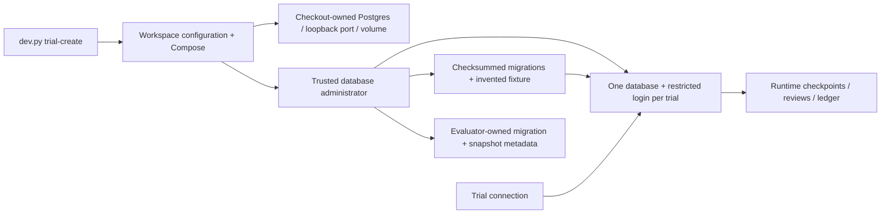

# Code study: local Postgres and trial isolation

F4 #13, branch `codex/f4-postgres-isolation`, based on merged main ce8334c. This chapter covers both new implementation files, their callers, packaged SQL and offline/disposable-database tests. Inspected source commit: **65dcefb3ea38707f288c6b3bd3a62d823c0e8ef8**. Subsequent docs do not change those implementation bytes; all anchors below were checked against that commit. Read [local Postgres](local-postgres.md) for commands/state ownership and Build Book Entry 11 for construction history.

## Architecture and an invented execution

Start `db-up`, then `trial-create --trial invented-a`. dev.py resolves its own root and forwards one locked child call to local_services.main. Workspace derives a 16-hex path hash and uses it in the Compose project name. It initializes ignored configuration without overwriting credentials, invokes the project's Compose file with a controlled empty env file and supplied image/password, then asks Compose for the actual loopback port. No free-port scan or global database URL participates.

Workspace.create writes a generated credential record first. A trial's PostgreSQL name is `pa_<workspace key>_<20 hex of trial ID hash>`; an input such as a slash/quote stays inside the hash rather than a SQL name or file path. create_trial obtains an advisory lock, refuses an existing database, creates a restricted role, attaches a full ownership marker and calls populate. SQL identifiers/literals use Psycopg composition; data values use bound parameters.

populate creates a template0 database with connections disabled, adds its marker, revokes PUBLIC database privileges and permits administrator connections. migrate builds protected metadata, locks transactional migration work, rejects missing/changed applied files and applies ordered new SQL plus its history in one transaction. seed inserts the invented checkpoint/review/ledger baseline and its text hash in a separate transaction. The bootstrap then grants trial schema/table access and finally database CONNECT. Trial credentials never select another database implicitly.

An application uses `with server.connect_trial(trial) as connection`: success commits; an exception rolls back. Mutating invented-a leaves invented-b's initial checkpoint unchanged. Connecting as a to b's database fails on CONNECT even if its name is known. This protects the declared trial login, not Python/Docker/host access: code that can read every local credential file is trusted and can bypass this intended use.

Reset is an administrator action. It verifies database/role markers, validates applied migrations and compares the exact fixture ID/hash. After its own read connection closes, Postgres refuses DROP if a runtime connection is still active; there is no FORCE or session termination. Otherwise rebuild only this generated database and retain its role/password. Drop removes the database then role; Workspace.drop removes only its credential file after server success. Another trial/service remains untouched.

## Every meaningful block

File [local_services.py](../harness/src/agent_harness/local_services.py):

| Symbol | Inputs, order and output/side effect | Invariant / caller / evidence |
|---|---|---|
| [POSTGRES_IMAGE, workspace_key, L18–24][local-image-key] | Pin an official immutable digest; hash resolved root path. | Same actual checkout selects the same project; copied configuration cannot select another root. |
| [private_json, L27–33][local-private_json] | Create parents, exclusively open a credential file, set POSIX mode 0600 and serialize. | Never overwrite an existing trial/init password. Windows directory ACLs remain a host responsibility; exclusive creation is not a fully atomic concurrent file publication. |
| [Workspace.key/project/local, L39–50][local-identity] | Derive identity/project and ignored state location from root. | No user-supplied container/volume global name. |
| [Workspace.config, L52–74][local-workspace-config] | Optionally initialize; load JSON; compare root/key/image and validate admin password shape. | Changed/copied/moved state fails. Corrupt/partial local files fail rather than selecting a guessed server. |
| [Workspace.compose, L76–116][local-workspace-compose] | Find Docker, load validated state, pass explicit project/directory/file/env-file, inject image/password, run argument list with captured output and timeout. | Caller directory and .env do not choose resources; errors do not dump interpolated secrets. The environment is inherited, so local Docker context/daemon remains trusted. |
| [Workspace.up, L118–120][local-workspace-up] | Initialize once and run Compose up with health wait. | pg_isready is startup evidence; actual connection/SQL checks supply database evidence. |
| [Workspace.server, L122–128][local-workspace-server] | Query actual service mapping; require one 127.0.0.1 numeric port; construct Server. | Restart can change the port; never reuse a cached connection URL. |
| [Workspace.trial_path/load_trial, L130–141][local-trial-config] | Hash identity into a filename; check workspace/trial identity and password before returning Trial. | Traversal strings stay within the generated name; relabelled records fail. |
| [Workspace.create, L143–156][local-workspace-create] | Reserve a local credential file, then bootstrap its server state; return Trial only on success. | Failed administrative bootstrap stays visibly incomplete; cannot silently rotate or retry as success. |
| [Workspace.drop, L158–161][local-workspace-drop] | Load/check its credential identity, remove server DB/role, then unlink its one local file. | Server failure retains local recovery identity. |
| [Workspace.down, L163–164][local-workspace-down] | Compose down, optionally with volumes. | Ordinary stop retains trial data. Volume removal requires exact workspace confirmation in the CLI. |
| [main and module guard, L167–235][local-cli] | Validate options and destructive workspace identity before dispatch; print identifiers/version; return errors nonzero with credential-safe messages. | Root wrapper forwards its absolute root; no administrator URL is printed. |

File [postgres.py](../harness/src/agent_harness/postgres.py):

| Symbol | Inputs, order and output/side effect | Invariant / caller / evidence |
|---|---|---|
| [resource_text/content_hash/FIXTURE_ID, L12–21][pg-resources] | Read packaged SQL, hash normalized UTF-8 text, identify foundation-v1. | Wheel must include resources. This is a content/compatibility check, not a source signature. |
| [trial_name, L24–29][pg-trial_name] | Validate 16-hex workspace key and nonempty bounded trial ID; derive a short legal SQL name. | Whitespace-only IDs fail; malicious identifier text cannot enter SQL directly. |
| [Trial.name/marker, L32–44][pg-trial] | Name is a short hash; marker includes full trial-ID hash/workspace. Password is excluded from repr. | Ownership checks are administrative guards; trusted administrators can edit markers. |
| [Server.connect/connect_trial, L47–73][pg-server] | Loopback, selected port, explicit database/user/password and timeout. Admin uses autocommit for CREATE/DROP DB; trial uses transaction context semantics. | Never send Server/admin credentials through AgentInput. A role knows its own DB credentials only under intended integration. |
| [migrate, L76–104][pg-migrate] | Transactional advisory lock; protected history; enumerate/sort packaged SQL; reject removed/changed applied entries; execute new DDL plus checksum row together. | Idempotent when identical. Failed new DDL leaves neither table nor history row. Unknown SQL cannot silently replace an applied version. |
| [seed, L107–117][pg-seed] | Insert snapshot table, fixture SQL and ID/hash together. | Not an idempotent reseed; only new database construction calls it. Trial role cannot read/change metadata. |
| [administration, L121–129][pg-administration] | Connect to postgres; set 5-second lock timeout; session-lock generated identity; always unlock/close. | Lifecycle requests for one trial serialize. Runtime writers do not acquire this lock; active connections make reset fail. |
| [verify_ownership, L132–142][pg-verify_ownership] | Look up DB/role comments by bound name; require both exact markers. | Refuse drop/reset of unknown or partially created state rather than guessing ownership. |
| [populate, L145–166][pg-populate] | Create closed template0 DB; mark/revoke/open admin; migrate/seed; grant narrow DML; grant CONNECT last. | Another restricted trial cannot use the transient public-default connection window. Administrator is intentionally trusted. |
| [create_trial, L169–182][pg-create_trial] | Lifecycle lock; refuse existing DB; restricted login; role marker; populate. | Cross-DB/role DDL cannot form one atomic transaction; crashes can leave incomplete state. |
| [drop_database, L185–187][pg-drop_database] | DROP only generated name without FORCE. | Active sessions are not terminated. No arbitrary database-name argument exists. |
| [reset_trial, L190–202][pg-reset_trial] | Ownership + migration + fixture validation; close own read connection; drop/populate with original credentials. | Reconstruct the exact invented baseline. New migrations may be applied during validation; do not describe it as a read-only dry run. |
| [drop_trial, L205–209][pg-drop_trial] | Ownership check; DROP DB; DROP ROLE. | Refuses another owner's marker; no production/data recovery guarantee. |

[SQL 001][pg-migration] makes schema `runtime` and three tables. JSON payloads must be objects, keys nonempty and checkpoint/review versions positive; review status is pending or resolved. Only trial INSERT/SELECT permissions make ledger entries append-only for that role. There are no business-operation keys, approval validators, compare-and-swap updates, LangGraph adapters or full workflow state machines yet. [Foundation-v1][pg-fixture] is three invented initial rows; no hidden expected label is granted to the runtime.

## Tradeoffs, risks and evidence

Database-per-trial handles missing WHERE filters and accidental database switches better than an ID convention; cost is per-trial bootstrap/storage and administrator DDL. One server/volume per checkout costs more than one shared server but makes resource ownership and developer resets clear. A reproducible SQL rebuild is easier than copying a live template; bigger snapshots may later require a frozen template or snapshot restoration with the same evidence boundary. Measure bootstrap/storage before changing this design.

**Design limitation:** local credential/admin/Docker access is trusted; this is not production tenant isolation or a same-host hostile-code sandbox. **Design limitation:** administrative DDL spans transactions and can leave partial bootstrap after a crash; retain identity, fail the run, inspect this project and explicitly recover. **Potential correctness concern:** concurrent init readers can observe a partially written JSON file; they fail rather than overwrite credentials, but atomic publication would improve concurrent startup. **Design limitation:** reset reconstruction and table privileges do not prove approval/idempotency/resume/compensation correctness. **Not assessed:** production backup/RPO/RTO, image vulnerability clearance, hostile administrators and arbitrary third-party domain migrations.

Offline [test_local_services.py][local-tests] contributes nine cases: copied state, init stability, missing Docker, wrong destructive confirmation, invalid IDs, malicious name/path input and relabelled credentials. Required [Postgres integration tests][pg-tests] has eleven cases: actual two-service port/system-ID/volume independence, cross-database login denial, restart persistence, failed-DDL rollback, exact reset, changed/missing migration refusal, fixture refusal, ledger/metadata privileges, DML rollback, active-session refusal and ownership/existing-trial guards. Ordinary check excludes database execution; explicit db-check removes that exclusion and fails if Docker is absent. Neither evidence path calls a model.

## Interview and change exercises

- Explain why changing search_path or forgetting a trial filter cannot expose another database, and why handing the agent administrator/host access would bypass the boundary.
- Trace a checkpoint update followed by an invalid review status: the connection context rolls back both writes. Contrast this with CREATE/DROP DATABASE, which cannot be one transaction.
- Leave a trial connection open and attempt reset: expect ObjectInUse, a still-live connection and preserved state. Close it and repeat: expect fixture step=start/version=1.
- Explain why INSERT-only ledger privileges do not implement business idempotency: two distinct entry IDs can still represent duplicate effects until a domain tool enforces the operation key transactionally.
- Add a new domain migration in the owning vertical; define its snapshot/reset compatibility and minimal role grants. Do not edit 001, import a vertical into harness, or claim fixture hash validates real-source provenance.

The root [study guide](../CODE_STUDY_GUIDE.md) retains unresolved original source-race, response-route and fake-state-scoring findings. This infrastructure change does not fix them.

[Compose definition][local-compose] is also part of this inspected source snapshot.

[local-private_json]: https://github.com/Protagonist01/my-production-agentic-systems/blob/65dcefb3ea38707f288c6b3bd3a62d823c0e8ef8/harness/src/agent_harness/local_services.py#L27-L33
[local-workspace-config]: https://github.com/Protagonist01/my-production-agentic-systems/blob/65dcefb3ea38707f288c6b3bd3a62d823c0e8ef8/harness/src/agent_harness/local_services.py#L52-L74
[local-workspace-compose]: https://github.com/Protagonist01/my-production-agentic-systems/blob/65dcefb3ea38707f288c6b3bd3a62d823c0e8ef8/harness/src/agent_harness/local_services.py#L76-L116
[local-workspace-up]: https://github.com/Protagonist01/my-production-agentic-systems/blob/65dcefb3ea38707f288c6b3bd3a62d823c0e8ef8/harness/src/agent_harness/local_services.py#L118-L120
[local-workspace-server]: https://github.com/Protagonist01/my-production-agentic-systems/blob/65dcefb3ea38707f288c6b3bd3a62d823c0e8ef8/harness/src/agent_harness/local_services.py#L122-L128
[local-workspace-create]: https://github.com/Protagonist01/my-production-agentic-systems/blob/65dcefb3ea38707f288c6b3bd3a62d823c0e8ef8/harness/src/agent_harness/local_services.py#L143-L156
[local-workspace-drop]: https://github.com/Protagonist01/my-production-agentic-systems/blob/65dcefb3ea38707f288c6b3bd3a62d823c0e8ef8/harness/src/agent_harness/local_services.py#L158-L161
[local-workspace-down]: https://github.com/Protagonist01/my-production-agentic-systems/blob/65dcefb3ea38707f288c6b3bd3a62d823c0e8ef8/harness/src/agent_harness/local_services.py#L163-L164
[pg-trial_name]: https://github.com/Protagonist01/my-production-agentic-systems/blob/65dcefb3ea38707f288c6b3bd3a62d823c0e8ef8/harness/src/agent_harness/postgres.py#L24-L29
[pg-migrate]: https://github.com/Protagonist01/my-production-agentic-systems/blob/65dcefb3ea38707f288c6b3bd3a62d823c0e8ef8/harness/src/agent_harness/postgres.py#L76-L104
[pg-seed]: https://github.com/Protagonist01/my-production-agentic-systems/blob/65dcefb3ea38707f288c6b3bd3a62d823c0e8ef8/harness/src/agent_harness/postgres.py#L107-L117
[pg-administration]: https://github.com/Protagonist01/my-production-agentic-systems/blob/65dcefb3ea38707f288c6b3bd3a62d823c0e8ef8/harness/src/agent_harness/postgres.py#L121-L129
[pg-verify_ownership]: https://github.com/Protagonist01/my-production-agentic-systems/blob/65dcefb3ea38707f288c6b3bd3a62d823c0e8ef8/harness/src/agent_harness/postgres.py#L132-L142
[pg-populate]: https://github.com/Protagonist01/my-production-agentic-systems/blob/65dcefb3ea38707f288c6b3bd3a62d823c0e8ef8/harness/src/agent_harness/postgres.py#L145-L166
[pg-create_trial]: https://github.com/Protagonist01/my-production-agentic-systems/blob/65dcefb3ea38707f288c6b3bd3a62d823c0e8ef8/harness/src/agent_harness/postgres.py#L169-L182
[pg-drop_database]: https://github.com/Protagonist01/my-production-agentic-systems/blob/65dcefb3ea38707f288c6b3bd3a62d823c0e8ef8/harness/src/agent_harness/postgres.py#L185-L187
[pg-reset_trial]: https://github.com/Protagonist01/my-production-agentic-systems/blob/65dcefb3ea38707f288c6b3bd3a62d823c0e8ef8/harness/src/agent_harness/postgres.py#L190-L202
[pg-drop_trial]: https://github.com/Protagonist01/my-production-agentic-systems/blob/65dcefb3ea38707f288c6b3bd3a62d823c0e8ef8/harness/src/agent_harness/postgres.py#L205-L209
[local-image-key]: https://github.com/Protagonist01/my-production-agentic-systems/blob/65dcefb3ea38707f288c6b3bd3a62d823c0e8ef8/harness/src/agent_harness/local_services.py#L18-L24
[local-identity]: https://github.com/Protagonist01/my-production-agentic-systems/blob/65dcefb3ea38707f288c6b3bd3a62d823c0e8ef8/harness/src/agent_harness/local_services.py#L39-L50
[local-trial-config]: https://github.com/Protagonist01/my-production-agentic-systems/blob/65dcefb3ea38707f288c6b3bd3a62d823c0e8ef8/harness/src/agent_harness/local_services.py#L130-L141
[local-cli]: https://github.com/Protagonist01/my-production-agentic-systems/blob/65dcefb3ea38707f288c6b3bd3a62d823c0e8ef8/harness/src/agent_harness/local_services.py#L167-L235
[pg-resources]: https://github.com/Protagonist01/my-production-agentic-systems/blob/65dcefb3ea38707f288c6b3bd3a62d823c0e8ef8/harness/src/agent_harness/postgres.py#L12-L21
[pg-trial]: https://github.com/Protagonist01/my-production-agentic-systems/blob/65dcefb3ea38707f288c6b3bd3a62d823c0e8ef8/harness/src/agent_harness/postgres.py#L32-L44
[pg-server]: https://github.com/Protagonist01/my-production-agentic-systems/blob/65dcefb3ea38707f288c6b3bd3a62d823c0e8ef8/harness/src/agent_harness/postgres.py#L47-L73
[pg-migration]: https://github.com/Protagonist01/my-production-agentic-systems/blob/65dcefb3ea38707f288c6b3bd3a62d823c0e8ef8/harness/src/agent_harness/migrations/001_foundation.sql#L1-L20
[pg-fixture]: https://github.com/Protagonist01/my-production-agentic-systems/blob/65dcefb3ea38707f288c6b3bd3a62d823c0e8ef8/harness/src/agent_harness/fixtures/foundation-v1.sql#L1-L7
[local-tests]: https://github.com/Protagonist01/my-production-agentic-systems/blob/65dcefb3ea38707f288c6b3bd3a62d823c0e8ef8/tests/test_local_services.py#L1-L68
[pg-tests]: https://github.com/Protagonist01/my-production-agentic-systems/blob/65dcefb3ea38707f288c6b3bd3a62d823c0e8ef8/tests/integration/test_postgres_isolation.py#L1-L248
[local-compose]: https://github.com/Protagonist01/my-production-agentic-systems/blob/65dcefb3ea38707f288c6b3bd3a62d823c0e8ef8/compose.yaml#L1-L17
