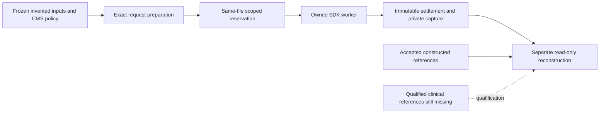

# Prior Auth release-readiness code walkthrough

Inspected November13,2026: branch `codex/prior-auth-release-readiness`, based on
main4d2b174(PR158). This chapter covers the new opt-in root modules and their tests;
it does not claim a line-by-line audit of the Java dependency or clinical qualification.
The earlier [pipeline chapter](code-study-prior-auth-pipeline.md) remains the source
for intake, native tools, SQL handoff and authenticated operator composition.

The proposed references do not enter the model request. A passing canary, matching
quote or accepted JSON response does not supply the missing clinical-reference node.

## Independent structured reference

[`Facts` and `reference`](../prior_auth_reference_method.py) describe one constructed
sleep study. Decimal values avoid binary float boundary changes. Grouping by measure
keeps an AHI2/RDI18 pair distinct from two competing AHI readings in the same study.
The seven returned states are proposals derived from supplied structured facts;
they do not infer those facts from a medical note. Missing facts remain insufficient.
The default short-study method deliberately cannot produce the local30/10event labels.
Its alternative requires a separately named argument and still is not accepted
clinical truth. Neither the model nor its recognizer generates these expected values.

The [source-method findings](prior-auth-release-readiness.md#source-findings-that-change-the-evaluation)
explain two legacy concerns: grouping unlike AHI/RDI measures, and rate-times-two
event counts. Do not silently change frozen policy interpretation or old captures.
A future candidate must get its own version and fresh applicable reference evidence.

## Trace one request preparation

`prior_auth_study_draft.prepare` refuses Git storage and existing output directories.
With `policy_directory`, `verified_policy` checks the independently known compilation
pin, original CMS source bytes, selected prose and every source span. It retains the
old compilation's AI-provisional status. Without it, the code uses a plainly marked
invented shape fixture; that path cannot establish policy readiness.

`population` supplies12authored notes. `narrative` renders a controlled development
language; it is not a natural-patient simulator. `request_plan` invokes the actual
legacy `candidate.extract` for each criterion, twice. `CaptureOnly.generate` records
the exact ModelRequest then raises a private sentinel. It has no SDK, credentials or
HTTP transport. A retrieval-absent criterion produces no request. Separate-criterion
preparation gives a worst-case request inventory even when a real whole-case run could
stop earlier after a failed request.

The packet separates inputs, proposed references, exact requests, policy and actual
rules/always-review outputs. A manifest hashes those artifacts plus selected code,
lock and environment. `baseline_agreement` stays unknown until a suitable reference
method is accepted. These are real baseline executions, not real model executions.
The manifest is not an approval or full live-runner/environment attestation. The
separate scoped runner, same-ledger grant and SDK readiness must precede dispatch.

The subsequently approved development runner is [`prior_auth_study_run.py`](../prior_auth_study_run.py).
It accepts only the exact v2 manifest pin, fixed request order and its original
Windows/Python environment. It freezes every executable source file and verifies
the private credential association against the original shared authorization. The
[new budget namespace](../prior_auth_study_budget.py) lives in the same ledger file:
append-only scope, reservation, settlement and stop tables; old tables/triggers are
unchanged. The history snapshot is recomputed inside each admission transaction.
One outstanding reservation blocks others. Known settled usage replaces the pending
full token ceiling; unknown usage creates a durable stop. This differs from the old
SharedControls policy that retains every pessimistic token reservation: that policy
could not admit the approved study within2million tokens. No frozen harness change
or smaller assumed model ceiling was used to work around it.

The isolated worker caps HTTP at90seconds and the parent at110; it never retries.
Private observations retain raw responses and process phase times. The readback
candidate reconstructs checked decisions from those exact captured responses, with
no provider access. Scheduled-but-missing case trials stay missing. This study remains
constructed development even if every model output agrees with its proposed labels.

[`prior_auth_study_readback.readback`](../prior_auth_study_readback.py) opens the ledger
read-only with query-only mode, checks the externally recorded scope identity and old
history, compares each immutable settlement with its private artifact, and independently
checks the raw parse/quote evidence. It reconstructs the checked decisions from captured
responses through the frozen extractor/checker, without a provider. It reads proposed
references separately for development agreement; that path cannot create clinical gold.
Observed failures remain in denominators and missing observations stay explicit.

The first actual reconstruction exposed a caller bug: the generic example context had
`invented-tenant`, while these notes belong to `demo`. The scope fence correctly refused
the completed case. Only the reader's explicit context and its completed-case regression
changed after the provider run. All provider execution/request/reference bytes remained
unchanged. The [actual study report](prior-auth-development-study-v1.md) records this
version distinction, raw/checked agreement, incomplete citation examples and limitations.

## Trace one external payer submission

[`PasClient.submit`](../prior_auth_pas.py) takes a trusted authenticated Principal,
Submission and current canonical NoteInput/version. Revalidation blocks mutated
Pydantic instances. Write authority, tenant/case, invented provenance, demo identities,
service and pins are checked before the journal reservation or network operation.
The caller must obtain canonical state from the application store; passing a Principal
is not itself a login. This opt-in adapter is not wired to an unauthenticated endpoint.

`bundle` makes five synthetic FHIR resources. Resource ids are derived from the full
submission pin to avoid collisions between distinct requests. It exports a note hash,
not its body. The synthetic service intentionally does not depend on a licensed code
catalog or pretend to trigger a real CPAP coverage rule.

The SQLite transaction commits `reserved` before contacting the payer. This ordering
trades automatic availability for duplicate containment: a crash may leave an
unresolved reservation, but a replay cannot resend the POST. Concurrent callers see
the same tenant/request identity. A changed payload under that identity is rejected.
I/O or response-validation errors become `unknown`; exception text is not persisted.
`SystemExit`/process death is not caught as an ordinary error, so `reserved` survives.
An explicit reconciliation path is still needed; there is no automatic retry.

`Loopback` uses a fixed numeric loopback address and closed paths. `http.client`
does not follow redirects or inherit HTTP proxy environment variables. Socket/read
limits and maximum bytes bound the operation. This is an owned reference-service
connection, not a production TLS/OAuth connector.

`checked_response` separates processing outcome from review-action code. The RI
assigns new Claim ids and random response Bundle identifiers. A separate GET checks
our stable Claim identifier; the response resources must also match the patient,
payer and provider identifiers. Closed relative references prevent a payer response
from directing reads to another host. Missing/ambiguous actions and unexpected items
are refused. `complete` plus A3 remains recorded as processing complete/not required;
the receipt schema has no clinical approval field and validation always stays false.

Actual hosted testing caught a protocol difference that the first submit-shaped fake
missed: inquiry returns Parameters containing responseBundle entries, and its Bundle
can omit patient/organization resources. `checked_inquiry` requires a single match;
the common validator fetches missing identities only through closed resource paths
at the same configured service. An empty/multiple-match response remains an unresolved
inquiry, never an implicit approval. Keep this regression separate from submit tests.

## Evidence and operating limits

[`test_prior_auth_release_readiness.py`](../tests/test_prior_auth_release_readiness.py)
tests semantic counterexamples, local/national separation, stale/denied submissions,
concurrent replay, lost response, process death, wrong correlation, foreign URLs,
duplicate JSON and separated proposal labels. These tests exercise controls; they do
not estimate clinical error rates or demonstrate external-server compatibility.

[`check_prior_auth_pas.py`](evaluation/check_prior_auth_pas.py) is the independent
process witness. It checks the actual upstream Git pin, refuses an occupied port,
starts only its own Java process and waits for FHIR readiness. It uses the adapter
to submit once, checks durable replay, and performs an actual inquiry with independent
Claim readback. Finally it terminates/reaps only its own child. The
[path-filtered workflow](../.github/workflows/prior-auth-pas.yml) builds upstream at
the exact pin. A passing test cannot establish full PAS conformance, real plan rules,
public-host authentication, patient consent or clinical adjudication. Inspect the
actual workflow result for the exact PR head before claiming the external check ran.

The [release matrix](prior-auth-release-readiness.md#qualification-matrix) preserves
all eight required fields/slices. These code checks grant neither clinical reference
qualification nor production release, and clinical acceptance limits remain pending.
Build Book Entry105 records the source research, choices and actual failures.

The subsequent [reference applicability audit](prior-auth-reference-applicability.md)
compares agency policy/examples, clinical-entailment sources and newer administrative
benchmarks. It records inspected metadata revisions, gated-access and grader limits,
and unestablished CPAP coverage. It supplies no imported clinical labels. The owner did
approve the separately bounded constructed development study; that grant is distinct
from clinical reference qualification and production release.
