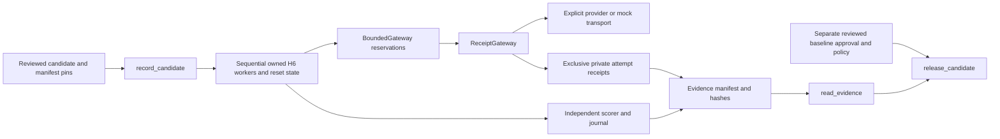

# Code study — fresh recording and release gates

Inspected: 2026-10-18, unmerged codex/h10-release-evidence based on verified fd87750. This chapter covers the five new H10 modules, root dispatch and adversarial tests. Source permalinks are added after the executable source commit. Existing H6/H9 boundaries are explained in [trial](code-study-trials.md) and [reporting](code-study-scorecards.md) chapters. [Operations](release-evidence.md) lists exact arguments and trust/approval requirements; [Build Book Entry 23](../BUILD_BOOK.md#entry-23--fresh-dispatch-receipts-and-independently-reviewed-releases) records construction choices. Verification is offline only by user instruction.

## Trace an invented case

The public request is `hello, shared contracts`. UppercaseAgent builds system/user messages from RecordingConfig and public AgentInput; no expected output or hidden state enters the request. A fresh worker calls BoundedGateway, which reserves its partition before ReceiptGateway dispatches to the selected transport. The mock computes uppercase anew on every dispatch. ReceiptGateway stores the detached exchange with an occurrence and random nonce before returning. UppercaseAgent writes actual returned output to the trial file. UppercaseScorer independently reads that file and compares it with evaluator-only expected output. The H6 parent owns state cleanup and journal rows; the recorder seals their canonical digest and each raw receipt digest.

The same request repeated three times can produce the same answer three times. The witness is three independent dispatch receipts with distinct run/trial scopes and nonces, not three different strings. Every fresh worker has its own gateway and isolated state; later recording executions always use new output directories. A killed worker, admission denial, missing receipt, failed state cleanup or usage mismatch cannot be turned into complete fresh evidence.

## Code anatomy and invariants

| Symbol | Inputs → effects → output | Why the boundary matters |
|---|---|---|
| CandidateSpec / verify_sources | External behavior/source inventory and source root → byte-hash checks | Version labels alone cannot detect changed source/configuration. All declared changes invalidate the whole capture. |
| AttemptReceipt / EvidenceManifest | Actual ModelExchange and execution times → immutable canonical contracts | Raw private evidence remains separate from reviewed exportable H3 fixtures. |
| BaselineApproval / ReleasePolicy | External reviewer reference, exact digests, dates and numeric policy | Candidate recording cannot select or promote its own baseline. |
| validate_fresh | Reviewed schedule/spec → validate three trials, fresh mode, identity and aggregate budget partitions | No prior response cache or population shrink can satisfy freshness. |
| ReceiptGateway.generate | Context/request and bounded timeout → one owned dispatch, exclusive receipt write → response | Serialization prevents ambiguous occurrence capture; write failure fails the worker before success reaches the agent. |
| CaptureFactory | Trusted FreshComponents → owned ProviderGateway/BoundedGateway → H6 TrialComponents | Generic adapters supply transport, never a replay gateway; H7 requires an explicit fault-aware adapter. |
| record_candidate | Independently pinned spec/manifest and trusted composition → reset-state H6 execution → sealed manifest | Source hashes are checked before and after execution; existing output cannot be resumed or overwritten. |
| UppercaseFactory | Selected invented composition and matching fingerprints → optional lazy provider adapter or mock | CLI inventory covers all runtime harness source and lock bytes; no data-driven imports or provider fallback. |
| read_evidence | Exact external pins, private artifact root and reviewed fault plan → detached verified evidence | Reconciles every scheduled context, receipt hash, occurrence, nonce, usage total and inventory. |
| compare_evidence | Two verified captures and reviewed report policy → case IDs that lost a trial pass | Fresh wall clocks differ; seeds/budgets/deadline durations and evaluation population/treatment must match. |
| release_candidate | Verified pair, expected current candidate pin, external approval/policy pins and trusted clock → blockers/allowed | Any critical event, incompleteness, mock evidence, stale approval, regression or failed required trial blocks. |
| release_cli.main / dev.main | Explicit argument vector → locked module invocation/private files/nonzero failures | Comparison never grants approval; release never changes approval files or deploys anything. |

The pin helper accepts WireContract because ModelRequest uses schema version 2 and the evaluation/release DTOs use Contract schema version 1. Both expose the same canonical serializer. SHA-256 hashes sorted object keys but preserves message order and exact text. source_files uses raw file bytes; scorer source inspection normalizes Python source text. Treat these as distinct declared encodings when preparing review inputs.

`read_evidence` first authenticates manifest/spec against external digests, then reads and validates the H6 journal. It uses the context's canonical pin as the directory key, gathers occurrences numerically, and requires exactly 1..N with at least one actual dispatch per scheduled trial. It rejects an agent-reported usage total that differs from the raw attempt totals. Unknown cost/tokens remain unknown and fail evidence completeness. A final recursive inventory comparison rejects extra files that an ordinary glob would miss. H9 build_scorecard then validates private scorer/source provenance before any gate uses pass facts.

The gate checks all-case lost passes, including nonrequired cases, as well as all-three correctness for every required case. Global completion/review floors cannot hide a required-case regression. `evidence_gate_only` identifies the decision's scope: external domain approval, deployment permissions, actual population safety and human identity are not inferred from a JSON `allowed` value.

## Tradeoffs, evidence and limits

| Decision | Alternative considered | Cost / next trigger |
|---|---|---|
| New whole-population capture after behavior changes | Reuse unaffected slices | More calls; reconsider only with an audited dependency map and common regression coverage. |
| Sequential bounded budget partitions | Cross-process quota server | Unused allocation is stranded; add shared accounting when real concurrent workloads require it. |
| Direct transport inside owned H6 worker | Nested H4 owned SDK worker | H6 daemons cannot spawn children. Whole-worker bounds include transport/agent/scorer; do not claim a nested attempt process. |
| External approval plus exact pins | Latest/first successful run becomes baseline | Reviewer workflow is external and must preserve access controls. No automatic candidate promotion. |
| Raw private receipts plus exclusive creation | Immediately publish H3 replay recording | Manual sanitization/review needed before fixture publication; partial failed outputs are preserved. |

Verified behavior is established by actual spawned mock recording and CLI tests, plus tamper and negative gate witnesses. The positive gate unit branch uses artificial provider-labelled objects and is **not actual provider freshness evidence**. No H10 live provider call or domain release baseline exists. Existing replay and SDK integration tests remain separate evidence. See #24 for exact complete-suite/package/hosted results.

**Design limitation:** trusted generic factories declare their source/config dependencies and origin. A malicious Python adapter can lie, bypass the supplied gateway or forge files; this is not hostile-agent isolation. The built-in CLI constrains its composition and checks the entire harness inventory, but does not authenticate an operator or approval author. **Operational trust boundary:** independently stored pins and approvals must actually be reviewed and protected. **Private handling:** raw receipts include model text and private identities; Windows ACLs are inherited. **Not assessed:** production domain quality, live H10 latency/cost, signed approval infrastructure, hostile host clocks and real domain fault adapters.

## Interview practice and maintenance

- Why can equal responses still prove separate attempts? Explain gateway ownership, exact occurrence/run/trial identity, random nonces and the no-resume path. Avoid claiming cryptographic provider attestation.
- Why keep approval outside the recorder? Trace exact baseline/policy pins and the timing checks. Explain why a self-comparison cannot produce an approved baseline.
- A model prompt changes but scores stay identical. What breaks? The externally expected candidate spec pin changes; old evidence fails. New whole-population dispatch is required even if replay still passes.
- A candidate improves its average but loses one required pass. Follow compare_evidence, required-case checks and the nonzero release result. An aggregate floor cannot waive the regression.
- A capture contains three rows but two receipts. read_evidence rejects the missing scheduled dispatch before any quality decision. Re-run using a new directory; do not copy an old receipt.

When extending a composition, update its source inventory, behavior digests, expected candidate pin, generic factory registration, independent scorer/fault compatibility and negative tests together. Changes to evaluator/policy/environment also require a newly reviewed compatible baseline. Refresh immutable symbol anchors after the source commit and run the documentation verifier; keep measured offline evidence distinct from a future live domain release.
