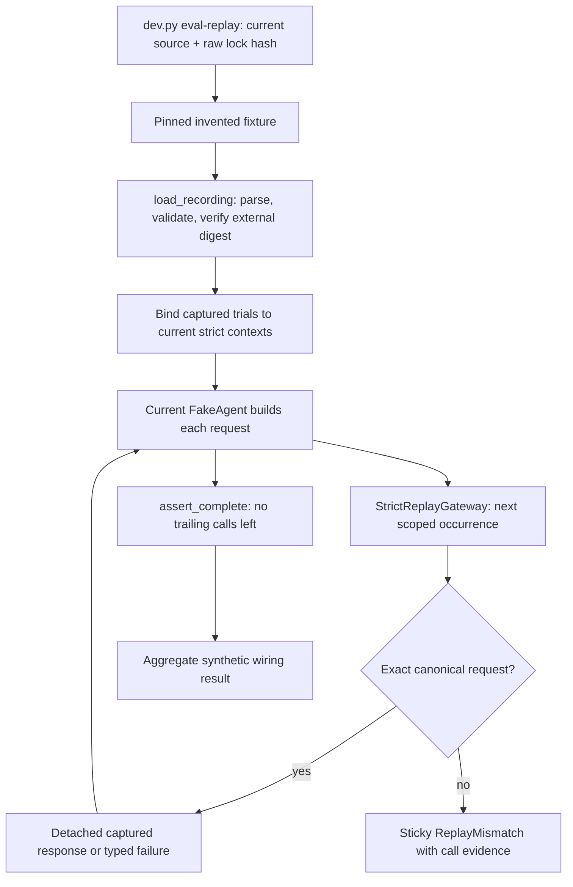

# Code study — immutable model recordings and strict replay

Inspected source: **fbf0d80a4d450ab9de27b325108613b9fdc497c5** on `codex/h3-strict-replay`, based on merged main 9282d87 (H2 #72). H3 is unmerged. This chapter covers all meaningful blocks in recording.py, replay.py and replay_example.py, their command/CI integration and 69 H3 test cases. H2 provider implementation is unchanged. Build Book Entry 15 records construction, actual failures and the line-ending fix; [runbook](replay.md) explains use and limits.

## Trace a current execution

The fixture records two successes and a timeout in each of two trials. The current agent's actual request is compared at each occurrence. A changed prompt fails even if the fixture has the desired final text. A recorded timeout is a normal typed `ModelResponse.failure`; a replay mismatch is an infrastructure exception that must not become a scored model outcome. Historical usage is returned unchanged, including unknown fields. Zero new outbound calls does not rewrite that historical usage to zero.

## Recording construction and publication

| Symbol / source | Execution and reason | Failure / evidence |
|---|---|---|
| [trial_scope][scope] and format constants | Full run/tenant/agent/case/trial identity separates equal prompts across trials. A 16 MiB read/export limit bounds local fixture bytes. | IDs are caller provenance, not authentication. Large corpora need explicit sharding/another store. |
| [RecordingProvenance][provenance] | Requires source kind/version, snapshot/policy/scorer and content policy/review references. | No default review attestation. Text references do not prove review occurred. |
| [Recording.complete_sequences][recording] | Groups rows, rejects replay-as-capture, requires synthetic category for fake capture, matches snapshot/policy and routes. Each scope must have one context and ordered contiguous occurrences. Canonical scope order is checked. | Invalid-response failures may retain the observed revision, so only successful responses require a requested revision match. Missing middle rows fail; an unknown missing suffix cannot be inferred. |
| [Recording.digest and make_recording][make] | Python-revalidate first, sort allocation order, canonical JSON copy, SHA-256 the complete versioned document. | Avoids H2's NaN-to-null trap and avoids aliasing nested dictionaries. Array/text order stays meaningful. |
| [_reviewed_bytes][review] | Walks decoded JSON string leaves/keys to check configured forbidden values and credential forms; rejects before writing. | Escaped newlines cannot hide a configured literal. This is a limited deny list plus human review, not PII discovery. Opaque signatures remain unchanged. |
| [write_recording][write] | Write private sibling → flush/fsync → exclusive hard link into final path → unlink staging. Returns canonical content digest. | Concurrent writes cannot replace a published destination. Failed fsync/link cleanup is tested. Unsupported filesystems fail; abrupt crashes may leave a staging file. |
| [_unique_object / _reject_constant / load_recording][load] | Bound read, reject duplicate keys/non-finite JSON, validate through strict JSON wire semantics, compare trusted external pin, return detached snapshot. | Error text never prints malformed contents. A digest with an attacker-controlled pin gives no authenticity; later disk edits do not mutate a loaded gateway. |

Alternative considered: SQLite would give transactions and selective queries. A small exportable fixture is inspectable, has no service lifecycle and can be shipped in a base wheel. The tradeoff is loading the document into memory and publishing one complete file. Revisit when actual case corpora or query needs justify a store. Application-level exclusive creation does not defend against an administrator editing a file; the external pin detects the changed content on the next load.

## Replay state and matching

| Symbol / source | Execution and reason | Failure / evidence |
|---|---|---|
| [ReplayBinding.compatible_context][binding] | Remove only run ID, mode and code/candidate version from two JSON views, then compare the remaining conditions exactly. Current mode must be strict replay. | Explicitly allows current code while retaining source policy/data/lock, clock, seed, budget and trial identity. Lock, tenant or event changes are not quietly accepted. |
| [ReplayMismatch][mismatch] | Retains structured context, occurrence, reason and optional request fingerprints; constructs typed nonretryable replay evidence. | Text includes case/trial/call but no prompt/schema/body. Domain identifiers still require appropriate log handling. |
| [StrictReplayGateway.__init__][init] | Snapshot the validated recording; group its rows; validate/detach every binding; require each captured scope exactly once; allocate independent cursor state and a lock. | Missing, duplicate or fabricated source bindings fail before caller execution. No provider transport can be supplied. |
| [_fail][fail] | Save one mismatch and raise it. | Later generate/completion calls re-raise that failure, so catching a mismatch cannot manufacture a passing session. |
| [generate][generate] | Validate context; under lock check failed/closed/bound state, validate/detach request, get next occurrence, compare complete canonical JSON, advance and return a detached response. | Changed context, invalid request, missing occurrence or mismatch fails before response delivery. Invalid context contracts raise validation errors before matching. Caller scheduling still determines which concurrent identical request receives which occurrence. |
| [assert_complete][complete] | Reject any earlier mismatch and every scope with unconsumed calls; otherwise seal the session. Repeated completion checks are harmless. | A matching prefix cannot pass. Extra calls or calls after completion fail. Callers must invoke this method after current agent code returns. |

Object-key reordering normalizes; prompt whitespace, message order, signed parts, tool IDs/results/schemas, output schema, sampling settings, endpoint/model/revision and serializer version do not. A fingerprint is useful evidence, but matching compares canonical strings directly. Per-scope cursors preserve repeated responses instead of collapsing them into a hash cache.

The session holds its own snapshot/cursors. Another session can consume the same fixture independently. Loading or reading a response never grants a mutable reference into retained rows. All-trial completion is intentionally stricter than a convenience API that silently selects whatever calls happened to match.

## Standalone command, capture helper and packaging

| Symbol / source | What to understand | Evidence / limit |
|---|---|---|
| [NetworkDisabledError / _deny_network][network] | The standalone process installs an audit hook before loading the fixture; normal Python connect/DNS/datagram operations raise. | A subprocess test tries all three. No provider/trace SDK is imported. Not an OS sandbox for malicious native code or child processes. |
| [invented_recording][author] | Maintenance-only helper executes existing FakeAgent with FakeGateway, captures every request and typed synthetic outcome, then constructs provenance. | Normal replay never calls it. Its source revision is the committed authoring revision, not a new provider run. Fake budgets remain declarations until H4. |
| [run_invented_replay][probe] | Derive explicit current contexts from capture plus actual current source/lock, bind all trials, run current FakeAgent three times per trial, check the invented results and require completion. | This command is one fixed wiring fixture, not a general domain dataset runner or independent scorer. Both source identities remain visible. |
| [main][main] | Parse source/lock arguments; load packaged resource with separately pinned digest; compute raw lock hash; execute probe; print aggregate JSON or a safe nonzero error. | Does not load .env.local, initialize Langfuse or regenerate fixtures. Wheel resource lookup uses importlib.resources/as_file. |
| [dev.py main][dev] and [workflow][workflow] | Map eval-replay to the current module with actual source/lock arguments; run it in each of four hosted quality cells. | eval-record/eval-compare remain unavailable. Dependency setup may use network before entering the replay process. |
| [Git attributes][attributes] | Force LF for uv.lock and fixture JSON at checkout. | Raw lock hashes otherwise change under core.autocrlf=true; see the reproduced control below. |

## Tests and verified findings

[All H3 tests][tests] include current-agent execution, changed prompt/route/schema/history, cross-trial isolation, repeated distinct outputs, signatures/provider IDs, recorded errors/unknown usage, context/version/budget drift, completion, sticky mismatches, publication races, tampering/invalid JSON and nested NaN mutation. Subprocess tests remove provider/trace variables, verify the packaged fixture and deny connect/DNS/datagram calls. These establish tested behavior, not absence of all bugs.

Local final source check passed **220 tests**, sixteen strict typed source files, both import contracts, Ruff/format and the unchanged lock; six distributions/wheels built. The CLI consumed six invented calls and reproduced two timeouts. An isolated base-wheel environment without Google/Langfuse imports ran the packaged replay; wheel bytes matched all three modules and the fixture. A fresh forced-CRLF clone in a directory with spaces installed and ran the command from its parent directory with the exact clean source fbf0d80. Hosted evidence belongs to its exact PR head, not an inferred result from a local pass.

**Verified bug fixed:** a clean clone forced to core.autocrlf=true had a different raw lock hash and replay refused it. Git attributes now pin LF; the post-fix clone retained the exact pinned hash and passed replay. Normalizing the hash at replay time was rejected because provenance should identify actual bytes.

**Design limitations:** model calls only; no reset of domain reads/writes/event schedules, batch/zero-call completeness, global budget enforcement, live latency, fresh quality or production release guarantees. Content review/deny lists are incomplete privacy controls. API caller contexts/references are not authentication. In-process Python is trusted; malicious code can bypass application conventions. The file writer is immutable by this API, not a WORM device. Future H5/H6/H8/H9/H10 and vertical adapters own those controls.

## Interview practice and a safe change

1. Why is a request hash insufficient? Explain identical requests at different occurrences/trials, distinct sampled outcomes and why current code must consume every expected call.
2. How can current code change while replay context remains exact? Show the explicit exceptions for run/code/candidate and retained policy/data/clock/seed/budget/lock. Explain why an implicit context rewrite would weaken evidence.
3. A caller catches a mismatch and retries. What happens? Trace `_fail`, `_failed`, generate and assert_complete; distinguish a typed recorded timeout from infrastructure mismatch.
4. Two writers publish the same path. Explain staging/fsync/link, one winner, unchanged existing bytes and failure cleanup. Then explain what a crash or administrator can still do.
5. Why sanitize before capture? Explain request identity and signed history, reject unsafe export, and avoid claiming credential regexes detect arbitrary PII.
6. A Linux replay passes and a Windows clone fails the lock pin. Inspect raw Git/worktree bytes and attributes before relaxing strict matching. Reproduce the forced-CRLF control from Entry 15.

To extend a supported request field, first change its versioned contract/serializer through review, capture a new explicitly reviewed fixture, then add positive and changed-field negative tests. Keep old fixture/pin history. Do not make the matcher fuzzy or regenerate a fixture when a regression appears. For domain replay, inject this gateway into current workflow code, pin reads/reset writes and run independent state assertions; model replay alone cannot prove refunds or approvals are correct.

[scope]: https://github.com/Protagonist01/my-production-agentic-systems/blob/fbf0d80a4d450ab9de27b325108613b9fdc497c5/harness/src/agent_harness/recording.py#L21-L28
[provenance]: https://github.com/Protagonist01/my-production-agentic-systems/blob/fbf0d80a4d450ab9de27b325108613b9fdc497c5/harness/src/agent_harness/recording.py#L31-L40
[recording]: https://github.com/Protagonist01/my-production-agentic-systems/blob/fbf0d80a4d450ab9de27b325108613b9fdc497c5/harness/src/agent_harness/recording.py#L48-L82
[make]: https://github.com/Protagonist01/my-production-agentic-systems/blob/fbf0d80a4d450ab9de27b325108613b9fdc497c5/harness/src/agent_harness/recording.py#L84-L97
[review]: https://github.com/Protagonist01/my-production-agentic-systems/blob/fbf0d80a4d450ab9de27b325108613b9fdc497c5/harness/src/agent_harness/recording.py#L104-L137
[write]: https://github.com/Protagonist01/my-production-agentic-systems/blob/fbf0d80a4d450ab9de27b325108613b9fdc497c5/harness/src/agent_harness/recording.py#L140-L160
[load]: https://github.com/Protagonist01/my-production-agentic-systems/blob/fbf0d80a4d450ab9de27b325108613b9fdc497c5/harness/src/agent_harness/recording.py#L163-L192
[binding]: https://github.com/Protagonist01/my-production-agentic-systems/blob/fbf0d80a4d450ab9de27b325108613b9fdc497c5/harness/src/agent_harness/replay.py#L25-L38
[mismatch]: https://github.com/Protagonist01/my-production-agentic-systems/blob/fbf0d80a4d450ab9de27b325108613b9fdc497c5/harness/src/agent_harness/replay.py#L41-L73
[init]: https://github.com/Protagonist01/my-production-agentic-systems/blob/fbf0d80a4d450ab9de27b325108613b9fdc497c5/harness/src/agent_harness/replay.py#L83-L111
[fail]: https://github.com/Protagonist01/my-production-agentic-systems/blob/fbf0d80a4d450ab9de27b325108613b9fdc497c5/harness/src/agent_harness/replay.py#L113-L128
[generate]: https://github.com/Protagonist01/my-production-agentic-systems/blob/fbf0d80a4d450ab9de27b325108613b9fdc497c5/harness/src/agent_harness/replay.py#L130-L164
[complete]: https://github.com/Protagonist01/my-production-agentic-systems/blob/fbf0d80a4d450ab9de27b325108613b9fdc497c5/harness/src/agent_harness/replay.py#L166-L176
[network]: https://github.com/Protagonist01/my-production-agentic-systems/blob/fbf0d80a4d450ab9de27b325108613b9fdc497c5/harness/src/agent_harness/replay_example.py#L20-L33
[author]: https://github.com/Protagonist01/my-production-agentic-systems/blob/fbf0d80a4d450ab9de27b325108613b9fdc497c5/harness/src/agent_harness/replay_example.py#L36-L88
[probe]: https://github.com/Protagonist01/my-production-agentic-systems/blob/fbf0d80a4d450ab9de27b325108613b9fdc497c5/harness/src/agent_harness/replay_example.py#L91-L143
[main]: https://github.com/Protagonist01/my-production-agentic-systems/blob/eaae533731730ed360bcc189aa85f552904a4e69/harness/src/agent_harness/replay_example.py#L147-L169
[dev]: https://github.com/Protagonist01/my-production-agentic-systems/blob/6b20fb959e5f54a71495aeac97f5c6b9b54ca182/dev.py#L111-L293
[workflow]: https://github.com/Protagonist01/my-production-agentic-systems/blob/0f3e75681cbd08206a0435a40ce805470edeebe0/.github/workflows/ci.yml#L1-L155
[attributes]: https://github.com/Protagonist01/my-production-agentic-systems/blob/fbf0d80a4d450ab9de27b325108613b9fdc497c5/.gitattributes#L1-L3
[tests]: https://github.com/Protagonist01/my-production-agentic-systems/blob/eaae533731730ed360bcc189aa85f552904a4e69/tests/test_replay.py#L37-L685

H8 adds an optional telemetry dependency group, changing the actual lock hash. PR #78 proposes a separate invented-v2 capture and digest pin at source eaae533731730ed360bcc189aa85f552904a4e69; historical invented-v1 remains unchanged and rejects the new lock. Matching and ReplayBinding are unchanged. See [the explicit fixture review record](replay.md#h8-proposed-dependency-lock-fixture-update).
