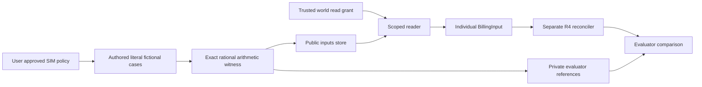

# Study independent fictional billing worlds

Inspected 2026-10-20 on `codex/r2-billing-worlds`, based on merged #87 main `058d1c7`. Implementation links pin `c6407aa7d15043cdb6a59af6f4844f3ef2ad3064`. Coverage: three new billing-world modules, their strict public/private DTOs, scoped reader and invented tests. R3's grant adapter and R4's reconciler are separate coordinated components. This chapter does not claim they were implemented in R2. Read the [operating guide](revenue-billing-worlds.md), [original-source guide](data/revenue-source.md) and [Build Book](../BUILD_BOOK.md).

## Trace one invented credit

An invented subscription declares eight seats at 1250 SIM hundredths each and a dated 1000-unit credit. Its correct invoice is the literal `9000`, checked independently as `8 × 1250 − 1000`. Related inputs with issued amounts 8500 and 9500 reference the same family/split and are respectively under/overbilled. These are three different inputs but one scenario family.

The generator creates their public terms and issued invoice without consulting the future reconciler. It stores public inputs separately from private references, checks the exact arithmetic witness and disposition, then writes an aggregate manifest after both stores commit. A trusted caller's `BillingGrant` authorizes a world ID before the reader opens any database. The returned DTO contains the source terms and actual simulated invoice, while expected amounts, family/split and review status stay in the evaluator store. Verification compares the stored records against the authored cohort, rather than trusting a new store hash alone.

The generator does not import the R4 reconciler, so changing production arithmetic cannot regenerate labels to hide its own regression.

## DTO and semantic boundaries

| Code | What it represents and why |
|---|---|
| [SubscriptionTerms][terms] | Explicit start/end, positive whole seats, integer minor-unit price, optional express uplift basis points/first uplift date, and a list of explicit contradictions. Seats/price may be absent so a review case is representable. An absent uplift rate means no expressed uplift; an expressed rate without its date requires engine review. |
| [Amendment / Credit / Invoice][events] | Dated seat/price amendments carry an explicit sequence; credits have an effective date and integer amount; the invoice records the actual simulated issued amount. These are input facts, not expected outcomes. |
| [BillingInput][input] | Case/tenant/account/subscription identity, period, terms, amendments, credits, actual invoice, SIM/source/policy declarations. Strict inherited contracts reject extra targets. The DTO intentionally permits semantically ambiguous dates; the independent engine must review them, rather than making review cases impossible to encode. |
| [BillingExpected][expected] | Literal should-be amount or null for review, disposition, authored reason and arithmetic witness. The generator does not use production extraction or reconciliation to author it. |
| [BillingCase][case] | Public input plus family/split/treatment/private reference, AI reviewer kind and provisional status. User policy approval is explicitly distinct from human review of individual labels. |

Dates are full Python dates. The approved mechanism is a half-open full calendar month, first-day events, whole seats, SIM integer hundredths, no tax/proration and exact integer annual uplifts only. This parser does not assume a fractional rounding rule. The separate engine owns semantic validation of those boundaries.

## Construct references independently

[_key][key] hashes the fixed versioned seed and invented family/treatment. No source contract or real customer identifiers participate. Related subscription variants share one family assignment; changing invoice text or date does not select a new arbitrary split.

[_literal_calculation][arithmetic] parses an expression with `ast.parse(..., mode="eval")`. It recursively accepts only exact integer constants and binary add/subtract/multiply/divide, returning `fractions.Fraction`. Calls, attributes, booleans, decimal float constants and arbitrary operators fail. This is not `eval`. Rational arithmetic gives a second exact method for each manually authored expected expression and exposes fractional minor units instead of rounding them away. It checks arithmetic consistency; it cannot certify that a legal interpretation was correct.

[cases][cases] authors six concrete charging families, each with correct, 500-under and 500-over invoices. The source assigns splits before candidate use. Nine explicit ambiguous/missing/unsupported cases have null should-be and review dispositions. Two extra yearly controls verify no uplift before the first date and compounding at the second anniversary. Every `BillingCase` is validated through its JSON representation, so dynamic fixture construction still meets strict wire types.

[validate_cases][validate] checks unique case IDs, a single split per family, a single family for all variants of a tenant/account/subscription, null targets exactly for review, signed disposition from issued versus literal expected, and the independent rational witness. It does not call the engine. The generated population is 29 cases in nine families: 9 development, 9 regression, 11 holdout; 8 correct, 6 underbilled, 6 overbilled, 9 review.

The deliberate tradeoff is transparency over scale: a small, fixed cohort exposes each arithmetic example and review boundary. It is not a random sample of invoices, a benchmark of real leakage prevalence, or human-reviewed domain truth. First-class benign ramps/credits/amendments prevent a future candidate from earning credit merely by flagging every change as suspicious.

## Separate stores, scope, verify

[prepare][prepare] resolves an external path and creates its directory exclusively. It writes only public canonical DTOs to `inputs.sqlite.inputs` and complete private cases to `evaluator.sqlite.cases`. Bound SQL parameters carry all document values. After both transactions close, it hashes the files and writes a final aggregate manifest containing versions, seed, date, population, review declaration and limitations. The two files are not atomically committed together; no final manifest is produced on failure. Existing directories are never overwritten or automatically deleted.

[read_world][reader] calls the coordinated R3 grant's keyword-only `require(tenant_id=grant.tenant_id, world_id=case_id, capability="read")` before resolving/opening the file. It opens SQLite read-only/query-only, validates the exact agent schema, fetches the requested ID and strictly parses `BillingInput`. Both parsed case ID and tenant must equal the trusted request/grant. An allowed world ID cannot make a different tenant's row visible. Account/subscription IDs remain facts inside the authorized world, not extra authority. A grant with only `reconcile` fails read.

[read_cases][private] is evaluator-only and yields full private references. It must never be called by the candidate or given its store path. These separate files and in-process DTO/grant controls are not a process sandbox or filesystem permission boundary.

[_schema][schema] compares every `sqlite_master` object with the exact table definition and its automatic primary-key index. Unexpected tables, views, triggers, indexes or changed table definitions fail, preventing the earlier original-source table-only schema gap from recurring.

[verify][verify] requires the independently reviewed manifest byte pin before parsing it. It checks each store's file hash, read-only integrity and schema, then compares the entire exact case-ID/document mapping against the authored cohort. It also checks versions, policy, count/split/disposition population, AI/provisional declaration, as-of date, approval distinction and limitations. Updating a derived database hash and supplying a new manifest pin cannot conceal a changed literal target, public input, extra row or SQL object.

[CLI main][cli] offers offline `prepare`/`verify`. It prints aggregate JSON on success and a generic error kind on expected failure, omitting exception payloads that could contain private inputs/targets. It performs no provider calls, source ingestion or billing writes.

## Evidence and practical limits

Focused checks passed **13 tests in 5.04 seconds**, plus Ruff/format and strict typing of the three new source files. Tests use invented material only. The parent combined delivery owns engine comparison, full-suite, packaging, audit and hosted evidence; those are not inferred from these local fixture checks.

The actual external preparation and verification also completed for 29 cases/nine groups, returning `verified: true`. The [aggregate snapshot](data/revenue-billing-worlds-v1.json) has manifest byte pin `97d4193e8339af5164dedc284b6b45d53fce4cb936e809ba76769adc4d104730`. Fixture source remains the authored implementation snapshot; later production-engine comparison must be recorded separately and cannot rewrite these references to match a candidate.

The [tests][tests] independently enumerate eight correct expected amounts, require null targets for all review cases, reject arbitrary AST execution, assert no engine import, reject duplicate IDs and family/split evasion, check public/evaluator storage separation, exercise denied scope before file access and wrong tenant/case rows, and reject repinned altered inputs/targets/SQL objects/counts. These are meaningful isolation and arithmetic controls, not tests that simply call the production implementation to manufacture an expected value.

**Design limitations:** labels are AI-authored provisional references; no independent human numeric/meaning review; small invented cohort, no source-derived billing truth; no tax, proration, fractional rounding, credit carry-forward or real payment; no provider/model-quality result; no claim of OS isolation or HTTP authentication. Original CUAD extraction remains separately labeled and must never be scored as if these invented subscriptions were its original facts. Passing these tests is not an exhaustive security audit.

Useful interview/debugging exercises:

- Change the production seat multiplication to use the issued invoice. The fixture labels must remain unchanged; gold-term engine tests should fail.
- Why can a 1000-unit credit be correct rather than a leakage signal? Trace the dated input credit and literal 9000 expected amount.
- Put a private expected amount into a SQL view and repin the database/manifest. Exact schema verification must reject it.
- Supply a read grant for an existing world whose stored JSON now claims another tenant/case. No row may be returned.
- Explain why `999 × 1.01` requires review here. No integer rounding rule has been approved, and exact rational arithmetic preserves the fractional result.

[terms]: https://github.com/Protagonist01/my-production-agentic-systems/blob/c6407aa7d15043cdb6a59af6f4844f3ef2ad3064/projects/revenue-integrity/src/revenue_integrity/billing_contracts.py#L15-L22
[events]: https://github.com/Protagonist01/my-production-agentic-systems/blob/c6407aa7d15043cdb6a59af6f4844f3ef2ad3064/projects/revenue-integrity/src/revenue_integrity/billing_contracts.py#L25-L38
[input]: https://github.com/Protagonist01/my-production-agentic-systems/blob/c6407aa7d15043cdb6a59af6f4844f3ef2ad3064/projects/revenue-integrity/src/revenue_integrity/billing_contracts.py#L41-L56
[expected]: https://github.com/Protagonist01/my-production-agentic-systems/blob/c6407aa7d15043cdb6a59af6f4844f3ef2ad3064/projects/revenue-integrity/src/revenue_integrity/billing_contracts.py#L59-L65
[case]: https://github.com/Protagonist01/my-production-agentic-systems/blob/c6407aa7d15043cdb6a59af6f4844f3ef2ad3064/projects/revenue-integrity/src/revenue_integrity/billing_contracts.py#L68-L78
[key]: https://github.com/Protagonist01/my-production-agentic-systems/blob/c6407aa7d15043cdb6a59af6f4844f3ef2ad3064/projects/revenue-integrity/src/revenue_integrity/billing_worlds.py#L38-L39
[arithmetic]: https://github.com/Protagonist01/my-production-agentic-systems/blob/c6407aa7d15043cdb6a59af6f4844f3ef2ad3064/projects/revenue-integrity/src/revenue_integrity/billing_worlds.py#L42-L60
[cases]: https://github.com/Protagonist01/my-production-agentic-systems/blob/c6407aa7d15043cdb6a59af6f4844f3ef2ad3064/projects/revenue-integrity/src/revenue_integrity/billing_worlds.py#L63-L344
[validate]: https://github.com/Protagonist01/my-production-agentic-systems/blob/c6407aa7d15043cdb6a59af6f4844f3ef2ad3064/projects/revenue-integrity/src/revenue_integrity/billing_worlds.py#L347-L372
[prepare]: https://github.com/Protagonist01/my-production-agentic-systems/blob/c6407aa7d15043cdb6a59af6f4844f3ef2ad3064/projects/revenue-integrity/src/revenue_integrity/billing_worlds.py#L375-L413
[reader]: https://github.com/Protagonist01/my-production-agentic-systems/blob/c6407aa7d15043cdb6a59af6f4844f3ef2ad3064/projects/revenue-integrity/src/revenue_integrity/billing_worlds.py#L416-L427
[private]: https://github.com/Protagonist01/my-production-agentic-systems/blob/c6407aa7d15043cdb6a59af6f4844f3ef2ad3064/projects/revenue-integrity/src/revenue_integrity/billing_worlds.py#L430-L435
[schema]: https://github.com/Protagonist01/my-production-agentic-systems/blob/c6407aa7d15043cdb6a59af6f4844f3ef2ad3064/projects/revenue-integrity/src/revenue_integrity/billing_worlds.py#L438-L455
[verify]: https://github.com/Protagonist01/my-production-agentic-systems/blob/c6407aa7d15043cdb6a59af6f4844f3ef2ad3064/projects/revenue-integrity/src/revenue_integrity/billing_worlds.py#L458-L505
[cli]: https://github.com/Protagonist01/my-production-agentic-systems/blob/c6407aa7d15043cdb6a59af6f4844f3ef2ad3064/projects/revenue-integrity/src/revenue_integrity/billing_worlds_cli.py#L12-L38
[tests]: https://github.com/Protagonist01/my-production-agentic-systems/blob/c6407aa7d15043cdb6a59af6f4844f3ef2ad3064/tests/test_revenue_billing_worlds.py#L1-L221
