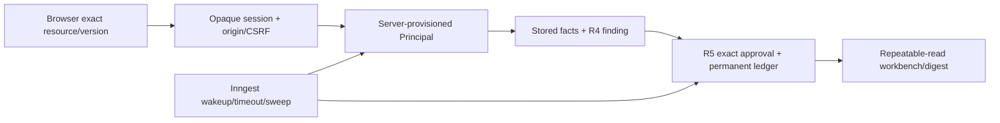

# Study the Revenue review and event boundary

Inspected 2026-10-21. R6 source `1b740970f02ba3f22826518fb545c2019d81f510` is an unmerged component of the user-authorized R5/R6/S1 batch. This chapter covers six new Python modules, application SQL, three static assets and focused tests. R5 transaction source and its repeatable-read snapshot are explained in [operations](code-study-revenue-operations.md). Root integration owns final broad/browser/hosted verification. No remote production or hosted event-server behavior is inferred from local tests.

## Follow one constructed correction

An invented original invoice is 90.00 SIM and authoritative terms require 100.00. An administrator enrolls the R2 BillingInput and assigns the invoice to provisioned operator/reviewer identities. Sign-in authenticates the password and creates opaque token/CSRF hashes in Postgres. The operator's session resolves its current enabled Principal; the HTTP request cannot name another tenant, grant, role or corrected amount.

The server proposes exactly the R4 should-be amount. The reviewer inspects the payload/digest and approves; a separate operator applies. R5 binds actor separation, permissions, original facts, cap, versions and permanent operation identity in the transaction. A retry receives the same receipt. The current finding becomes zero; historical found/applied remain 10.00. An approved compensation appends minus10.00, leaving gross applied10.00/compensated 10.00/net zero. The UI does not describe this as real revenue recovered.

## Code anatomy and consequences

| Block | Trace into behavior | What changing it could break |
|---|---|---|
| [Principal and grant][principal] | Provisioned tenant/actor and exact invoice/account IDs become closed operator or reviewer capability tuples. | An incoming browser grant would grant itself scope; allowing reviewer apply would weaken separation. |
| [Closed requests][requests] | Submission accepts operation/kind/resource/version and merge/compensation identities, but no amount/role/tenant. Decision carries exact action digest. | Permissive extra fields could forward hidden authority or an invented correction. |
| [Password/session schema][auth-schema] | Independent application tables store password hash, opaque token/CSRF hashes and bounded throttle counters. Trusted bootstrap pins SQL bytes and grants limited runtime privileges. | Runtime account insertion would bypass provisioning; changing SQL without migration must be rejected. |
| [Password functions][passwords] | Salted PBKDF2-HMAC-SHA256 with 600,000 iterations and constant-time comparison; wrong/unknown accounts still hash. | Unsalted or plaintext storage makes a database read much worse. This is a local account design, not an assessed production identity service. |
| [Authentication store][auth] | Commits throttle counters before failed login raises; sessions expire after 30 minutes, disabled accounts immediately fail resolution, and current principals are loaded on every request/event. | Raising inside the transaction before persisting failure could bypass throttling. Token possession cannot override a disabled account. |
| [Authoritative finding][finding] | Missing source yields review. Current mode substitutes current invoice amount; original mode preserves the stored original invoice. R4 calculates the should-be value and cap eligibility. | Deriving amounts from browser suggestions or hiding an unresolved source would manufacture commercial authority. |
| [Workbench and proposal service][service] | One snapshot supplies records/proposals/ledger; cumulative stages use immutable proposed adjustments, receipts own effects, and server-generated commands recheck the finding. | Separate reads can combine different database moments. Summing stages as a funnel double-counts retries/reproposals. |
| [Body and wire boundary][wire] | Streaming request bodies stop at 16,384 bytes; browser-facing integers become decimal strings. | Raw Pydantic error output could echo private fields; IEEE754 numbers round legitimate signed64-bit amounts. |
| [Loopback API][api] | Explicit origin/host, trial-specific session/CSRF cookie, bounded errors, no-cache/CSP, closed routes, role checks and exact displayed digest. | Prefix-only cookie selection could pick a second trial's CSRF token; generic success on logout failure would misstate server revocation. |
| [CLI composition][cli] | Trusted bootstrap/enrollment/account commands remain outside HTTP; serving binds loopback, disables proxy/access logs and optionally registers signed local event functions. | Publishing this local trust model remotely requires a new authentication/deployment design. |
| [Canonical event handlers][handlers] | Event data resolves a current enabled operator and canonical proposal. Sweep/receipt checks never infer approval from the event. | A review event carrying approval authority would bypass exact consent. SDK 24-hour deduplication is not a permanent ledger. |
| [Actual SDK functions][functions] | Stable step IDs wrap thread-offloaded SQL; one optional bounded wait is only a wakeup, and cron recovers missed events. | A second workflow-owned approval state or nested steps would introduce competing owners. A returned receipt confirms an effect, not necessarily a fresh effect created by that retry. |

## Browser implementation

The packaged [page](../projects/revenue-integrity/src/revenue_integrity/web/index.html), [styles](../projects/revenue-integrity/src/revenue_integrity/web/console.css) and [script](../projects/revenue-integrity/src/revenue_integrity/web/console.js) use an editorial ledger layout: dark identity rail, large serif headings, tabular amounts and restrained terracotta action emphasis. It is an operator tool with findings, exact review, append-only ledger and account hygiene views. No remote font/CDN dependency is required.

DOM elements are created with textContent rather than interpolating source notes into HTML. `money` formats decimal-string minor units with BigInt, preserving all signed64-bit digits. Mutating requests convert only safe record versions; overlarge versions explicitly require administrator review. The server injects the exact trial-specific CSRF cookie name into a meta tag, so another Revenue trial's host cookie cannot be selected by prefix. `keyFor` retains the operation key per tenant/user/resource/version/action for response-loss retries. `action` refreshes authoritative state even after an error; logout distinguishes confirmed server revocation from merely clearing the local view.

The review dialog shows the exact kind, resource/version, corrected total, adjustment, merge target/version, original operation, proposer and digest. It never treats a pending or overdue proposal as applied. API outputs redact the stored billing source from workbench records; the public UI needs amounts and findings, not the entire source contract/context.

## Verified bugs and limits

- **Verified design bug corrected before acceptance:** a Number-based browser money formatter could round signed64-bit values. Wire integer strings plus BigInt formatting and an explicit safe-version gate preserve the display/action boundary.
- **Verified design bug corrected before acceptance:** selecting the first `revenue_csrf_` cookie could choose another trial's token. The page now binds the exact server-selected name. A failed logout reports unconfirmed server sign-out rather than a false success.
- **Verified design bug corrected before acceptance:** historical approved totals initially dropped when an unapplied approval expired. Reviewer attribution plus nonrejected status preserves cumulative approval evidence; applied money still comes only from receipts.
- **Verified consistency concern corrected:** independent record/proposal/ledger reads could interleave a commit. R5's repeatable-read snapshot preserves one database view; its deterministic interleaving test is documented in the operations chapter.
- **Design limitation:** finding totals are per enrolled original invoice, while proposal stages include repeat attempts and can exceed found. They overlap and are not additive balances. Compensation is separate from gross applied and net signed ledger movement.
- **Design limitation:** SDK mocked execution stubs wait return/timeout and does not prove a live Inngest server's persistence, signature deployment, scheduling or restart behavior. Lost/early events recover from canonical SQL through timeout/sweep; production event delivery remains unassessed.
- **Not assessed:** remote authentication, production concurrency/latency, clinical/financial advice, live provider quality or real revenue recovery. No such deployment/result is claimed.

## Tests and useful exercises

The initial combined focused run passed 13 checks but failed one outdated test expectation: after an already committed receipt the handler correctly returned `already_applied`, while the double's mutated pending row expected `pending`. The regression now tests duplicate delivery separately from a new unapproved proposal. All four actual SQL cases in that initial run passed. The corrected ten offline checks passed **20.29 seconds**. After merging R5 snapshot source `1bb4579`, all four real SQL composition tests passed **131.27 seconds**, and strict typing of all six owned modules passed. Ruff check/format passed for eight owned Python files; `node --check` passed for the browser script. The SDK mocked harness emits an upstream event-loop deprecation warning; that warning is not a durable-server acceptance result. The parent records final complete checks and browser evidence separately. A UTF8-only source-read correction fixed an earlier Windows test/helper decoding issue without changing policy.

For interview practice, explain why a source quote, reviewer approval and committed receipt are three different pieces of evidence. Trace a lost response after commit and show why stable operation identity must outlive Inngest's deduplication window. Explain how an early review event can be missed without losing the decision: canonical proposal state survives, and timeout/sweep re-reads it. Compare cumulative found/proposed/approved with gross applied/compensated/net signed movement. Finally, propose a production sign-in/event deployment plan and name which local claims would need new evidence.

Offline exercise: enroll a 90.00 SIM invoice with 100.00 SIM authoritative terms, reject one proposal, approve another, apply twice, then approve compensation. Expected digest: found 10.00, proposed 20.00, approved 10.00, rejected 10.00, gross applied 10.00, compensated 10.00, net zero, exactly two ledger receipts. A compensation after an intervening legitimate change must fail without a new effect.

[principal]: https://github.com/Protagonist01/my-production-agentic-systems/blob/1b740970f02ba3f22826518fb545c2019d81f510/projects/revenue-integrity/src/revenue_integrity/console_contracts.py#L13-L33
[requests]: https://github.com/Protagonist01/my-production-agentic-systems/blob/1b740970f02ba3f22826518fb545c2019d81f510/projects/revenue-integrity/src/revenue_integrity/console_contracts.py#L36-L60
[auth-schema]: https://github.com/Protagonist01/my-production-agentic-systems/blob/1b740970f02ba3f22826518fb545c2019d81f510/projects/revenue-integrity/src/revenue_integrity/console_auth.py#L51-L91
[passwords]: https://github.com/Protagonist01/my-production-agentic-systems/blob/1b740970f02ba3f22826518fb545c2019d81f510/projects/revenue-integrity/src/revenue_integrity/console_auth.py#L30-L48
[auth]: https://github.com/Protagonist01/my-production-agentic-systems/blob/1b740970f02ba3f22826518fb545c2019d81f510/projects/revenue-integrity/src/revenue_integrity/console_auth.py#L94-L217
[finding]: https://github.com/Protagonist01/my-production-agentic-systems/blob/1b740970f02ba3f22826518fb545c2019d81f510/projects/revenue-integrity/src/revenue_integrity/console_service.py#L69-L107
[service]: https://github.com/Protagonist01/my-production-agentic-systems/blob/1b740970f02ba3f22826518fb545c2019d81f510/projects/revenue-integrity/src/revenue_integrity/console_service.py#L110-L270
[wire]: https://github.com/Protagonist01/my-production-agentic-systems/blob/1b740970f02ba3f22826518fb545c2019d81f510/projects/revenue-integrity/src/revenue_integrity/console_api.py#L26-L72
[api]: https://github.com/Protagonist01/my-production-agentic-systems/blob/1b740970f02ba3f22826518fb545c2019d81f510/projects/revenue-integrity/src/revenue_integrity/console_api.py#L75-L303
[cli]: https://github.com/Protagonist01/my-production-agentic-systems/blob/1b740970f02ba3f22826518fb545c2019d81f510/projects/revenue-integrity/src/revenue_integrity/console_cli.py#L26-L189
[handlers]: https://github.com/Protagonist01/my-production-agentic-systems/blob/1b740970f02ba3f22826518fb545c2019d81f510/projects/revenue-integrity/src/revenue_integrity/events.py#L29-L97
[functions]: https://github.com/Protagonist01/my-production-agentic-systems/blob/1b740970f02ba3f22826518fb545c2019d81f510/projects/revenue-integrity/src/revenue_integrity/events.py#L100-L151
