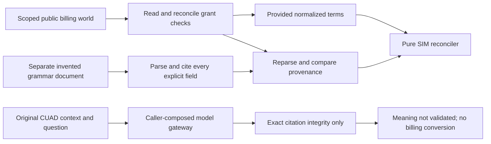

# Study cited extraction and monthly SIM reconciliation

Follow-up inspected 2026-10-24 from merged base `b915f1b`: unmerged
`codex/three-release-evaluators` adds the [three-issue evaluation preparation](three-release-evaluators.md).
The original walkthrough below retains its historical implementation/evidence scope.

Inspected 2026-10-21: committed implementation `45ebabb85a8cdbb3142ff32421767d7cff7221c3` on `codex/r4-revenue-engine`, based on merged #87 main `058d1c7c758867546085d16a1224375b0258e6b1`. The source snapshot was committed; these two new documentation files and temporary untracked R2/R3 dependency copies were present locally during documentation work. This unmerged R4 chapter covers three new runtime modules and two invented test modules, with R2 billing DTOs and R3 grants as dependencies. It does not claim a legal extraction benchmark, payment integration or deployed service. Read the [operating guide](revenue-reconciliation.md), [R1 source preparation](code-study-revenue-source.md) and [Build Book](../BUILD_BOOK.md) for context.

## Follow an invented case

Imagine three whole seats at 1,000 SIM hundredths each for January 2025, with a 2,500-hundredth issued invoice. A trusted local grant permits reading and reconciling that billing world. The tool checks capability, loads only its scoped public input, and checks the stored tenant. The pure reconciler validates a complete monthly period, checks conflicting/missing terms, applies any dated amendments/uplift, subtracts that month's credits and returns expected 3,000, delta +500 and `underbilled`. It writes no invoice or balance.

Now suppose an invented grammar document explicitly says four seats. The extracted-terms path parses that document, verifies its literal citations and full source hash and replaces the supplied three-seat terms. The result is 4,000 rather than 3,000. This is why the test intentionally gives the two paths different terms: accidentally using gold/provided terms in both paths would still pass a simpler identical-input comparison.

Original text, invented billing facts and evaluator expectations remain different trust domains. The figure has no edge from original citations to numeric billing terms.

## `reconcile.py`: validate before arithmetic

[Reconciliation][result] gives the caller a disposition, expected/issued amounts, signed delta and reason tuple. Review results deliberately omit numeric guesses. The version and unit are fixed literals; callers cannot label these results as another policy or real currency. `_next_month` computes the exclusive next boundary; `reconcile` guards December 9999 before calling it.

[reconcile][engine] first revalidates the frozen input because nested containers or unchecked model copies must not bypass contract validation. Its local `review` closure builds the same result shape for every unsupported fact. Checks run before arithmetic in this order:

1. Require exactly one first-of-month calendar interval. Reject explicit conflicts, missing initial quantity/price, partial or reversed subscription intervals and incomplete/invalid uplift facts.
2. Require first-of-month dated changes. Reject amendments outside subscription, duplicate sequences, sequences that contradict date order and empty changes. Group same-date fields; two different values for the same field require review.
3. Determine whether the subscription is active using `start <= month < end`. Apply changes no later than the billing month; retain the most recent explicit price and its effective date.
4. Starting at the explicitly declared first uplift anchor, compound anniversaries after that latest price date. An anniversary coinciding with a price reset has unknown precedence. Integer divisibility is checked before each multiplication/division result is accepted.
5. Multiply current seats by current price if active, subtract exactly that month's credits, reject excess credits/range overflow and compare with the issued invoice.

There is no Decimal/float conversion: one hundredth is the indivisible SIM unit. For an anniversary uplift, `price * (10000 + bps) % 10000 != 0` means the authorized policy cannot express the result exactly, so the engine asks for review. Rounding would introduce a new billing policy. Explicit price resets restart the base for later anniversaries; the engine does not apply historical uplift twice to a price already reset by amendment.

The engine is pure typed arithmetic. The CLI/tool wrapper owns file reads and grants, while the evaluator owns targets. This separation allows direct independent arithmetic tests without claiming that the pure function authenticates callers.

## `extraction.py`: two deliberately different meanings of extraction

| Code | Responsibility and failure boundary |
|---|---|
| [ExtractionClaim / VerifiedExtraction][original-shapes] | A candidate names supported, unsupported or uncertain status and literal spans. Verification adds an unchanged-context hash and explicit `meaning_status: not-validated`. That field prevents a correct substring from being presented as a validated commercial interpretation. |
| [verify_extraction][verify] | Revalidates both wire objects, checks case identity, requires spans exactly for supported status, compares each slice at Python character offsets and rejects overlapping/duplicate spans. It does not compare with publisher references or judge relevance. An exact irrelevant quotation is still a possible candidate error. |
| [extract / abstain][candidate] | Gives an injected callable only the public projection. `abstain` returns unsupported with no span and no model call. A Python callable is trusted code and can access its process filesystem; this API is a data projection, not sandboxing. |
| [_ModelAnswer / GatewayExtraction][gateway-shapes] | The model schema omits case identity. It bounds span count and rationale, while the wrapper retains typed usage/failure evidence separately from extraction content. |
| [GatewayExtractor][gateway] | Copies the trusted route, replaces messages with fixed instruction plus context/question JSON, removes tools, declares strict JSON schema and caps output. It rejects run/input identity mismatch and oversized input before dispatch. It calls the supplied gateway once, revalidates the response contract and binds provider/model plus any explicitly requested revision before interpreting content; failed responses, timeout or invalid content become uncertain without retrying or echoing provider errors. Successful JSON is still sent through the exact span verifier. |
| [SyntheticDocument / TermCitation / ParsedTerms][synthetic-shapes] | These are a different source kind and DTO from original text extraction. Parsed terms retain the source digest plus one exact line citation per explicit field. An original claim cannot satisfy this schema accidentally. |
| [synthetic_document][render] | Renders explicitly invented normalized facts as sorted `field=JSON-value` lines. This is a controlled fixture/input renderer; it never reads original contracts or published answers. |
| [parse_synthetic][parse] | Splits unchanged lines with retained newline lengths for offsets; rejects malformed, duplicate or schema-version fields; requires the exact complete field set. JSON/Pydantic parse ISO dates and strict values. Missing data must appear as explicit null; the parser never supplies an inferred seat count or amount. |
| [reconcile_extracted][extracted] | Revalidates the supplied parsed DTO, reparses the actual document and compares the complete result, including citations. It then replaces `terms` in a newly validated billing input. This catches a caller changing the terms but retaining a valid source hash. |

`GatewayExtractor` accepts at most 200,000 context characters and 8,192 question characters, 65,536 response characters, sixteen spans and 2,048 output tokens. The trusted route can set generation parameters, but the wrapper overwrites `max_output_tokens`, messages, tools and output schema. The caller composes the harness gateway that enforces total cost/deadline reservations; this adapter does not make arbitrary `ModelGateway` implementations safe. There is no gateway CLI option that silently enables live calls.

## `reconcile_cli.py`: keep private inputs off stdout

[reconcile_world][scoped] requires `reconcile`, then calls R2 `read_world`, which requires `read` before opening the database and checks the stored tenant. Neither a read-only grant nor a reconcile-only grant can use the exposed tool. It optionally accepts the separate synthetic document. There are no write/refund/manage-account capabilities in this interface.

[_read][read] opens only an external path and reads at most two million bytes plus one overflow byte. `external` rejects Git ancestors, including worktrees, but is not an OS access-control boundary. [_run][cli] dispatches three modes: trusted unscoped input arithmetic, scoped stored-world reconciliation and explicit original all-abstain baseline. Every mode requires a fresh external `--output` file. Opening with `x` prevents overwriting another result; stdout contains only aggregate completion metadata.

[main][main] catches validation, filesystem and SQLite errors and exits with a fixed message. It never interpolates the raw exception, which could contain an original quotation, account ID or Pydantic input value. Argparse still validates command syntax; the caller must not put private payloads or passwords in command arguments. The grant file is trusted local composition, not proof that a remote user has authenticated.

## Evidence, bugs and limits

**Verified bug, corrected:** an otherwise valid Python date at December 9999 caused `_next_month` to construct year 10000 before returning a review result. Peer review reproduced the exception. The engine now checks the unsupported boundary first, and a literal negative control expects review. This was a calendar-range error, not a financial write or data leak.

**Verified bug, corrected:** peer review supplied a valid literal quote through a response naming a different model route. The initial adapter accepted it because span verification did not bind response provenance. The adapter now revalidates the complete `ModelResponse`, then requires exact provider/model and any requested revision before handling output or failure. Three wrong-identity controls and an unchecked invalid-usage control return uncertainty; no provider payload is printed.

**Design limitation:** the original verifier checks literal integrity and case binding, not answer relevance, commercial meaning or completeness. The schema records that limit; original model-quality and normalized commercial-label review remain pending. The scripted tests do not establish resistance to all prompt injection or the quality of any real provider.

**Trust boundary:** Python candidate/gateway code, account-scoped grant construction and local files are trusted process inputs. The external-path guard is a publication safeguard, not a sandbox. A future service needs authenticated principal issuance, session lifecycle, rate/resource controls and private evidence handling before reusing these local entrypoints.

**Policy limitation:** malformed/conflicting future events conservatively require review even if they would not change today's arithmetic. No general legal amendment precedence, proration, taxation, multiple currencies, arbitrary billing cycles or fractional-seat rules are implemented. There are no mutation paths or recovered-revenue claims.

The [arithmetic tests][arithmetic-tests] use literal expected amounts and dispositions, including before/after subscription boundaries, explicit/no uplift, two anniversaries, price reset, credit/ramp changes, contradictory facts, fractional units and the calendar limit. The [extraction/tool tests][extraction-tests] inject public-only scripted responses, verify citations and forged failures, compare distinct provided/extracted terms, exercise both grant capabilities and check generic CLI errors using a private canary. Final focused evidence on Python 3.13.4 was `uv run --locked --all-packages python -m pytest -q tests/test_revenue_reconcile.py tests/test_revenue_extraction.py`: **41 passed in 0.84 seconds**, with external `TEMP`/`TMP`. Ruff check/format passed for all five owned Python files. Strict mypy passed three modules with explicit harness/Revenue source `MYPYPATH`; the initial narrow invocation omitted these paths and failed on untyped installed imports before the corrected command passed. No source change was needed for that invocation error; root integration evidence belongs to the combined delivery. R2's separate worker compared 29 independently authored provisional fixture outcomes with no mismatches. This is deterministic mechanism evidence rather than real contract quality.

## Explain and change it safely

- **Architecture pitch:** original quotation integrity and constructed billing arithmetic are independent. A model proposes spans; code verifies literal evidence. Only declared synthetic billing facts reach the pure amount engine. Trusted scoped I/O remains outside arithmetic.
- **Trace exercise:** change the supplied invoice from 2,500 to 3,500 while keeping three seats at 1,000. Expected remains 3,000, delta becomes -500 and disposition becomes overbilled. The engine does not edit that invoice.
- **Debug exercise:** return a supported model answer with a correct quote at the wrong Unicode offset. The gateway wrapper returns uncertain with `invalid_extraction_response`, preserving usage; it does not retry or accept approximate matching.
- **Tradeoff:** rejecting fractional uplift is less permissive than rounding, but follows the constructed policy without introducing a hidden money rule. A change needs explicit rounding policy, new independent examples and a new policy version.
- **Security exercise:** a read-only principal invokes `reconcile-world`. It fails before opening the store because the tool checks `reconcile`; a reconcile-only principal fails the separate read check. Editing a local trusted grant is outside the remote-authentication model because no remote service exists.
- **Scale follow-up:** the current event scan is bounded by input file size and Python's supported date range, not designed as a hostile public API. An API would need declared collection/time limits, authenticated grant issuance and concurrency controls; a general contract model additionally needs reviewed normalized labels and held-out fresh-provider evidence.

[result]: https://github.com/Protagonist01/my-production-agentic-systems/blob/45ebabb85a8cdbb3142ff32421767d7cff7221c3/projects/revenue-integrity/src/revenue_integrity/reconcile.py#L11-L21
[engine]: https://github.com/Protagonist01/my-production-agentic-systems/blob/45ebabb85a8cdbb3142ff32421767d7cff7221c3/projects/revenue-integrity/src/revenue_integrity/reconcile.py#L28-L137
[original-shapes]: https://github.com/Protagonist01/my-production-agentic-systems/blob/45ebabb85a8cdbb3142ff32421767d7cff7221c3/projects/revenue-integrity/src/revenue_integrity/extraction.py#L29-L40
[verify]: https://github.com/Protagonist01/my-production-agentic-systems/blob/45ebabb85a8cdbb3142ff32421767d7cff7221c3/projects/revenue-integrity/src/revenue_integrity/extraction.py#L43-L61
[candidate]: https://github.com/Protagonist01/my-production-agentic-systems/blob/45ebabb85a8cdbb3142ff32421767d7cff7221c3/projects/revenue-integrity/src/revenue_integrity/extraction.py#L64-L78
[gateway-shapes]: https://github.com/Protagonist01/my-production-agentic-systems/blob/45ebabb85a8cdbb3142ff32421767d7cff7221c3/projects/revenue-integrity/src/revenue_integrity/extraction.py#L81-L90
[gateway]: https://github.com/Protagonist01/my-production-agentic-systems/blob/45ebabb85a8cdbb3142ff32421767d7cff7221c3/projects/revenue-integrity/src/revenue_integrity/extraction.py#L93-L190
[synthetic-shapes]: https://github.com/Protagonist01/my-production-agentic-systems/blob/45ebabb85a8cdbb3142ff32421767d7cff7221c3/projects/revenue-integrity/src/revenue_integrity/extraction.py#L193-L209
[render]: https://github.com/Protagonist01/my-production-agentic-systems/blob/45ebabb85a8cdbb3142ff32421767d7cff7221c3/projects/revenue-integrity/src/revenue_integrity/extraction.py#L212-L219
[parse]: https://github.com/Protagonist01/my-production-agentic-systems/blob/45ebabb85a8cdbb3142ff32421767d7cff7221c3/projects/revenue-integrity/src/revenue_integrity/extraction.py#L222-L250
[extracted]: https://github.com/Protagonist01/my-production-agentic-systems/blob/45ebabb85a8cdbb3142ff32421767d7cff7221c3/projects/revenue-integrity/src/revenue_integrity/extraction.py#L253-L262
[scoped]: https://github.com/Protagonist01/my-production-agentic-systems/blob/45ebabb85a8cdbb3142ff32421767d7cff7221c3/projects/revenue-integrity/src/revenue_integrity/reconcile_cli.py#L25-L36
[read]: https://github.com/Protagonist01/my-production-agentic-systems/blob/45ebabb85a8cdbb3142ff32421767d7cff7221c3/projects/revenue-integrity/src/revenue_integrity/reconcile_cli.py#L39-L44
[cli]: https://github.com/Protagonist01/my-production-agentic-systems/blob/45ebabb85a8cdbb3142ff32421767d7cff7221c3/projects/revenue-integrity/src/revenue_integrity/reconcile_cli.py#L47-L87
[main]: https://github.com/Protagonist01/my-production-agentic-systems/blob/45ebabb85a8cdbb3142ff32421767d7cff7221c3/projects/revenue-integrity/src/revenue_integrity/reconcile_cli.py#L90-L96
[arithmetic-tests]: ../tests/test_revenue_reconcile.py
[extraction-tests]: ../tests/test_revenue_extraction.py
