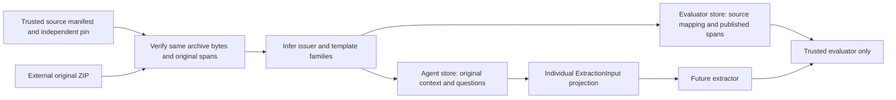

# Study original-contract preparation

Inspected 2026-10-20: R1 #39 branch `codex/r1-contract-corpus`, implementation commit `229a238a495bd515df8024cb0a97c086863a7b27`, based on verified #86 main `67e0349`. This chapter covers four new Python modules and the invented boundary tests. The code is unmerged preparation, with no extractor, billing engine, model-quality score or remote deployment. Read the [source runbook](data/revenue-source.md) and the [build history](../BUILD_BOOK.md) alongside it; the parent delivery maintains Entry 30.

## Trace an invented contract

Imagine four invented documents: two share issuer A; one of those has exactly the same context as an issuer B document; a fourth has unrelated text. Their published questions ask for a document name and renewal term. The document-name answer contains a literal span at character zero; the renewal question has no answer. The candidate has authored neither reference.

The CLI loads the independently pinned source manifest. The importer hashes the same archive buffer that it opens as ZIP, checks the complete member, then validates title/question uniqueness, consistent category coverage, answerability and exact offsets. It groups the first three documents together by transitive issuer/text relations before choosing splits. Each original context goes into the agent database once, while its questions refer to an opaque contract key. Evaluator-only targets preserve answer strings, offsets and source identity in a separate database. A final aggregate manifest pins both completed stores. Verification reads the original source again and compares every stored record against it.

The future extractor is deliberately absent from this implementation. The arrows to it describe the allowed input boundary, not a completed evaluation integration.

## Contracts: separate the task from its references

| Code | Inputs, behavior and invariants |
|---|---|
| [SourcePin][pin] | Records source commit/URL, archive and member bytes/hashes, expected contract/category counts and the source license. `load_pin` must verify the manifest's bytes against an independently supplied digest. This metadata is trusted; SHA256 establishes byte equality, not annotation authority or permission. |
| [ExtractionInput][input] | Exactly `case_id`, original `context` and published `question`, plus inherited schema version. The frozen strict contract rejects extra fields, so a target/family/split cannot be included as an unnoticed input field. The entire source context remains visible because locating the clause is the task. |
| [Span][span] | A nonnegative Python character offset and nonempty literal text. Its end is `start + len(text)`; this is not a UTF-8 byte offset or a PDF page coordinate. |
| [PublishedTarget][target] | The case/category, original answer spans and impossible flag, inferred family/split, original-source category and publisher-reference authority. The validator requires impossible exactly when the answer tuple is empty. It does not normalize dates, invent billing terms, or turn legal reference spans into numeric billing gold. |

`Contract` supplies strict, frozen, extra-forbidden wire validation from the harness; the revenue package imports no other industry package. Nested [_Answer, _Question, _Paragraph, _Document and _Corpus][source-shapes] validate the publisher's JSON shape, including exactly one full context per document. These internal classes are parser shapes, not candidate APIs.

## File and archive trust boundary

| Code | Execution and failure behavior |
|---|---|
| [sha256 / external][io-path] | `sha256` hashes bytes, while `external` resolves paths and rejects any Git checkout ancestor, including a worktree `.git` file. This keeps original contracts and evaluator stores out of version control. It is not a filesystem access-control system and does not contain arbitrary Python. |
| [load_pin][load] | Reads one manifest buffer, checks its externally supplied hash and parses that same buffer. A substituted manifest cannot be silently repinned by the importer. |
| [pinned_member][archive] | Bounds archive reading to declared size plus one byte, compares size/hash, opens those same verified bytes, rejects duplicate names, unsafe member paths, encryption and oversized entries, then checks the selected member's size/hash. Nothing is extracted onto disk. Reopening the original archive pathname after hashing would reintroduce a hash/parse race. |
| [canonical][canonical] | Produces sorted, indented UTF-8 JSON with a final LF for aggregate manifests. The source bytes themselves are never normalized by this helper. |

Archive and member limits are 100 MB and 200 MB respectively. They bound this trusted-source importer; this is not a resource-isolated hostile-file parser. Expected archive/member pins are inputs to preparation, and the prepared manifest has a separate reviewed pin for later verification.

## Group before splitting

[_key and _normalized][normalization] supply opaque SHA256 identifiers and Unicode NFKC/case/whitespace normalization. `_shingles` additionally replaces numeric runs with `#`, keeps ASCII word tokens/numeric markers and forms distinct five-token sequences. The originals are untouched; only grouping uses normalized text.

[families][families] uses union-find with path compression. It scans observed issuer prefixes and exact normalized contexts first, then compares every plausible pair's shingle sets. The size-ratio prune skips pairs whose largest possible intersection could not reach 65% Jaccard. Pairs with fewer than 100 distinct shingles are excluded from template matching. A qualifying overlap joins the components even when a prior issuer relation connects otherwise dissimilar documents. Finally, each component hashes its policy version and sorted original titles into one family key. The output also counts relation types, multi-contract components, largest component and unknown issuers; edge counts can overlap.

[family_split][split] takes the first 32 hash bits modulo five: bucket zero is holdout; four others are development. This gives an approximately 20% family allocation, not a guaranteed 20% document count. It does not look at categories, answers, model output or observed accuracy. Source title/issuer inference can overgroup unrelated contracts and miss relationships across renamed parties or changed templates. One real title has no recognized boundary, so the implementation reports an unknown issuer and still applies exact/template matching. A stronger independence claim needs further review.

An alternative considered was the publisher's existing contract-level train/test split. It is preserved in the raw archive, but a contract-level allocation alone does not enforce the project's issuer/template grouping. This local split trades published-benchmark comparability for a transparent inferred-family policy. It cannot prove that a pretrained model never saw public CUAD.

## Validate, then prepare two stores

[_validate][validate] checks declared document count, unique titles and globally unique question IDs. It derives each category from the published `__category` question-ID suffix, rejects duplicate or malformed question identities, and requires the same complete category set for every document. It checks `is_impossible` against answer presence, then compares `context[start:start + len(answer)]` with the exact original answer. Incorrect offsets are rejected before output creation; the code never searches for a convenient replacement span or repairs the label using an extractor.

[import_corpus][import] first rejects a Git path or existing output directory. After validation and grouping, it creates a new private directory and two SQLite connections. `inputs.sqlite.contracts` holds each full context once; `questions` stores opaque case/contract IDs and question text. This avoids repeating roughly 40 MB of JSON context 41 times. Each input projection is shape-validated before insert. The other database stores `PublishedTarget.canonical_json()` plus source title/question-ID/context-hash mappings. Only the evaluator receives those fields.

The table inserts use bound SQL values. Context managers commit both prepared stores before their byte hashes are written into `manifest.json`. These are two local database files, so their commits are not one atomic distributed transaction. If preparation fails, no final manifest is published; the exclusive directory remains for inspection. A caller must not treat the mere existence of one SQLite file as completion. There is no automatic destructive cleanup or overwrite.

The manifest records original-source metadata, canonical source-pin digest, group policy/statistics, split populations, per-category answer coverage, store hashes and known limits. No contract title, source question identifier or answer string appears in it. This is the only full preparation report copied into tracked documentation.

## Read and verify without exposing targets

[read_inputs][inputs] opens the agent database in read-only/query-only mode, joins context and questions and yields one strict input at a time in case order. It does not load 41 copies of every context into memory. A trusted evaluator selects allowed cases and passes individual projections; the candidate must not receive the store path. [read_targets][targets] is explicitly evaluator-only and yields published target contracts. This repository does not supply an OS sandbox that would protect a sibling evaluator file from a candidate running under the same unrestricted account.

[verify_corpus][verify] takes the independently pinned prepared manifest and the original archive. It checks manifest/source/store byte identity, recomputes the source and inferred families, checks SQLite integrity, checks the agent table/column allowlist and contract population, and compares every original question, literal span, family/split and provenance row with the stored values. It also rejects extra/missing case or provenance rows and recomputes category/split/answer counts. Store hashes alone cannot establish these semantic invariants. The verifier queries contexts one at a time rather than retaining a 1.6 GB expanded input dictionary.

[main][cli] exposes only offline `prepare` and `verify` commands. Preparation requires a source-manifest path plus its independently reviewed digest; verification requires the separately reviewed prepared-manifest digest. Expected failures return status one and a generic JSON error kind. The exception text is deliberately excluded because Pydantic errors can contain full source records. The CLI performs no download, provider request, live Langfuse mutation or billing write.

## Evidence, limits and debugging exercises

The focused command `python -m pytest tests/test_revenue_source.py -q` passed **15 invented tests in 1.94 seconds**. Strict mypy passed the five revenue source files with the harness source directory available to resolve its existing unmarked package. Ruff and formatting checks passed for owned source/tests. The parent delivery owns the combined full suite, packaging, audit and hosted checks; these focused results are not a claim that those checks already passed.

The [tests][tests] exercise source manifest/archive pin mismatches, duplicate/unsafe archive members without extraction, changed answerability or offsets, duplicate question/title identities, inconsistent categories, exclusive output, transitive issuer/exact/template relations, numeric edits, unknown issuers, literal Unicode offsets, strict input projection, changed evaluator references and aggregate-count tampering. They use invented words only. A newly calculated manifest pin cannot hide a source-reference change from the verifier.

The complete original-source CLI drill also passed at clean implementation `229a238`: **510 contexts / 20,910 questions / 13,823 exact published spans / 457 inferred families**, with the verifier reporting `verified: true`. The [aggregate report](data/revenue-source-cuad-v1.json) pins both prepared stores; its byte pin is `b852424ab854c30bd730ccc90a799907e02d3875a3066d203aed36f842f78540`. There were 17,097 development questions and 3,813 held-out questions, including 14,208 unanswerable questions overall. This verifies corpus preparation and reference preservation; it is not an extraction-quality result.

**Verified source-shape failure, corrected:** the first strict filename parser rejected 23 human-titled contracts; after accepting the observed `issuer - contract` shape, one additional undelimited title still failed. The final parser keeps that issuer unknown and reports its count rather than inventing an identity. The full source subsequently validated all 13,823 literal spans with zero repairs.

**Design limitations:** inferred-family matching is not exhaustive legal-family certification; published references can be incomplete or wrong; no normalized numeric billing gold or fresh domain review; no original PDF page mapping; no extractor/scorer/provider experiment; no model pretraining independence; separate files and path guards are not OS isolation. Source acquisition/provenance review is trusted and hash pins are not signatures. Passing tests is not an exhaustive security audit.

Useful interview/debugging exercises:

- Explain why an answer offset of four can be correct after `é Ω ` even though its UTF-8 representation occupies more than four bytes. Changing the validator to byte slicing should fail the Unicode regression.
- Trace an issuer relation A→B and an exact-context relation B→C. All three must share one family and split even if A and C have dissimilar text.
- Change an evaluator answer and update its database hash in a newly pinned manifest. Verification must still reject it against the original pinned annotation.
- Describe what a successful source-span extraction proves about a proposed per-seat billing amount. A strong answer distinguishes quoted source evidence, independent numeric normalization and account-linked billing state; the latter two do not exist here.
- Explain how a preparation crash between two database commits is detected. Completion requires the final independently reviewed manifest and successful verification, not just existing files.

[pin]: https://github.com/Protagonist01/my-production-agentic-systems/blob/229a238a495bd515df8024cb0a97c086863a7b27/projects/revenue-integrity/src/revenue_integrity/source_contracts.py#L15-L27
[input]: https://github.com/Protagonist01/my-production-agentic-systems/blob/229a238a495bd515df8024cb0a97c086863a7b27/projects/revenue-integrity/src/revenue_integrity/source_contracts.py#L30-L35
[span]: https://github.com/Protagonist01/my-production-agentic-systems/blob/229a238a495bd515df8024cb0a97c086863a7b27/projects/revenue-integrity/src/revenue_integrity/source_contracts.py#L38-L40
[target]: https://github.com/Protagonist01/my-production-agentic-systems/blob/229a238a495bd515df8024cb0a97c086863a7b27/projects/revenue-integrity/src/revenue_integrity/source_contracts.py#L43-L61
[source-shapes]: https://github.com/Protagonist01/my-production-agentic-systems/blob/32265b23e6c5185eccdfcfd436413b29d6c8801a/projects/revenue-integrity/src/revenue_integrity/source.py#L36-L60
[io-path]: https://github.com/Protagonist01/my-production-agentic-systems/blob/229a238a495bd515df8024cb0a97c086863a7b27/projects/revenue-integrity/src/revenue_integrity/source_io.py#L12-L20
[load]: https://github.com/Protagonist01/my-production-agentic-systems/blob/229a238a495bd515df8024cb0a97c086863a7b27/projects/revenue-integrity/src/revenue_integrity/source_io.py#L23-L27
[archive]: https://github.com/Protagonist01/my-production-agentic-systems/blob/229a238a495bd515df8024cb0a97c086863a7b27/projects/revenue-integrity/src/revenue_integrity/source_io.py#L30-L58
[canonical]: https://github.com/Protagonist01/my-production-agentic-systems/blob/229a238a495bd515df8024cb0a97c086863a7b27/projects/revenue-integrity/src/revenue_integrity/source_io.py#L61-L62
[normalization]: https://github.com/Protagonist01/my-production-agentic-systems/blob/32265b23e6c5185eccdfcfd436413b29d6c8801a/projects/revenue-integrity/src/revenue_integrity/source.py#L63-L74
[families]: https://github.com/Protagonist01/my-production-agentic-systems/blob/32265b23e6c5185eccdfcfd436413b29d6c8801a/projects/revenue-integrity/src/revenue_integrity/source.py#L77-L141
[split]: https://github.com/Protagonist01/my-production-agentic-systems/blob/32265b23e6c5185eccdfcfd436413b29d6c8801a/projects/revenue-integrity/src/revenue_integrity/source.py#L144-L146
[validate]: https://github.com/Protagonist01/my-production-agentic-systems/blob/32265b23e6c5185eccdfcfd436413b29d6c8801a/projects/revenue-integrity/src/revenue_integrity/source.py#L149-L181
[import]: https://github.com/Protagonist01/my-production-agentic-systems/blob/32265b23e6c5185eccdfcfd436413b29d6c8801a/projects/revenue-integrity/src/revenue_integrity/source.py#L184-L273
[inputs]: https://github.com/Protagonist01/my-production-agentic-systems/blob/32265b23e6c5185eccdfcfd436413b29d6c8801a/projects/revenue-integrity/src/revenue_integrity/source.py#L276-L284
[targets]: https://github.com/Protagonist01/my-production-agentic-systems/blob/32265b23e6c5185eccdfcfd436413b29d6c8801a/projects/revenue-integrity/src/revenue_integrity/source.py#L287-L292
[verify]: https://github.com/Protagonist01/my-production-agentic-systems/blob/32265b23e6c5185eccdfcfd436413b29d6c8801a/projects/revenue-integrity/src/revenue_integrity/source.py#L295-L417
[cli]: https://github.com/Protagonist01/my-production-agentic-systems/blob/229a238a495bd515df8024cb0a97c086863a7b27/projects/revenue-integrity/src/revenue_integrity/source_cli.py#L14-L52
[tests]: https://github.com/Protagonist01/my-production-agentic-systems/blob/32265b23e6c5185eccdfcfd436413b29d6c8801a/tests/test_revenue_source.py#L1-L283

The verifier also rejects unexpected schema objects (views, triggers and additional indexes) in both private stores. Three invented repinned-agent-store negative controls reproduce and reject those additions; all18focused source checks passed6.15seconds. This validates the application data boundary, not protection against a malicious administrator or a caller that bypasses verification.
