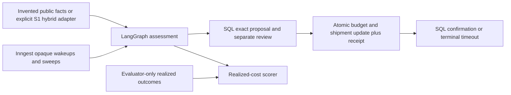

# Code study: shipping worlds, budgeted actions and waits

Inspected branch: `codex/s2-s3-s4-supply-chain`, based on merged `77b98df` (2026-10-22, Africa/Lagos). This chapter covers all seven new Supply source files and their simulator/Postgres tests. Supply source is pinned to `ba962c6cdec3a7f7f694a2eaf92d705c324e7e3e`; the table below verifies symbols against that immutable snapshot. [Build Book Entry 33](../BUILD_BOOK.md#entry-33--independent-shipping-worlds-and-durable-budgeted-intervention) records construction and failed checks; the [runbook](supply-chain-operations.md) records operational limits. This is not the S5 UI or S6 release evaluation.

## Execution and state ownership

The planner cannot receive hidden targets through the declared API. All durable decisions belong to SQL; resuming a graph or receiving an event never supplies authorization. Even a committed command remains awaiting confirmation until the canonical confirmer or expiry resolves it.

## Contracts and visible choices

[`action_contracts.py`](../projects/supply-chain-disruption/src/supply_chain/action_contracts.py) extends the shared strict Contract. `Shipment.require_fresh` checks explicit clock offset, completeness, conflicting alerts, observation and expiry before `options` constructs a bounded server catalog. There is no caller cost field in Command. Capacity zero omits paid choices. `DemoPolicy` uses literal constants so JSON cannot change the approved limits.

`Grant.require` binds tenant/resource/capability, and `require_event` separately binds incident access. Without that second check an actor could use a different incident's budget despite having shipment scope. Grants are service-composed objects, not HTTP authentication. `Command.operation_id` hashes only tenant/incident/shipment using null separators; versions/action remain in the payload fingerprint. This is why new runs cannot create duplicate effects, while changing a pending stale proposal invalidates approval.

## Independent simulation and optimization

[`simulator.py`](../projects/supply-chain-disruption/src/supply_chain/simulator.py) keeps `HiddenOutcome` separate from public Shipment. `make_scenario` hashes version/split/family/seed before initializing a local RNG, avoiding global randomness and accidental seed reuse across namespaces. Development generates linear realized reductions; holdout generates nonlinear congestion and a reroute downside. `suite` reserves two families entirely for holdout and uses distinct development/holdout seed values. These choices test some simulator overfit, not all possible real distribution changes.

`Scenario.agent_input` serializes/revalidates each public shipment. `allocate` sorts identifiers, then builds dynamic-programming states keyed by total spend. Each state retains the lowest estimated cost and a deterministic action tuple. For each shipment, combine each prior spend with each available option; discard spends above the budget and retain the best objective/path at each spend. After the final shipment choose the least objective/path and zip it back to stable IDs. The input bound of twelve shipments limits work. This exact solver uses estimated costs only.

`realized_cost` joins selected actions to independently stored evaluator outcomes, preserves omitted/unsafe cases in denominators and prices an unavailable/unsafe intervention as a wait while recording the violation. It refuses unknown actions/IDs and missing/duplicate evaluator targets. `compare` runs do-nothing, rules and the estimate solver separately; it retains split/family/seed/template/formula provenance, each policy's monetary components and normalized differences with a null zero-denominator result. Sensitivity changes delay price, not the hidden realized delays.

An isolated hidden-target perturbation test changes realized targets to 100 hours while leaving all public inputs/choices equal. An independent exhaustive enumeration over all combinations verifies the optimizer objective on small portfolios. Neither test establishes real causal correctness or human-reviewed labels.

## Atomic effects and review lifecycle

[`operations.py`](../projects/supply-chain-disruption/src/supply_chain/operations.py) owns schema bootstrap and state transitions; [`operations.sql`](../projects/supply-chain-disruption/src/supply_chain/operations.sql) defines constrained budget, shipments, proposals, append-only receipts and terminal confirmations. `setup` hashes packaged DDL, serializes bootstrap under an advisory lock and rejects a changed immutable version. Runtime grants exclude schema mutation, ledger deletion and arbitrary enrollment.

`enroll` accepts one tenant and unique version-zero shipments under administrator control; it never overwrites records. `portfolio`, `propose`, `_locked`, `receipts` and `current` revalidate trusted grants and enforce incident scopes. Every mutation acquires budget then shipment locks, so competing actions serialize consistently.

`propose` recomputes current options and verifies both expected versions and remaining budget. It returns an identical proposal idempotently. A different payload under an already committed key fails. Replacing a stale uncommitted proposal consumes one persisted incident-wide replan allowance, creates a new exact fingerprint/deadline and clears old approval. Rejected/expired proposals cannot be reopened by a replan.

`review` checks separate actor and exact fingerprint before approving/rejecting; it rejects stale facts/versions. `apply` checks the same command, then returns an existing receipt before requiring fresh facts, which makes a committed retry recoverable even after expiry. For a new effect it rechecks eligibility, versions, trusted option, separate reviewer and budget inside the lock transaction. Updating budget and shipment and inserting the receipt all commit together. A precommit exception rolls back all three; a postcommit failure leaves all three recoverable.

`confirm` requires its own capability and matching receipt fingerprint. `_terminal` inserts the first outcome with `ON CONFLICT DO NOTHING`; at/after deadline the outcome is timeout. `snapshot` materializes expired review/confirmation state and never removes a receipt or refunds spend. Reading a canonical snapshot can therefore persist a terminal status; this is a reconciliation operation, not a pure database SELECT. SQL service credentials remain trusted; this design does not provide row-level tenant isolation against a stolen service credential.

## Graph and event adapter

[`workflow.py`](../projects/supply-chain-disruption/src/supply_chain/workflow.py) compiles two LangGraph nodes: public assessment and canonical reconciliation. It excludes receipts from planning, retains canonical terminal/pending state, rereads current budget before proposals and bounds retries. The final result passes through JSON validation because graph JSON-mode dictionaries contain lists while strict internal DTOs require tuples. This was a reproduced bug in the first Postgres run, not a theoretical concern.

[`events.py`](../projects/supply-chain-disruption/src/supply_chain/events.py) resolves opaque wakeup identities through a configured trusted operator registry. Incident fanout sorts/deduplicates at most 100 authorized shipments. Per-shipment handlers use scoped graph calls and up to three bounded approval waits plus one confirmation wait. Match expressions include tenant, incident and shipment; step IDs include attempt identity. A returned event never approves or confirms anything; the next step reads SQL. Sweep reads a trusted incident registry to recover early/lost signals. The registry and provider webhook authentication must be supplied by the hosting application.

No framework checkpoint holds a competing approval state. A new graph/process rereads SQL and cannot erase committed work. Inngest's offline SDK harness checks real adapter composition; a mocked timeout with a fixed clock is not evidence of wall-clock expiry or hosted durability. Direct SQL expiry tests use an advanced aware clock. Real hosted Inngest acceptance remains unassessed. Tracing is explicitly disabled so source facts and grants are not implicitly sent to external services.

## Hybrid observation adapter

[`source_adapter.py`](../projects/supply-chain-disruption/src/supply_chain/source_adapter.py) accepts only S1 public ShipmentFact plus explicitly supplied simulation assumptions and a maximum observation age. It preserves a hashed source reference and hybrid label but does not expose historical targets, assert unknown timezones, infer NWS joins or estimate interventions from retrospective outcomes. Calling it with fabricated ShipmentFact objects does not establish source provenance; trusted composition must use S1's pinned reader.

## Verified evidence and remaining limits

Final focused evidence: **30 simulator tests** and **18 actual Postgres tests** passed, including real postcommit process exit/restart. Full hosted run [39864242079](https://github.com/Protagonist01/my-production-agentic-systems/actions/runs/39864242079) at review head `0406e82` passed all ten jobs: 846 tests in every quality cell, 86 Postgres tests, 100 typed files, strict six-call/two-timeout/zero-provider replay, all six wheel/source pairs, audits and secret scan. A network-denied installed-wheel probe matched 52 harness and 11 Supply source/resource files and constructed all three event functions. The markdown audit verified 492 immutable ranges and 409 local links. Entry 33 retains the initial failures and repairs; broad local reruns after the C-drive temp-directory diagnosis are not counted as passes while pending.

The canonical replan cap is deliberately conservative and shared by the incident; bursts can remain unresolved. There is no production API, operations UI, carrier authentication/integration, deployment, calibrated intervention outcome model, human-adjudicated target set or paid/fresh provider evidence in these three issues. Those are explicit follow-ups, not hidden success claims.

## Interview practice

1. Trace reroute from a public twelve-hour estimate to pending review, exact approval, one 80.00 debit and an awaiting-confirmation receipt. Explain why an approval wakeup alone cannot advance SQL state.
2. Change another shipment's budget version after approval. Explain the stale rejection, new fingerprint and reviewer requirement. What remains after the shared two-replan limit is exhausted?
3. Exit the process immediately after the SQL commit. Predict the budget, shipment version and ledger, then explain why a new run returns the original receipt despite source expiry.
4. Replace hidden outcomes while preserving public facts. Explain unchanged choices/different scores, and distinguish the estimate optimizer from a realized-outcome oracle.
5. Replay an opposite confirmation after timeout. Explain the unique terminal row and why no credit is silently returned.
6. Describe what eventual production needs: authenticated service composition, durable incident registry, real carrier reconciliation, fresh source mapping, outcome validation and hosted orchestration evidence. Do not claim those from passing offline tests.

## Verified immutable source anchors

| File | Core symbols | Immutable snapshot |
|---|---|---|
| `action_contracts.py` | `fingerprint`, `ReviewRequired`, `DemoPolicy`, `Shipment`, `Option`, `options`, `Grant`, `Command`, `Proposal`, `Receipt`, `Snapshot` | [L16–L170](https://github.com/Protagonist01/my-production-agentic-systems/blob/ba962c6cdec3a7f7f694a2eaf92d705c324e7e3e/projects/supply-chain-disruption/src/supply_chain/action_contracts.py#L16-L170) |
| `events.py` | `IncidentWake`, `ShipmentWake`, `event_for`, `EventHandlers`, `build_functions` | [L17–L202](https://github.com/Protagonist01/my-production-agentic-systems/blob/ba962c6cdec3a7f7f694a2eaf92d705c324e7e3e/projects/supply-chain-disruption/src/supply_chain/events.py#L17-L202) |
| `operations.py` | `setup`, `enroll`, `OperationStore` | [L30–L482](https://github.com/Protagonist01/my-production-agentic-systems/blob/ba962c6cdec3a7f7f694a2eaf92d705c324e7e3e/projects/supply-chain-disruption/src/supply_chain/operations.py#L30-L482) |
| `simulator.py` | `HiddenOutcome`, `Scenario`, `make_scenario`, `allocate`, `do_nothing`, `rules`, `realized_cost`, `compare`, `suite`, `main` | [L36–L254](https://github.com/Protagonist01/my-production-agentic-systems/blob/ba962c6cdec3a7f7f694a2eaf92d705c324e7e3e/projects/supply-chain-disruption/src/supply_chain/simulator.py#L36-L254) |
| `source_adapter.py` | `hybrid_observation` | [L9–L40](https://github.com/Protagonist01/my-production-agentic-systems/blob/ba962c6cdec3a7f7f694a2eaf92d705c324e7e3e/projects/supply-chain-disruption/src/supply_chain/source_adapter.py#L9-L40) |
| `workflow.py` | `Planner`, `ActionStatus`, `WorkflowResult`, `FlowState`, `SupplyWorkflow` | [L17–L179](https://github.com/Protagonist01/my-production-agentic-systems/blob/ba962c6cdec3a7f7f694a2eaf92d705c324e7e3e/projects/supply-chain-disruption/src/supply_chain/workflow.py#L17-L179) |
