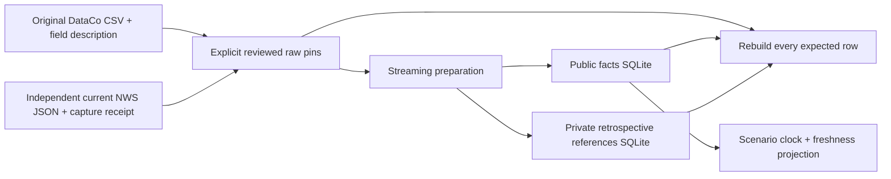

# Study independent shipping and weather source preparation

Updated 2026-10-21. S1 #52 is part of the authorized R5/R6/S1 batch, initially based on verified main `5f73fc9`. This chapter inspects three source modules and their invented checks at source `f9fb0ed`; generated private stores, dependency internals, external publisher provenance and future simulator decisions are outside the inspected code. No release or intervention-quality result is claimed.

The [operations guide](supply-chain-source.md) records source attribution, use conditions and reproduction. Build Book Entry 32 belongs to root integration and records construction as it happened. Only `supply_chain → agent_harness` imports are used; no cross-domain importer or shared scope mechanism is invented for this trusted local source tool.

The arrows do not join weather to shipments. Original DataCo references are retrospective operational labels; neither source creates hidden simulation outcomes. S2 must define that separate controlled experiment.

## Trace an invented shipment and alert

1. A trusted administrator downloads and reviews the original source sizes/digests and capture clocks. [`SourcePin`][pin] is a strict H2 Contract: fixed source version, bounded byte counts, lowercase SHA256 fields and aware observation times. The pin's separately retained digest is the authority, rather than a digest silently recalculated after corruption.
2. [`external`, `pinned` and `load_pin`][paths] reject any path beneath a Git marker, read bounded buffers for small inputs and require the externally supplied hash. This is publication hygiene, not filesystem access control. The source owner still controls local paths and permissions.
3. [`shipping` and `shipping_file`][csv] decode one raw line at a time through the exact 53-column CSV schema. Source item IDs become opaque keys; duplicate IDs fail. Dates remain naive, with `original_timezone=unverified`. A real example's elapsed duration/outcome is never inferred from timezone conversion. The generator hashes exactly the consumed bytes and checks size/digest at EOF; callers must exhaust it before treating preparation as complete.
4. [`ShipmentFact` and the separate reference DTO][facts] enforce the projection: an invented line with one unit and two scheduled days exposes neither customer PII nor its actual two-day outcome. The latter goes into `ShipmentTarget`, including original IDs and source status. Public projections cannot gain extra label fields through an untyped metadata dictionary.
5. [`prepare`][prepare] opens one public and one evaluator SQLite connection, creates exact schema once, and inserts rows in transactions. It counts rows/orders/source flags and recorded date limits while streaming, then adds independently parsed NWS facts. Source bytes and complete parsing must succeed before a final manifest is written. A failed private directory is diagnostic; an exclusive new directory is required for retry.
6. [`verify`][verify] consumes the originals again while stepping both ordered store cursors. It compares each strict canonical row and ordinal/key, catches extra/missing records, checks raw/derived hashes, exact schema and aggregate totals. A new hash for a changed evaluator value does not make it agree with the unchanged source. No production decision engine produces these references.
7. [`read_shipments`][read] checks the independently retained manifest and public-store digest/schema before parsing public DTOs. With snapshot observation 12:00 UTC, a scenario clock at 11:59:59 gets no row even if the original order date is years older. A clock at 12:00 can access only the closed public projection. The reader never opens the evaluator database.
8. Weather follows its own clock. [`alerts`][alerts] requires a GeoJSON feature population with no next-page link, unique source IDs and aware times; a collection update or alert sent after capture is invalid. Expiry must follow sent/effective. No missing timestamp is replaced with the system clock.
9. [`visible_alerts`][clock] revalidates each alert, binds its exact snapshot capture time and requires the caller's explicit positive maximum age. Before capture or after collection staleness it returns no alerts. Only Actual Alert/Update messages with sent/effective reached and expires/ends not reached survive. Future onset can describe a forecast; it is not an observed weather event or causal shipment outcome.

## Acquisition is explicit and separate

[`capture_weather`][capture] is the only network function. It creates one exclusive external directory, validates an identifying bounded User-Agent, requests the fixed official endpoint once and bounds the response to thirty million bytes. It verifies source host/status, parses the collection, records start/completion times and selected cache headers, then saves unchanged raw JSON plus its digest/receipt. There is no hidden retry, background monitor, signing key, LLM call or ordinary-reader refresh.

The normal [`CLI`][cli] exposes prepare, verify and capture-weather distinctly. Preparation and verification use existing local files. Successful stdout contains aggregate counts/hash only; errors omit private source/model-validation payloads. Full errors used during development stay in private diagnostic files, not published logs.

[`_check_schema`][schema] compares every SQLite schema object and exact table DDL, permitting only the expected unique-key autoindexes. It rejects repinned unexpected views/triggers rather than only checking column names. Public read cursors are read-only and close in finally blocks; preparation failures cannot create a passing final manifest.

## Decisions, bugs and limits

- **Design limitation — historic availability:** DataCo contains retrospective order/shipping timestamps, with no verified timezone or per-field publication history. The importer deliberately exposes records only after the explicit real snapshot observation. Re-timing for later simulation must be declared constructed data.
- **Design limitation — trust boundary:** local source/manifest files and explicit pins are trusted administrative inputs. A privileged file owner could replace files between digest checking and SQLite opening. Protect immutable snapshot permissions; this source tool is not a remote authenticated upload service or OS sandbox.
- **Design limitation — reference meaning:** published late/status fields are source observations, not independently adjudicated cause, avoided loss or realized simulator outcomes. NWS U.S. alert area text is not a verified mapping to historical multinational DataCo routes.
- **Verified development failure — missing private log directory:** the first source-run pipeline attempted to tee stdout into an absent ignored artifacts directory. Its output is incomplete diagnostic state, never passing cohort evidence. The replacement run uses an owned hidden process, existing log directory, saved PID, captured stdout/stderr and a private exception receipt.
- **Verified test setup failure — real clock in a scripted capture:** the first mocked acquisition used a fixed future source time against the actual clock, correctly failing collection-update validation. Freezing the test clock to the same invented instant makes the witness deterministic without loosening production checks.
- **Not assessed:** source publisher's operational authenticity, downstream intervention quality, geography matching, load/service scaling, native concurrency attacks and real logistics outcomes.

## Verification and interview exercises

The final focused source tests are [invented fixtures][checks], not redistributions of customer rows. Twenty tests passed in 7.94 seconds on Python 3.13.4, with external TEMP/TMP; Ruff/format and strict typing of the three source modules passed. A first narrow mypy invocation lacked the workspace source path; explicit `MYPYPATH=harness/src;projects/supply-chain-disruption/src` resolves the local typed harness. Actual full preparation completed in 305.66 seconds for 180,519 lines/65,752 orders and 306 independent weather features. The current-source verifier reconstructed every row and passed in 205.42 seconds, including clock checks: 245 eligible alerts at capture under a thirty-minute allowance, zero stale alerts and zero pre-observation shipments. The [aggregate](data/supply-chain-source-v1.json) pins that source-integrity evidence. Parent integration owns the full matrix and package/database checks; these source checks establish no model or intervention quality.

For an architecture pitch, explain why a shipment source fact, retrospective reference and future simulated outcome are three different objects. A strong answer traces where hidden outcomes are excluded, how raw pins differ from derived-store pins, and why current weather cannot certify a historical causal join.

For a code exercise, change an invented private target and repin only its store/manifest. The verifier must still fail against original CSV. Then move the scenario clock before the observation or after the explicit weather freshness window; the public view must be empty. Explain why HTTP max-age is retained but does not choose that scenario rule.

For a debugging exercise, a valid future-onset warning is already issued and effective. It may be visible as a forecast, while a future-sent record is rejected as impossible in the captured population. Explain the difference without inventing past weather or shipment exposure.

[pin]: https://github.com/Protagonist01/my-production-agentic-systems/blob/f9fb0ed0d25d478fc9dbb04814e168ea4bc299da/projects/supply-chain-disruption/src/supply_chain/source_contracts.py#L12-L24
[facts]: https://github.com/Protagonist01/my-production-agentic-systems/blob/f9fb0ed0d25d478fc9dbb04814e168ea4bc299da/projects/supply-chain-disruption/src/supply_chain/source_contracts.py#L27-L66
[paths]: https://github.com/Protagonist01/my-production-agentic-systems/blob/f9fb0ed0d25d478fc9dbb04814e168ea4bc299da/projects/supply-chain-disruption/src/supply_chain/source.py#L95-L115
[csv]: https://github.com/Protagonist01/my-production-agentic-systems/blob/f9fb0ed0d25d478fc9dbb04814e168ea4bc299da/projects/supply-chain-disruption/src/supply_chain/source.py#L126-L187
[alerts]: https://github.com/Protagonist01/my-production-agentic-systems/blob/f9fb0ed0d25d478fc9dbb04814e168ea4bc299da/projects/supply-chain-disruption/src/supply_chain/source.py#L190-L236
[clock]: https://github.com/Protagonist01/my-production-agentic-systems/blob/f9fb0ed0d25d478fc9dbb04814e168ea4bc299da/projects/supply-chain-disruption/src/supply_chain/source.py#L239-L264
[schema]: https://github.com/Protagonist01/my-production-agentic-systems/blob/f9fb0ed0d25d478fc9dbb04814e168ea4bc299da/projects/supply-chain-disruption/src/supply_chain/source.py#L267-L286
[capture]: https://github.com/Protagonist01/my-production-agentic-systems/blob/f9fb0ed0d25d478fc9dbb04814e168ea4bc299da/projects/supply-chain-disruption/src/supply_chain/source.py#L289-L326
[prepare]: https://github.com/Protagonist01/my-production-agentic-systems/blob/f9fb0ed0d25d478fc9dbb04814e168ea4bc299da/projects/supply-chain-disruption/src/supply_chain/source.py#L329-L391
[verify]: https://github.com/Protagonist01/my-production-agentic-systems/blob/f9fb0ed0d25d478fc9dbb04814e168ea4bc299da/projects/supply-chain-disruption/src/supply_chain/source.py#L394-L471
[read]: https://github.com/Protagonist01/my-production-agentic-systems/blob/f9fb0ed0d25d478fc9dbb04814e168ea4bc299da/projects/supply-chain-disruption/src/supply_chain/source.py#L474-L534
[cli]: https://github.com/Protagonist01/my-production-agentic-systems/blob/f9fb0ed0d25d478fc9dbb04814e168ea4bc299da/projects/supply-chain-disruption/src/supply_chain/source_cli.py#L12-L53
[checks]: https://github.com/Protagonist01/my-production-agentic-systems/blob/f9fb0ed0d25d478fc9dbb04814e168ea4bc299da/tests/test_supply_source.py#L1-L344
