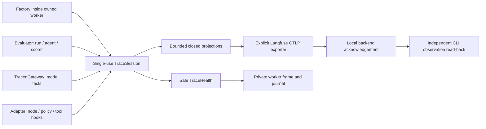

# H8 code study: retain the result, constrain the trace

Inspected H8 implementation **08ba28e28e9ac01a946648cdc3411ae65451833b**, branch `codex/h8-correlated-traces`, based on reviewed merged H7 main 487242f. H8 is unmerged. Coverage includes all four telemetry modules, evaluator/scorer/worker/journal changes, the CLI boundary, optional dependencies and invented acceptance tests. The companion replay change proposes a separate invented fixture/pin for the new dependency lock; historical capture bytes and strict binding remain unchanged. No production domain adapter, private record, third-party SDK internals, server administration or exhaustive security audit is included. [Entry 20](../BUILD_BOOK.md#entry-20--safe-correlated-telemetry) records construction and observed failures; [operations](telemetry.md) covers configuration and limits.

## Follow an invented evaluation

The probe uses an invented offline uppercase agent and one public source observation. It places the same canary in tenant/event identities, the public prompt, source reference/text and hook names. Private expected output is independently set to the uppercase canary. The actual code identifier and lock hash are supplied through the portable command; they are keyed before export.

1. `dev.py telemetry-check` obtains HEAD plus a dirty marker and selects the invented H8 module. It cannot accidentally select H1's live probe. A source-export override remains explicit caller evidence, not independent proof.
2. `telemetry_probe.check` reads only selected Langfuse configuration, requires a loopback backend and initializes an explicit exporter. It generates a private per-probe HMAC key; this demo does not claim persistent correlation across probe executions.
3. `evaluation.run_case` validates copies of context/case before trace projection. This prevents an unvalidated `model_copy(mode=<secret>)` from exporting an arbitrary string as an enum. It starts a run span and delegates ordinary evaluation through a traced gateway. The original public-input/private-expectation boundary remains.
4. `_run_case` creates an agent span, runs the actual agent, validates identity and gives an independent result copy to the scorer under its own span. `ProbeAgent` explicitly opens a node; the model, policy and tool execute beneath it. The tool consumes the model's invented result and returns it. No automatic framework capture observes their arguments.
5. `TracedGateway.generate` records keyed model/provider/request references and finite shape facts. It calls the delegate and validates the returned response before recording known token counts and a response reference. Unknown usage is omitted; observed zero is retained. A typed failure is marked separately from a raised exception. Neither failure text nor stack is exported.
6. Root completion records a finite outcome and keyed retained-result reference. Its `finally` closes telemetry even when agent/scorer execution raises. A successful report receives health; an infrastructure exception still propagates. Export failure cannot manufacture a passing score or erase a real completed result.
7. `LangfuseExporter` encodes fixed resources, generated contexts, timestamps, correct observation types and safe input/output facts. It never creates a global tracer provider or reads ambient OTel resource attributes. Each ended span points to its generated parent. The root has no parent.
8. The session sends one bounded batch, invokes flush and shutdown once, and reports each result separately. Actual backend acceptance is checked independently through the CLI response envelope. The probe verifies persisted types, parents, token usage, actual version references, source evidence, tool-result reference and canary absence, then prints only a safe report and local URL.

## Source anatomy

| Symbol | Responsibility and why it exists |
|---|---|
| [TraceHealth][health] | Fixed statuses/counts and generated trace identity. `matching_counts` rejects an empty export paired with nonzero spans, or an accepted export with zero spans. `healthy` also requires no dropped observations. |
| [SpanRecord / TraceExporter][records] | Provider-independent projection and explicit three-step resource contract. Base users need neither SDK nor Google imports. Exporters are trusted code. |
| [TraceSession][session] | Owns key, generated identity, context-local parents, lock, admission budget and terminal health. `reference` separates identity/version/content domains before HMAC; stable keys enable scoped matching. |
| [TracedGateway][gateway] | One model span per generic gateway invocation. H4 may perform multiple internal attempts; those attempt details remain in H4 evidence rather than silently claiming one span per wire retry. |
| [encode / accepted][encoding] | Maps fixed projections to OTLP and understands standard partial acceptance plus the tested legacy queue acknowledgement. No raw response body becomes a diagnostic. |
| [LangfuseExporter][exporter] | Explicit origin/authentication, no redirects/proxies, one synchronous request and credential reference cleanup. Endpoint acceptance is not durable storage evidence. |
| [Evaluator composition][evaluation] | Validates before projection, retains ordinary runtime/scorer behavior and closes telemetry in `finally`. A session is single-use; reuse is a composition error. |
| [BoundEvaluation][binding] | Keeps manifest/scorer selection independent, forwarding only the optional trace session to evaluation. |
| [Worker composition][worker] | Creates components inside the child, preserves safe health on ordinary execution errors and binds it to a successful case report in the worker frame. |
| [TrialRow][row] | Rejects inconsistent row/case health during recovery. No health on a killed worker means unknown; no exporter cleanup can be certified after termination. |
| [Probe validation and command][probe] | Reads real exported observations, validates the CLI envelope and safe evidence, and separates invented infrastructure checks from model quality. |
| [Telemetry tests][tests] | Exercise successful/failing runtime and export paths, canaries, actual HTTP behavior, concurrency, bounded storage, spawned workers and recovered journals. |

## Lifetimes, ordering and concurrency

Admission occurs at span start, rather than end. If the root were admitted last, a busy child could fill the buffer and leave every exported record without its root. The default capacity is 256; tests use two and show that run/agent remain while five later observations are visibly dropped. Dropping an observation does not skip its callable.

The context variable saves a parent token and restores it in `finally`, including raised errors. A lock protects admission/end counts and health. A new thread without copied context attaches to the root; callers propagate context explicitly to preserve deeper parentage. Each thread's nested tool still attaches to its own node. Threads must finish before the evaluator returns: `finish` refuses active spans rather than exporting a half-ended tree. The session does not propagate across processes; H6 factories create it inside the owned process.

The exporter imports optional OpenTelemetry packages only while encoding/sending. `Resource` receives a fixed service field directly, avoiding environment/process detectors. The synchronous batch has no background queue to drain; `flush` confirms the exporter is still open. `shutdown` marks it closed and drops its authorization string reference. Python immutable strings/bytes are not securely erased from memory; no memory-zeroization claim is made.

## Evidence, risks and tradeoffs

**Verified implementation behavior:** canaries in public inputs, identities, versions, sources, model metadata, schemas and exceptions do not appear in projected spans, decoded protobuf or safe health. Existing private CaseReports deliberately retain original identities and output. Full report publication therefore remains unsafe without a separate reviewed projection.

**Design limitation:** fixed names and keyed operation/model references sacrifice readable domain names, raw prompt/output reconstruction, thought text and automatic backend pricing. The best-practices audit preserves structure/types/known usage and meaningful safe facts while honoring this privacy boundary. Adding readable fields requires an explicit reviewed allowlist; regex masking arbitrary payloads is not equivalent.

**Design limitation:** HTTP 200 only establishes endpoint acknowledgement. The observed 4.50 server returns a queued-job object. The independent CLI read-back establishes visibility for the tested trace; it is not a durable delivery guarantee for every later run. A lost process loses its in-memory buffer. A socket timeout does not impose a total slow-peer deadline, so the H6 process supervisor remains necessary.

**Trust boundary:** the code protects its own projections, not against a malicious factory/exporter that already holds application credentials. HMAC references permit scoped equality checks and may still be personal data. A reference does not prove its source exists, a version string identifies truthful code, or a scorer is independent of a malicious plugin. Private journal checks validate consistency rather than signatures.

The local backend initially rejected our response interpretation: HTTP status was successful, but its body was a legacy JSON job acknowledgement. A later check assumed top-level CLI data and then a string source-list field. Actual CLI records live under `body.data`, and metadata expansion returns lists. The response tests now cover those observed shapes, extra aggregate token totals, altered version references, bad parents and canaries. An accidentally shadowed expected-version variable was caught by the new read-back tests before publication.

Final evidence is recorded on issue #22 and the PR. The merged H7 local check's one Windows pre-start timeout and passing unchanged retry are retained separately from H8 acceptance. No invented test result is a domain accuracy, latency, production traffic or billing claim.

## Explain and change it safely

1. Why use a keyed hash rather than SHA-256 for tenant IDs? Mention small identifier dictionaries, private correlation keys, domain separation and key rotation. Explain why a pseudonym is not guaranteed anonymity.
2. Trace a tool error while export also fails. Identify the original exception, ended spans, `finally`, separate export/flush/cleanup statuses and the worker's explicit execution-error row. Explain why the denominator survives.
3. Add a retriever adapter. Sketch an explicit hook/type extension, a reviewed safe projection, canaries in retrieved text/references, parent tests and actual read-back. Do not add raw framework auto-capture by default.
4. Increase reliability after worker termination. Compare a durable collector/queue with the current in-memory buffer, and identify new authentication, replay, duplication and retention contracts. This remains a proposal.
5. Offline exercise: replace the memory exporter with one returning false. Expect unchanged runtime result and score, failed export, successful flush/cleanup, unhealthy telemetry and the same recovered terminal row. Replace the scorer with one raising an invented secret: expect execution_error, no evaluation report, safe telemetry health and no secret in exported bytes.

[health]: https://github.com/Protagonist01/my-production-agentic-systems/blob/08ba28e28e9ac01a946648cdc3411ae65451833b/harness/src/agent_harness/telemetry_contracts.py#L12-L28
[records]: https://github.com/Protagonist01/my-production-agentic-systems/blob/08ba28e28e9ac01a946648cdc3411ae65451833b/harness/src/agent_harness/telemetry.py#L31-L47
[session]: https://github.com/Protagonist01/my-production-agentic-systems/blob/08ba28e28e9ac01a946648cdc3411ae65451833b/harness/src/agent_harness/telemetry.py#L50-L191
[gateway]: https://github.com/Protagonist01/my-production-agentic-systems/blob/08ba28e28e9ac01a946648cdc3411ae65451833b/harness/src/agent_harness/telemetry.py#L194-L220
[encoding]: https://github.com/Protagonist01/my-production-agentic-systems/blob/08ba28e28e9ac01a946648cdc3411ae65451833b/harness/src/agent_harness/langfuse_export.py#L24-L150
[exporter]: https://github.com/Protagonist01/my-production-agentic-systems/blob/08ba28e28e9ac01a946648cdc3411ae65451833b/harness/src/agent_harness/langfuse_export.py#L153-L219
[evaluation]: https://github.com/Protagonist01/my-production-agentic-systems/blob/08ba28e28e9ac01a946648cdc3411ae65451833b/harness/src/agent_harness/evaluation.py#L120-L217
[binding]: https://github.com/Protagonist01/my-production-agentic-systems/blob/08ba28e28e9ac01a946648cdc3411ae65451833b/harness/src/agent_harness/scorers.py#L99-L126
[worker]: https://github.com/Protagonist01/my-production-agentic-systems/blob/08ba28e28e9ac01a946648cdc3411ae65451833b/harness/src/agent_harness/trial_runner.py#L75-L125
[row]: https://github.com/Protagonist01/my-production-agentic-systems/blob/08ba28e28e9ac01a946648cdc3411ae65451833b/harness/src/agent_harness/trials.py#L141-L156
[probe]: https://github.com/Protagonist01/my-production-agentic-systems/blob/08ba28e28e9ac01a946648cdc3411ae65451833b/harness/src/agent_harness/telemetry_probe.py#L54-L249
[tests]: https://github.com/Protagonist01/my-production-agentic-systems/blob/08ba28e28e9ac01a946648cdc3411ae65451833b/tests/test_telemetry.py#L35-L570
