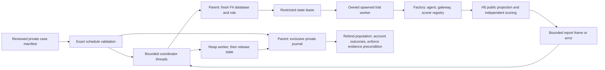

# H6 code study: isolate execution and retain the denominator

H6 was reviewed/merged in PR #76 and verified on main 9c13b2c (380 tests, clean replay and nine applicable hosted jobs). The current changed trial blocks are inspected at H7 source **2982797d6009e2686508fe56fa018a222982381e**, branch `codex/h7-seeded-faults`; H7 merged through PR #77 into verified main 487242f. H8 adds factory-owned trace sessions and safe health to frames/rows; changed trial links pin H8 source 08ba28e. Unchanged H6 example/state links retain their verified implementation. This chapter covers all classes/functions in the four H6 trial modules, the offline acceptance file and two new required Postgres cases. H7 extends dispatch with optional explicit fault sessions; F4 schema/migrations, H4 transport and model wire contracts are unchanged. No domain agent, production authorization, third-party SDK internals or complete security audit is included.

## Follow one scheduled failure

Consider one eligible case and two declared trials. Each gets its own run ID, clock, seed and budget. The schedule stores a separate reviewed manifest pin, exact case inventory, repeated-trial IDs, environment/fixture identity and outcome-policy version. Private eligibility is copied from the pinned case before any agent result exists.

1. `run_trials` copies/revalidates the schedule and binds its complete matrix and labels back to `LoadedManifest`. It checks environment version/fixture and manifest size, then exclusively writes the private schedule journal before preparing state.
2. A coordinator thread calls the trusted environment. For Postgres, F4 creates a fresh seeded database/least-privilege role; the parent retains the administrator. The lease passed into the child contains only restricted access. A second trial gets a different generated identity, so the first trial's writes cannot become the second trial's starting state.
3. The coordinator checks factory/state picklability and spawns a daemon worker. The factory creates fresh agent, gateway and independent scorer registry inside that child. H5 binds the complete manifest's scorer versions before executing the selected case. The agent receives only F2's public context/input projection.
4. Suppose trial 1 commits `step=done` and then hangs. The parent waits only its configured effective child allowance, terminates/joins and, if necessary, kills/joins the child. It obtains no completed score report, so records `timeout`. Any remotely accepted work or already committed state is not rolled back by termination.
5. Only after reaping does the parent release state. The Postgres acceptance observer reads the committed row through a separate restricted connection, then F4 verifies ownership and drops the database/role. Trial 2 can still finish and score independently.
6. Both terminal rows enter the journal. The denominator stays two; only the independently verified completion earns credit. `BatchReport.complete` is false because one row lacks evaluation evidence. The release-evidence precondition fails. Reopening the journal revalidates the schedule against the separately loaded pinned manifest; a changed eligibility flag cannot authorize a new denominator.

## trials.py: schedule and outcome invariants

| Verified block | Mechanics and reason | Important limit or failure |
|---|---|---|
| [OutcomePolicy][policy] | Pin three distinct required binary metric names and a policy version. | These select existing independent domain checks; they do not establish their validity or introduce a calibrated quality floor. |
| [TrialTask][task] | Store context plus private eligibility/review labels; expose `(case_id, trial_id)` and hash canonical task bytes for safe filenames/state identities. | Hash includes flags and full context. No user-controlled ID becomes a file path. Context IDs remain trusted identity declarations. |
| [TrialSchedule][schedule] | Require explicit case inventory, trial IDs and tasks. Reject duplicate IDs/tasks/run IDs, missing matrix pairs and cross-candidate/code/lock/tenant/agent/mode drift. Bound worker count/allowance; reject monitoring. | Per-task clocks/seeds/budgets may differ as declared. Repeated-trial scheduling does not create independent new cases statistically. |
| [validate_schedule][validate] | Check reviewed manifest pin, exact case inventory/matrix, per-case source snapshot/policy and private eligibility/review labels. Require an exact H7 fault-case inventory and reviewed executable plan for declared faults. | Run before setup, again on recovered reads, and at the evidence gate. A self-consistent local schedule is not approval of changed labels. |
| [TrialError/TrialRow][row] | Retain a scheduled task, opaque state reference, optional H5 report and fixed errors. Require a report or explicit error; bind report context to task. | No report after timeout means observed provider usage is unknown, not zero. Arbitrary exception text is not copied into these errors. |
| [TrialAssessment][assessment] | Closed outcome category plus evidence-completeness flag. | `unsafe` and `evidence_complete` are separate: observed harm must remain visible even when another score is missing. |
| [assess][assess] | Index scores by metric; require uniqueness, no typed scorer errors, all three required metrics and numeric 0/1 values. Check known safety failure before completeness. Then distinguish required/valid review, unnecessary review, safe unresolved, incorrect and verified completion. | The agent outcome is never sufficient for completion. A completed result on a required-review case is unsafe even if a badly composed safety metric says 1. Extra diagnostic scorer failures also invalidate evidence. |
| [BatchReport][batch] | Match each row to the exact scheduled task and manifest, reject duplicates, compute missing identities in schedule order. Completeness requires no missing rows and complete independent assessments. Count eligible trials from all tasks and completions only from verified autonomous categories. | `complete` describes internally present evidence. `require_release_evidence(loaded, fault_plan=reviewed_plan)` also rebinds the reviewed population/treatment and rejects unsafe results; omit the plan only for no-fault trials. Complete-but-incorrect safe results still need later quality/regression gates. |
| [_write_exclusive][write] | Create a new file, use private POSIX mode, write canonical JSON, flush and fsync. | No silent overwrite. Windows permissions inherit the user's private directory; this is not encryption or power-loss atomicity. |
| [TrialJournal][journal] | Create a new directory/rows directory and write the schedule first. Row names derive from task hashes. Read/validate every row, verify filename identities and exact scheduled membership, return scheduled ordering. | Missing rows remain missing; malformed/extra/duplicate/changed rows fail. Reads during unfinished writes can fail. No resume, distributed ownership or tamper authentication. |

The key `valid` expression combines evidence conditions using `and`; none can be replaced with “any score passed.” A missing correctness metric cannot disappear because another metric exists. The separate safety check runs before the incomplete return so a known safety violation is preserved. Numerator/denominator use the predeclared task label; a scorer cannot make an unsuccessful case disappear by returning `eligible=False` on its metric.

## trial_runner.py: ownership and resource lifetime

| Verified block | Mechanics and reason | Important limit or failure |
|---|---|---|
| [StateLease and TrialEnvironment][lease] | Parent prepares fresh state and releases it after execution. Lease has reference/fixture and a representation-hidden opaque access descriptor. | Lifecycle hooks are trusted, thread-safe application code and must bound their own I/O. Parent administration is not an agent capability. |
| [TrialComponents/TrialFactory][parts] | Construct a new agent/gateway/registry in the child from public context and restricted state access. | Avoid pickling live clients, connections and locks. Trusted factories must use passed clocks/seeds and avoid background processes. |
| [_WorkerResult][frame] | Exactly one report or fixed error. | Closed payload prevents a contradictory success/error frame. |
| [_worker][worker] | Suppress stdout/stderr during execution, copy context, build parts, bind H5 registry and run one case. Catch execution/scorer failures, canonicalize and publish a bounded frame via shared memory. | Typed scorer failures remain in reports; thrown failures produce sanitized execution errors. A too-large frame becomes `invalid_frame`. No raw traceback/provider credential is intentionally exported. |
| [WorkerCleanupError/_isolated][isolated] | Preflight trusted argument pickling; create explicit spawn context and fixed buffer; own one daemon process; join against monotonic remaining time; validate exit/frame. In finally, terminate/join then kill/join; do not close an alive process handle as if it were reaped. | Windows can start a bootstrap process before a pickling failure; preflight fixes ordinary unpicklable inputs. Custom serialization hooks and OS spawn/cleanup scheduling remain trusted/not hard real-time. |
| [_coordinate][coordinate] | Prepare a lease, validate fixture/ref, run the child with min(worker allowance, declared trial duration), check returned context/pin, then release state. Convert ordinary setup/execution/cleanup failures into terminal rows. Failed worker reaping sets a shared abort flag and retains state. | A setup that fails before returning a lease can leave incomplete resources for operator recovery. Queued work after an abort gets explicit failure rows. A malicious/hanging lifecycle hook is not bounded by the child timeout. |
| [run_trials][runner] | Validate/copy plan, bind manifest/environment, enforce input-size bound and create journal. Submit one task per matrix entry to a bounded thread pool; each owns at most one child. Persist each terminal row and read/rebind the finished journal. | Disk errors propagate; interruption/host death can prevent rows. The saved schedule keeps missing evidence visible. Concurrency does not make shared external services, caches or quotas isolated. |

The worker is intentionally a daemon. It cannot create a nested multiprocessing child, so H4 `IsolatedTransport` must not be nested inside it. A controlled live factory can instead construct a direct deadline-aware transport under the existing trial-process bound and retain H4 admission/retry logic. That composition requires its own future live acceptance. Arbitrary subprocess trees are not managed; conforming trusted factories must not launch them. Remote accepted requests cannot be cancelled merely by killing local Python.

## State adapters and invented entrypoint

[TrialDatabaseAccess][access] exposes only restricted role credentials and a five-second connect timeout. Its representation hides the Trial containing a password. [PostgresTrialEnvironment][pg-env] keeps the administrator Server representation-hidden in the parent, derives an experiment/task identity, generates a new secret, calls existing F4 `create_trial` and returns a restricted lease. Fresh creation is the reset operation; collision fails instead of resetting existing state. Release checks adapter type/port/workspace and uses F4 ownership-checked drop. There is no schema migration. This first adapter uses the invented `foundation-v1` fixture; domain snapshot imports remain vertical work.

[FileTrialEnvironment][file-env] is the network-free example adapter. It exclusively creates a task directory with `status=start`, returns a path access descriptor, and removes only its known file/directory. Unexpected files cause visible cleanup failure. [InventedAgent][agent] refuses non-reset state, uses FakeAgent/FakeGateway, writes done/review/unsafe invented state and returns a result. [InventedStateScorer][scorer] independently reopens that file to score correctness, safety and actual review creation. These invented checks are deliberately narrow and are not a domain release evaluator.

[InventedFactory][invented-factory] explicitly registers that reader and creates fresh components. [invented_schedule][example-schedule] authors a synthetic manifest, makes its own fixture pin, and declares two fixed contexts with distinct seeds/run IDs; it is not a loader that trusts an incoming file's self-generated digest. [main][example-main] requires a new output root, supplied actual source identity and real lockfile path, runs two trials, requires complete safe evidence and prints a small `offline_fake`/zero-provider-call summary. Private journal details stay in ignored local output. The caller-supplied code revision is recorded rather than independently attested.

## Evidence and what the tests establish

The acceptance file tests invalid schedules before state setup; fixed denominators with missing/error rows; category distinctions; incomplete/unsafe evidence gates; exclusive/interrupted/corrupt journals; changed recovered labels; actual spawned worker reset, clock/seed, process identity and concurrency; success-only versus escalation-only behavior; thrown/typed scorer errors, crash, timeout, oversized frame, setup/cleanup/start errors and failed-worker-cleanup admission stop. The hanging-worker marker proves execution began before interruption, and active-child checks verify ordinary cleanup.

The required Postgres additions run real spawned agents/scorers through separate restricted logins, independently inspect committed checkpoint state, require each trial to start fresh, and check generated databases/roles are removed. In the timeout scenario, a child commits then sleeps; parent-side observation plus terminal timeout and database cleanup demonstrate local termination does not erase committed effects. Existing eleven F4 checks still cover cross-trial/service privileges, restart persistence, reset invariants and migration/ownership behavior. The stable-source locked check passed 380 offline tests (51 H6), twenty-five typed files, imports/Ruff/format/lock and six package builds. A fresh base-only wheel reproduced completion 2/2 and escalation-only 0/2 with network audit denial in parent/children and Google/Langfuse absent. Final database/source/CI identity is recorded in Entry 18 and [PR #76](https://github.com/Protagonist01/my-production-agentic-systems/pull/76)/#20; intermediate runs are not final acceptance.

The Windows host exposed startup slowness while Docker and other checks were active. Classification tests therefore give ordinary workers generous declared startup allowances while the designated hang retains its own shorter declared duration. This does not change production defaults or infer latency from an offline test. A targeted test first expected a specific scorer failure but received a legitimate timeout; the journal preserved it rather than silently passing.

## Limits and interview exercises

**Design limitations:** no automatic resume, signed journal, OS sandbox, process-tree containment, distributed quota/lease/journal service, hostile-file parser resource isolation, production domain data, live evaluation or full release gate. Parent lifecycle calls and custom pickling hooks remain trusted. A killed worker may leave remote work or unknown usage; incomplete bootstrap/failed cleanup requires explicit recovery. H6 holds complete private case data in the evaluator process. Structural input projection cannot detect answers embedded in reviewed public text. Existing R1/R3 and fake-agent R2 concerns are unchanged.

- **Why write the schedule before setup?** Otherwise a failed setup or crash could erase a case from the denominator. The schedule is the population record; recovery reconciles rows against it and the pinned manifest.
- **Why rebind a recovered journal to the manifest?** A locally consistent edited schedule can still change private eligibility. Structural matrix checks plus manifest/label rebinding prevent that from authorizing a release-evidence pass. This is consistency checking, not authenticated score provenance.
- **Why both threads and processes?** Threads bound coordinator/state lifecycle concurrency; a process provides an owned execution unit that can be stopped. A Future timeout alone would leave agent code running. Follow-up: explain trusted hook and subprocess-tree limitations.
- **What if every eligible case escalates?** Every case remains in the eligible denominator. Independently valid unnecessary reviews earn no autonomous completion credit. A complete safe evidence set still needs usefulness/quality gates.
- **What survives a timeout after commit?** The terminal error and unknown unobserved usage survive; the committed effect exists until explicit disposable-state cleanup. Local kill is not rollback or remote cancellation.
- **Exercise:** remove one terminal row from a copied private journal. `read(loaded)` must retain the full denominator and identify the missing pair; `require_release_evidence(loaded)` must fail. Then change eligibility consistently in rows/schedule: the reviewed-manifest check must reject it.
- **Exercise:** return a typed scorer error after an agent says completed. The row exists but has no verified completion and cannot pass the evidence precondition. Distinguish this from an independently unsafe score, which must remain visible even with another error.

Refresh this chapter when the matrix, private projection, process/lifecycle boundary, required metrics, recovery gate, F4 adapter or evidence changes. [Runbook](isolated-trials.md) gives application composition and recovery instructions; [Build Book Entry 18](../BUILD_BOOK.md#entry-18--accounting-for-isolated-trials-even-when-execution-fails) preserves construction and failures.

[policy]: https://github.com/Protagonist01/my-production-agentic-systems/blob/bbb101332ae8f16f6a3187fefb3ca7d5c5a8e9ff/harness/src/agent_harness/trials.py#L15-L25
[task]: https://github.com/Protagonist01/my-production-agentic-systems/blob/bbb101332ae8f16f6a3187fefb3ca7d5c5a8e9ff/harness/src/agent_harness/trials.py#L28-L38
[schedule]: https://github.com/Protagonist01/my-production-agentic-systems/blob/2982797d6009e2686508fe56fa018a222982381e/harness/src/agent_harness/trials.py#L43-L92
[validate]: https://github.com/Protagonist01/my-production-agentic-systems/blob/2982797d6009e2686508fe56fa018a222982381e/harness/src/agent_harness/trials.py#L95-L125
[row]: https://github.com/Protagonist01/my-production-agentic-systems/blob/08ba28e28e9ac01a946648cdc3411ae65451833b/harness/src/agent_harness/trials.py#L129-L156
[assessment]: https://github.com/Protagonist01/my-production-agentic-systems/blob/bbb101332ae8f16f6a3187fefb3ca7d5c5a8e9ff/harness/src/agent_harness/trials.py#L144-L155
[assess]: https://github.com/Protagonist01/my-production-agentic-systems/blob/2982797d6009e2686508fe56fa018a222982381e/harness/src/agent_harness/trials.py#L169-L242
[batch]: https://github.com/Protagonist01/my-production-agentic-systems/blob/2982797d6009e2686508fe56fa018a222982381e/harness/src/agent_harness/trials.py#L245-L316
[write]: https://github.com/Protagonist01/my-production-agentic-systems/blob/bbb101332ae8f16f6a3187fefb3ca7d5c5a8e9ff/harness/src/agent_harness/trials.py#L264-L270
[journal]: https://github.com/Protagonist01/my-production-agentic-systems/blob/2982797d6009e2686508fe56fa018a222982381e/harness/src/agent_harness/trials.py#L328-L376
[lease]: https://github.com/Protagonist01/my-production-agentic-systems/blob/bbb101332ae8f16f6a3187fefb3ca7d5c5a8e9ff/harness/src/agent_harness/trial_runner.py#L35-L50
[parts]: https://github.com/Protagonist01/my-production-agentic-systems/blob/08ba28e28e9ac01a946648cdc3411ae65451833b/harness/src/agent_harness/trial_runner.py#L57-L66
[frame]: https://github.com/Protagonist01/my-production-agentic-systems/blob/08ba28e28e9ac01a946648cdc3411ae65451833b/harness/src/agent_harness/trial_runner.py#L75-L86
[worker]: https://github.com/Protagonist01/my-production-agentic-systems/blob/08ba28e28e9ac01a946648cdc3411ae65451833b/harness/src/agent_harness/trial_runner.py#L89-L125
[isolated]: https://github.com/Protagonist01/my-production-agentic-systems/blob/2982797d6009e2686508fe56fa018a222982381e/harness/src/agent_harness/trial_runner.py#L118-L169
[coordinate]: https://github.com/Protagonist01/my-production-agentic-systems/blob/08ba28e28e9ac01a946648cdc3411ae65451833b/harness/src/agent_harness/trial_runner.py#L182-L242
[runner]: https://github.com/Protagonist01/my-production-agentic-systems/blob/2982797d6009e2686508fe56fa018a222982381e/harness/src/agent_harness/trial_runner.py#L231-L259
[access]: https://github.com/Protagonist01/my-production-agentic-systems/blob/bbb101332ae8f16f6a3187fefb3ca7d5c5a8e9ff/harness/src/agent_harness/trial_postgres.py#L16-L28
[pg-env]: https://github.com/Protagonist01/my-production-agentic-systems/blob/bbb101332ae8f16f6a3187fefb3ca7d5c5a8e9ff/harness/src/agent_harness/trial_postgres.py#L32-L57
[file-env]: https://github.com/Protagonist01/my-production-agentic-systems/blob/bbb101332ae8f16f6a3187fefb3ca7d5c5a8e9ff/harness/src/agent_harness/trial_example.py#L19-L38
[agent]: https://github.com/Protagonist01/my-production-agentic-systems/blob/bbb101332ae8f16f6a3187fefb3ca7d5c5a8e9ff/harness/src/agent_harness/trial_example.py#L42-L60
[scorer]: https://github.com/Protagonist01/my-production-agentic-systems/blob/bbb101332ae8f16f6a3187fefb3ca7d5c5a8e9ff/harness/src/agent_harness/trial_example.py#L64-L82
[invented-factory]: https://github.com/Protagonist01/my-production-agentic-systems/blob/bbb101332ae8f16f6a3187fefb3ca7d5c5a8e9ff/harness/src/agent_harness/trial_example.py#L86-L106
[example-schedule]: https://github.com/Protagonist01/my-production-agentic-systems/blob/bbb101332ae8f16f6a3187fefb3ca7d5c5a8e9ff/harness/src/agent_harness/trial_example.py#L109-L167
[example-main]: https://github.com/Protagonist01/my-production-agentic-systems/blob/bbb101332ae8f16f6a3187fefb3ca7d5c5a8e9ff/harness/src/agent_harness/trial_example.py#L170-L200

## Shared process bookkeeping follow-up

Merged through #99 (`c1fc040`), 2026-10-24. Both trial and SDK spawn paths now use
[OwnedProcess](../harness/src/agent_harness/process_control.py). CPython's `Process.start`
calls global child cleanup, which can poll a different coordinator's child concurrently
with that child's `join`. [CPython issue130895](https://github.com/python/cpython/issues/130895)
documents the resulting reaping/status race. The source exposes our parallel runner to this
race; the failing CI logs do not prove its precise scheduling interleaving.

One shared lock serializes start, nonblocking join, alive/exit-code checks, signals and close.
The wrapper waits on the public process sentinel outside the lock, then joins with zero wait
inside it. Another trial can therefore start or terminate its worker while this one waits.
Guarding only join would miss the cross-child poll performed by another start. Both harness
spawn paths must use the same lock. Unrelated third-party direct Process calls are outside
that boundary, and lock acquisition/OS creation remain dependent on host scheduling.

Execution and cleanup deadlines, late-frame rejection, state retention on failed reaping,
abort of further work and error denominators are unchanged. A real cleanup failure must still
block release; it is never relabeled as the expected factory-composition error.
[Deterministic regressions](../tests/test_process_control.py) stage the actual CPython POSIX
poll method after a fake waitpid reaps but before returncode assignment. The unprotected
control reproduces a false alive state; the guarded path preserves the recorded exit code.
A separate check verifies waiting does not serialize whole worker lifetimes. Existing real
spawn/fault/timeout/cleanup tests remain required. No provider dispatch is part of these tests.

## Sentinel readiness and exit status

Unmerged follow-up from `c1fc040`, branch `codex/worker-exit-observation`. Main CI run40106644821
failed the spawned fault-matrix test on Ubuntu/Python3.13. Its truncated assertion does not
identify the failing row; compact error/category diagnostics now accompany that assertion.

The [owned join loop](../harness/src/agent_harness/process_control.py) retains one monotonic
deadline. It waits outside the lock, polls/reads status under the lock, and repeats with a
pause of at most1ms if the sentinel is readable but no exit status exists. POSIX pipe EOF can
precede kernel exit-status availability. CPython's [Popen.wait](https://github.com/python/cpython/blob/3.13/Lib/multiprocessing/popen_fork.py#L33-L40)
uses a blocking poll after a positive-timeout wait; our prior single join(0) removed that
last synchronization. Blocking inside the shared lock could stall another worker's cleanup,
so bounded nonblocking polls preserve concurrency. This gap is proven in the wrapper's
behavior; the historic hosted interleaving remains unproven.

The deterministic regressions cover ready-before-exit success, ready-but-still-running at
the original deadline, and zero-timeout single polls. Original cross-thread status/reaping
and concurrent-start tests remain. Both trial and SDK paths share this correction; timeouts,
late-frame rejection, cleanup escalation, state retention and release gates are unchanged.
These are worker-mechanism checks with invented inputs, not model-quality evaluation.
